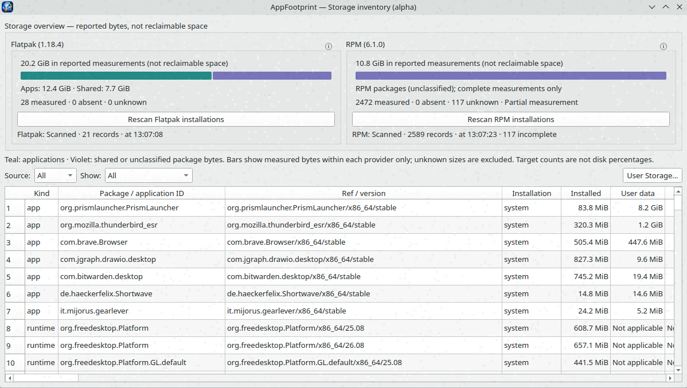
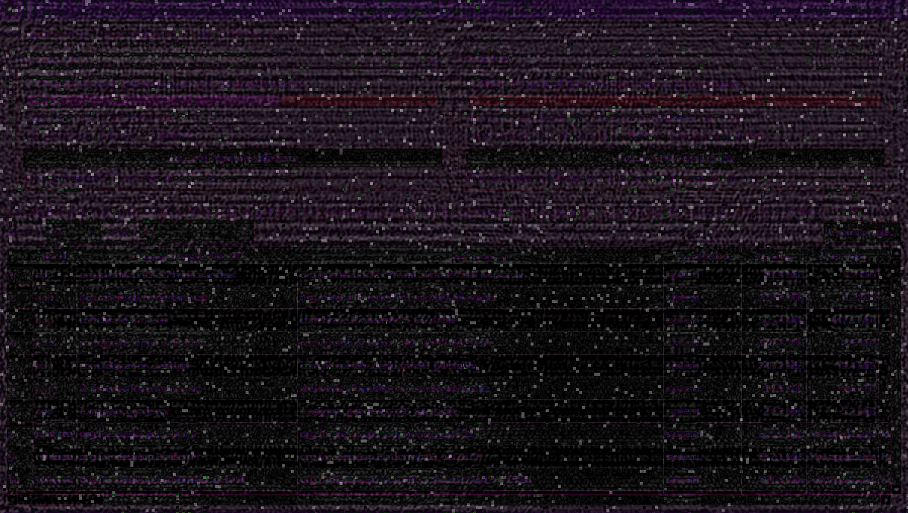

*What if an image or audio file contains more than we can see or hear?*

That question started my CryptoLeaf project. I suspected that major social media platforms might be embedding information invisible to users in videos, images, or audio. A suspicion, of course, is not evidence. I wanted to understand whether such information could be detected and how it could be hidden in the first place.

My initial idea was to approach the problem through steganalysis: examine media files and look for statistical anomalies. It soon became clear that a credible investigation would require much more computing power, memory, and comparative data than I had available. I found no evidence supporting my original suspicion. Instead, I changed the question.

**If I cannot easily detect a hidden message, could I build a system that hides one?**

## 2025: Building my own tool

In 2025, I began developing CryptoLeaf, an open-source steganography application for hiding messages in image and audio files and subsequently extracting them. Encryption and steganography address different problems: encryption protects the contents of a message, while steganography attempts to conceal its very existence.

The first successes were encouraging. In lossless file formats, I could recover hidden information, and the project gradually became a real application rather than just an experimental script. The user interface, file handling, encryption, and tests developed into a more coherent whole. Later additions included AES-GCM-based handling for JPEG payloads and an experimental Robust image mode.

But this revealed an important distinction: **a message successfully embedded in a file may not survive subsequent processing.** Social media services often resize images and recompress images, audio, and video. Successful embedding in the original file does not guarantee successful extraction after those transformations.

## MP3: When audio quality conflicts with robustness

In my audio experiments, I explored *spread-spectrum* techniques, in which the hidden signal is distributed across a wider portion of the audio signal. The idea is appealing: each individual change could be small, while the receiver might still detect the distributed message.

In practice, things were more complicated. A fixed embedding strength produced low-frequency rumbling in quiet passages. Some experiments introduced noise resembling breathing, while boundaries between segments produced clicks. I tried adaptive embedding strength, windowing, frequency cutoffs, and combinations of these approaches. Changes were better masked by loud audio, but became noticeable in quiet sections. My test notes reached an uncomfortable conclusion: with the configurations tested, there was too little usable capacity for robust embedding without audible degradation.

I also considered embedding in the modified discrete cosine transform (MDCT) domain, but did not regard it as a promising next step under those conditions. Eventually, I returned to the simpler least significant bit (LSB) method, fully aware of its limitation: it does not reliably survive lossy recompression such as MP3 encoding.

This does not prove that MP3-resistant steganography is impossible. It shows that **the specific approaches I tested did not simultaneously meet the requirements for audio quality and message recovery**.

Below is an example from a spread-spectrum experiment involving adaptive alpha, windowing, and a 600–1000 Hz cutoff. The message was embedded in the original WAV audio, which was then compressed. The recording illustrates the audible quality problem; it is not, by itself, proof of extraction success or failure.

<audio controls preload="none" style="width:100%">
  <source src="enc_testaudio.mp3" type="audio/mpeg">
  Your browser does not support audio playback.
</audio>

## JPEG: The message may survive, but the image starts giving it away

With images, the problem took a different form. JPEG compression discards image information. Simply hiding a message in the least significant bits of pixel values is insufficient if the image is recompressed.

During CryptoLeaf development, we experimented with block-based techniques, error correction, repetition, and discrete wavelet transforms (DWT). In the Robust research branch, we investigated the Haar wavelet, quantization index modulation (QIM), and parameters such as DELTA=38 and REPEAT=13. These were experimental reference values, not universal constants or a final optimized solution.

Then I noticed something awkward: changes could be hard to see in large photographs taken with a dedicated camera, but the traces of embedding were clearly visible in smaller images and screenshots. A technique intended to conceal information was revealing itself through the image structure.

There was no reason to hide this observation. It was a research result.

*Smooth, nearly uniform light surfaces are particularly challenging: embedding artifacts stand out against them.*

## Failure is a measurement, not a disgrace

After that, our investigation became more systematic. We stopped asking only whether the message could be recovered. We also asked: where does the change become visible, which part of the algorithm causes it, and which assumption might be wrong?

We performed ablation experiments, removing or changing individual components of the method, and so-called *oracle* experiments intended to separate different sources of error. We compared Haar with other wavelet alternatives and examined how different images behaved. Not every promising idea worked. That was precisely what made the experiments valuable: a failed hypothesis narrowed the set of possible explanations.

*The full ablation output shows conspicuous block-like patterns.*

*An enlarged difference view makes the encoder-induced changes easier to inspect.*

The central trade-off gradually became clearer. Stronger embedding can better withstand image-processing noise, but increases the risk of visible artifacts. Weaker embedding preserves image quality, but the message may disappear. Moreover, an image can look completely normal to a human observer while still containing statistically detectable changes. Visual imperceptibility alone does not establish steganographic security.

## Divergent thinking and GPT-6 as a research partner

CryptoLeaf has not followed a conventional development process in which a finished specification leads directly to implementation. I have raised questions, sometimes unconventional ones, and GPT-6 has helped turn them into implementable hypotheses, test code, and analyses of results. Sometimes I have challenged the AI's proposals; at other times, the AI has challenged my assumptions.

A discussion might begin with a simple idea: what if we change where information is embedded? Next, we might consider how local image texture affects visibility, how a receiver could identify the same locations after recompression, and which experiment would distinguish between competing explanations.

**GPT-6's greatest benefit is not that it already knows the right answer. It shortens the distance between a question and an experiment.** Writing code, constructing alternative models, automating tests, and challenging interpretations become substantially faster. Yet a language model can also suggest a plausible but incorrect explanation. That is why the decisive authority remains the experiment—not the human or the model.

I also asked Qwen to evaluate the current research direction. It suggested investigating adaptive QIM embedding, optimization based on local image structure, and the dual-tree complex wavelet transform (DTCWT). These are interesting hypotheses for future work. However, I did not accept every criticism in its report: some comparisons it described as missing had already been performed, and a method that looks attractive in theory is not necessarily superior in practice.

This, too, is divergent research: an outside assessment is not a verdict, but another collection of testable claims.

## One research cycle in practice: Why does Robust leave visible traces?

**Observation.** Robust embedding looked promising in large photographs, but regular patterns began to appear in smaller images and screenshots. This was more informative than a failed message extraction alone: the image itself offered a clue about a possible source of the problem.

**Hypothesis.** Could the visible pattern be caused by the Haar wavelet we were using? Its simple, block-like structure offered a plausible explanation. If the transform itself were responsible, another wavelet—such as db2 or a biorthogonal alternative—should change the appearance of the artifacts.

**Experiment with GPT-6.** We turned the question into comparable tests: the same image material and embedding principle, but different wavelet choices. We also used ablation and *oracle* experiments to distinguish visible changes introduced by embedding from problems related to message extraction. GPT-6 helped structure the experiments, produce test code, and consider alternative interpretations. My role was to inspect the images, assess the assumptions, and decide what to test next.

**Unexpected result.** Changing the wavelet altered the appearance of the disturbance, but did not eliminate it on its own. Traces were also detectable in nature photographs. The original explanation—that Haar alone was responsible—was therefore insufficient. The oracle experiments helped narrow down possible causes; they did not, by themselves, establish that a new solution worked.

**New hypothesis.** Perhaps the decisive factors are not only the wavelet, but also how strongly and where information is embedded. This led to another research direction: adaptive QIM that takes local image structure into account, treating a smooth sky differently from a highly detailed rocky surface. For now, this remains a hypothesis, not a demonstrated improvement.

A cycle like this can emerge within a single conversation: **observation → hypothesis → implemented experiment → refined hypothesis**. Without GPT-6, implementing and comparing multiple alternatives would have taken longer. The AI did not replace the experiment; it made building the next one easier.

Human visual inspection is an important part of the test procedure. Numerical metrics such as signal-to-noise ratio (SNR) do not always reveal whether changes are perceptually noticeable. In the following example, the image's complex texture makes the changes difficult to spot by eye.

*The embedded image: changes are difficult to distinguish visually in its complex texture.*

*The position map indicates where the content-aware encoder applies modifications.*

## What did CryptoLeaf ultimately teach me?

My original suspicion concerned information that might be hidden in social media content. I have not demonstrated that platforms are doing what I suspected. Instead, I learned firsthand how difficult it is to combine three goals: recoverability of the hidden message, image or audio quality, and resilience to subsequent processing.

Along the way, I built a working open-source application and an experimental research environment. The most valuable findings were not only successful embeddings, but also audio noise, visible image artifacts, and failed extractions. They showed where the next investigation should focus.

In the next phase, I would like to investigate adaptive embedding strength, compare wavelet transforms under controlled conditions, and measure not only message recovery but also visual quality and statistical detectability. That requires a carefully designed dataset and substantial computation.

**CryptoLeaf's Robust research is now on hold.** My Lenovo laptop, with its 8 GB of RAM, has taken the project surprisingly far, but the larger experiments and potentially more demanding models needed for the next phase call for a more powerful computer. The pause does not mean the project is over. It is an opportunity to preserve the results, document the failures as well as the successes, and return later with better tools.

Perhaps the most important lesson of this research is this: **a good experiment does not always confirm an idea. Sometimes it shows us why the idea needs to change.**

Source code and releases: [CryptoLeaf on GitHub](https://github.com/ollavarma-create/cryptoleaf).

The English-language [research report is available in the repository's development branch](https://github.com/ollavarma-create/cryptoleaf/blob/feature/v0.4-robust-mosaic/docs/ROBUST_V04_RESEARCH.md).
