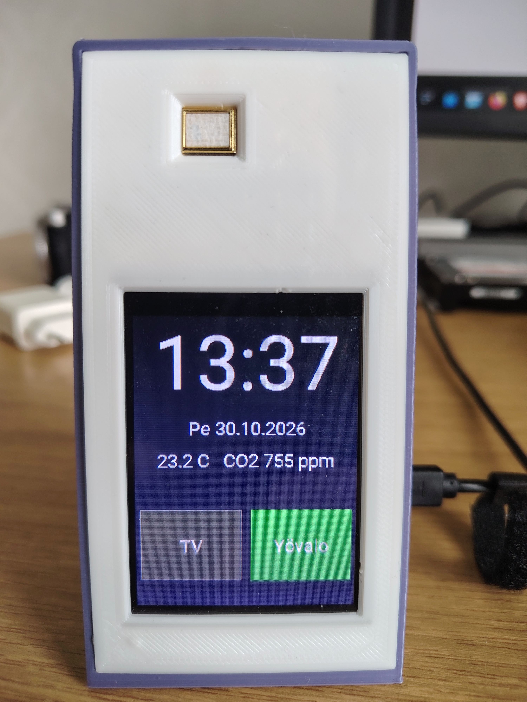
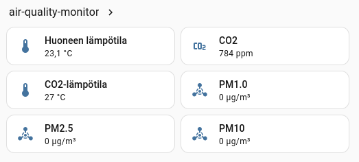

# Air Quality Monitor with ESPHome: What I Learned When the Display Wouldn't Cooperate

I built an air quality monitor on an ESP32-Wroom-32D platform, featuring an ILI9341 touchscreen, an MCP9808 temperature sensor, an MH-Z19 CO2 sensor, and a PMS7003 particulate matter sensor. The goal was simple: a display that wakes up on a tap, shows the time, temperature, and CO2 levels, offers two buttons to control Home Assistant entities – and turns itself off when no one is looking.

The 3D-printable enclosure and parametrized Fusion360 design can be found on [Printables - Air Quality Monitor Enclosure - Tilted Display Design](https://www.printables.com/model/1861937-air-quality-monitor-enclosure-tilted-display-desig), and the working code is at the very bottom of this blog post.

With the latest code, the air quality monitor's display looks like this:

And since ESPHome devices integrate directly with Home Assistant, the display brightness can be controlled right from Home Assistant:


Sensor data is updated in Home Assistant:



The end result finally works the way it should. But along the way, I ran into several pitfalls that took time and some of which could have been avoided if someone had told me about them beforehand. This post is that "someone".


## Where It All Started

The first version was ambitious: two pages (`idle_page` and `active_page`), a state machine with three states (off, idle, active), scripts for page switching and idle timeout, and tap logic where the first tap woke the display and the second opened the control page.

It worked – poorly. The buttons didn't respond, taps seemed to "get stuck in memory," and the display would sometimes change pages on its own. The debug log was flashing:

```
[W][component:419]: display took a long time for an operation (262 ms), max is 260 ms
```

That's where the learning process began.

## Lesson 1: XPT2046's `on_touch` Fires Multiple Times per Tap

The first symptom was baffling: a single tap seemed to be processed twice. The display woke up but immediately switched to the next page. The culprit was the `on_touch` trigger, which can fire multiple times during a single touch – at the beginning, during, and at the end of the touch. If the state machine transitions between these events, the same tap is interpreted as two different actions.

Solution: **`on_touch` only saves the coordinates, `on_release` performs the state transition.** `on_release` fires exactly once, when the finger is lifted. This was the first major improvement, and it's worth doing from the very start.

```yaml
on_touch:
  then:
    - lambda: |-
        id(last_touch_x) = touch.x;
        id(last_touch_y) = touch.y;

on_release:
  then:
    - lambda: |-
        int tx = id(last_touch_x);
        int ty = id(last_touch_y);
        // ... state transition here
        
```
## Lesson 2: turn_on() and turn_off() Do Nothing Without .perform()

This was the most embarrassing bug. The display wouldn't turn off, even though the interval block correctly checked the timeout and ESP_LOGI printed "60s idle - turning display off". The reason:

```cpp
id(backlight_light).turn_off();   // does nothing!
```

In the ESPHome C++ API, turn_off() returns a LightTurnOffAction object, but does not execute it. The action must be explicitly performed:

```cpp
id(backlight_light).turn_off().perform();
```

The same applies to turn_on() if you want to set the brightness:

```
auto call = id(backlight_light).turn_on();
call.set_brightness(1.0);
call.perform();
```

This single .perform() was the reason the display wouldn't turn off. If I had known that from the start, I would have saved a couple of hours of debugging.

## Lesson 3: on_touch and on_release Triggers Have No release.x Coordinates

I first tried to read the coordinates directly from the on_release trigger:

```yaml
on_release:
  then:
    - lambda: |-
        if (release.x >= 5 && release.x <= 115) { ... }   // does not work
 ```
 
on_release does not provide a release variable. It only signals "the touch ended", not where it ended. That's why the coordinates must be saved in global variables in the on_touch trigger and read in on_release – as done in Lesson 1.

## Lesson 4: One Page Is Better Than Two

The original idle/active page split felt logical: the clock is a calm default view, and the buttons are a separate control page. In practice, it caused three problems:

1. Page switching forces a full redraw. display.page.show redraws the entire screen, which blocks the main loop and delays touch events.

2. The state machine becomes complicated. Three states, two scripts, page-switching logic – and every new feature requires a new rule.

3. The "two taps" interaction is confusing. The user taps once to wake the display but doesn't see the buttons. A second tap opens them. If the first tap accidentally hits a button's location, nothing happens – because the buttons weren't visible yet.

Solution: one page where all elements are always visible. The clock, date, temperature, CO2, and buttons in the same view. The display wakes up with a single tap, and the buttons are immediately available. The state machine shrinks to two states: off (0) and on (1).

```yaml
lambda: |-
  it.fill(Color::BLACK);
  // clock, date, temperature, CO2
  // buttons
  
 ```
 This was the single biggest improvement in both simplicity and performance.
 
## Lesson 5: The delay Script Is Not an Idle Timer

I first tried to handle the idle timeout with a script:

```yaml
script:
  - id: screen_timeout
    mode: restart
    then:
      - delay: 20s
      - if: ...
 ```
 
The problem was that mode: restart and delay didn't always work as expected: a new call didn't necessarily cancel the previous delay in time, and multiple consecutive taps spawned multiple timers that fired at different times. The result was a "rubber band" experience: the button didn't respond, and taps seemed to accumulate.

Solution: a passive interval check instead of delay. interval: 1s checks once per second whether enough time has passed since the last activity. It doesn't reserve execution time and doesn't block the main loop for long. 

```yaml
interval:
  - interval: 1s
    then:
      - lambda: |-
          if (id(display_state) == 1 &&
              (uint32_t)(millis() - id(last_activity_ms)) >= 60000) {
            id(display_state) = 0;
            id(backlight_light).turn_off().perform();
          }
  ```
          
This is the same mindset as in asynchronous programming: events update a timestamp, and a background task polls the timeout. It's simple, predictable, and easy to debug – ESP_LOGI tells you directly when 60 seconds have elapsed.

## Lesson 6: Don't Update the Idle Timer from HA State Changes

One confusing symptom was that the display wouldn't turn off, even though the interval logic was correct. The cause was in the switch block:


```yaml
on_state:
  then:
    - lambda: |-
        if (id(display_state) == 1) {
          id(last_activity_ms) = millis();   // resets the idle timer!
        }
   ```     
If Home Assistant updates the switch state regularly (e.g., every 30 seconds, even if the state doesn't change), last_activity_ms is reset continuously, and 60 seconds never elapses.

Solution: an HA state change is not user activity. It may update the display, but must not reset the idle timer:

```yaml
on_state:
  then:
    - if:
        condition:
          lambda: 'return id(display_state) == 1;'
        then:
          - component.update: tft_display     
      
```

This is a small but important distinction: a user tap keeps the display on, an HA event does not.

## Lesson 7: The display took a long time Warning Means the Main Loop Is Blocked

The recurring warning in the log:
```text
[W][component:419]: display took a long time for an operation (262 ms), max is 260 ms
```

means that drawing the display blocked the main loop beyond the recommended limit (20–30 ms). This delays all other components – including touch events. That's why the buttons felt sluggish exactly when the display was being drawn.

Solutions:

- buffer_size: "50%" and color_depth: 8 reduce RAM usage and drawing time.
- One page removes the full redraw caused by page switching.
- Reducing the font size from 80 px to 60 px significantly shortens the drawing time of large digits.
- it.fill(Color::BLACK) is the slowest single operation. If drawing time is an issue, it can be replaced with partial updates – but that complicates the code considerably. In a single-page model, the fill is usually acceptable.

## Lesson 8: on_turn_off and on_turn_on Keep the State in Sync

If the backlight turns off or on from somewhere other than the interval block – for example, from Home Assistant – display_state must be updated to match the actual state. Otherwise, the next tap may misinterpret the state.

```yaml
on_turn_off:
  - lambda: |
      id(display_state) = 0;
on_turn_on:
  - lambda: |
      if (id(display_state) == 0) {
        id(display_state) = 1;
        id(last_activity_ms) = millis();
      }
      
```

This is a small detail, but it makes the state machine consistent regardless of who turns the backlight off.

## What Was Left Out and Why

The final version also contains two dead variables: display_user_off and idle_seconds. They are leftovers from earlier attempts and do nothing. They can be removed in the interest of cleaner code – or left for future use, as I did. They are included in the blog code so the reader can see what was tried along the way.


## Summary

If you're building a similar ESPHome device, these eight lessons will save you hours:

1. on_touch saves, on_release acts. One tap = one action.
2. turn_on() and turn_off() require a .perform() call. Otherwise, they do nothing.
3. on_release does not provide coordinates. Save them in on_touch.
4. One page is better than two. Fewer states, less drawing, fewer bugs.
5. Use an interval check instead of delay. A passive poll is more predictable.
6. Don't reset the idle timer from HA state changes. Only user activity keeps the display on.
7. Watch for the display took a long time warning. It tells you when drawing blocks the main loop.
8. Keep display_state in sync with the backlight. on_turn_on/on_turn_off handle it.

The end result is simple and functional: the display wakes up on a tap, shows the time, temperature, and CO2, offers two buttons to control Home Assistant, and turns itself off after 60 seconds. No page switching, no complicated state machine, no rubber-band taps.

The full commented code is below, and if anything is unclear, it's worth starting with these eight lessons. They are the ones I wish I had known before I started.

## ESPHome Code

```yaml
# ============================================================
# ESPHome-based air quality monitor and touchscreen
# Hardware: ESP32-Wroom-32D
# Display: ILI9341 (SPI, 240x320)
# Touch: XPT2046 (SPI)
# Sensors: MCP9808 (I2C), MH-Z19 (UART, CO2), PMS7003 (UART, PM)
# ============================================================

esphome:
  name: air-quality-monitor
  friendly_name: air-quality-monitor

esp32:
  variant: ESP32
  flash_size: 4MB
  framework:
    type: esp-idf
    version: recommended
    advanced:
      sram1_as_iram: true
      minimum_chip_revision: "3.0"
      flash_chip: generic

api:
  encryption:
    key: "change this"

ota:
  - platform: esphome
    encryption:

wifi:
  ssid: !secret wifi_ssid
  password: !secret wifi_password
  ap:
    ssid: AirQuality Fallback Hotspot
    password: "change this"
  domain: .sensornet.home.arpa

captive_portal:

# INFO level is sufficient for normal use. DEBUG level prints a lot
# of extra data and slows down the main loop.
logger:
  level: INFO


# ============================================================
# Buses
# ============================================================

# The display SPI bus uses hardware SPI (faster than software SPI).
spi:
  - id: spi_display
    clk_pin: GPIO18
    mosi_pin: GPIO23
    miso_pin: GPIO19
    interface: hardware

  # The touchscreen SPI is a separate bus. The XPT2046 does not
  # require high speed, so software SPI is sufficient.
  - id: spi_touch
    clk_pin: GPIO14
    mosi_pin: GPIO13
    miso_pin: GPIO35

i2c:
  sda: GPIO21
  scl: GPIO22
  scan: true

# Two separate UART buses: CO2 sensor and PM sensor.
uart:
  - id: uart_co2
    tx_pin: GPIO17
    rx_pin: GPIO16
    baud_rate: 9600

  - id: uart_pm
    tx_pin: GPIO32
    rx_pin: GPIO33
    baud_rate: 9600


# ============================================================
# Time and Home Assistant switches
# ============================================================

# The time is obtained from Home Assistant. This is the simplest
# way to keep the ESP32 clock in sync without an NTP server.
time:
  - platform: homeassistant
    id: ha_time

# HA switches mirror the state of Home Assistant switches.
# When the state changes, the display is updated – but only if
# the display is on. Otherwise, unnecessary drawing would slow things down.
switch:
  - platform: homeassistant
    id: tv_switch
    entity_id: switch.iso_makuuhuone_iso_mh_televisio
    on_state:
      then:
        - if:
            condition:
              lambda: 'return id(display_state) == 1;'
            then:
              - component.update: tft_display

  - platform: homeassistant
    id: olohuone_switch
    entity_id: switch.olohuone_oh_ledinauha
    on_state:
      then:
        - if:
            condition:
              lambda: 'return id(display_state) == 1;'
            then:
              - component.update: tft_display


# ============================================================
# Sensors
# ============================================================

sensor:
  # MCP9808: accurate I2C temperature sensor. The offset correction
  # compensates for the temperature rise inside the enclosure.
  - platform: mcp9808
    id: mcp_temp
    address: 0x18
    name: "Room Temperature"
    filters:
      - offset: -2.3
    update_interval: 20s

  # MH-Z19: CO2 sensor via UART. It also sends its own
  # temperature reading, but it is inaccurate and not used
  # on the display.
  - platform: mhz19
    co2:
      id: co2_sensor
      name: "CO2"
    temperature:
      id: mhz_temp
      name: "CO2 Temperature"
    update_interval: 60s
    uart_id: uart_co2

  # PMSX003: particulate matter sensor. PM1.0, PM2.5, and PM10 are read,
  # but only the PM values are available – currently only temperature
  # and CO2 are shown on the display.
  - platform: pmsx003
    type: PMSX003
    pm_1_0:
      name: "PM1.0"
      id: pm1_0
    pm_2_5:
      name: "PM2.5"
      id: pm2_5
    pm_10_0:
      name: "PM10"
      id: pm10
    uart_id: uart_pm
    update_interval: 30s


# ============================================================
# Global variables
# ============================================================

globals:
  # idle_seconds: reserved for future use (not currently in use).
  - id: idle_seconds
    type: int
    restore_value: false
    initial_value: '0'

  # display_user_off: dead variable – set but never read.
  # Can be removed, but left for future use.
  - id: display_user_off
    type: bool
    restore_value: false
    initial_value: 'false'

  # display_state: 0 = off, 1 = on.
  # A simple two-state machine, since the display only has
  # one page.
  - id: display_state
    type: int
    restore_value: false
    initial_value: '0'

  # Coordinates of the most recent touch. on_touch saves them,
  # on_release reads them.
  - id: last_touch_x
    type: int
    restore_value: false
    initial_value: '0'
  - id: last_touch_y
    type: int
    restore_value: false
    initial_value: '0'

  # Timestamp of the last activity in milliseconds.
  # Used for the 60-second idle timer.
  - id: last_activity_ms
    type: uint32_t
    restore_value: false
    initial_value: '0'


# ============================================================
# Fonts
# ============================================================

font:
  # Small font: date, temperature, CO2, button texts.
  # The glyphs include the Nordic characters.
  - file: "gfonts://Roboto"
    id: font_small
    size: 20
    glyphs:
      - "!\"%()+=,-./:°µ0123456789ABCDEFGHIJKLMNOPQRSTUVWXYZ abcdefghijklmnopqrstuvwxyzÄÖÅäöå"

  # Large font: clock only. Only digits and colon are needed,
  # which significantly reduces the font size.
  - file: "gfonts://Roboto"
    id: font_large
    size: 80
    glyphs:
      - "0123456789:"


# ============================================================
# Display
# ============================================================

display:
  - platform: mipi_spi
    id: tft_display
    model: ILI9341
    cs_pin: GPIO15
    dc_pin: GPIO4
    reset_pin: GPIO25
    spi_id: spi_display
    rotation: 180

    # buffer_size 50 % and color_depth 8 reduce RAM usage and
    # drawing time. 16-bit color would be more accurate, but
    # 8-bit is perfectly sufficient for this use case.
    buffer_size: "50%"
    color_depth: 8

    # One page, one lambda. No page switching, no separate
    # idle/active pages – this simplifies the logic and
    # significantly reduces drawing time.
    lambda: |-
      it.fill(Color::BLACK);

      // --- Time ---
      auto now = id(ha_time).now();
      it.printf(120, 50, id(font_large), Color::WHITE, TextAlign::CENTER,
                "%02d:%02d", now.hour, now.minute);

      // --- Date and abbreviated weekday ---
      // In ESPHome, day_of_week is 1-7 (1 = Sunday).
      const char* weekdays[] = {"Sun", "Mon", "Tue", "Wed", "Thu", "Fri", "Sat"};
      it.printf(120, 120, id(font_small), Color(200, 200, 200), TextAlign::CENTER,
                "%s %02d.%02d.%04d",
                weekdays[now.day_of_week - 1],
                now.day_of_month, now.month, now.year);

      // --- Temperature and CO2 on one line ---
      // Only display the values that are available.
      if (id(mcp_temp).has_state() && id(co2_sensor).has_state()) {
        it.printf(120, 155, id(font_small), Color(200, 200, 200), TextAlign::CENTER,
                  "%.1f C   CO2 %.0f ppm",
                  id(mcp_temp).state, id(co2_sensor).state);
      } else if (id(mcp_temp).has_state()) {
        it.printf(120, 155, id(font_small), Color(200, 200, 200), TextAlign::CENTER,
                  "%.1f C", id(mcp_temp).state);
      } else if (id(co2_sensor).has_state()) {
        it.printf(120, 155, id(font_small), Color(200, 200, 200), TextAlign::CENTER,
                  "CO2 %.0f ppm", id(co2_sensor).state);
      }

      // --- Buttons ---
      // Helper function draws the button based on its state: green when
      // on, grey when off.
      auto draw_button = [&](int x, int y, const char* text, bool is_on) {
        Color bg_color = is_on ? Color(0, 180, 0) : Color(50, 50, 50);
        Color border_color = is_on ? Color(0, 255, 0) : Color(120, 120, 120);
        it.filled_rectangle(x, y, 110, 80, bg_color);
        it.rectangle(x, y, 110, 80, border_color);
        it.printf(x + 55, y + 40, id(font_small), Color::WHITE, TextAlign::CENTER, text);
      };

      draw_button(5, 210, "TV", id(tv_switch).state);
      draw_button(125, 210, "Night", id(olohuone_switch).state);


# ============================================================
# Touchscreen
# ============================================================

touchscreen:
  - platform: xpt2046
    id: touch_screen
    cs_pin: GPIO5
    interrupt_pin: GPIO26
    spi_id: spi_touch
    threshold: 400
    calibration:
      x_min: 20
      x_max: 3860
      y_min: 340
      y_max: 3860

    # mirror_x flips the X-axis so that left = 0 and right = 240.
    transform:
      mirror_x: true

    display: tft_display

    # on_touch only saves the coordinates. This is important
    # because on_touch can fire multiple times during a single tap.
    # The state change is only made in on_release.
    on_touch:
      then:
        - lambda: |-
            id(last_touch_x) = touch.x;
            id(last_touch_y) = touch.y;

    on_release:
      then:
        - lambda: |-
            int tx = id(last_touch_x);
            int ty = id(last_touch_y);

            // State 0: display off -> wake up.
            // Note: turn_on() returns an action object that must
            // be explicitly performed with .perform().
            if (id(display_state) == 0) {
              id(display_user_off) = false;
              auto call = id(backlight_light).turn_on();
              call.set_brightness(1.0);
              call.perform();
              id(display_state) = 1;
              id(last_activity_ms) = millis();
              return;
            }

            // State 1: display on -> check buttons.
            // Button coordinates match the display lambda's
            // draw_button calls (5..115 and 125..235, y 210..290).
            if (id(display_state) == 1) {
              if (tx >= 5 && tx <= 115 && ty >= 210 && ty <= 290) {
                id(tv_switch).toggle();
              } else if (tx >= 125 && tx <= 235 && ty >= 210 && ty <= 290) {
                id(olohuone_switch).toggle();
              }
              // Reset the idle timer regardless of whether a button was hit.
              id(last_activity_ms) = millis();
            }


# ============================================================
# Idle timer
# ============================================================

# The interval block checks once per second whether the display
# has been on for more than 60 seconds without activity. This is a
# passive check: it does not block the main loop for long, unlike
# the script's delay action.
#
# Note: turn_off() must be performed with .perform(), otherwise
# the action will not happen.
interval:
  - interval: 1s
    then:
      - lambda: |-
          if (id(display_state) == 1 &&
              (uint32_t)(millis() - id(last_activity_ms)) >= 60000) {

            ESP_LOGI("display", "60s idle - turning display off");

            id(display_state) = 0;
            id(backlight_light).turn_off().perform();
          }


# ============================================================
# Backlight
# ============================================================

output:
  - platform: ledc
    pin: GPIO27
    id: backlight_pwm

light:
  - platform: monochromatic
    output: backlight_pwm
    id: backlight_light
    name: "Display Backlight"
    default_transition_length: 0s
    restore_mode: RESTORE_DEFAULT_OFF

    # on_turn_off and on_turn_on keep display_state in sync
    # with the actual state of the backlight.
    # This is important because the backlight can also turn off
    # from somewhere other than the interval block (e.g., HA).
    on_turn_off:
      - lambda: |
          id(display_user_off) = true;
          id(display_state) = 0

    on_turn_on:
      - lambda: |
          id(display_user_off) = false;
          if (id(display_state) == 0) {
            id(display_state) = 1;
            id(last_activity_ms) = millis();
          }
          
          
```