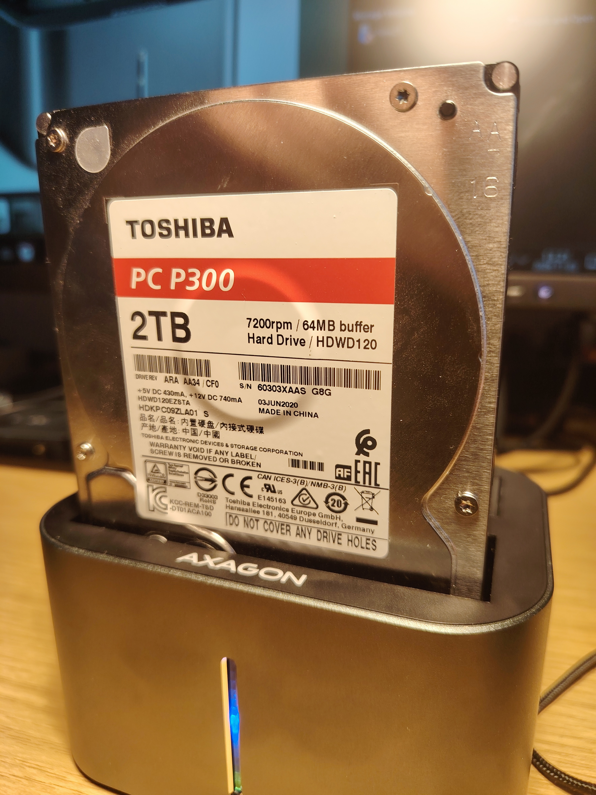
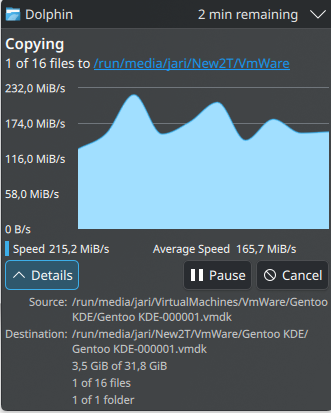

## Introduction

I recently ran into a rather confusing storage problem on my Fedora KDE Plasma 44 system. Copying large files, particularly multi-gigabyte VMware virtual machine files, to an external AXAGON dual-bay drive enclosure, the [ADSA-DC SuperSpeed USB DUAL 2.5"/3.5" HDD/SSD DUAL dock](https://www.axagon.eu/en/products/adsa-dc) would eventually stall.



The copy operation typically stopped at around 55%. Dolphin became almost unresponsive, and the entire Plasma desktop felt sluggish or nearly frozen. At first, this looked like a disk performance problem or perhaps a filesystem issue.



It turned out to be something else entirely: the USB connection path through my Lenovo USB4 5000 dock.

This article describes the symptoms, the investigation, and the test that finally isolated the problem.

## The hardware and software

The relevant setup was:

- **Laptop:** Lenovo ThinkBook 14 G7 ARP
- **Operating system:** Fedora KDE, Plasma 44
- **Kernel:** Fedora 6.x/7.x development series (7.2.15-200.fc44.x86_64 at the time of the final investigation)
- **Dock:** Lenovo USB4 5000
- **External storage:** AXAGON dual-bay USB enclosure
- **Drives:** Two internal SATA drives, including a Toshiba P300 2 TB HDD

Both drives were installed in the same AXAGON enclosure. The enclosure was connected to the laptop through the Lenovo USB4 dock.

The dock had its own power supply.

## The symptoms

When copying large files to the external storage, the transfer would progress normally for a while and then stop making progress. Transfer rate dropped to 0B per second.

At approximately 55%, Dolphin would become unresponsive or extremely sluggish. Plasma also appeared to struggle, making the whole desktop feel as though it was close to freezing.

This was not limited to a single application. The system was waiting for storage operations to complete.

## First suspicion: the hard drive

The Toshiba P300 was an obvious suspect. However, its SMART information did not indicate an obvious media failure:

- SMART overall health: PASSED
- Reallocated sectors: 0
- Current pending sectors: 0
- Offline uncorrectable sectors: 0
- UDMA CRC errors: 0
- Temperature: approximately 39 °C

A short SMART self-test also passed.

I additionally ran:

```bash
sudo hdparm -t /dev/sda
```

The result was approximately 183 MB/s, which was a reasonable sequential read speed for this drive.

These results did not prove that the drive was perfect, but they provided no obvious explanation for the freezes.

The next step was to investigate the kernel logs.

## The important evidence: UAS timeouts and USB resets

The kernel log revealed something much more interesting.

```bash
sudo journalctl -kf
```

Among the messages were:

```text
uas_eh_abort_handler
uas_eh_host_reset_handler start
usb 9-1.2.2: reset SuperSpeed USB device number 13 using xhci_hcd
uas_eh_host_reset_handler success
```

After the reset, the kernel also reported errors such as:

```text
I/O error, dev sda, sector ...
```

There were stalled write commands involving `sdb` as well as stalled read commands involving `sda`.

Both drives were connected through the same USB storage device. In other words, the problem was not necessarily associated with one particular disk.

The kernel was waiting for USB Attached SCSI (UAS) commands to complete, aborting them, and eventually resetting the USB device.

This explained why the desktop appeared to freeze: the operating system was waiting for storage operations that were not completing normally.

## Checking the USB topology

The next command was:

```bash
lsusb -t
```

The relevant part of the output looked like this:

```text
Bus 009.Port 001: Dev 001, Class=root_hub,
    Driver=xhci_hcd/1p, 10000M
    |__ Port 001: Dev 008, Class=Hub,
        Driver=hub/4p, 10000M
        |__ Port 002: Dev 009, Class=Hub,
            Driver=hub/4p, 10000M
            |__ Port 002: Dev 013, Class=Mass Storage,
                Driver=uas, 5000M
```

This revealed two important details:

1. The AXAGON enclosure was connected through two USB hubs in the dock's USB topology.
2. The storage enclosure was using the UAS driver at 5 Gbit/s.

This did not prove that either hub or UAS was defective. However, it made the dock and the USB connection path much more interesting suspects than the hard drives themselves.

## The decisive test: bypassing the dock

I then disconnected the AXAGON enclosure from the Lenovo dock and connected it directly to the laptop.

Nothing else was intentionally changed.

The result was immediate:

**The enclosure worked perfectly.**

Large file copies completed without stalling. Dolphin remained responsive, and Plasma behaved normally.

The kernel log also looked completely different. There were no repeated UAS command timeouts or mass-storage device resets. Both filesystems mounted normally:

```text
EXT4-fs (sda1): mounted filesystem ... r/w
    with ordered data mode.

EXT4-fs (sdb): mounted filesystem ... r/w
    with ordered data mode.
```

This was the most important finding of the entire investigation.

The same AXAGON enclosure, the same two drives, and the same Fedora installation worked normally when the dock was bypassed.

## What was actually wrong?

The tests strongly suggest that the problem was somewhere in the USB connection path involving the Lenovo dock.

Possible explanations include:

- A USB hub compatibility issue in the dock.
- An interaction between the dock's USB topology and the AXAGON enclosure's UAS controller.
- A USB cable or connection stability problem.
- A power-management or power-delivery issue involving the dock and enclosure.

The available evidence does not identify one specific component as the definitive root cause.

It is also worth noting that the AXAGON enclosure was powered independently through its own power supply. Nevertheless, that does not completely rule out USB power-management or signalling issues.

I have not yet established whether disabling UAS would make the enclosure stable through the dock. I decided not to introduce that workaround because the enclosure works correctly when connected directly to the laptop.

## Lessons learned

There are a few useful lessons from this case.

**1. A healthy SMART report does not rule out storage problems.**

SMART can help identify failing media, but it cannot diagnose every problem in the USB connection between a disk and the computer.

**2. A desktop freeze can actually be a storage transport problem.**

When applications become unresponsive during file operations, it is tempting to blame the desktop environment. However, the underlying issue may be that the kernel is waiting for storage commands to complete.

**3. Check the kernel log, not just the application.**

These commands were particularly useful:

```bash
sudo journalctl -kf
```

and:

```bash
lsusb -t
```

The first exposed the UAS timeouts and USB resets. The second showed the USB topology and confirmed that the storage device was using UAS.

**4. Test the same hardware without the dock.**

This was ultimately the decisive step. By connecting the enclosure directly to the laptop, I could isolate the problem without changing the operating system, filesystem, or drives.

## Conclusion

The AXAGON dual-bay enclosure and its drives were not the apparent cause of the problem.

The enclosure worked perfectly when connected directly to the Lenovo ThinkBook. The failures occurred when it was connected through the Lenovo USB4 5000 dock.

The evidence points to a USB transport or compatibility issue somewhere in that connection path, although the exact component responsible remains unknown.

If you experience similar symptoms on Linux — stalled file transfers, an unresponsive desktop, UAS timeouts, and repeated USB resets — do not immediately replace your hard drives.

First, check the kernel log and try connecting the storage device directly to the computer.

Sometimes the problem is not the storage device at all. It is everything between the storage device and the computer.

---

*Update: The direct-connection test resolved the observed problem. Further investigation would be needed to establish whether the dock's USB hub, UAS compatibility, cabling, or another aspect of the connection is responsible.*
