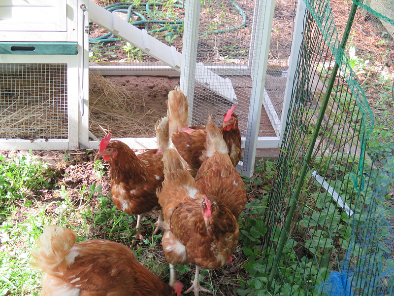
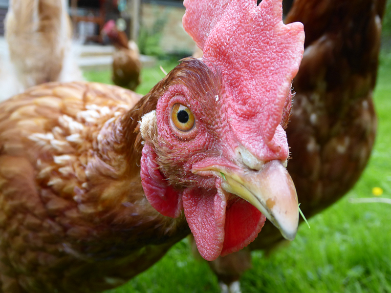
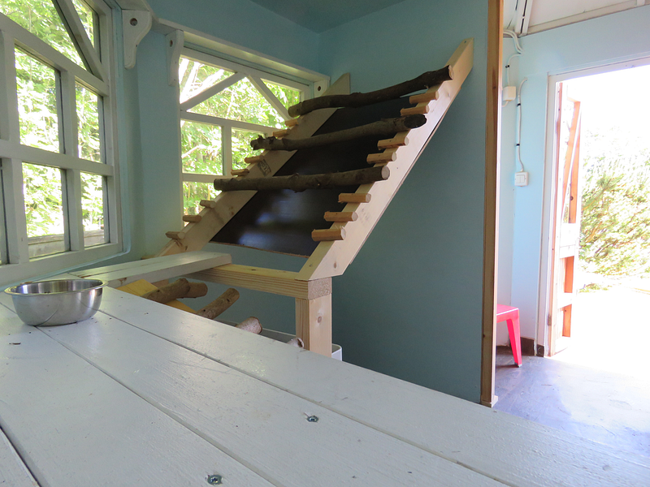
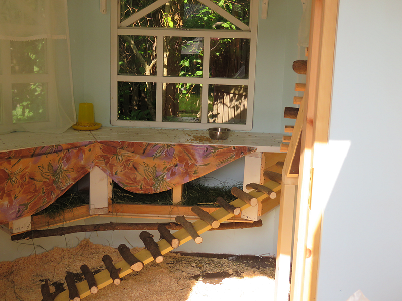
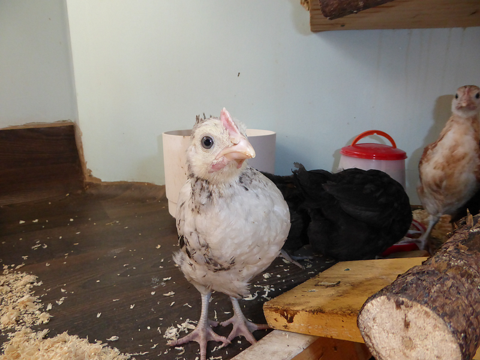
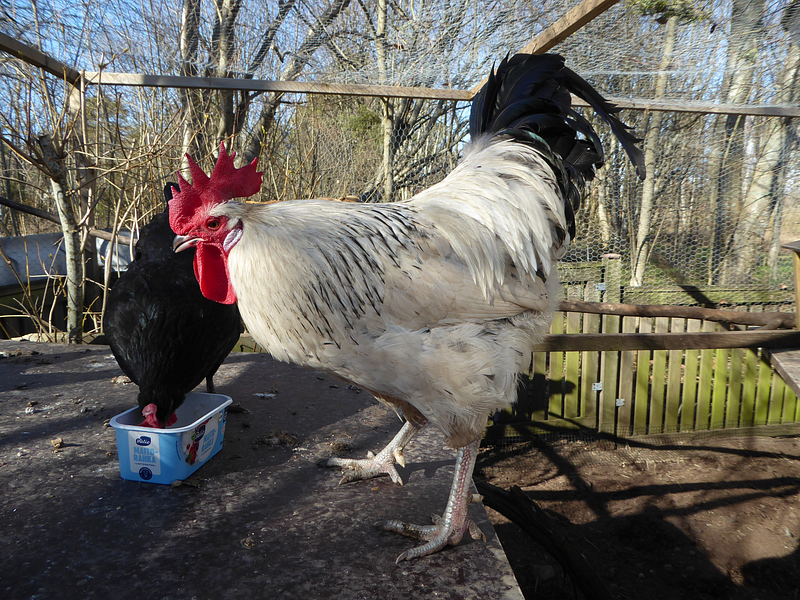
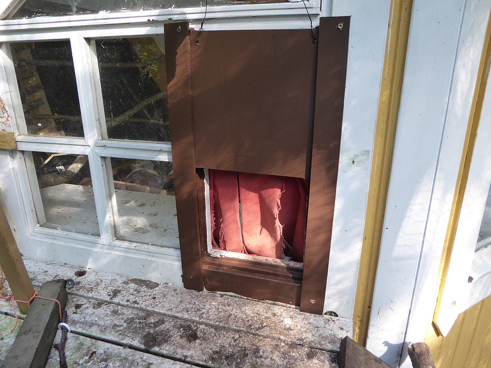
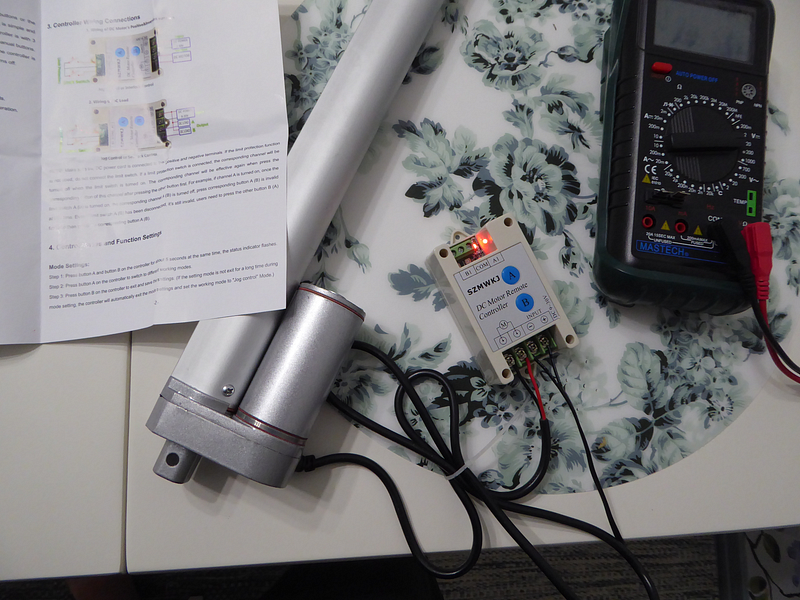
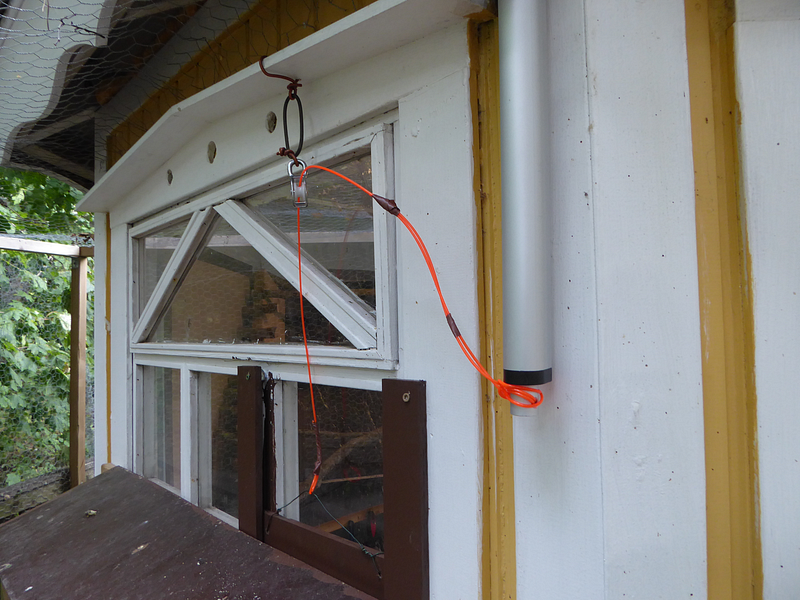

While Gentoo Linux updates itself, I thought I’d take a moment to write about some of my upcoming projects.

---

### From Hobby Chickens to the IoT World — Part 1

While [Gentoo Linux](https://www.gentoo.org/) updates itself, I thought I’d take a moment to write about some of my upcoming projects. I’ll begin by giving a brief overview of my current endeavours, along with a bit of history on how I’ve arrived at various innovations, many of which I’ve shared for free.

In this first part, I’ll discuss how acquiring summer chickens to tackle a garden snail problem eventually led to automating a hobby chicken coop. This automation, in turn, sparked a series of IoT innovations, which I’ll explore in subsequent parts. In the final part, I’ll cover what I’m currently working on, including the latest developments in my most recent project.

---

Back in 2017, I noticed a garden snail problem in my backyard — specifically, the presence of **Arianta arbustorum** snails, which were wreaking havoc on my crops like rhubarb and strawberries. Using chemical pesticides was out of the question due to my dog and the edible nature of the plants. I tried a few non-toxic alternatives, such as beer traps, but without success.

Eventually, I started researching which animals could naturally control these snails. Initially, it seemed like ducks might be the best option, but after further investigation, I decided to get summer chickens from a local poultry farmer. These chickens were set to be culled, as commercial laying hens are typically kept only for a limited period. My goal wasn’t to collect eggs for food but rather to control the snail population. Surprisingly, the chickens turned out to be excellent layers, and their eggshells became a great source of calcium for my dog’s diet.

To accommodate the summer chickens, I purchased a small chicken coop and some wire fencing, which I moved around to the areas most affected by the snails.

---

The first summer with chickens went well — the snail population decreased significantly, and I ended up with more than enough eggs. At the same time, I was studying psychology, which sparked an interest in the chickens’ personalities and learning behaviours. I also grew quite attached to them over the summer. As autumn approached, I couldn’t bear the thought of culling the chickens just because I didn’t have a winter coop for them.

Fortunately, there was an old garden gazebo in the backyard that we hadn’t used in years. It was roughly 6 square metres in size but not suitable for winter use. With a bit of effort, I was able to convert the gazebo into a winter-proof chicken coop by insulating the walls and floor, adding an extra layer of plexiglass to the windows, and installing perches for the chickens. Beneath the perches, I added a plywood board angled to let the chicken droppings slide into a collection container. Chicken manure is excellent for composting, providing rich nutrients for plants.

Chickens need nesting boxes. The nesting boxes should be easy to clean and provide a calm, quiet environment.

---

Outside the coop, I built a secure wire enclosure where the chickens could roam safely. Potential threats included the neighbour’s five cats, hawks, and my own dog, who was very interested in the chickens.

To allow the chickens to move in and out of the coop freely, I removed a small windowpane and added steps leading down to the ground. For two winters, everything went smoothly, but eventually, the chickens — already at the end of their natural lifespan — began to fall ill and had to be put down. The snail problem persisted, however, and I found chickens to be enjoyable pets. Plus, I already had a winter-ready coop. So, I decided to get new residents: a few-week-old chicks of the local heritage breed known as Piikkiö landrace chickens.

One of the chicks, which we initially thought was a hen, turned out to be a rooster. From a psychological perspective, observing him was particularly fascinating. He was promptly named Elvis.

During his adolescence, Elvis the rooster became somewhat aggressive, even bullying the hens. According to advice from a chicken-focused Facebook group, I should have culled him due to an apparent temperament issue. This was supposedly the standard approach for aggressive roosters. Out of the thousands of group members, 99.9% were women, and the consensus was that a “defective” rooster like Elvis should go straight to the cooking pot. However, one man in the group suggested I be patient and see how things develop.

At that point, I had progressed to intermediate psychology studies and was intrigued by the developmental parallels between humans and chickens. In human development, the increase in testosterone during adolescence can lead to behavioural changes, sometimes making boys more aggressive. I wondered if the same might be true for roosters — and it turns out, it was. Elvis eventually matured into an excellent rooster. He took great care of the hens, letting them eat first and even teaching them how to brood.

From a developmental psychology perspective, it was fascinating that my rooster, Elvis, had no role models to learn rooster behaviour from, as he was the only male among the chicks. His actions were therefore entirely driven by genetics. Moreover, the female-dominated “experts” in the Facebook group were completely wrong about aggressive roosters. After all, we don’t get rid of adolescent boys just because they don’t obey their parents!

At some point, I started considering whether I could automate the chicken coop door with some sort of actuator. To test this idea, I built a plywood door that covered the entrance.

The entrance seemed to work well and posed no danger to the chickens, as the door gently slid down under its own weight. To automate the opening, I needed a linear actuator capable of lifting the door, along with a remote control system. I ordered a linear actuator and a **KZ005–2 DC 9–30V Wireless Remote Control Kit** from AliExpress. I installed it so that when the linear actuator pushes a rod downward, the door lifts up. This design ensures that no excess force or malfunction can harm the chickens.

Linear actuator and a **KZ005–2 DC 9–30V Wireless Remote Control Kit**

As someone with a technical background and experience as a radio amateur, I knew that the remote control likely operated on the 433 MHz frequency and that its transmitted code could potentially be “hacked.” To explore this, I purchased my first Raspberry Pi 3B mini-computer, along with a 433 MHz transmitter and receiver. However, I had no prior experience with Python, which was necessary for working with the Raspberry Pi. My programming background was in Java, thanks to an object-oriented programming course during my computer science studies, and I had over 20 years of experience in the ICT field, so I had a general understanding of coding.

Fortunately, there are plenty of good tutorials online, and this led to my first Python project.

The linear actuator’s remote control system was the KZ005–2 DC 9–30V Wireless Remote Control Kit, and the open/close codes were:

- **3669736**: #close
- **3669729**: #open

Interestingly, using the receiver, I could also detect the codes from my neighbours’ TV remotes and other devices. Many people may not realise how easy it is to intercept a cheap remote control signal and potentially cause disruption, like controlling a heat pump or other devices remotely. While there are now more frequencies and modulations available, and some communication between remotes and devices may be encrypted, cheaper devices can still have these vulnerabilities.

Knowing the exact codes I needed to send, I used a Raspberry Pi connected to a budget-friendly **FS1000A 433 MHz transmitter module**. Surprisingly, even with just a few milliwatts of power, the signal could reach quite far.

To make the automation of the linear actuator and chicken coop door smarter, I decided to implement remote control using the MQTT (IoT) protocol, with a Mosquitto broker installed on the Raspberry Pi. This allowed me to schedule the open and close commands, for example, based on sunrise and sunset times.

Since then, I’ve significantly improved my programming skills, but that original code still works flawlessly.

In the next parts, I will discuss how I continued from this point by creating sensors for various purposes and how I utilised the data from these sensors in control and visualisation.