### From Hobby Chickens to the IoT World — Part 2

I just designed a new sensor case for the [BME280](https://www.bosch-sensortec.com/products/environmental-sensors/humidity-sensors-bme280/) in my [HVAC](https://en.wikipedia.org/wiki/Heating,_ventilation,_and_air_conditioning) system, and my 3D printer is currently working on the first draft. Now it’s time to write this article…

I am upgrading my home automation IoT systems, which I have developed as a hobby. In the HVAC system, I now have three BME280 sensors measuring temperature, relative humidity, and pressure:  
- one measures incoming air to the HVAC,  
- another measures outgoing air to the rooms,  
- and the third measures ‘bad air’ from the rooms.  

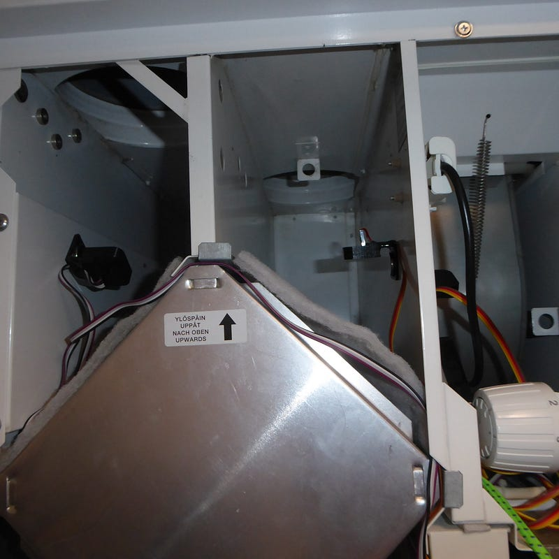

Let’s look at what information those sensors have sent via the [MQTT](https://mqtt.org/) protocol to [InfluxDB](https://www.influxdata.com/), which I visualise with [Grafana](https://grafana.com/). Grafana also generates email alerts whenever a value falls out of the expected range.

Here are 1‑year, 30‑day and 7‑day views in Grafana:

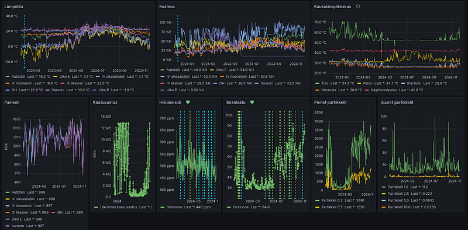

One year of sensor data

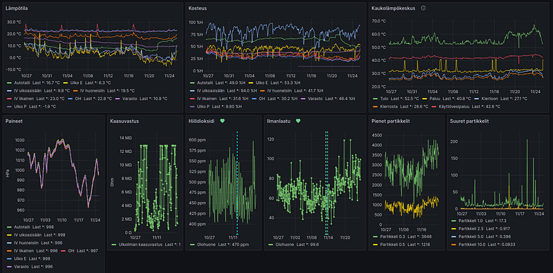

30 days data

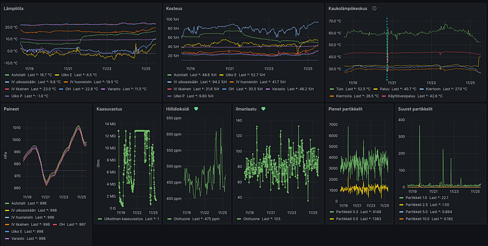

7 days data

But what can I see from these graphs? **Anomalies!**  

For example, on 21 November 2024 around 16:00, the temperature in my garage rose from 8 °C to 13.5 °C. What happened? I started the **air‑source heat pump** in the garage. I’ve added this information to the trend as a blue vertical dotted line.

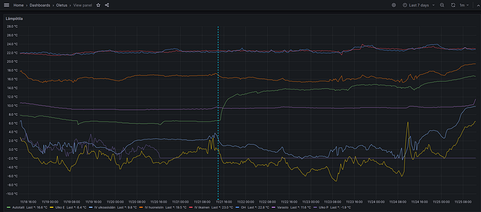

Let’s take another example. From the HVAC temperature and moisture sensors, I see peculiar zig‑zag patterns where incoming air temperature and moisture fluctuate. This behaviour is related to the [Swegon Casa ILTO 440](https://www.casastore.fi/ilto-440-control-ac) Control AC HVAC, which is programmed so that if the incoming temperature is too low, the incoming air flow stops to prevent the heat recovery cell from freezing.

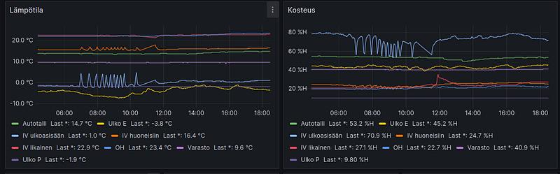

ILTO 440 HVAC system – incoming air motor stepping

In this next example, the red line represents ‘dirty’ air from the rooms, and we see a temperature peak about once a week. This is typical in houses with a sauna: the sauna is about 80–100 °C, and the hot air ends up in the HVAC system. As you can see, the heat exchanger works because the orange line (air going to the rooms) follows the red line. This means that energy is not lost, thanks to the heat exchanger.

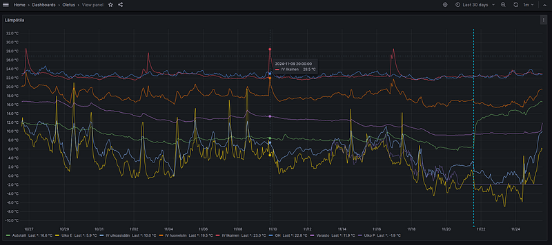

Heating the sauna shows up in the trends

What else can we see? For example, if the filters of the HVAC system become clogged (which typically happens in autumn when many mosquitoes and other debris end up in the filters), the pressure difference between the incoming and outgoing air drifts.

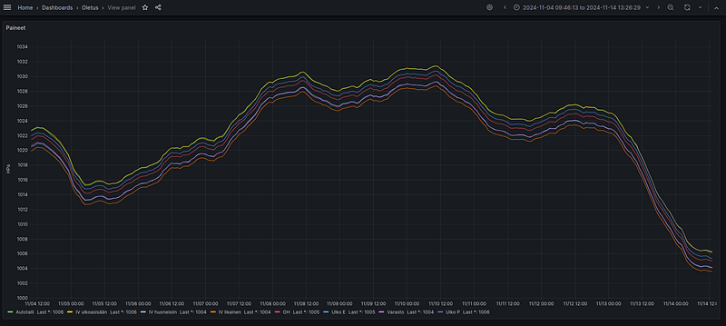

Drifting pressure prior to filter cleaning

As you can see, with simple ideas, you can monitor the health of your home and carry out preventive maintenance. Currently, I am testing a few scenarios for controlling systems using AI‑based data, which could reduce the house’s energy consumption. Zigbee‑controlled relays and automation components assist with this.

In Finland, HVAC systems are designed to ventilate air so that room air is replaced every two hours, or at least 6 litres of fresh air per person per second. In my case, the HVAC system operates in the ‘normal’ setting, resulting in an air exchange rate of 2.1–2.45 times per hour for a total air volume of 335 m³ (based on my anemometer measurements). That means **703,500 litres/hour** to **820,750 litres/hour**! While effective for ventilation, this is excessive from a heating perspective because the more heated air you exchange, the more energy you lose.

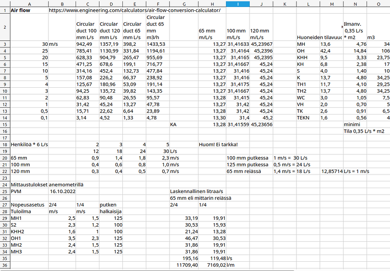

Sample calculations based on anemometer measurements

---

I installed a CO₂ sensor and a particle sensor in my living room, which gave me the idea to add a CO₂ NDIR sensor and a PMS9103M particle sensor to the HVAC system. From the living room particle sensor, I realised how much poor‑quality clothes made of polyester and other synthetic fibres pollute the air. The CO₂ sensor is actually the best indicator of how well the HVAC system is working: if CO₂ levels rise, it means the system is not providing enough fresh air to the room.

The next screens show AQI, small particles and large particles from the PMS7003 sensor in my living room:

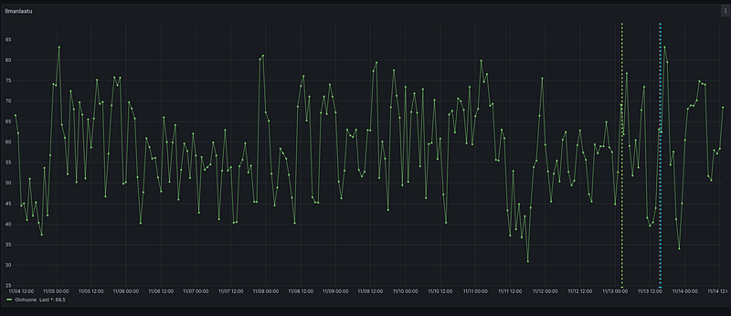

AQI = Air Quality Index

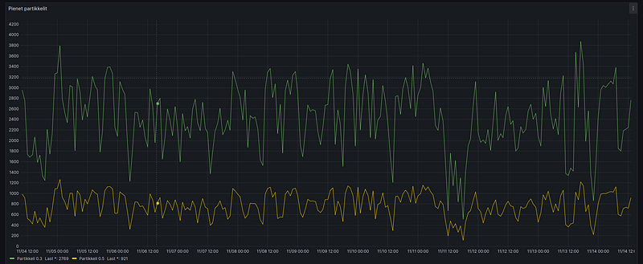

Small particles

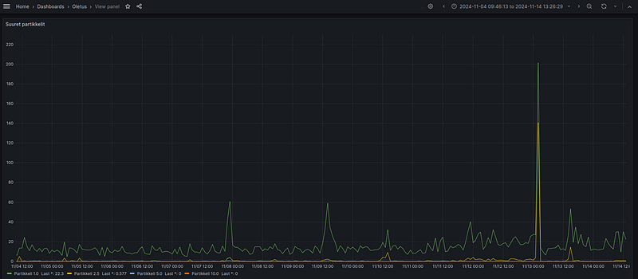

Large particles

---

*In later articles, I will explain the design principles you need to know when creating 3D‑printable objects, such as sensor cases. Following those, I will write additional articles about testing and programming an ESP32 with a WiFi connection to an MQTT broker for IoT applications. This way, you’ll gain an understanding of how I turn my ideas into tangible, fully functional gadgets!*	