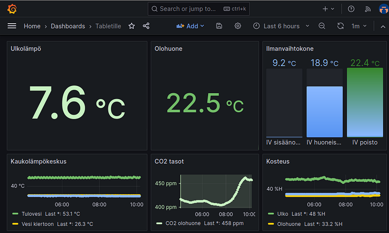
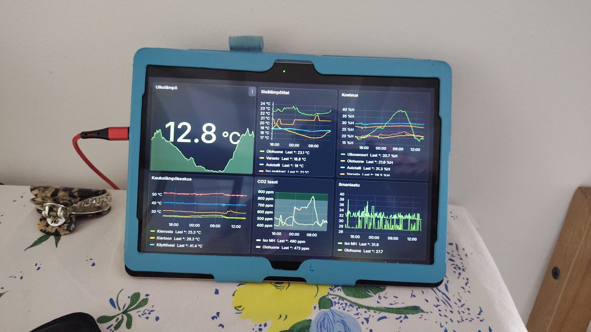
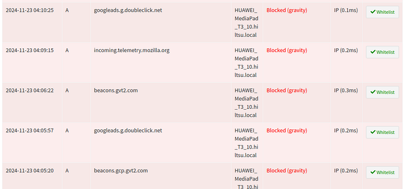

### From Hobby Chickens to the IoT World — Part 3

In this section, I’ll continue the story by showing how old tablet computers can be repurposed as display screens. This approach gives a new life to outdated tablets and older Android operating systems, contributing to resource conservation.

As I mentioned earlier, the sensors I’ve installed can measure various parameters such as temperature, humidity, pressure, and carbon dioxide levels, among others. For instance, sensors monitoring the district heating system have been particularly helpful because interruptions in the system are quite common. Nobody likes stepping into a cold shower due to a lack of hot water. This inconvenience can be avoided thanks to Grafana sending me email alerts as soon as the district heating supply temperature begins to drop. I’ve even been able to pass these alerts on to my neighbours via WhatsApp, helping them prepare — whether that means avoiding a cold shower or gathering firewood for the fireplace if the outage is prolonged.

But that’s not all. The information visualised in Grafana can also be displayed on tablet screens, allowing these devices to serve as dashboards for outdoor temperature and other data. The only requirements are that the tablet is connected to a WiFi network capable of communicating with the Grafana server and that the displayed data is formatted appropriately for the tablet’s screen size.

For example, on one previously discarded tablet, I have configured the display to show the following: on the left, the outdoor temperature; in the centre, the living room temperature; and on the right, the HVAC intake, supply, and return air temperatures. At the bottom, the screen displays district heating temperatures, a carbon dioxide trend graph in the middle, and humidity values on the lower right.

Grafana display for tablet

The following image shows a repurposed Huawei MediaPad tablet displaying the previous “for tablet” dashboard during the summer heat. I’ve configured the colours to indicate temperature levels: red for temperatures above 25°C and blue for those below 18°C.

On the left side of the Huawei tablet, you can see one of the air quality monitors I built (black box). It features a touchscreen, a BME280 sensor for temperature, humidity, and pressure, an MH‑Z19B NDIR CO₂ sensor, a PMS7003 particulate matter sensor, and an ESP32 processor, all integrated into a single device. Enclosure 3D printer objects are at [Codeberg](https://codeberg.org/hiltsu/fusion360-piirrokset-3D-tulostusobjektit/src/branch/main/AirQualityCase_v3), and the MicroPython code for the ESP32 is at [Codeberg](https://codeberg.org/hiltsu/micropython-for-embedded-systems/src/branch/main/Airquality/esp32-oled-mhz19b-pms9103m-bme680).

Huawei tablet with Grafana display

The tablet runs Firefox, and I’ve enabled Kiosk mode in Grafana, which removes any unnecessary elements from the display. Ideally, a simpler web browser without any extra features would be even better for this purpose. Additionally, the tablet is configured with an app that keeps the screen always on, and all settings that might interfere with the display functionality have been disabled.

It’s a good idea to turn off all synchronisation settings, as they tend to cause unnecessary disruptions. Despite this, Google still attempts to push updates and send irrelevant notifications, even when synchronisation is disabled. For some inexplicable reason, the tablet also tries to send data to services like Google Ads and other destinations on the internet.

The image below shows Pi‑hole’s blocked attempt list, highlighting where the tablet tried to send data during the early hours of the morning. Nobody was using the tablet at that time, so these requests were generated by background processes even with all synchronisation turned off.

Pi‑hole blocking Huawei tablet DNS queries prior to firewall blocking

Since the tablet is used exclusively within the local network and internet connectivity is not needed, it’s advisable to configure a firewall rule to block all internet traffic from the tablet’s IP address for all protocols. This eliminates the need for updates and prevents telemetry from reporting any app data or other “spy‑worthy” information.

Tablets can also be used for many other purposes through MQTT (a lightweight IoT protocol), such as controlling lights or other smart devices. For example, commands can be sent to an MQTT broker to trigger relays that manage lighting. Free apps for this are readily available on the Play Store.

The tablet has now been running continuously for about a year without any issues, contrary to what one might expect. There’s no burn‑in on the screen, and all pixels seem to function perfectly.

---

Repurposing old tablets not only extends their lifespan but also helps reduce e‑waste and resource consumption. Whether used as smart home dashboards, air quality monitors, or IoT controllers, these devices can take on new, meaningful roles beyond their original purpose. With a bit of creativity and technical know‑how, even outdated hardware can provide significant value in modern setups.

> *Have an old tablet lying around? Maybe it’s time to give it a second life!*