Recently, I have been investigating my home's energy consumption and ways to improve heating efficiency using Home Assistant. Alongside the heat pump, ventilation and temperature sensors, one essential piece of information was missing: actual district heating energy consumption.

This led to an open-source project, **Salon Kaukolämpö for Home Assistant**. Its first release candidate, v0.1.0-rc.1, is now available. In this article, I describe how the project came about, what I learned from investigating measurement data, and why I am now looking for additional testers.

## Starting with energy efficiency

My home uses district heating and hydronic underfloor heating. An Ouman EH-203 controller regulates the heating water temperature. I also use an air-source heat pump. The consumption of any individual appliance therefore tells only part of the story of the building's energy efficiency.

A district heating meter measures thermal energy transferred from the network to the building. The supply and return water temperature difference and water flow are useful quantities for understanding heat transfer.

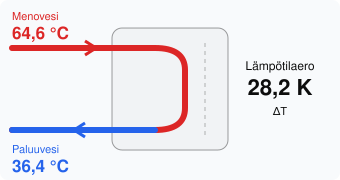

My goal is to bring these measurements into the same environment as the other sensors. This makes it possible to investigate relationships between outdoor temperature, the heating curve, heat pump operation and energy consumption. Temporal correlation alone, however, does not establish causation.

## Salon Kaukolämpö and LämpöVahti

Salon Kaukolämpö, the district heating utility in Salo, Finland, provides its customers with the LämpöVahti service. I contacted the utility to ask whether its application programming interface could be used in my own Home Assistant environment.

The inquiry led to a constructive discussion, and API access was made available to detached-house customers without a separate fee. Salon Kaukolämpö deserves credit for this. Giving customers access to their own measurement data opens new opportunities for investigating energy efficiency.

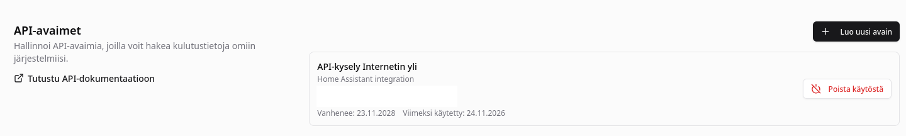

The interface is described in the [LämpöVahti API documentation](https://api-lampovahti.salonkaukolampo.fi/external/api/docs/). It provides metering location and consumption data, including cumulative energy readings, hourly consumption, temperatures and flow when available.

## Integration design principles

The integration was developed in Python using Home Assistant's native integration architecture. I wanted to keep the solution as simple as possible: no separate database, proprietary cloud service or tariff engine. Measurement history is handled by Home Assistant's Recorder. Official consumption history and cost information remain available in LämpöVahti.

The API key and metering location are configured through the user interface, without editing configuration.yaml. The integration supports Finnish, Swedish and English. It uses the API for read-only access.

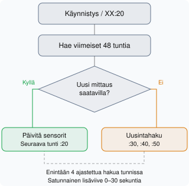

## When API data is not yet final

The most interesting part of development was investigating how measurement data behaves. I observed that a newly available hourly record could initially report zero consumption even though the cumulative energy reading had increased. Later, the hourly consumption in the same record was updated to match the change in cumulative energy.

In one observation, the cumulative reading was 17,379 kWh. Hourly consumption was still 0 kWh at 12:31 local time, but had become 1 kWh at 12:40. The record's modified_at timestamp remained unchanged. Consequently, polling based exclusively on the modified_since filter could miss such a correction.

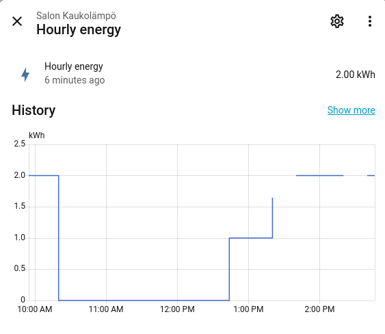

These are observations from my own metering location, not confirmed characteristics of every installation. I have asked Salon Kaukolämpö for clarification on timestamp semantics, correction handling and the use of cumulative readings to calculate hourly consumption.

The current integration compares the difference between consecutive hourly cumulative readings from the same meter with the reported hourly consumption. If they disagree, the hourly value is not presented as a new confirmed measurement. The previous confirmed value may be retained for up to two hours from its own measurement timestamp. Data quality and the consumption measurement timestamp are exposed as separate sensors.

In my dataset, energy readings have changed in increments of one kilowatt-hour. This is an observed data resolution, not an assessment of the meter's actual measurement accuracy. Average power calculated from hourly energy is not instantaneous thermal power either.

## Adaptive polling

There is little reason to query the API continuously when new measurements are mainly produced hourly. Conversely, polling only once an hour could miss a delayed correction.

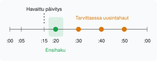

The integration normally aims to fetch data around 20 minutes past the hour. If new data is missing or awaiting confirmation, additional requests may be made around 30, 40 and 50 minutes past the hour. A small random delay distributes requests across installations.

For research purposes, I also run a separate Bash script that records API responses once a minute. This allows me to investigate API behaviour independently of the integration. This high-frequency research logging is not part of the integration's normal operation.

## Installing from Home Assistant Marketplace

Home Assistant 2026.11 introduced Marketplace, which also supports community integrations hosted in public GitHub repositories. I tested installation in a clean Home Assistant 2026.11.0 Docker environment on Fedora Linux.

First, back up Home Assistant. Open **Settings → Marketplace**, acknowledge the community content warning if prompted, and select **Add from link**.

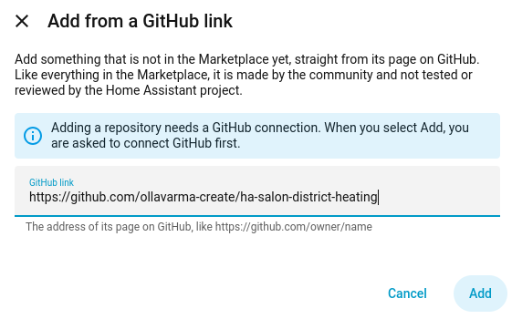

Enter the repository URL:

```text
https://github.com/ollavarma-create/ha-salon-district-heating
```

Adding a custom repository may require GitHub authentication. In my test, authorization covered public data, and the GitHub authorization application was still labelled HACS.

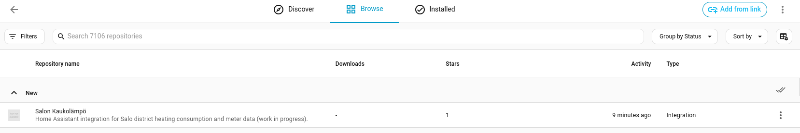

Select and install the integration. Restart Home Assistant if required. In my test, Marketplace installed the Git commit corresponding to the release candidate. Named pre-release selection and the subsequent update mechanism have not yet been fully tested.

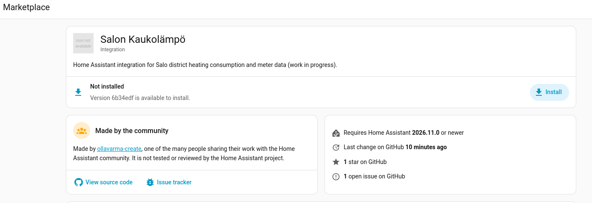

## Creating an API key and configuring the integration

Sign in to [LämpöVahti](https://lampovahti.salonkaukolampo.fi/login), open **Tilini (My account) → API-avaimet (API keys)** and create a new key.

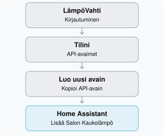

In Home Assistant, open **Settings → Devices & services → Add integration** and search for Salon Kaukolämpö. Enter the API key and select your metering location. Never publish your API key in screenshots or issue reports.

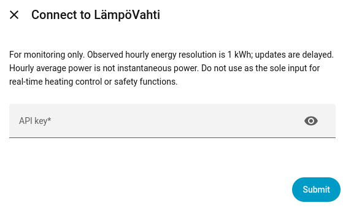

## Eleven sensors

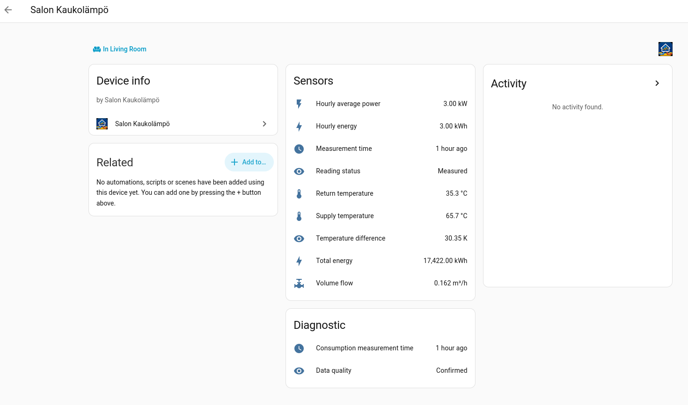

| Sensor | Meaning |
|---|---|
| Total energy | Cumulative energy (kWh) |
| Hourly energy | Confirmed hourly consumption (kWh) |
| Hourly average power | Average power over the hour (kW) |
| Supply temperature | Supply water temperature (°C) |
| Return temperature | Return water temperature (°C) |
| Temperature difference | Temperature difference (K) |
| Volume flow | Volumetric flow rate (m³/h) |
| Measurement time | Timestamp of the latest measurement record |
| Reading status | API reading status |
| Consumption measurement time | Measurement timestamp of the displayed consumption |
| Data quality | Integration's consumption data quality status |

The quality states are confirmed, pending, stale and unverifiable. They help users distinguish confirmed consumption data from data awaiting confirmation, outdated data or data that cannot be verified.

## A dedicated district heating dashboard

In my test, the Home Assistant 2026.11.0 Energy Dashboard did not offer a dedicated district heating category. I did not want to classify purchased thermal energy as electricity or gas merely to display it in the energy overview.

The repository therefore includes an [example district heating dashboard](https://github.com/ollavarma-create/ha-salon-district-heating/tree/main/examples). It displays recent measurements, daily, weekly and monthly consumption, temperature history, flow and data quality information.

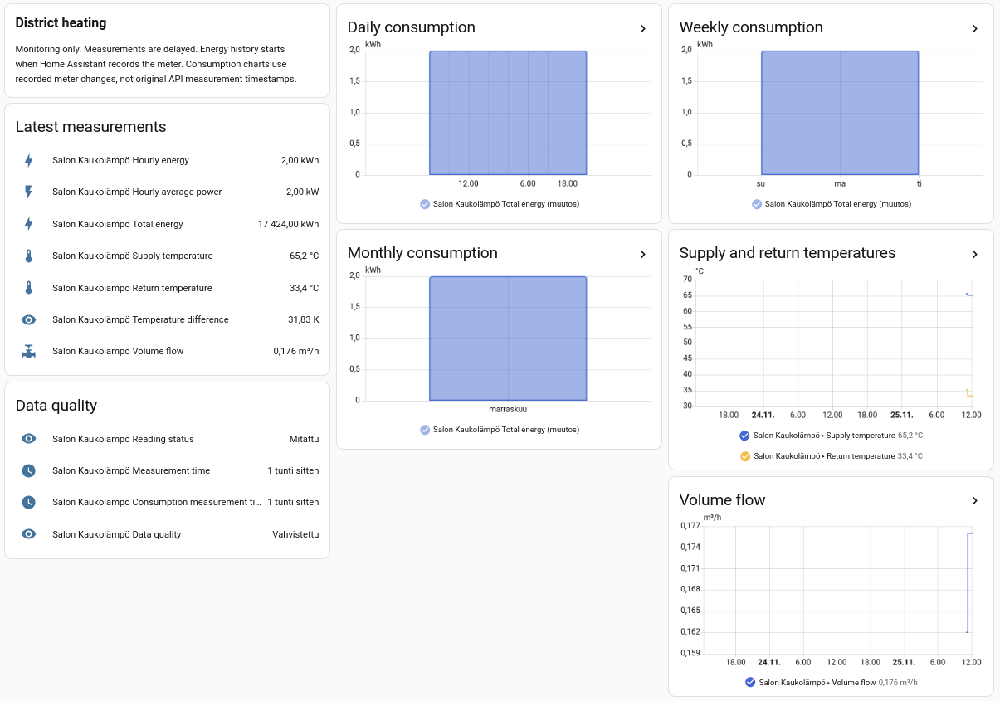

The example entity IDs must be adapted to each installation. Home Assistant may include an area name in the assigned IDs, for example. Consumption charts use changes in the cumulative energy reading according to Home Assistant's recording timestamps, rather than the original API measurement timestamps. Historical data is not imported retroactively, and long-term statistics are still being tested.

## What comes next?

My longer-term goal is to combine district heating consumption data with Ouman EH-203 controller information and other Home Assistant measurements.

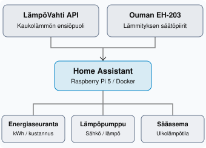

This is a future development concept, not an implemented feature of the current integration. Before attempting to optimize heating, we need to understand measurement delays, resolution and semantics. The integration is intended for monitoring and must not be used as the sole input for real-time heating control or safety functions.

## Call for testers

The first release candidate is available. I am particularly looking for Salon Kaukolämpö customers who use Home Assistant and would like to help test the integration before its first stable release.

Feedback is especially welcome on:

- Marketplace installation and configuration in different HA environments.
- Sensor values compared with LämpöVahti and any missing data.
- Data quality states and measurement delays.
- Restarts, long-term statistics and multiple metering locations.
- User interface, translations and documentation clarity.

When reporting an issue, please include the HA and integration versions, installation method, observed behaviour and expected behaviour. Remove API keys, addresses, metering location identifiers and other identifying information before submitting a report.

- [GitHub repository](https://github.com/ollavarma-create/ha-salon-district-heating)
- [Release Candidate v0.1.0-rc.1](https://github.com/ollavarma-create/ha-salon-district-heating/releases/tag/v0.1.0-rc.1)
- [Issue reports and feature suggestions](https://github.com/ollavarma-create/ha-salon-district-heating/issues)

The project is free and MIT-licensed. It is an independent community integration, not an official Salon Kaukolämpö product. Its purpose is to complement LämpöVahti, not replace it.

The value of open-source software is not simply that it can be downloaded free of charge. It also lies in the ability to examine how information is produced, how it is processed and on what grounds it can be trusted. In this project, understanding the measurement data has proved at least as interesting as developing the software itself.
