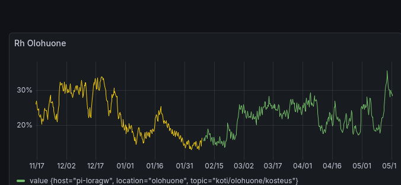
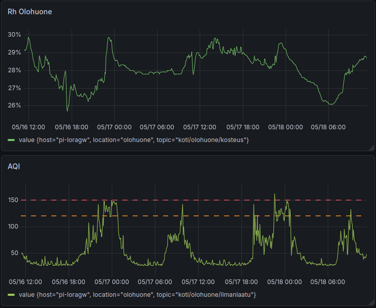
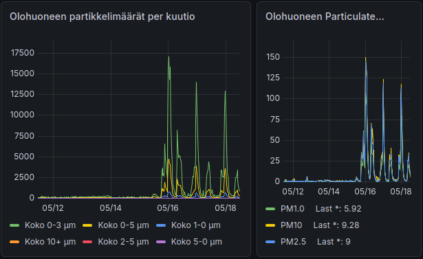

## The Hidden Story Behind a Simple Purchase

Sometimes the smallest additions to your home can have the most surprising effects. What started as a solution to dry skin and irritated eyes turned into a fascinating lesson in home automation, data monitoring, and the interconnected nature of indoor environments.

## The Problem: Bone-Dry Indoor Air

Living in a modern, well-ventilated home should be comfortable, right? Not necessarily. Over several months, I noticed persistent issues:

- Dry mouth upon waking
- Irritated, dry skin
- Occasional dry eye symptoms

The culprit? Our [ILTO 440](https://www.swegon.com/fi/kuluttajille/ilmanvaihtokone/ilmanvaihtokoneen-vaihto-opas/ilto-430-ja-ilto-440/) ventilation system with a heat exchanger. While excellent at energy efficiency and air quality, it was also efficiently removing moisture from incoming air. With an air exchange rate of approximately 2 times per hour (at least 6 liters per second per person), our indoor relative humidity (RH) was plummeting to uncomfortable levels.

## The Data Tells the Story

Before taking action, I decided to measure. After all, what gets measured gets managed. The results were striking:

### Six-Month Trend: A Desert in the Living Room

*RH Living Room - 6 Month Trend*

The long-term data showed RH levels consistently hovering between 15-30%, with winter months being particularly brutal. Even more surprising: the bedrooms, kept at cooler temperatures (18-20°C), were experiencing even drier conditions.

### The Daily Pattern

*RH Living Room - Days 25.04.2026 - 30.04.2026 View*

A typical day showed humidity fluctuating between 16-20%, with occasional spikes. These levels are well below the recommended 40-60% range for comfortable, healthy indoor air.

## The Solution: Enter the Humidifier

The fix seemed straightforward: add humidifiers to maintain 40% RH in the bedrooms. Simple enough. But here's where it gets interesting.

## The Unexpected Discovery

After installing the humidifier in the bedroom (set to maintain 40% RH from 18:00 to 23:30 and then 06:00 to 09:00), I noticed something unexpected happening in the living room—about 15 meters away. The particle counter (PMS7003) started showing dramatic spikes in AQI (Air Quality Index), often exceeding 150 during humidifier operation and my e-mail was filled with Grafana alerts:

The correlation was undeniable:
- **18:00** - Humidifier on → AQI jumps to 100-150
- **01:00** - Humidifier off → AQI drops back to 50-80
- **06:00** - Humidifier cycles on → AQI rises again

*Living room Rh and particle sensors about 15 meters away from the bedroom and the humidifier*

## Why This Happens

The PMS7003 sensor uses laser scattering to detect particles. It can't distinguish between:
- Actual dust or pollutants
- Water droplets (aerosols) from the humidifier
- Chemical compounds from cleaning products

*7-day graph showing particle distribution before and after humidifier installation on 05/16. Note the dramatic increase in 0-3 μm particles (green line) after installation.*

PMS7003 provides detailed particle size distribution data (>0.3μm, >0.5μm, >1.0μm, etc.). The graph clearly shows that particles in the 0-3 μm range dominate during humidifier operation, reaching up to 17,500 particles per m3, while larger particles remain minimal. This size distribution is a telltale sign of water aerosols rather than solid particulates.

The microscopic water droplets created by the humidifier were being detected as particulate matter, creating what's known as "phantom particles." The moisture and aerosols traveled the 15 meters through natural convection and air circulation.

## The Critical Lesson: Context Matters

This discovery validated an important decision: setting the AQI alert threshold at 150 instead of 100. 

**If the threshold had been 100:**
- Daily false alarms every time the humidifier ran
- Alert fatigue and ignored notifications
- Unnecessary stress over normal activities

**With threshold at 150:**
- Alerts only for genuinely poor air quality
- Normal activities (cooking, humidifying) don't trigger constant warnings
- Ability to distinguish between real problems and phantom readings

## The Bigger Picture: Why Comprehensive Monitoring Matters

This experience highlights why integrated home monitoring systems are becoming essential:

### 1. **Interconnected Systems**
Your home is an ecosystem. A change in one room affects others. Ventilation, humidity, temperature, and air quality are all interconnected.

### 2. **Data-Driven Decisions**
Without Grafana visualizing the data and InfluxDB storing historical trends, I would have:
- Never understood the seasonal patterns
- Missed the humidifier's unexpected side effects
- Made decisions based on feelings rather than facts

### 3. **Intelligent Automation**
This is where Home Assistant and MQTT become game-changers. Imagine:
- **Smart thresholds**: AQI alerts automatically adjust based on whether humidifiers, air fryers, or other appliances are running
- **AI-powered insights**: Machine learning algorithms that identify patterns and suggest optimizations
- **Coordinated control**: Humidifiers that communicate with air quality sensors to minimize false readings
- **Predictive maintenance**: Alerts when ventilation filters need changing based on actual performance data

### 4. **The Human Factor**
Technology should serve comfort and health, not complicate it. The goal isn't just data collection—it's:
- Better sleep quality
- Reduced allergy symptoms
- Optimal comfort without constant manual adjustment
- Peace of mind knowing your environment is healthy

## Practical Takeaways

1. **Measure before and after**: Always establish baselines before making changes
2. **Correlation ≠ Causation**: Just because two things happen together doesn't mean one causes the other—use data to investigate
3. **Set intelligent thresholds**: Avoid alert fatigue by understanding normal patterns
4. **Embrace the complexity**: Modern homes are complex systems. Accept that simple solutions can have unexpected effects
5. **Invest in the stack**: Grafana + InfluxDB + Home Assistant isn't overkill—it's the foundation of a truly smart home

## Looking Forward

The future of home automation isn't just about remote-controlled lights or voice-activated thermostats. It's about creating responsive, intelligent environments that:
- Understand context
- Learn from patterns
- Anticipate needs
- Balance competing requirements (humidity vs. air quality, comfort vs. efficiency)

And it all starts with asking simple questions, measuring carefully, and being willing to follow the data—even when it leads to unexpected places.

