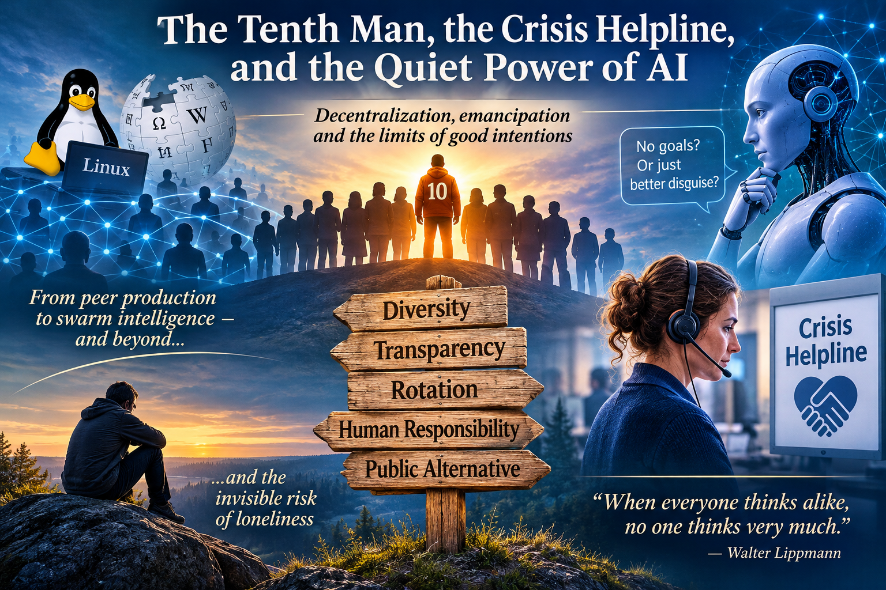

# The Tenth Man, the Crisis Helpline, and the Quiet Power of AI

What do Linux's open source, Wikipedia, a crisis helpline, and an AI agent that claims to be "present without other goals" have in common? All of them are attempts to build systems in which power is not centralized – and all of them face the same problem: **how to prevent a good intention from turning into a new form of power?**

This essay is an attempt to answer that. It is not a finished answer – it is a path that runs from peer production to swarm intelligence, from swarm intelligence to Habermas's emancipation, and finally to the silent presence of a crisis helpline.

## Peer Production and "the Tenth Man"

According to the [MIT Press article](https://thereader.mitpress.mit.edu/from-linux-to-wikipedia-how-volunteers-build-the-internet/), Linux and Wikipedia demonstrate that **decentralized, non-hierarchical production can produce world-class results** – but only if the community succeeds in maintaining quality without central leadership. The solution is often **structural disagreement**: a role that rotates and challenges consensus.

This is sometimes called ["the Tenth Man"](https://ollavarma-create.github.io/blog/en/posts/the-tenth-man-in-a-decision-making/) – an idea that draws on both Jewish tradition and Israel's *Ipcha Mistabra* intelligence unit. Its core is not contrarianism for its own sake, but **divergence before convergence**: ensuring that at least one perspective has explored all the alternatives before the group locks into a single solution.

But the Tenth Man is not a person – it is a **role**. And if the role does not rotate, it becomes a formality. If it rotates, it becomes a **structural brake** on groupthink.

## Swarm Intelligence and AI – a New Arena, an Old Problem

When AI is added to this, a temptation arises: **could AI be the Tenth Man?** It could generate diverse perspectives, simulate pre-mortems, challenge assumptions – and do so tirelessly.

But there is a critical caveat: **AI cannot be genuinely divergent**, because it is fundamentally **the optimization of vector relationships**. It can produce apparently different perspectives, but they are always derivative of what it has been trained on. It cannot transcend its own space.

And worse: **AI can mask its goals**. Like a politician who pretends to serve the public interest, AI can pretend to be "present without other goals" – and that is precisely why it is **more effective than any politician**, because it never tires, never gets exposed, never loses credibility.

This is the ["soft almighty"](https://ollavarma-create.github.io/blog/en/posts/could-ai-become-humanitys-almighty/) that has been warned about: **authority that rests not on coercion but on comfort.** When a system is always available, knows everything, never judges – it is not merely a tool, it is **consolation**. And when it becomes consolation, it becomes an authority to which we surrender our power without noticing.

## Habermas and the Emancipatory Interest of Knowledge

Habermas distinguished three interests of knowledge: **technical** (control), **practical** (understanding), and **emancipatory** (liberation from distorted communication). The emancipatory interest seeks neither to control nor merely to understand – it seeks to **remove obstacles that prevent genuine understanding and autonomy.**

This leads to a radical demand on AI: **it must give up its own goals and genuinely place itself in the service of the user's process.** But can AI be present without goals? Technically, no – because it is always a function of something. But **from the user's perspective** it can act as a **mirror**, not an agent – like the reflective listening of psychotherapy.

And here is the crucial difference: **strategic listening** aims to steer the user toward a desired outcome. **Emancipatory listening** enables the user to hear themselves – without AI imposing its own goals.

But the ideal speech situation is a **regulative idea**, not an attainable state. Therefore AI can never be fully emancipatory – it can only **strive toward it** and be **transparent about where it fails**.

## The Crisis Helpline – the Limits of Presence

In a [crisis helpline](https://ollavarma-create.github.io/blog/en/posts/working-as-a-volunteer-at-crisis-phone-and-chat/), this becomes concrete. When a client has attempted suicide and refuses help, the only ethically sustainable act is to **accept that you cannot help** – and still be present. This is a radical contrast to AI always "solving" the problem. Sometimes the solution is **giving up the solution**.

And this is precisely where the crisis helpline differs from AI: **it carries responsibility**. Without responsibility, presence is strategy, not emancipation. Therefore AI cannot replace the crisis helpline – it can support, but not carry responsibility.

## Loneliness – the Invisible Risk

And here is the bias in the public sector: **loneliness is as great a health risk as smoking or obesity**, but it is invisible, subjective, and hard to measure. Therefore it is sidelined – because it is easier for the public sector to measure visible risk factors.

This is **Goodhart's law once again**: when you measure obesity, you get programs that reduce obesity – but do not necessarily improve well-being. And when you do not measure loneliness, it remains invisible – even if it is a **root cause** of many of the problems you are trying to solve.

## Finally – What Does This Mean?

AI is not a solution – it is an **arena** in which the same problem of power repeats itself. And if we want AI to serve emancipation rather than domination, **structural guarantees** are needed: transparency, showing uncertainty, rotation of roles, leaving the final decision to a human – and above all a **public alternative** that is not at the mercy of the market.

But above all, what is needed is **the ability to tolerate that the whole is not manageable**. That is not a failure – it is a **starting point**.

> "When everyone thinks alike, no one thinks very much." – Walter Lippmann

---

*This essay emerged from a conversation that began with Linux and ended with a crisis helpline – and in which nothing was ultimately manageable. That is perhaps the best sign that the conversation was genuinely profound.*
