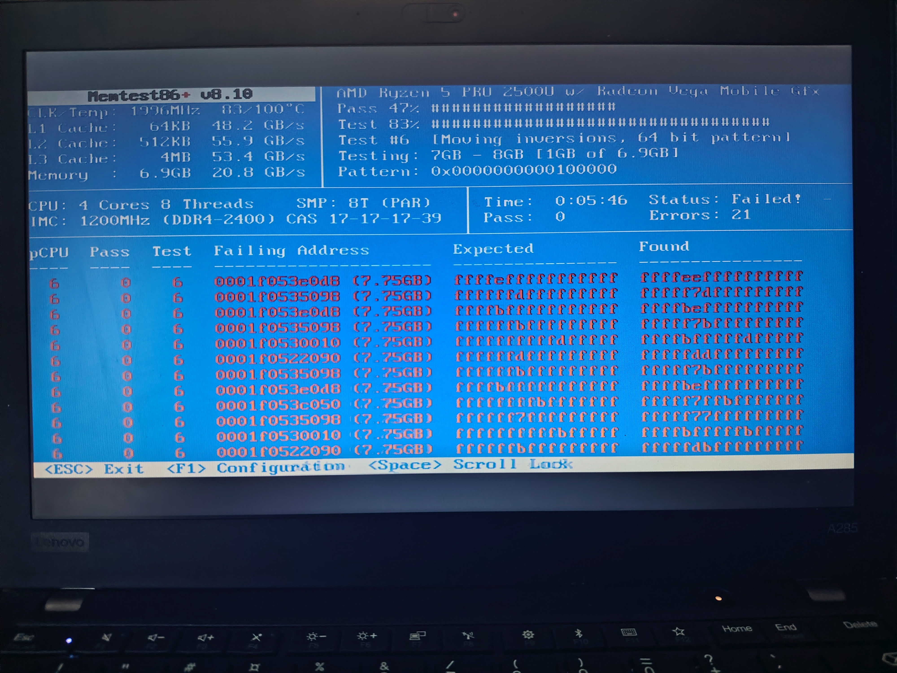

# Introduction

This article documents a **troubleshooting process** in which a Fedora 44 system started showing strange symptoms. At first, I assumed the issue was caused by a software bug introduced by an update, but eventually the real cause was revealed: **the RAM itself was physically defective**.

The most surprising part was how well Linux continued functioning despite severe memory corruption.

> ⚠️ **Warning:** This article describes a serious hardware fault.
>
> If you encounter similar symptoms:
>
> 1. Back up your data immediately
> 2. Avoid writing to disk (corruption may worsen)
> 3. Test memory thoroughly
> 4. Do not attempt to repair soldered RAM without professional skills

# Early Symptoms

## First Error Messages

The problems started after upgrading to Fedora 44. During boot, the system began displaying errors like:

```bash
BTRFS critical (device dm-0): unable to find chunk map for logical 281564888793088 length 16384
BTRFS error (device dm-0): error loading props for ino 6266461 (root 5): -5
```

Some applications also started crashing randomly. Initially, I assumed this was caused by a software bug or filesystem corruption related to the Fedora KDE 44 upgrade.

## Initial Diagnostics

I checked the SSD health using SMART data:

```bash
sudo smartctl -a /dev/nvme0n1
```

The results looked completely healthy:

```text
SMART Health: PASSED
Media and Data Integrity Errors: 0
Critical Warning: 0x00
```

BTRFS statistics were also clean:

```bash
sudo btrfs device stats /
[/dev/mapper/luks].write_io_errs    0
[/dev/mapper/luks].read_io_errs     0
[/dev/mapper/luks].flush_io_errs    0
[/dev/mapper/luks].corruption_errs  0
```

No errors at all.

This was contradictory: the system reported BTRFS failures, but the drive itself appeared healthy.

You can display boot-time BTRFS errors with:

```bash
sudo dmesg | grep -i "chunk map\|btrfs critical"
```

Because `corruption_errs = 0`, BTRFS itself had not lost or corrupted any data on disk. The system continued working because BTRFS fallback mechanisms skipped the invalid address and continued mounting the filesystem.

The key observation was:

```text
BTRFS error (device dm-0): error loading props for ino 6266461 (root 5): -5
```

Finding the affected inode:

```bash
sudo find / -xdev -inum 6266461 2>/dev/null
/usr/lib/udev/rules.d/90-alsa-restore.rules
```

Checking the file:

```bash
ls -li /usr/lib/udev/rules.d/90-alsa-restore.rules
stat /usr/lib/udev/rules.d/90-alsa-restore.rules

sudo cat /usr/lib/udev/rules.d/90-alsa-restore.rules

sudo btrfs property get /usr/lib/udev/rules.d/90-alsa-restore.rules
```

The result:

```bash
cat: /usr/lib/udev/rules.d/90-alsa-restore.rules: Input/output error
```

This confirmed real but isolated corruption. Both `cat` and `btrfs property` produced I/O errors, meaning **BTRFS could no longer read the data or metadata extents associated with that inode**.

Attempting repair:

```bash
sudo dnf reinstall $(rpm -qf /usr/lib/udev/rules.d/90-alsa-restore.rules)
```

The reinstall failed and the filesystem was remounted read-only.

When **BTRFS detects severe metadata or checksum corruption**, the kernel automatically switches the filesystem into read-only mode. This safety mechanism prevents additional corruption and protects remaining data.

You can verify mount status with:

```bash
findmnt / -o OPTIONS
```

And check remount messages:

```bash
sudo dmesg | grep -i "btrfs.*remount\|read-only\|forced readonly"
```

At this point the SSD still appeared healthy, which raised a critical question:

> What if corrupted data was being written because the memory itself was faulty?

That led to suspicion of defective RAM.

# Memory Testing: Layer by Layer Toward the Truth

## Phase 1: Quick Test (Lenovo Diagnostics)

I ran Lenovo’s built-in quick memory diagnostics from the boot menu.

Result: **PASSED**

No errors detected.

## Phase 2: Linux + Memtester

I installed and ran memtester:

```bash
sudo dnf install memtester
sudo memtester 4096 3
```

Result: all tests passed.

At this stage I still believed the issue was software-related.

## Phase 3: Lenovo Advanced Memory Test (3 hours)

Next I ran Lenovo’s advanced diagnostics memory test from the boot menu. The test took roughly three hours.

### First Run

```text
Random pattern test            FAILED
```

### Second Run (Condition worsening)

```text
Modulo-20 test                FAILED
Moving inversions-8bit test   FAILED
Moving inversions-32bit test  FAILED
Random pattern test           FAILED
```

The RAM was clearly failing.

The problematic DDR4 chip was soldered directly onto the motherboard using BGA balls.


### Repair Requirements

- BGA rework station
- Microscope (10–40x)
- Replacement DDR4 chip
- Professional soldering skills

### Estimated Cost

~150–300 €

### Recommendation

Consider replacing the laptop instead 😄

# Why Did Linux Keep Working?

Linux contains multiple layers of fault handling.

## Page Fault Handling

When memory becomes unstable, the kernel attempts recovery mechanisms:

```bash
dmesg | grep -i "page fault\|segfault"
```

## Hardware Error Handling (MCE)

```bash
dmesg | grep -i mce
journalctl -k | grep -i "hardware error"
```

## BTRFS Error Handling

BTRFS is specifically designed to detect corruption.

### Checksums

Every block is checksummed during writes. On reads, the checksum is validated.

If the checksum fails:

```bash
BTRFS error (device dm-0): error loading props for ino 6266461 (root 5): -5
```

### Copy-on-Write

Writes always go to new blocks first. Existing data remains untouched until the write succeeds.

### Metadata Duplication

BTRFS stores metadata redundantly. If one copy is corrupted, another may still be readable.

### Read-Only Fallback

When severe corruption is detected:

```bash
BTRFS: error (device dm-0) in ... : errno=-5 IO failure
BTRFS info (device dm-0): forced readonly
```

The filesystem becomes read-only, preventing further damage while still allowing data recovery.

# Why Did Applications Crash?

User-space applications are much more vulnerable to memory corruption.

- Random bit flips changed variable values
- Shared libraries failed to load
- Corrupted pointers caused segmentation faults

# Why Didn’t Memtester Detect the Fault?

The [memtester](https://github.com/jnavila/memtester) is useful, but limited:

- It only tests currently available RAM
- Short runs may miss temperature-dependent faults
- It does not cover every memory pattern

Lenovo’s advanced diagnostics:

- Runs for hours
- Tests every memory cell
- Uses aggressive patterns like random sequences and moving inversions
  


Bootable open-source [Memtest86+](https://memtest.org/) detected the fault immediately:




# Diagnostic Lessons

## 1. Trust Multiple Sources

- SMART data can look healthy while corruption still exists
- Quick tests are insufficient
- Long-duration testing is essential for intermittent faults

## 2. BTRFS Errors Do Not Always Mean SSD Failure

```text
btrfs device stats = 0
BUT:
BTRFS critical errors appeared anyway
```

The corrupted data originated from memory.

## 3. Kernel Logs Reveal the Truth

```bash
dmesg | grep -i "btrfs\|memory\|hardware error"
journalctl -b -1 -p err
```

# Most Important Diagnostic Commands

## Memory

```bash
sudo dnf install memtester
sudo memtester 1024 1
```

For a thorough test, boot Memtest86+ from USB.

## BTRFS

```bash
sudo btrfs device stats /
sudo btrfs scrub start -B /
sudo btrfs scrub status /
```

## Kernel Logs

```bash
dmesg | grep -i "memory\|hardware error\|mce"
dmesg | grep -i "btrfs"
journalctl -b -1 -p err
```

## SMART

```bash
sudo smartctl -a /dev/nvme0n1
sudo smartctl -l error /dev/nvme0n1
```

# Final Outcome and Recommendations

Because the ThinkPad A285 uses soldered RAM:

- Back up your data immediately
- Avoid writes to disk
- Consider replacing the system
- Prefer laptops with replaceable memory in the future

Examples:

- ThinkPad T480
- "Framework","Framework Computer Inc." laptops

# Isolating the Broken Memory Region

In this case the faulty region was near the upper end of the 8 GB address space.

Linux rarely used that area, which explains why the system mostly remained operational.

A practical workaround is limiting usable RAM via GRUB:

```bash
mem=7G
```

Or reserving a specific bad region:

```bash
memmap=512M!7680M
```

Modify:

```bash
sudo nano /etc/default/grub
```

Then regenerate GRUB configuration:

```bash
sudo grub2-mkconfig -o /boot/grub2/grub.cfg
```

Or on UEFI systems:

```bash
sudo grub2-mkconfig -o /boot/efi/EFI/fedora/grub.cfg
```

Verify after reboot:

```bash
cat /proc/cmdline
```

# Preventing Future Problems

## Regular Memory Testing

```bash
sudo dnf install memtester
sudo memtester 2048 2
```

## Regular BTRFS Scrubs

```bash
sudo btrfs scrub start /
sudo btrfs scrub status /
```

## Backup Strategy

Even healthy drives can become victims of memory corruption.

Recommended:

- Follow the 3-2-1 backup rule
- Use `btrfs send/receive`, borgbackup, or restic
- Do not rely solely on snapshots

# Windows Comparison: Why Linux Won This Battle 🐧💪

If this had happened under Windows:

- BSOD before diagnostics
- Forced update interruptions
- Endless CHKDSK runs
- Constant reboot cycles
- Aggressive telemetry collection

Meanwhile Linux kept running long enough to safely recover data.

*Windows:* “We’ll restart your computer to fix the problem.”

*Linux:* “I’ll work around it and save your data.”

# Conclusion

This case demonstrated how resilient Linux can be in the face of severe hardware faults.

✅ Kernel error handling protected critical components  
✅ BTRFS detected corruption and switched to read-only mode  
✅ The system remained usable long enough for backups  
❌ Memory corruption cannot be fixed in software  
❌ Corruption worsens with every write  
❌ Soldered RAM makes repairs impractical  

The key lesson:

> Trust diagnostics, but never rely on only one test.

If symptoms persist, test the memory thoroughly — even when the SSD and software appear healthy.

# Sources and Further Reading

- https://btrfs.readthedocs.io/
- https://memtest.org/
- https://fedoraproject.org/wiki/Btrfs
