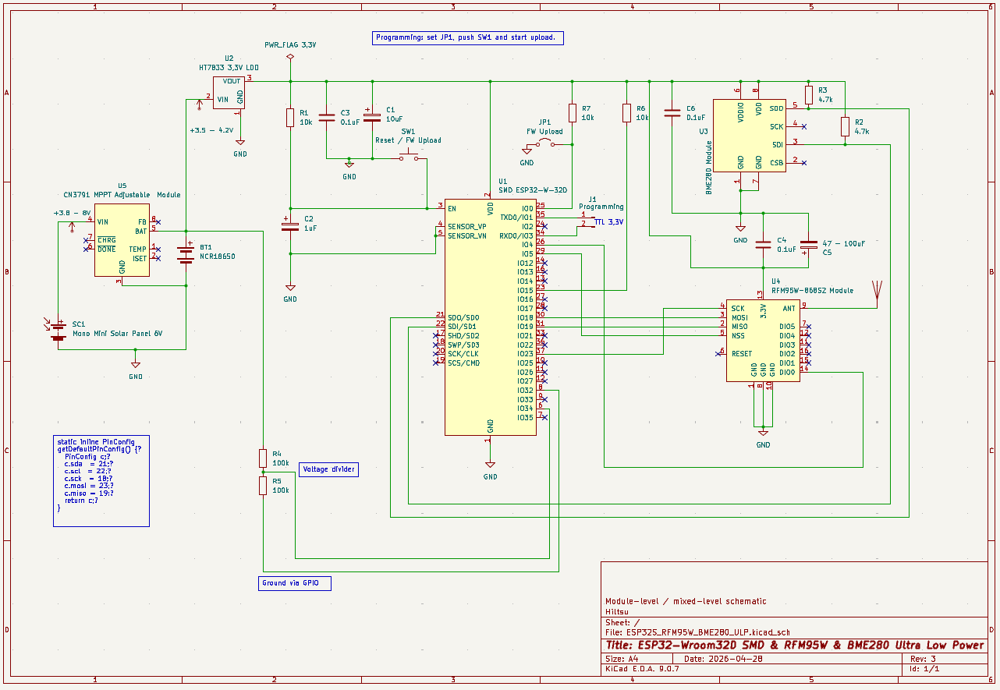
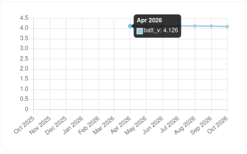
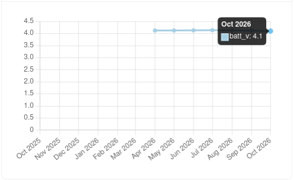
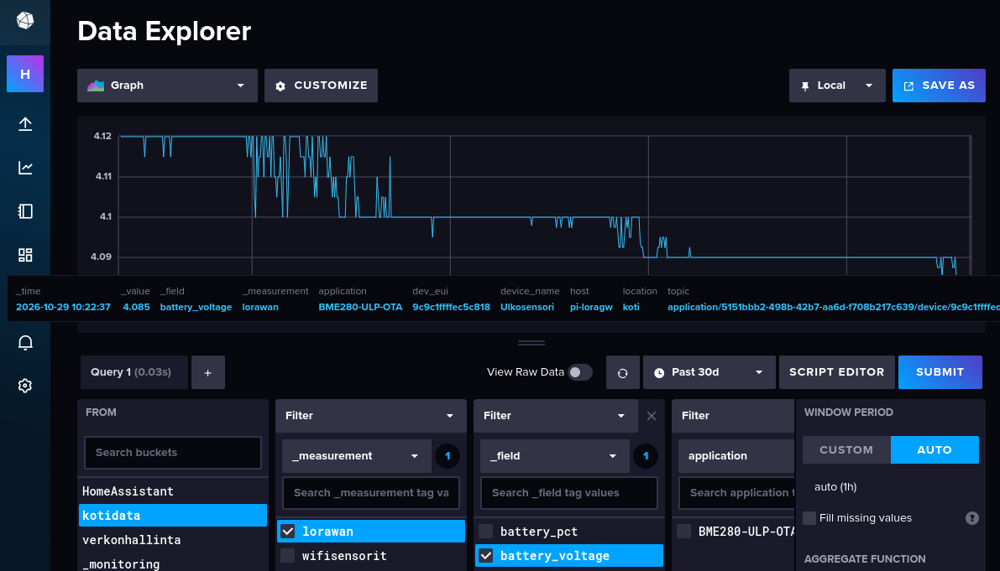
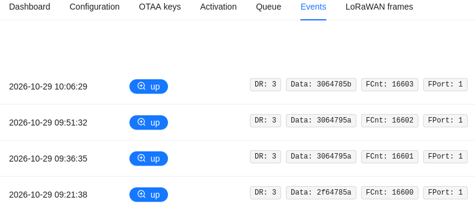

# TL;DR
After six months outdoors, the ultra-low-power ESP32 LoRaWAN sensor is still running reliably on solar power. The battery voltage has dropped only 0.026 V since April, and the frame counter confirms approximately 173 days of continuous 15-minute transmissions.

# Project Description  

I have been transitioning my home automation from self-made asynchronous MicroPython code running mostly on ESP32 MCUs to ESPHome and integrated data in Home Assistant. The MicroPython code sending information over Wi-Fi to an MQTT broker, InfluxDB, and Grafana has been working perfectly since 2016. However, maintaining code, OTA updates, and the power consumption of 2.4 GHz Wi-Fi guided me to seek new approaches, such as Zigbee and LoRaWAN.

I started in December 2025 by purchasing a Raspberry Pi 5 and a Seeed WM1302 HAT. Documentation on how to set up the Raspberry Pi 5 and the WM1302 HAT is available at [GitHub - Raspberry Pi 5 — Dedicated ChirpStack Gateway](https://github.com/ollavarma-create/lorawan/blob/main/Chirpstack/raspberrypi5-chirpstack-dedicated.md) and more in detail at [GitHub - ChirpStack Installation Guide — Raspberry Pi 5 + RAK WM1302](https://github.com/ollavarma-create/lorawan/blob/main/Chirpstack/chirpstack-installation.md). Note: choose the installation method that best suits your needs. From a maintenance standpoint, Docker might be easiest, but it could cause some hardware-related issues that need to be solved. 

Data flowing from ChirpStack can be sent to the MQTT broker, from where Home Assistant can also receive data. Example: [GitHub - MQTT Chirpstack Integration — LoRaWAN Data to InfluxDB](https://github.com/ollavarma-create/lorawan/blob/main/Chirpstack/MQTT_Chirpstack_integration.md).

A 3D enclosure design for the Raspberry Pi 5 and WM1302 HAT, including a parametrized Fusion360 drawing, is available at [Printables](https://www.printables.com/model/1852010-raspberry-pi5-case-for-lorawan-1302-hat) and from [Autodesk](https://a360.co/4tKQ2nZ)

Images of the project execution are at [GitHub -LoRaWAN Project — Image Gallery](https://github.com/ollavarma-create/lorawan/blob/main/IMAGES.md)

The root of the LoRaWAN project repository is at [GitHub](https://github.com/ollavarma-create/lorawan)

## Ultra-Low-Power Outdoor Sensor Design

One of the reasons I wanted to use LoRaWAN was the possibility to design ultra-low-power sensors. I designed an ESP32 sensor that activates every 15 minutes, sends data to ChirpStack, and then sleeps.

The electrical design is simple:

Files for KiCad are available from [GitHub](https://github.com/ollavarma-create/lorawan/tree/main/ESP32/ULP%20Electrnic%20Design) and the PlatformIO code from [GitHub](https://github.com/ollavarma-create/lorawan/tree/main/ESP32/PlatformIO/Temp_Moisture_Pressure) (check the platformio.ini file and src path for the source codes).

From an ultra-low-power design standpoint, it is important to keep the LoRaWAN frame as short as possible. For BME280 sensor accuracy, integer values are sufficient. The LoRaWAN payload format is (4 bytes):

| Byte | Field | Encoding |
|---|---|---|
| 0 | Temperature | value + 40 (covers −40…+85 °C) |
| 1 | Humidity | 0–100 % |
| 2 | Pressure | value − 900 (covers 900–1060 hPa) |
| 3 | Battery | 0–100 % |

The frame will be decoded at ChirpStack with the [chirpstack_decoder_v2.js](https://github.com/ollavarma-create/lorawan/blob/main/Chirpstack/Tenants/Device%20profiles/chirpstack_decoder_v2.js)

The frame can also be used for downlink, such as setting the ESP32 to OTA update mode. Downlink commands (fPort 1):

| HEX | Action |
|---|---|
| `01 HH LL` | Set sleep time: seconds = HH×256 + LL |
| `02` / `02 MM` | Start OTA mode (MM = timeout minutes, default 5) |
| `03` | Clear pin cache (forces re-probe on next boot) |

For more on sensor OTA updates, see [OTA-Updatable ESP32 LoRaWAN Sensor — User Guide](https://github.com/ollavarma-create/lorawan/blob/main/ESP32/PlatformIO/Temp_Moisture_Pressure/OTA-UPDATE-ESP32_RFM95W_BME280.md)

The outdoor sensor Stevenson Shield 3D design and STL files are available from [Printables](https://www.printables.com/model/1851996-parametric-stevenson-shield-for-esp32-weather-stat) and [Autodesk](https://a360.co/4tpuix3), and explained in more detail in the blog article [Stevenson Shield for ESP32 LoRaWAN Weather Station — Parametric 3D-Printed Enclosure](https://ollavarma-create.github.io/blog/en/posts/stevenson-shield-esp32-lorawan/)

## Half-Year Checkup for the Ultra-Low-Power Outdoor Sensor

Since power-on, the sensor has been running outdoors without errors. From a design standpoint, the BME280 sensor must be positioned inside the Stevenson Shield so that circulating air removes moisture from the sensor. This is important to keep humidity readings reliable.

For better temperature accuracy, a sensor such as the MCP9808 high-precision digital temperature sensor could be used. However, the LoRaWAN payload would then need to be expanded to accommodate temperature decimals, and the decoder on the ChirpStack side would need to be adjusted accordingly.

Example payload with higher accuracy:

| Byte | Field | Encoding |
|---|---|---|
| 0 | Temperature integers | value + 40 (covers −40…+85 °C) |
| 1 | Temperature decimals | 0–99 |
| 2 | Humidity | 0–100 % |
| 3 | Pressure | value − 900 (covers 900–1060 hPa) |
| 4 | Battery | 0–100 % |

The downside is that the longer the payload, the more airtime and power consumption are required.

Looking at the ChirpStack device metrics, we can see that from April 2026 (the first data point since installation), the voltage was 4.126 V:

The solar panel works perfectly fine in Finland in summer because we have almost endless days. However, since midsummer, the days have become shorter and less light is available until the turning point on December 21st. Today, October 28th, the battery voltage measurement in ChirpStack has dropped to 4.1 V, meaning that over approximately six months, the battery voltage difference is only 0.026 V. This variation could partly be related to cloudiness as well.

This information can be verified from InfluxDB as well, and we can see that the drop seems to have occurred in the past 30 days.

This makes sense because October is darker, and the past days have been cloudy and rainy.

The next six months will be the most interesting: if the voltage drops by about 0.1 V each month, how long can my ultra-low-power ESP32 run on an 18650 battery? Most likely it will work fine, but we will see the real-world results in April 2027.

Each time the device sends data to ChirpStack, the frame counter (FCnt) increases. Currently, FCnt is 16603, which means the sensor has woken up 16,603 times at 15-minute intervals. This corresponds to approximately 173 days, or about 5.8 months, which is consistent with the installation date.

## Summary

The ultra-low-power ESP32 LoRaWAN sensor has performed reliably outdoors for over six months. The solar panel and 18650 battery have maintained a stable voltage, with only a 0.026 V drop since April. The frame counter confirms continuous operation at 15-minute intervals. The coming winter months will provide valuable data on long-term power performance in Nordic conditions.