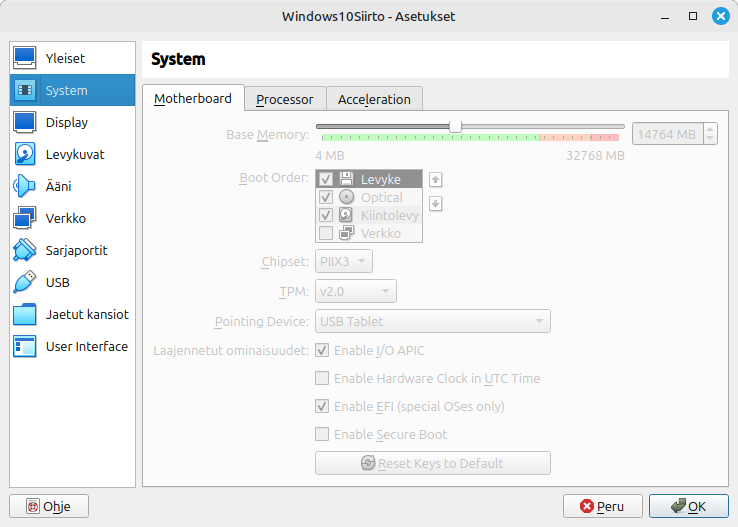
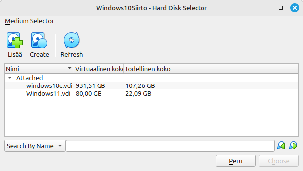
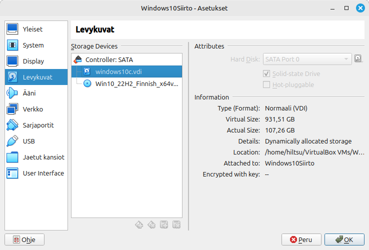
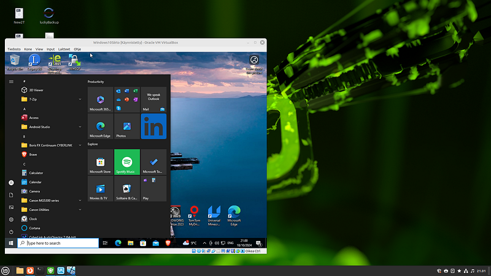
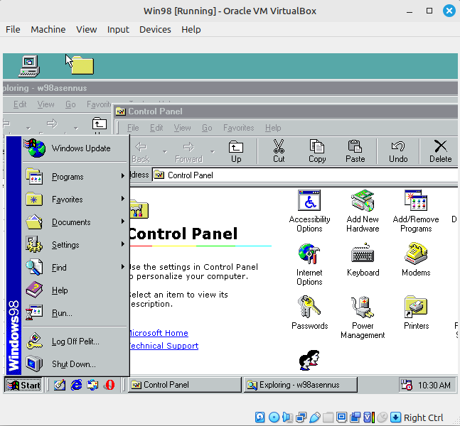
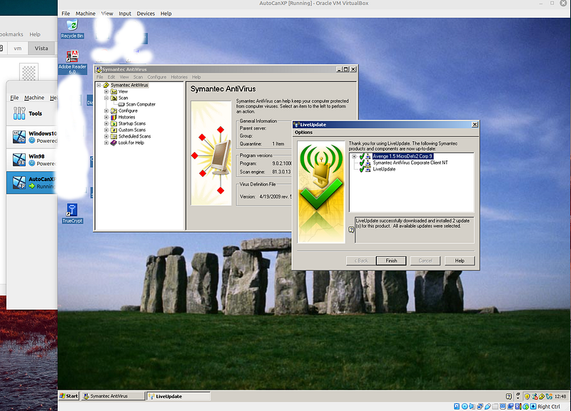
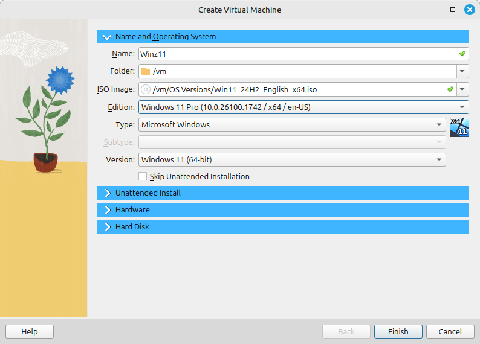
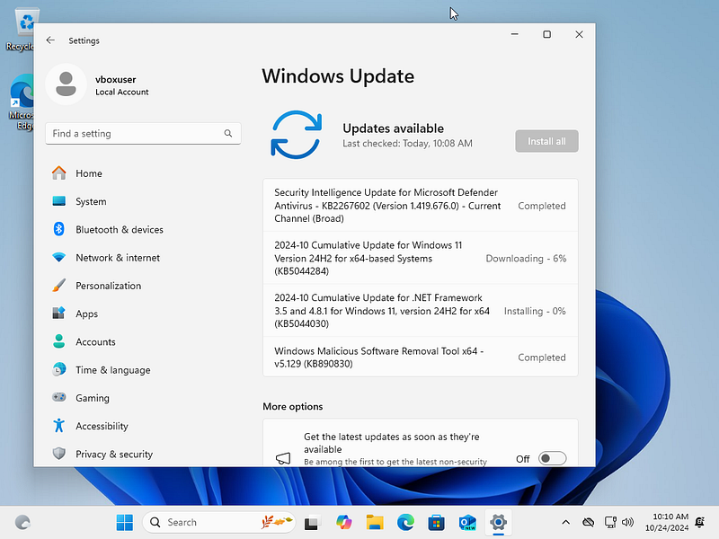

With Windows 10 support ending on **14 October 2025**, I’ve been transitioning all my workstations to Linux Mint Wilma and servers to Ubuntu 24.04 LTS.

---

### How to Move Your Windows 10 Dual‑Boot (UEFI+GRUB) into VirtualBox on Linux Mint 22 / Ubuntu 24.04 LTS

With Windows 10 support ending soon, I’ve been transitioning all my workstations to Linux Mint Wilma and servers to Ubuntu 24.04 LTS. However, I still rely on a few applications like Fusion360 and other CAD software that don’t run smoothly with Wine.

While I initially used a dual-boot setup with GRUB for both Windows and Linux, I realized it would be more efficient to create a VirtualBox image of my Windows 10 installation. This approach not only simplifies switching between systems but also makes backing up Windows much easier by simply exporting the virtual drive.

For Fusion360, which needs Windows and DirectX 12, I have been using VMWare Workstation. You can convert VirtualBox virtual drive to VMWare rather easily. Check my blog about instructions.

---

## Why Move Windows to a VM?

- No more rebooting to switch OS
- Snapshot and backup the entire Windows system easily
- Isolate Windows from your host hardware (drivers, updates)
- Keep using essential Windows‑only apps like CAD software

---

## License Check: Retail vs. OEM (Important!)

Creating an image of the Windows 10 installation and converting it for use in VirtualBox can be a straightforward process. However, it’s essential to consider the potential challenges you may encounter, particularly when dealing with OEM licenses.

Before embarking on this process, I recommend verifying your Windows license type:

- **Retail License**: No issues with activation – you are allowed to move the license.
- **OEM License**: You may encounter problems with re‑activation. The license is **not** movable to another PC (Microsoft considers the VM a “new PC”).

In my experience, Microsoft Support can be slow to assist, or not at all. In my case, the issue was particularly frustrating. When I attempted to reactivate my license through VirtualBox, Microsoft Support seemed uncooperative and unresponsive. They reinstalled Windows, spent an hour remotely troubleshooting, and then claimed they needed to escalate the issue to upper management for a new license key. Unfortunately, that request was never fulfilled. I found out about the support ticket closure from an Outlook spam folder message, which is still puzzling to this day.

Perhaps my Windows license was OEM and it could not be re‑activated anymore. If it was, I wish I knew it before I started this process, or if that was actually the reason the Windows 10 Pro license expired.

> **If you upgrade VirtualBox Guest Additions, Extensions, or VirtualBox itself, Windows may believe the BIOS has changed and treat the updated guest as a new computer.** I updated from VirtualBox 7.0.16 (Ubuntu repo) to 7.1.4 because I had issues with 3D acceleration and the Right Ctrl key. 

When creating a Windows image for VirtualBox, it’s generally recommended to install Windows fresh using the VirtualBox tools. This approach has proven reliable in my experience. After a successful install you can create your own local account and change Windows Autologon (registry key) to that new local account. At minimum, add a password for the `vboxuser` account.

By taking these precautionary steps, you can minimise potential headaches and ensure a smoother transition to VirtualBox.

---

## Cleaning Up Your Windows 10 Installation

A typical Windows 10 installation can take up a lot of space, but your user profile and temporary files often take up even more. To optimise your system for virtualisation, perform the following clean‑up steps:

- Clear all your browser caches and temporary files.
- Uninstall any applications you no longer need.
- Run Disk Cleanup and optimise the disk.

If your `Users\username` folder is particularly large, it’s likely due to files in locations like `AppData`. In this case, it might be simpler to create a new local user account and then delete the old, large profile. Be aware that this will remove all program settings, including stored passwords in browsers and websites.

Make sure you have enough extra hard drive space for creating the system image.

---

## Creating a Disk Image with Disk2vhd

Next, download the [**Sysinternals Disk2vhd**](https://learn.microsoft.com/en-us/sysinternals/downloads/disk2vhd) tool from Microsoft’s support website. Use this tool to create an image of your drives, enabling the **Volume Shadow Copy** option for accuracy. Do **not** enable “Use VHDX” because the image needs to be converted to a VDI file for use in Oracle VirtualBox. (If you already created a VHDX, you can convert it with `vboxmanage clonehd` as well – see the conversion step below.)

---

## Installing and Configuring VirtualBox

VirtualBox is an open‑source type 2 hypervisor that allows you to run virtual machines (VMs) on your host system. It’s a powerful tool for creating and managing VMs, making it possible to run different operating systems, like Windows, on top of Linux without dual‑booting. If you need a type 1 hypervisor and run mostly Linux guests, consider the built‑in type 1 hypervisor, KVM ([Kernel Virtual Machine](https://linux-kvm.org/page/Main_Page)).

Both are free for personal use. For commercial enterprise use of Oracle VirtualBox, see the [licensing terms](https://www.virtualbox.org/wiki/Licensing_FAQ).

To install VirtualBox on your host system (Linux Mint Wilma or Ubuntu 24.04 LTS), run the following commands:

```bash
sudo apt install virtualbox
sudo usermod -a -G vboxusers $USER
```

Once installed, create a new virtual machine for Windows 10. During the setup process, do not create or link a hard drive at this point. Configure the VM settings to your preference, such as adjusting the number of processors and allocating memory.

If your original Windows installation used UEFI boot (whether with or without GRUB), make sure to check the option Enable EFI in the VM settings to match the original boot environment.



Once you’ve created the VM for your Windows installation, the next step is to convert your hard drive image to VDI format.
Converting the VHD File to VDI Format

To convert the VHD file to a VDI file, use the vboxmanage command as follows:

```bash
sudo vboxmanage clonehd DESKTOP-0Q108QU-3.VHD /home/hiltsu/VirtualBox\ VMs/Windows10Siirto/windows10c.vdi --format vdi
```

In this command:

    DESKTOP-0Q108QU-3.VHD is the source file (the one you created with Disk2vhd).

    windows10c.vdi is the target file, located in the folder where you created your Windows 10 VirtualBox.

This process will take some time, and you should see progress percentages (0%, 10%, 20%, etc.) as it runs.

    Note for VHDX files: If you have a VHDX file, the same vboxmanage clonehd command works – just change the extension and optionally add --format vdi.

Once the conversion is complete, add the converted VDI file to your VirtualBox by clicking the green floppy disk icon with a plus sign. This will open the Medium Selector, where you can choose the new VDI file.



You should now see your converted virtual drive listed under Storage Devices. On this screen, you’ll also see the Windows 10 ISO image, which may be necessary if you’re unable to boot due to a GRUB issue or if you need to repair the Windows boot process.



Once you’ve attached your virtual drive to VirtualBox, proceed to check if Windows starts. In my case, the setup was complex, and I was greeted by a GRUB screen with no options. At the GRUB screen, you can attempt to fix the boot by using the fwsetup command and identifying which partition is the correct one in your virtual drive.

Ultimately, I decided to remove the EFI menu and directly fix the boot process.
Removing GRUB and Fixing Windows Boot (Manual EFI Repair)

To recover and fix the Windows boot process, you’ll need installation media. Note that VirtualBox doesn’t support USB boot (tools like plpbt may not detect your USB stick), so you’ll need to download the Windows 10 installation media.

Add the downloaded ISO file in VirtualBox’s Medium Selector as a CD drive (as shown earlier).

Boot into Windows recovery mode and see if Windows can automatically fix the boot issue. If not, proceed with the following steps.

In recovery mode, select Advanced Options, open the Command Prompt, and try these commands:

```bash
BOOTREC /FIXMBR
BOOTREC /FIXBOOT
```

> Note: On UEFI systems, /FIXMBR does nothing because UEFI uses GPT and an EFI system partition instead of an MBR. The commands are harmless, but the real fix is rebuilding the EFI bootloader (next steps).

If you encounter the error “Access is denied,” you’ll need to manually format the EFI partition and create a new EFI setup. Use the following commands:

Open Diskpart:

```cmd
diskpart
```

List the available disks:

```cmd
list disk
```

Identify which disk is your boot disk, typically Disk 0. 

Select the boot disk:

```cmd
sel disk 0
```

List the volumes:

```cmd
list volume
```
Look for the EFI volume, usually between 100–500 MB in size, filesystem FAT32.

Select the EFI volume:

```cmd
select volume 4
```
Replace 4 with the correct volume number from the listing.

Assign a drive letter to the EFI volume:

```cmd
assign letter=V:
```

>Warning: Choose a drive letter that is not already in use (avoid C, D, etc.). V: is usually free.

Exit Diskpart:

```cmd
exit
```

Then format the EFI volume (FAT32 is mandatory for UEFI):

```cmd
format V: /FS:FAT32
```
Rebuild the boot configuration for UEFI:

```cmd
bcdboot C:\windows /s V: /f UEFI
```
At this point, your EFI partition should be properly configured. You can now attempt automatic boot recovery again or retry the BOOTREC commands mentioned earlier.

Once completed, your Windows installation should boot successfully within VirtualBox on your Linux Mint host!



Windows 10 running in Linux Mint Wilma host
Post‑Install: Guest Additions, Shared Folders, Activation

Install VirtualBox Guest Additions (mount the ISO and run the executable). This enables better video performance, seamless mouse integration, and shared folders.

To map drives from Windows to your Linux host, add Shared Folders in VirtualBox settings. They will appear under “Network” in Windows.

Remember to:

- Activate your Windows license again (if needed)
- Remove any display or hardware drivers that are no longer relevant (e.g., GPU drivers for hardware that doesn’t exist in the VM)

Bonus: Old Windows Virtual PC Drives in VirtualBox

If you have old Windows Virtual PC .vhd or .vmdk files, you can convert them into VDI with vboxmanage clonehd or convertfromraw. For example:

```bash
vboxmanage clonehd WindowsXPProfessional-flat.vmdk xpdrivec.vdi --format VDI
```





Bonus 2: VirtualBox and Windows 11 (Fresh Install)

If you want to install Windows 11 fresh, download the media from the Microsoft website.

Create a new virtual machine and remember to select the correct edition (Home/Pro)!



Important for Windows 11: VirtualBox 7.0 and later support TPM 2.0 and Secure Boot. Before installing, go to VM settings → System → Motherboard → Enable EFI (required). Then under System → Processor → Enable PAE/NX. Finally, under System → Security (or TPM), add a TPM 2.0 chip. Without these, the Windows 11 installer will refuse to continue.

The VirtualBox installer automatically creates a vboxuser local account for you. Then perform typical updates, activation, and whatever you wish to do with Microsoft.



Have fun! Your Windows environment now lives safely inside a VirtualBox VM on your Linux host.