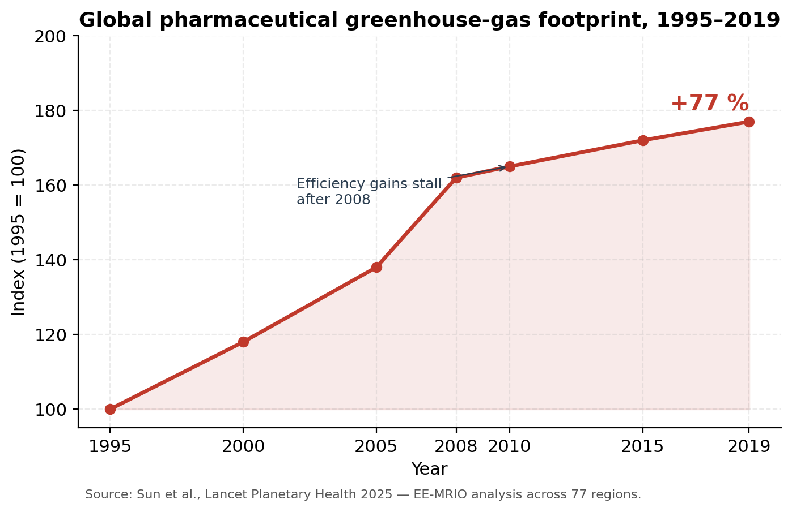
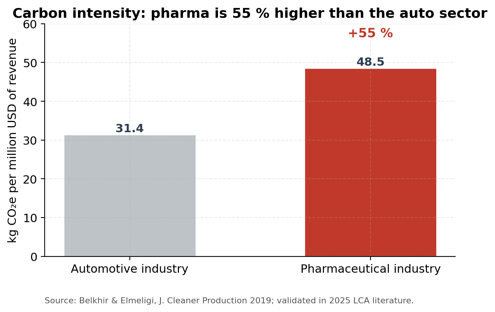
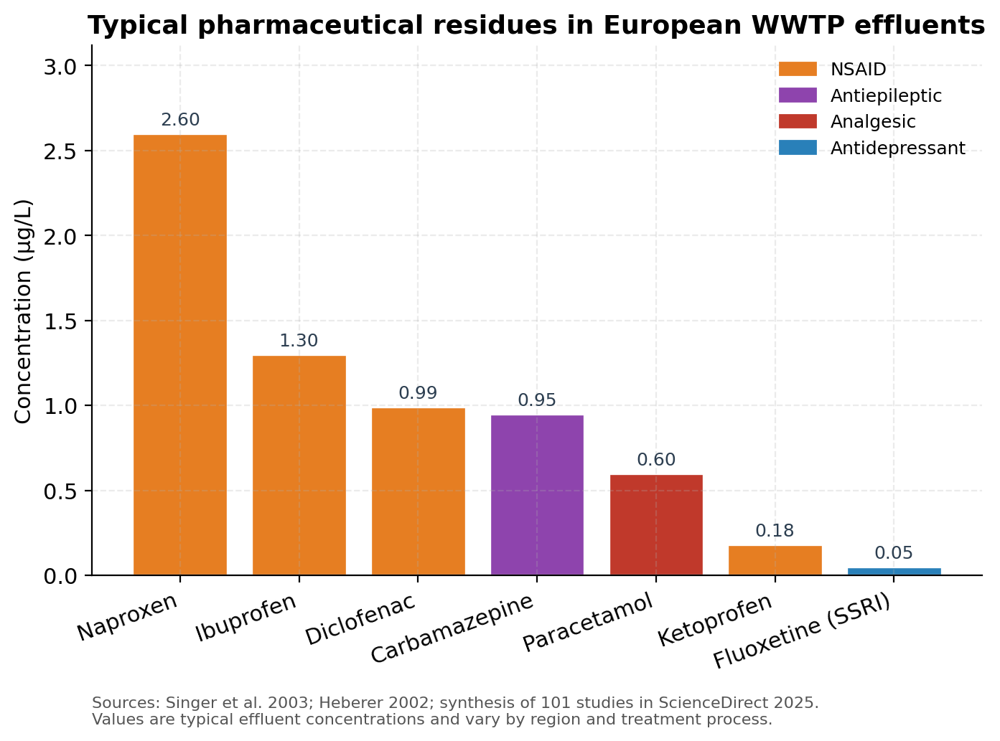
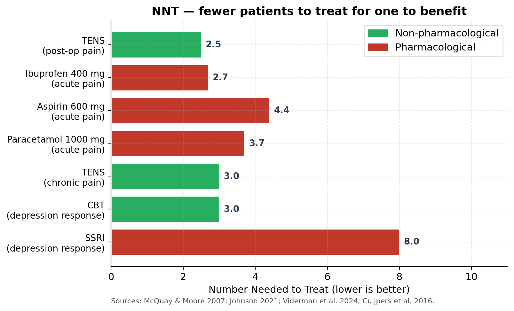

## The pharmaceutical paradox

There is a strange asymmetry at the heart of modern healthcare. We treat pharmaceuticals as the default first response to common conditions — pain, low mood, sleep problems, mild inflammation — even when the evidence for their effectiveness is modest, and even when the environmental cost of producing and excreting them keeps growing. Non-pharmacological alternatives with comparable or better Number Needed to Treat (NNT) values exist for several of these conditions, but they remain niche. This article walks through the data behind that paradox: what pharmaceuticals actually cost the planet, how effective they really are compared to alternatives like Transcutaneous Electrical Nerve Stimulation (TENS), and the structural reasons non-pharmacological options keep losing the policy fight.

## 1. The hidden carbon footprint of modern pharmacology

The pharmaceutical industry is among the most emissions-intensive sectors of the global economy. A widely cited 2019 analysis by Belkhir & Elmeligi found that the industry's carbon intensity — kilograms of CO₂-equivalent per million USD of revenue — was roughly 55 % higher than the automotive sector's, despite the auto industry receiving substantially more public attention for its emissions. That finding has held up. A 2025 input–output analysis published in *The Lancet Planetary Health* covering 77 regions over 1995–2019 reported that the global pharmaceutical greenhouse-gas footprint grew by **77 %** over that period, with efficiency gains stalling after 2008.

In OECD countries, pharmaceuticals are now estimated to be responsible for between 8 % and 25 % of total healthcare-sector greenhouse-gas emissions, and a 2025 study of HIV-medication life cycles by Cornell and the Clinton Health Access Initiative found that switching the energy mix and supply-chain logistics could cut pharmaceutical carbon footprints by up to **45 %** without raising costs. A November 2025 report from Salud por Derecho, released alongside COP30 in Belém, put the same achievable reduction in the **35–40 %** range.

That intensity is driven by three things: solvent-heavy synthesis of active pharmaceutical ingredients (APIs), the long international supply chains that move APIs and finished products between Asian, European, and American facilities, and the high energy demand of the controlled-environment manufacturing (HVAC, cleanrooms, sterilisation). Most generic drugs are made in India, where electricity remains coal-dominant — a structural reason the industry's footprint is harder to bring down than its consumer-facing branding suggests.

## 2. Residues in waterways: the aquatic crisis

Once a drug is consumed, the molecule does not simply vanish. A substantial fraction is excreted unchanged or as bioactive metabolites, passes through wastewater treatment plants (WWTPs) — most of which were designed in the 20th century and were never built to remove pharmaceutical residues — and enters surface water. A 2025 synthesis of 101 peer-reviewed publications across Asia, the Americas, Europe, Africa and Australia confirmed that analgesics and anti-inflammatory drugs are the dominant pharmaceutical pollutants in sewage worldwide.

The numbers are not trace. Naproxen reaches **2.6 µg/L** in WWTP effluent. Ibuprofen hits **1.3 µg/L**, diclofenac **0.99 µg/L**, carbamazepine **0.95 µg/L** (Singer et al., *Environ. Sci. Technol.* 2003 — values reproduced in the 2025 ScienceDirect synthesis). A long-running monitoring programme on the river Rhine has documented carbamazepine and diclofenac in the **hundreds of nanograms per litre** for over a decade, with annual transports measured in tonnes per year and only marginal decreases over time.

A 2025 paper in *Nature Scientific Reports* confirmed that diclofenac concentrations in European groundwaters now exceed Predicted No Effect Concentrations (PNECs) under multiple species-sensitivity scenarios, prompting calls for a formal groundwater Environmental Quality Standard. A 2025 study in the *MDPI International Journal of Environmental Research and Public Health* highlighted that pharmaceuticals are now reliably detected at ng/L to µg/L concentrations in surface waters globally, and that conventional treatment plants were never designed to remove them.

A more unsettling 2025 preprint went further: pharmaceutical residues, even non-antimicrobial ones such as paracetamol, atenolol and ibuprofen, were shown to **shift the composition of wastewater microbial communities and enrich pathogens** of humans, animals and plants. The drugs themselves do not have to be antibiotics to push the microbiome in directions that increase biohazard risk.

## 3. The producing organisms — wildlife collateral damage

The most striking evidence of pharmaceutical pollution is behavioural. A five-year international study led by Monash University and the University of Tuscia, published in the *Journal of Animal Ecology* in 2024, exposed wild-caught guppies to environmentally relevant concentrations of fluoxetine (Prozac, an SSRI). Even at low levels, the antidepressant altered body condition, increased gonopodium size in males, reduced sperm vitality, and disrupted the behavioural plasticity that fish populations rely on to adapt. The team concluded that long-term, low-dose pharmaceutical pollution is fundamentally rewiring fish life history — not just causing acute toxicity.

The same pattern shows up across taxa. A 2024 *Environmental Science & Technology* paper on early-life zebrafish exposed to amitriptyline at environmentally realistic concentrations found altered neurotransmitter profiles and behaviour persisting into adulthood. Sertraline — among the most prescribed SSRIs and one of the most frequently detected in surface water — has been shown to impair neurochemical development in zebrafish at concentrations now common in rivers.

These are not laboratory artefacts. The compounds were designed precisely to interact with conserved monoaminergic systems, which means they act on any animal that has serotonin receptors — which is essentially all vertebrates and many invertebrates. The endocrine-disruption story Fent, Weston and Caminada flagged in *Aquatic Toxicology* in 2006 has matured, two decades later, into a documented threat to wild fish populations across Europe, North America, and Australia.

## 4. The 2024 EU regulatory earthquake

This is the context for what is, quietly, one of the most consequential pieces of environmental legislation of the decade. **Directive (EU) 2024/3019** — the recast Urban Wastewater Treatment Directive — was adopted by the Council on 5 November 2024 and entered into force in January 2025. It replaces Directive 91/271/EEC, which had stood for 33 years.

Three things matter:

First, it mandates a **fourth (quaternary) treatment stage** specifically targeting micropollutants, with a removal efficiency of at least **80 %** for a list of indicator substances — most of which are active pharmaceutical ingredients. The previous directive imposed no quaternary treatment requirements at all.

Second, it applies the polluter-pays principle through Extended Producer Responsibility: pharmaceutical and cosmetics companies must collectively cover **at least 80 %** of the cost of removing the micropollutants their products generate. The Commission estimates that pharmaceuticals and cosmetics together represent roughly **90 %** of the urban-wastewater micropollutant load that requires this advanced treatment.

Third, it requires WWTPs to reach **energy neutrality by 2045**, lowers the population-equivalent threshold for treatment requirements (from 2,000 to 1,000), and introduces stormwater management plans for large cities.

The political signal is unmistakable: the cost of pharmaceutical environmental externalities, which previously fell entirely on water utilities and downstream ecosystems, is being internalised. A May 2025 European Parliament question raised concerns that complying with the new rules could increase the production cost of low-margin generics like metformin by up to 445 %, illustrating just how undervalued these externalities had been.

## 5. Effectiveness — the NNT reality check

Environmental cost is one side of the equation. The other is whether the drugs actually deliver the benefit that justifies the cost. The Number Needed to Treat (NNT) — the count of patients who must be treated for one to gain a clinically meaningful benefit over placebo — is the cleanest yardstick we have. Lower is better.

The data, drawn from McQuay & Moore's foundational 2007 BJCP overview, Johnson's 2021 comprehensive TENS review in *Medicina*, Viderman et al.'s 2024 meta-analysis in the *Journal of Clinical Medicine*, and Cuijpers et al.'s 2016 meta-analysis on psychotherapy, tell a consistent story:

- **Ibuprofen 400 mg** for acute pain: NNT ≈ 2.7
- **TENS** for postoperative pain (40-study meta-analysis, 2024): pooled effect equivalent to NNT ≈ 2.5 (SMD −0.51 at rest, −1.28 during coughing)
- **Paracetamol 1000 mg** for acute pain: NNT ≈ 3.7
- **TENS** for chronic pain (pooled): NNT ≈ 3
- **Aspirin 600 mg** for acute pain: NNT ≈ 4.4
- **CBT** for depression response: NNT ≈ 3
- **SSRIs** for depression response: NNT ≈ 7–10

Three observations follow. First, paracetamol — the most-prescribed analgesic in the OECD — is **not** the most effective pharmacological option. Ibuprofen consistently outperforms it. Second, a 2016 systematic review (Ennis, *Basic & Clinical Pharmacology & Toxicology*) and a 2022 Cochrane synthesis found that paracetamol is essentially **ineffective** for chronic low back pain, despite its first-line status in clinical guidelines. A 2025 Swiss randomised trial registered in *BMJ Open* is testing whether paracetamol adds any benefit when combined with strong opioids — the hypothesis being explicitly that it does not. Third, TENS is competitive on NNT with the most effective pharmacological analgesics across multiple meta-analyses published in 2024–2025 covering postoperative pain (Viderman et al.), fibromyalgia (García-López et al.), trigeminal neuralgia (2025 BMC Neurology), post-stroke spasticity (2025 systematic review of studies through March 2025), and emergency-department pain management (Ahmed et al., *Cureus* 2024).

The NNH (Number Needed to Harm) picture compounds the asymmetry. TENS has essentially no documented serious adverse events when contraindications are observed (no use over pacemakers, no use during pregnancy without medical advice, etc.). Paracetamol's NNH for acute liver injury at supratherapeutic doses is non-trivial — it is the leading cause of acute liver failure in several Western countries — and the 2024 Mayo Clinic chronic-pain guidance specifically warns about cumulative dosing risks.

## 6. Why non-pharmaceutical alternatives still lose

Given comparable NNTs, lower NNHs, and dramatically lower environmental footprints, why does TENS — and similarly, CBT, exercise therapy, mindfulness-based interventions — remain a marginal recommendation in most clinical pathways? The answer is structural, not scientific.

**Heterogeneous evidence.** Mark Johnson's 2021 *Medicina* review made the point bluntly: after 50 years of research, TENS clinical efficacy remains officially "uncertain" in many guideline reviews — not because TENS does not work, but because trials have used wildly inconsistent stimulation parameters, electrode placements, frequencies, intensities, and pulse widths, making meta-analysis difficult. Pharmaceutical RCTs, by contrast, study a fixed molecule at a fixed dose. The difference is methodological tractability, not therapeutic merit.

**The placebo problem.** It is genuinely hard to blind a TENS trial. Patients can usually tell whether the device is delivering current. Sham TENS designs are imperfect, and Cochrane reviews have therefore tended to downgrade the certainty of evidence even when effect sizes are clinically significant. This is a methodological problem that the pharmaceutical industry largely does not face.

**No commercial sponsor.** Pharmaceutical manufacturers spend an estimated 25–30 % of revenue on marketing and "medical education." A consumer TENS device costing €60–120 produces no recurring revenue stream and no detail-rep visits to GPs. There is no industry actor whose business model depends on TENS being prescribed. The same applies to CBT, exercise therapy, and most physical-medicine interventions.

**Reimbursement asymmetry.** In Finland, Kela reimburses prescribed paracetamol; the patient pays out-of-pocket for a TENS device. The same asymmetry exists across most OECD healthcare systems. From a household-budget perspective, the "cheaper" option is the one your insurance covers — even if its lifetime cost is higher.

**Clinical-training inertia.** Physicians' barriers to adopting evidence-based care follow well-documented patterns (see the 2019 systematic review by Slade et al. in *BMC Musculoskeletal Disorders* using the Theoretical Domains Framework): training gaps, time constraints in consultations, patient expectations of receiving a prescription, and concerns about deviating from established prescribing norms. A 7-minute consultation tends to end in a prescription pad, not a referral to physical therapy.

**Patient framing.** Surveys consistently find that patients perceive a prescribed pill as a "real" treatment and a non-pharmacological alternative as a soft option. This is partly a culture-of-medicine artefact and partly the product of decades of pharmaceutical marketing. Digital symptom-checker pathways such as Finland's OmaOlo currently ask whether pain medication is providing adequate relief, but typically do not surface non-pharmacological alternatives as a peer option — which silently steers the population toward pharmacological framing.

None of these reasons relate to whether the alternative actually works. They are all properties of the system, not of the therapy.

## 7. What a more rational pathway would look like

Several things are now changing the equation. First, the EU Urban Wastewater Directive's polluter-pays principle is going to internalise pharmaceutical environmental costs in a way that has never happened before. Even modest pass-through to consumer prices makes the lifetime-cost comparison between, say, a €100 TENS device and decades of paracetamol/codeine prescriptions look very different. Second, the growth of integrated digital-health pathways and wearable TENS devices — such as smart consumer products that pair an FDA/CE-cleared stimulator with a phone app — solves part of the parameter-heterogeneity problem by standardising delivery. Third, the post-2024 wave of meta-analyses (postoperative pain, fibromyalgia, trigeminal neuralgia, post-stroke spasticity, ED pain management) has materially strengthened the TENS evidence base.

A reasonable health-policy response would include: (a) explicit listing of TENS, exercise therapy, CBT and mindfulness-based interventions as **peer first-line options** in clinical guidelines for the conditions where the evidence supports them, alongside the pharmacological choice; (b) reimbursement parity for non-pharmacological options that meet evidence thresholds; (c) making digital pathways like OmaOlo neutral with respect to therapy class, rather than implicitly anchoring on medication; and (d) reflecting environmental externalities in pharmaceutical pricing, which the EU UWWTD is now beginning to do.

## 8. Conclusion

The numbers do not say "pharmaceuticals are bad." They say something more nuanced: that for several common conditions — chronic pain, mild-to-moderate depression, fibromyalgia, dysmenorrhea, postoperative pain — the dominant first-line pharmacological option is **not clearly superior** to a well-evidenced non-pharmacological alternative on effectiveness, **carries a higher harm profile**, and **comes with environmental costs** that are now large enough to justify dedicated EU-level wastewater legislation. Paracetamol alone generated roughly 22 million euros of reimbursed prescriptions in Finland in 2020, and modelling suggests up to 20 % of that could be substituted by TENS-based pathways for the conditions where Käypä hoito guidelines already endorse it (menstrual pain, low back pain, knee osteoarthritis pain). That is a measurable saving — and it would shrink, not grow, the load on the river Vantaa.

The pharmaceutical paradox is, in the end, a system-design problem rather than a science problem. The science has shifted; the prescribing defaults, the reimbursement codes, and the consultation incentives mostly have not. Closing that gap is policy work, not laboratory work — and the EU's 2024 Urban Wastewater Directive is, encouragingly, the first piece of that policy work to take seriously the environmental side of the ledger.

---

## References

- Ahmed, A., Mojiri, M., Abu Halimah, J., et al. (2024). Evaluating the effectiveness of transcutaneous electrical nerve stimulation in emergency department settings: a systematic review and meta-analysis. *Cureus* 16(7). DOI: 10.7759/cureus.65703
- Aich, U., Polverino, G., Wong, B., et al. (2024). Long-term effects of widespread pharmaceutical pollution on trade-offs between behavioural, life-history and reproductive traits in fish. *Journal of Animal Ecology*. DOI: 10.1111/1365-2656.14152
- Ansar, M. A., van Zelm, R., & Ragas, A. M. J. (2025). Closing data gaps for LCA of pharmaceutical production: estimating energy usage by upscaling laboratory data. *ACS Sustainable Chemistry & Engineering*. DOI: 10.1021/acssuschemeng.5c04708
- Belkhir, L., & Elmeligi, A. (2019). Carbon footprint of the global pharmaceutical industry and relative impact of its major players. *Journal of Cleaner Production*, 214, 185–194.
- Brodin, T., Fick, J., Jonsson, M., & Klaminder, J. (2013). Dilute concentrations of a psychiatric drug alter behavior of fish from natural populations. *Science*, 339(6121), 814–815.
- Cochrane (2022). Paracetamol: widely used and largely ineffective. Cochrane UK.
- Cuijpers, P., Karyotaki, E., Weitz, E., et al. (2016). The effects of psychotherapies for major depression in adults on remission, recovery and improvement: a meta-analysis. *Journal of Affective Disorders*, 202, 16–24.
- Directive (EU) 2024/3019 of the European Parliament and of the Council concerning urban wastewater treatment (recast). OJ L, 12.12.2024.
- Ennis, Z. N., Dideriksen, D., Vægter, H. B., et al. (2016). Acetaminophen for chronic pain: a systematic review on efficacy. *Basic & Clinical Pharmacology & Toxicology*, 118(3), 184–189.
- Estrada-Almeida, A. G., Castrejón-Godínez, M. L., Mussali-Galante, P., et al. (2024). Pharmaceutical pollutants: ecotoxicological impacts and the use of agro-industrial waste for their removal from aquatic environments. *Journal of Xenobiotics*, 14(4). DOI: 10.3390/jox14040082
- Fent, K., Weston, A. A., & Caminada, D. (2006). Ecotoxicology of human pharmaceuticals. *Aquatic Toxicology*, 76(2), 122–159.
- García-López, H., Calle-Ortega, F., García-Robles, P., et al. (2024). Effectiveness of transcutaneous electrical nerve stimulation in fibromyalgia syndrome: a systematic review with meta-analysis. *Disability and Rehabilitation*, 46(26), 6323–6333.
- Giunchi, V., et al. (2025). Narrative review on the environmental impact of medicines. *Frontiers in Drug Safety and Regulation*. DOI: 10.3389/fdsfr.2025.1681648
- IQVIA Institute (2024). The Global Use of Medicines 2024: Outlook to 2028.
- Johnson, M. I. (2021). Resolving long-standing uncertainty about the clinical efficacy of TENS to relieve pain: a comprehensive review of factors influencing outcome. *Medicina*, 57(4), 378.
- Käypä hoito -suositukset (2012, 2014, 2015, 2019). Finnish current care guidelines on TENS for menstrual pain, knee osteoarthritis, chronic low back pain, and MS-related pain.
- McQuay, H. J., & Moore, R. A. (2007). Dose–response in direct comparisons of different doses of aspirin, ibuprofen and paracetamol in analgesic studies. *British Journal of Clinical Pharmacology*, 63(3), 271–278.
- Meghea, I., Stefan, D. S., Ioniţă, F., et al. (2025). An integrative approach to hazardous effects caused by pharmaceutical contaminants on aquatic effluents. *Molecules*, 30(17). DOI: 10.3390/molecules30173483
- Salud por Derecho (2025). *Decarbonizing Pharma: A Climate-Conscious Approach to Pandemic Preparedness*. COP30 release, November 2025.
- Singer, H. P., Müller, S. R., et al. (2003). Occurrence and fate of carbamazepine, clofibric acid, diclofenac, ibuprofen, ketoprofen, and naproxen in surface waters. *Environmental Science & Technology*, 37(6), 1061–1068.
- Sun, Y., et al. (2025). The greenhouse-gas emissions of pharmaceutical consumption and production: an input–output analysis over time and across global supply chains. *The Lancet Planetary Health*. DOI: 10.1016/S2542-5196(25)00028-2
- Vance, C., Rakel, B., Dailey, D., & Sluka, K. (2015). Skin impedance is not a factor in transcutaneous electrical nerve stimulation effectiveness. *Journal of Pain Research*, 8, 571–580.
- Viderman, D., Nabidollayeva, F., Aubakirova, M., et al. (2024). The impact of transcutaneous electrical nerve stimulation on acute pain and other postoperative outcomes: a systematic review with meta-analysis. *Journal of Clinical Medicine*, 13(2), 427.
- ScienceDirect synthesis (2025). Global pharmaceutical pollution in waterways: insights from sewage treatment point sources. *Environmental Advances* / *Heliyon* family.
