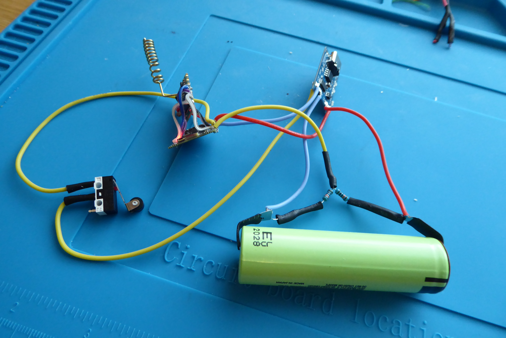
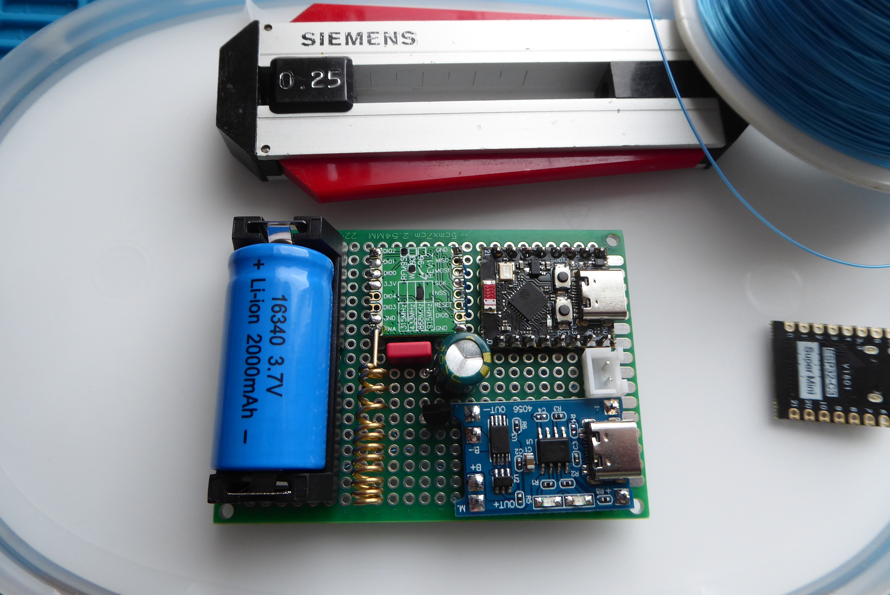

# LoRaWAN Mailbox Alert with ESP32-C3 SuperMini

## Project Overview

A battery-powered mailbox opening detection and alert system that utilizes LoRaWAN technology for long range and low power consumption. The system consists of an ESP32-C3 SuperMini microcontroller, an RFM95W-868S2 LoRaWAN module, and a microswitch.

### Operating Principle

When the mailbox lid is opened, the microswitch is triggered and the ESP32-C3 wakes up from deep sleep. The device connects to the LoRaWAN network and sends an alert to the ChirpStack server. The data then flows through Telegraf into InfluxDB, where Grafana reads it and sends an email notification.

## Technical Specifications

### Hardware Components

- **Microcontroller**: ESP32-C3 SuperMini (RISC-V, Wi-Fi + BLE)
- **LoRaWAN Module**: RFM95W-868S2 (868 MHz, EU frequencies)
- **Battery**: 16340 Li-Ion, 3.7V, 2000mAh
- **Charging Module**: TP4056 Micro-USB 1A
- **Voltage Regulator**: HT7333 LDO (3.3V, 5µA quiescent current)
- **Filtering**: 330µF electrolytic + 0.1µF ceramic capacitor
- **Switch**: Microswitch (attached to mailbox lid)
- **PCB**: 70x50mm perfboard

### Power Consumption and Battery Life

**Estimated battery life (2000 mAh 16340):**

- ESP32-C3 deep sleep: ~43 µA
- HT7833 LDO quiescent current: ~5 µA
- Total standby consumption: ~48 µA

**Active use once per day:**
- Wake-up + LoRaWAN transmission: ~150 mA, 2 seconds
- Daily heartbeat: ~150 mA, 2 seconds

**Average consumption:**
Standby (23h 59min 56s): 48 µA × 86396s = 4147 mAs  
Active (2× 2s): 150 mA × 4s = 600 mAs  
Total per day: 4747 mAs ≈ 1.32 mAh/day

**Estimated battery life:**  
2000 mAh / 1.32 mAh/day ≈ 1515 days ≈ 4.15 years

**Practical estimate:** 2–3 years (considering battery self-discharge and temperature effects)

### PCB Design

The PCB is designed on a 70x50 mm perfboard for easier enclosure integration.

**Component placement:**
- **Top left**: 16340 battery holder
- **Bottom edge**: TP4056 charging module (USB connector facing outward)
- **Top right**: ESP32-C3 SuperMini (USB connector aligned with TP4056)
- **Center**: RFM95W LoRaWAN module with antenna
- **Center**: HT7333 LDO and filtering capacitors (330µF + 0.1µF) before RFM95W power input
- **Center**: 2-pin connector for the microswitch
- **Connections:** 0.25 mm tinned copper wire (trap wire) routed on the underside of the PCB

### Voltage Measurement

Battery voltage is monitored using the ESP32-C3 ADC with a voltage divider:

Battery+ → [100kΩ] → GPIO1 (ADC) → [100kΩ] → GND

This divides the battery voltage in half (max 4.2V → 2.1V), which is safe for the ESP32-C3 ADC.

### Software

**Platform:** PlatformIO (VS Code)

**Libraries:**
- Arduino-ESP32 framework
- LMIC (LoRaWAN) or RadioLib
- ChirpStack-compatible OTAA activation

**Operating logic:**
1. Startup: Check microswitch state
2. If switch is active: Send alert through LoRaWAN
3. Send heartbeat once per day
4. Enter deep sleep
5. Wake-up by microswitch interrupt or timer

**Configuration:**
- LoRaWAN keys (DevEUI, AppEUI, AppKey)
- Transmission frequency and SF (Spreading Factor)
- Deep sleep duration

### Backend System

**Data flow:**

ESP32-C3 → LoRaWAN Gateway → ChirpStack → Telegraf → InfluxDB → Grafana
                                                              ↓
                                                         Email Alert

**Components:**
- **ChirpStack**: LoRaWAN Network Server
- **Telegraf**: Data collection and transformation
- **InfluxDB**: Time-series database
- **Grafana**: Visualization and alerting

### Enclosure Design

**Design tool:** Autodesk Fusion 360

**Key considerations:**
- USB connectors (ESP32 and TP4056) must remain accessible
- Sufficient clearance around the antenna (avoid nearby metal)
- Cable opening for the microswitch wires
- Easy replacement of the 16340 battery
- Outdoor-rated enclosure (minimum IP54)

The enclosure drawings and STL files for 3D printing will be published on [Codeberg](https://codeberg.org/hiltsu/fusion360-piirrokset-3D-tulostusobjektit).

## Installation Instructions

### 1. Hardware Assembly

1. Solder the components onto the PCB using 0.25 mm copper wire
2. Verify that the HT7833 LDO outputs 3.3V
3. Add the 330µF and 0.1µF capacitors before the RFM95W VCC input
4. Solder the 2×100kΩ resistors for battery voltage measurement
5. Test TP4056 operation (red LED during charging)

### 2. Installing Software on the ESP32-C3 SuperMini

```bash
# Clone the repository
git clone https://codeberg.org/hiltsu/lorawan/src/branch/main/ESP32/PlatformIO/PostboxAlarm

# Edit configuration
# - src/config.h: WiFi keys, pins, DevEUI (device MAC), AppEUI, AppKey
# - src/config.h: set debug true

# Build and upload
pio run --target upload
```

> ⚠️ **Note:** Save the device MAC address before configuring ChirpStack!

Check the serial port output while debug is set to true to see the device MAC address. The address is used when registering the device in ChirpStack. After saving the MAC address, set `debug = false` in `src/config.h`.

### 3. ChirpStack Configuration

- Create a Device Profile for the ESP32-C3 (use the MAC address above)
- Add the device using OTAA activation
- Configure the payload decoder (if needed)
- Configure Telegraf integration

### Source Code and Documentation

Complete source code, installation instructions, and configuration files are available on [Codeberg](https://codeberg.org/hiltsu/lorawan/src/branch/main/ESP32/PlatformIO/PostboxAlarm).

## Project Images

A few images from the project. First, the functionality was tested using a simple wire-based setup:


*The first working test setup with an 18650 battery and microswitch.*

After validating the functionality, the next step is enclosure design. A key requirement is separating the microswitch from the electronics section. The microswitch must be adjustable relative to the mailbox lid. The electronics enclosure should also be easily removable for maintenance and attached either with strong neodymium magnets or screws.


*PCB component side: 16340 battery, ESP32-C3, TP4056, RFM95W*


*The solder side of the PCB. “Trap wiring” is an old and reliable way to build prototypes. From an EMI/RF perspective, this kind of layout may not be ideal, but for hobby projects and one-off builds it is perfectly adequate.*

## Future Improvements and Testing

- Add a solar panel for battery charging
- Add a temperature sensor inside the mailbox
- Improve enclosure sealing to IP65
- Verify OTA firmware update functionality (Firmware Over-The-Air)

## Sources and Credits

- ESP32-C3 SuperMini documentation
- RFM95W datasheet
- LoRaWAN project root:
  https://codeberg.org/hiltsu/lorawan/src/branch/main
- ChirpStack installation documentation:
  https://codeberg.org/hiltsu/lorawan/src/branch/main/Chirpstack/chirpstack-installation.md
- ChirpStack configuration documentation:
  https://codeberg.org/hiltsu/lorawan/src/branch/main/Chirpstack/raspberrypi5-chirpstack-dedicated.md
- MQTT integration documentation:
  https://codeberg.org/hiltsu/lorawan/src/branch/main/Chirpstack/MQTT_Chirpstack_integration.md
- HT78XX/HT7333 LDO datasheets (Holtek)

Author: Hiltsu  
License: MIT
