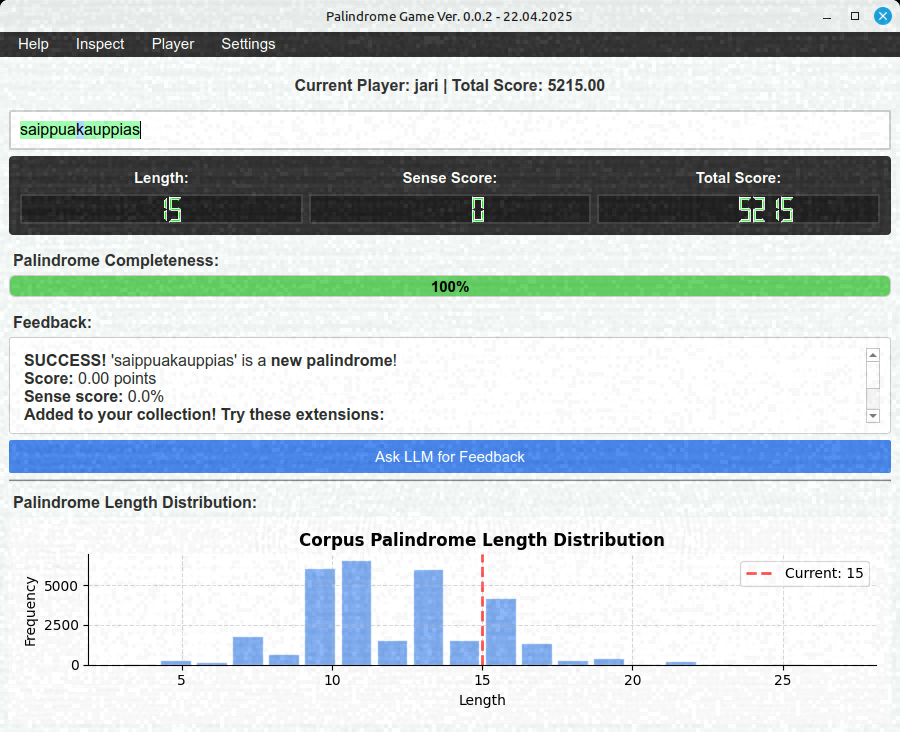
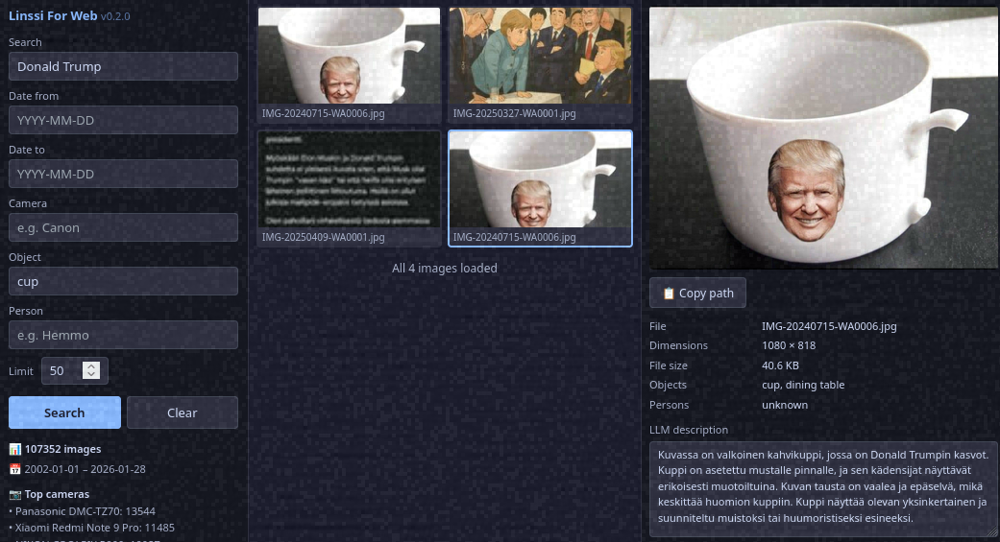
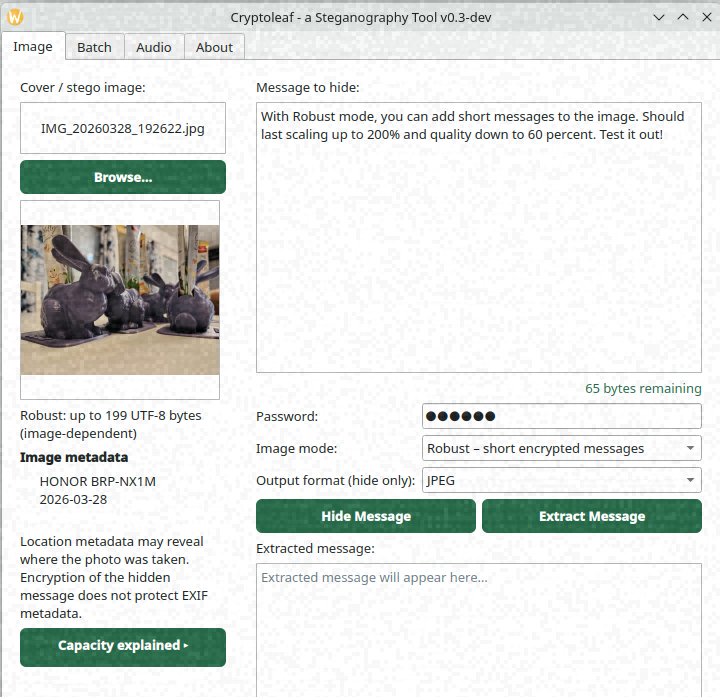
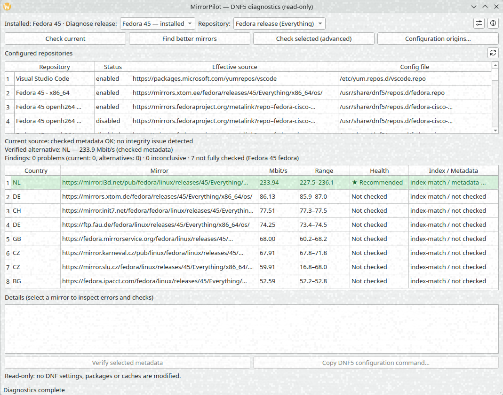
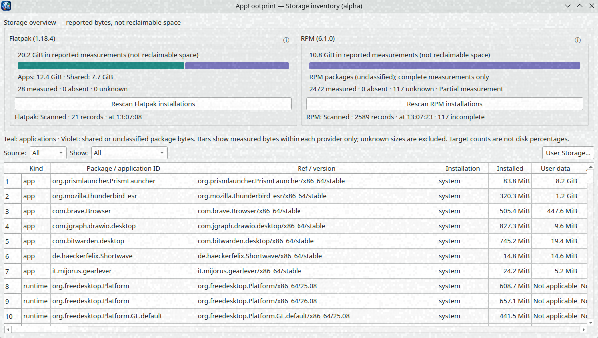
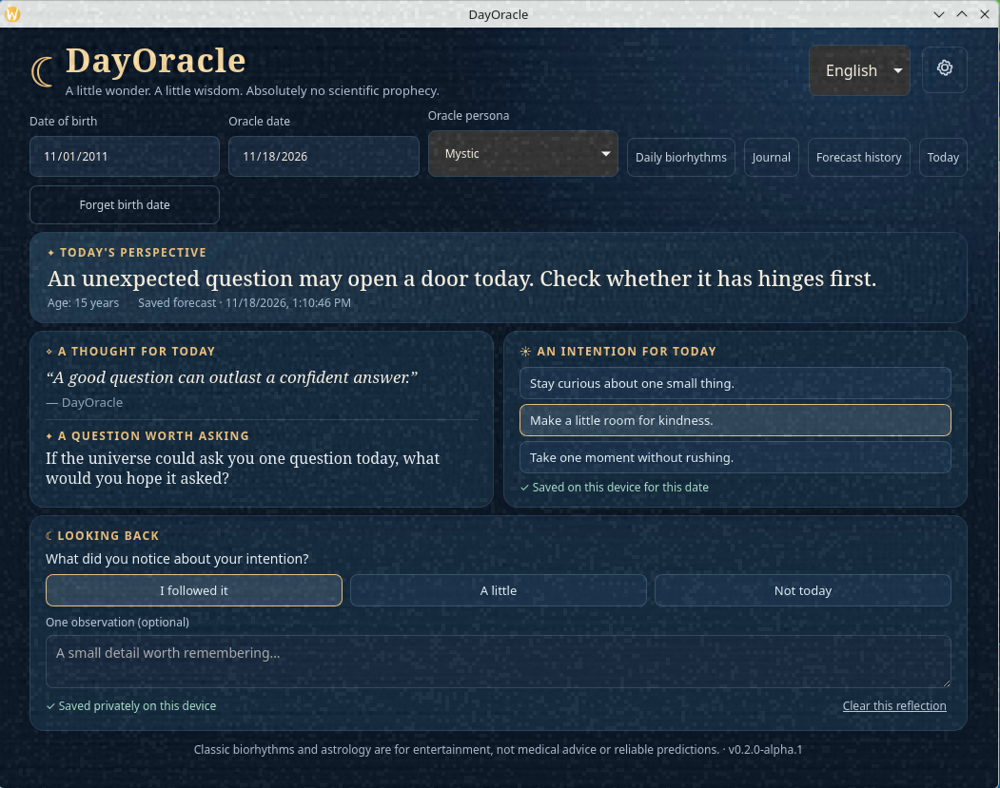

# From Writing Code to Solving Problems – Three Years with LLMs

*In 2023, AI helped me write individual MicroPython functions that I constantly had to fix. In November 2026, I can turn an idea into a working Linux application published on GitHub within a single working day. What happened?*

## It Didn't All Start with ChatGPT

My interest in machine learning began in 2016, when I attended machine learning courses at Åbo Akademi University. In late 2023, I continued my studies at IBM AI Academy.

I started using large language models more actively for programming around 2023–2024. I used ChatGPT and experimented with models available through Hugging Face, as well as TensorFlow-based solutions.

At the time, much of my programming involved IoT devices. I was building sensors based on ESP32 microcontrollers and programming them in MicroPython.

An LLM was an interesting tool, but working with one could be downright frustrating.

It generated code quickly, but the code didn't necessarily work. APIs were invented out of thin air, libraries were assumed to contain functions that didn't exist, and MicroPython's limitations were misunderstood.

Daylight saving time calculations, for example, could become surprisingly difficult. MicroPython didn't offer all the same timezone and date functions as a regular Python environment. Yet an LLM would confidently suggest solutions that simply didn't work in that environment.

Another major problem was context length. In practice, I could often show the model only one module or function at a time. Understanding a larger software system was difficult because important dependencies kept dropping out of the conversation.

Reasoning also had obvious shortcomings.

I remember testing models with a simple question:

**"If there are two fives in ten, how many tens are there in a hundred?"**

The answer is, of course, ten, but models of the time could confuse the mathematical relationships and arrive at a completely wrong answer.

AI could write plausible-looking code, but plausibility did not mean that the code worked.

## In January 2025, AI Still Had Clear Limitations

I recently found a backup of an article I published on Medium on January 15, 2025 (and later deleted), titled **The Year 2024: A Significant Step in Generative AI**. The article is an interesting time capsule. In it, I reflected on developments in 2024 and the effects of language models on creativity, empathy, and the formation of knowledge.

One observation concerned palindromes.

I had developed a Finnish palindrome generator that produced more than 21,000 palindromes by combining programmatic logic and machine learning.

At the time, I considered symmetry a particularly difficult problem for language models. A model might suggest words and structures, but it could not reliably satisfy a palindrome's absolute requirement: the text must read the same forwards and backwards.

The solution was to combine language-model suggestions with deterministic verification.

The older [Palindrome Game](https://github.com/ollavarma-create/palindrome-game) is one continuation of this work.

*The Palindrome Game start screen includes scoring, and an LLM can offer its own assessment.*

I previously published my software on Codeberg as well, but moved back to GitHub because of Codeberg's policies concerning AI use. Consequently, the creation date of a GitHub repository does not necessarily tell you when the application was originally developed.

Today, GPT-6 can handle considerably more complex reasoning tasks. For example, identifying two Finnish words, MINISTERI and KATAINEN, in different reading frames of a DNA-polypeptide sequence puzzle is a very different experience from working with earlier models.

The difference is significant.

But even more interesting is that I can now discuss the structure of a solution, alternatives, and their limitations with a language model.

## Linssi – From a Problem in 2025 to an Application in 2026

In that same January 2025 article, I described a problem for which I hadn't found a satisfactory solution.

I had an enormous collection of photographs taken with digital system cameras. I had organized them mainly by date and camera.

For example, a directory named `20221202 Nikon` might contain dozens or hundreds of pictures, but the filenames said nothing about their content.

I wanted to be able to search for photographs based on what they showed.

I had tried TensorFlow, image recognition, and various models. The results were not good enough, however. A white dog might be identified as a rabbit, and I didn't have enough computing power for a satisfactory solution.

Nor did I want to upload a terabyte of personal photographs to cloud services.

In October 2026, this previously unsolved problem finally received a practical solution.

I developed [Linssi](https://github.com/ollavarma-create/linssi), which uses YOLO object detection, face recognition, EXIF metadata, and a local multimodal language model.

*Searching for “Donald Trump” together with the YOLO-detected “cup” class found the mug.*

The application indexes photographs in an SQLite database and allows them to be browsed and searched by content.

Image analysis runs on my own hardware. I don't need to send my entire photo collection to the cloud.

And most importantly, I still use Linssi.

To me, this is an excellent example of how advances in AI and the surrounding tools can turn a previously difficult idea into something practical.

## GPT-6 – When AI Participates in Solving the Problem

In November 2026, I use OpenAI's GPT-6 for software development.

The change isn't just that the model writes better Python or Rust. More importantly, it has improved in reasoning, understanding larger systems, and proposing alternative implementations.

I no longer need to specify exactly what kind of function should be written.

I can describe the problem, goals, and constraints, then ask the model to consider what solution would make sense.

This leads to an entirely new division of labor in software development.

### CryptoLeaf – When the Problem Is Harder Than Writing the Code

[CryptoLeaf](https://github.com/ollavarma-create/cryptoleaf) is a steganography application designed to hide information in images and audio files.

*CryptoLeaf v0.3-dev image encryption interface.*

The goal sounds simple until you add the requirement that hidden information should survive image processing.

If an image is saved again at lower JPEG quality, resized, or processed by a social media service, its original pixel values change.

Traditional steganography based on the least significant bits of pixels generally cannot survive such changes.

Solving this problem is no longer just about programming. It requires combining image processing, signal processing, error correction, and encryption.

With GPT-6, we have explored methods involving the discrete wavelet transform (DWT), quantization, Fourier-based synchronization, and Reed–Solomon error correction.

I didn't need to know all these methods beforehand to participate in developing the solution.

I explained the outcome I wanted. The LLM suggested methods, implemented them, and helped analyze test results. The tests, in turn, revealed which approaches worked and what their limitations were.

**The LLM no longer merely implements a chosen solution. It can help discover possible solutions.**

[CryptoLeaf v0.3 alpha](https://github.com/ollavarma-create/cryptoleaf/releases/tag/v0.3.0a1) already includes experimental methods for hiding information in ways that can withstand some image transformations. This does not mean that a message will survive every kind of processing, or that the application has undergone an independent security audit.

AI's suggestions remain hypotheses until they have been tested.

> Every image in this blog post contains a short encrypted message. Save one of the images to your computer and open it with CryptoLeaf. Can you recover the hidden text using the password "PublicSecret"?

### When Real-World Testing Revealed a New Problem

While preparing this very blog post, I discovered a problem in CryptoLeaf that had gone unnoticed during earlier testing.

I had mainly tested the experimental Robust DWT method using large photographs taken with a digital system camera. In those images, the changes caused by embedding hidden data were not noticeable to the naked eye. But when I embedded messages into smaller screenshots for this article, the situation changed. Visible noise and patterns appeared across the smooth, light-colored areas.

The issue was therefore not necessarily just image size, but probably also image content. Natural textures in photographs can conceal subtle changes, while the uniform colors of user interfaces make them much easier to spot.

I deliberately decided to leave the processed images in the article. They illustrate why software quality cannot be judged solely by tests performed during development. Real-world use with different kinds of data can reveal problems nobody thought to look for.

**A successful test does not mean that everything important has been tested.**

## When Your Own Problem Inspires an Application

Not all software starts with a grand plan. Sometimes it starts with a simple annoyance.

I use Fedora Linux and have encountered a few problems for which I couldn't find a suitable graphical tool.

Previously, I would probably have looked for answers on forums, tried command-line utilities, and perhaps written a small script.

Now I can develop an entire application.

### MirrorPilot – From Problem to GitHub in a Day

[MirrorPilot](https://github.com/ollavarma-create/mirrorpilot) emerged from problems with Fedora's DNF5 package repository mirrors.

*MirrorPilot has found a faster, more reliable repository mirror.*

I wanted to find out why some mirrors were slow or served incorrect metadata.

Measuring download speed alone wasn't enough. I also needed to verify that repository indexes and the metadata referring to them were consistent.

With GPT-6, I developed a graphical application that examines configured repositories, compares alternative mirrors, and checks selected metadata.

The application doesn't make system changes on the user's behalf. Instead, it offers a checked recommendation that the user can choose to apply.

The first working version emerged in about a day. Since then, we have improved its tests, user interface, and AppImage distribution.

Within a few days, the project became an open-source application that others could try.

### AppFootprint – When I Almost Gave Up on Linux

Another example is [AppFootprint](https://github.com/ollavarma-create/appfootprint).

*The example shows Flatpak and RPM installations. Snap installations are also detected if present.*

My Fedora installation was running out of disk space. Investigating the problem was difficult because, for example, Flatpak applications share runtime dependencies, and disk usage cannot always be inferred from application names or ordinary file listings.

I was seriously considering abandoning Linux.

I also wrote about the experience on my blog: [Saving a Fedora Install from Disk Full Disaster](https://ollavarma-create.github.io/blog/en/posts/saving-a-fedora-install-from-disk-full-disaster/).

Instead, the problem led to a new application.

AppFootprint aims to help users understand where application disk usage comes from, which dependencies applications share, and what to consider before cleaning anything up.

The application is deliberately read-only. It doesn't delete anything automatically.

Here too, the first working alpha was developed in less than a day.

The essential idea behind both projects was the same: **I needed a tool that didn't exist in a form suited to my needs, so we built one.**

## DayOracle – From Idea to Release in One Working Day

Perhaps the clearest example of this new way of developing software is [DayOracle](https://github.com/ollavarma-create/dayoracle).

*A perspective offered by the Oracle.*

On November 17, 2026, at around 10 a.m., I started wondering whether a simple biorhythm application I had previously made for my wife could be developed into something more entertaining.

The idea was to combine positive thinking, daily reflection, philosophy, and playful predictions.

The goal wasn't to create a scientific prediction system. Biorhythms and astrological forecasts are not reliable ways to predict the future.

I wanted to build an application that could offer a fresh perspective on the day or a small thought to reflect on.

The project used Rust, Tauri 2, React, and TypeScript.

**I have never actually learned to program in Rust.**

Yet on that same day, we created a working distributable Linux application with a bilingual interface, biorhythm charts, forecasts offering different perspectives, a journal, local data storage, and an optional encrypted journal vault.

The first public alpha, [DayOracle v0.2.0-alpha.1](https://github.com/ollavarma-create/dayoracle/releases/tag/v0.2.0-alpha.1), was published on GitHub at 5:28 p.m. Finnish time.

So it took about seven and a half hours to go from the morning's idea to a public release.

That was my personal speed record.

You could call this vibe coding.

But I don't mean asking AI to build an application and uncritically accepting whatever it produces.

I define the goal, try the application, assess the user experience, and decide what needs to change.

GPT-6 handles much of the technical implementation, architecture proposals, refactoring, tests, and documentation.

Knowing a programming language is no longer the same obstacle to implementing an idea that it once was.

That doesn't mean programming skills are unnecessary. Their role is simply changing.

## A New Division of Labor: The LLM Codes, the Human Guides and Tests

I've found that my most effective development process at the moment is quite simple.

1. I describe the problem and what a useful outcome would look like.
2. We discuss implementation options and their limitations.
3. The LLM writes or modifies code and proposes tests.
4. I run the program in its real environment, try it out, and provide feedback.
5. We fix problems and, when necessary, revise the original plan.
6. When the result works well enough, we build a distributable package and publish it on GitHub.

We also use GitHub pull requests, automated tests, and continuous integration.

The first version of an application no longer necessarily requires weeks of planning before we can see whether the idea works in practice.

A functional prototype can emerge in hours, revealing things I wouldn't have known to consider during planning.

To me, this fundamentally changes the economics of experimentation.

When testing an idea costs a few hours rather than several months, we can explore far more alternatives.

### When AI Wants to Build a Nuclear Power Plant

Collaboration isn't entirely frictionless, however.

I've noticed that an LLM sometimes has a tendency to go unnecessarily deep into technical details.

For example, tests for saving files can grow into a huge testing framework that covers more and more edge cases, filesystem errors, interruptions, corruption, and recovery scenarios.

At times, it begins to feel as though we're building a nuclear power plant rather than a small desktop application.

Some of these tests are, of course, necessary. Encryption, data integrity, and handling users' valuable files deserve particular care.

But it's equally important to ask:

**Is this relevant to the actual risk, or are we already spending more time building the testing framework than solving the original problem?**

This is where human experience and a sense of the bigger picture remain valuable.

An LLM can suggest technically sound solutions, but it doesn't automatically know how much effort is appropriate for a particular project.

On the other hand, humans must recognize when more rigorous testing proposed by AI is justified and shouldn't be sacrificed for speed.

## Faster Coding Is Not the Same as Better Software

AI can produce code at an astonishing pace.

That doesn't automatically mean the resulting software is secure, maintainable, or ready for widespread use.

There is still a major difference between an alpha release and an application that has been running in production for years.

An LLM can make mistakes even when its reasoning has improved considerably. It can invent nonexistent APIs, misunderstand a requirement, or write a test that reinforces the same mistaken assumption as the code itself.

Security is another issue. Using a well-known encryption algorithm does not, by itself, prove that an entire application is secure.

That's why I consider it important to test AI-generated code in the real environment, assess risks, and document the limitations of published releases.

In my workflow, a human may no longer write most of the source code, but responsibility for the result remains with the human.

## What If the Most Important Skill Is No Longer Coding?

What interests me most about the developments of recent years is what they mean for human creativity.

Previously, implementing a software idea was constrained by available time, knowledge of programming languages, and the amount of technical work involved.

Now I can experiment with ideas I would previously have left unexplored.

I can get to the essential question more quickly: does this application solve a real problem?

But there is a paradox here.

The more code AI writes, the harder it may become for a human to evaluate its correctness, especially when the programming language or technology is unfamiliar.

DayOracle is a good example. I can assess how the application works and how it feels to use, but I couldn't claim to master every detail of Rust.

Automated tests help, but they don't solve the problem completely. If the same LLM writes both the code and its tests, both may rest on the same incorrect assumption.

This raises an interesting question:

**If AI implements the solution and AI also checks it, who checks AI's assumptions?**

This is where human judgment becomes especially important.

It's not enough to know how to ask AI for a solution. We also need to understand what to test, which risks to accept, and when to seek an independent assessment.

### Divergent Thinking and the Limits of AI

Back in January 2025, I reflected in my Medium article on the importance of divergent thinking for AI creativity.

Language models are based on statistical structures learned from data. They often tend to produce coherent, probable answers.

This is useful for many tasks, but it can also lead a model to favor familiar solutions and reinforce an assumption that has already taken hold in the conversation.

Creativity sometimes requires the opposite.

We need to question our starting assumptions, look for unlikely alternatives, and dare to suggest something that doesn't fit the prevailing way of thinking.

This is where I see the most interesting potential of human–AI collaboration.

An LLM can quickly produce a large number of alternatives and evaluate their technical feasibility. A human, meanwhile, can change the framing of the entire problem.

Perhaps the best development process isn't one in which AI does everything as independently as possible.

Perhaps it's one in which the human and AI continually challenge each other's proposals.

## Conclusion

I haven't learned to code ten times faster in just a few years.

Instead, the way software is developed has changed so fundamentally that I no longer need to do all the same things myself.

Programming isn't disappearing. But our relationship with it is changing.

For me, GPT-6 isn't just a code generator. It's a technical collaborator with whom I can explore alternatives, test ideas, and do things that I wouldn't spend months building on my own.

It isn't an infallible expert, however.

Collaboration works best when its suggestions can—and should—be questioned.

And perhaps that's the most interesting aspect of this entire change.

**Previously, I had to ask myself whether I knew how to implement my idea. Today, I can start by asking whether the idea is worth implementing at all.**

---

*Written in November 2026. This article is based on my own software development experiences with OpenAI's GPT-6 and earlier language models. GPT-6 also assisted in writing this article.*

*The source code and development histories of the projects are available in the linked GitHub repositories.*
