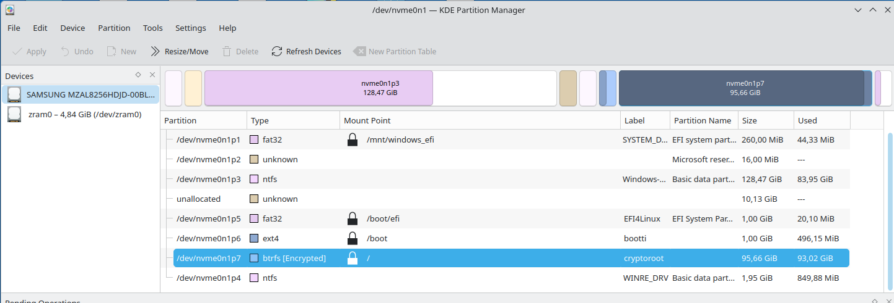
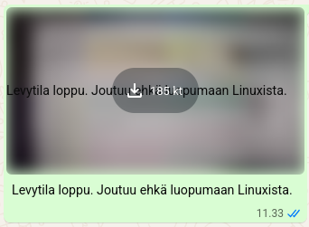

Today, I was ready to give up on Linux.

My dual-boot Windows 11 + Fedora KDE Plasma (Btrfs + LUKS) setup had gone from “comfortable” to “actively hostile.” Less than 13 GB free. Every `dnf update` felt like Russian roulette. The upcoming [Fedora KDE Plasma Desktop 45](https://fedoraproject.org/kde/download/) lists a minimum of 15 GB unallocated drive space for a default installation, and I was staring at the digital equivalent of a closet so full that the door no longer closes.

I tried the classic “shrink Windows, expand Linux” move. The unallocated space politely appeared… right between the Windows NTFS partition and my encrypted Btrfs root. Perfect. Exactly where KDE Partition Manager and a Live USB cannot reach it without heroic (and slightly terrifying) surgery.


*Disk partitions — note the awkward 10 GB unallocated gap sitting between the Windows partition and the Btrfs volume*

So, after booting into a Live USB, the graphical KDE Partition Manager could not expand the Btrfs + LUKS2 encrypted volume. From the CLI I tried:

```bash
sudo cryptsetup resize luks-98b6465c-2a4f-44a8-b133-d11113899495
sudo mkdir -p /mnt/fedora
sudo mount /dev/mapper/luks-98b6465c-2a4f-44a8-b133-d11113899495 /mnt/fedora
sudo btrfs filesystem resize max /mnt/fedora
df -h /mnt/fedora
```

…but no luck. The free space from the Windows shrinkage was too far from the Btrfs volume, so it could not be expanded at all.

Trying to expand a LUKS-encrypted Btrfs root partition into non-adjacent unallocated space is not a task for the faint of heart—especially not when the system is already on its knees. I had already started downloading a Windows 11 ISO, fully prepared to wipe the drive and abandon my Linux journey.

Then I opened a terminal instead.

## The First Suspect: Flatpak

The first place to look was the usual suspect: Flatpak.

```bash
du -sh /var/lib/flatpak
# Output: 41.3 GB
```

A staggering 41.3 GB. The culprit? Not the apps themselves, but the accumulated runtimes and SDKs. Specifically, multiple versions of the GNOME SDK, Freedesktop SDKs, and massive KiCad 3D model libraries I had installed “just in case” months earlier and then forgotten.

By running:

```bash
flatpak uninstall --unused
```

and manually removing the pinned KiCad libraries plus a few old SDKs, I dropped that 41.3 GB down to just 6.4 GB. That was a massive win, but I was still in the danger zone.

## The Second Suspect: The Home Directory

Next, I turned my eye to `/home`. The `.cache` directory was bloated at 10.1 GB. It turned out to be mostly `debuginfod_client` (5.8 GB) and ESPHome build caches (2.5 GB). A quick `rm -rf` on those folders freed up another ~8 GB.

But then I looked at `.config`. It was sitting at 9.5 GB. This was strange. Normally, `.config` is just a few megabytes of text files. What could possibly take 9.5 GB?

```bash
du -sh ~/.config/* 2>/dev/null | sort -rh
# Output: 9.5G /home/jari/.config/mozilla
```

Mozilla? In `.config`?

Ah — Firefox had recently started migrating its profile to `~/.config/mozilla/firefox/` on Linux, adhering to the XDG Base Directory specification. But 9.5 GB for a profile is insane.

## The 9 GB Secret: The Firefox `morgue` Directory

I dug deeper, looking for the biggest folders inside the Firefox profile. What I found was a directory path that sounded like it belonged in a horror movie:

`storage/default/https+++web.whatsapp.com/cache/morgue`

That single directory was 9.0 GB.

### What is a morgue?

In Firefox, the `morgue` directory is part of the QuotaManager. When a website (like WhatsApp Web, which heavily uses IndexedDB and local storage) clears its cache, Firefox doesn’t delete the files immediately. It moves them to the morgue (“graveyard”), waiting for a time when the system is idle to actually remove them from disk.

But sometimes Firefox gets stuck. The website generates new cache faster than Firefox can sweep the graveyard. The morgue grows into a massive black hole, silently eating gigabytes. Because this data is already considered “deleted” by the browser, it is 100 % safe to remove manually.

I closed Firefox and ran:

```bash
find ~/.config/mozilla/firefox -type d -name morgue -prune -exec rm -rf {} +
```

Boom. 9.5 GB down to 397 MB in a split second.



**Note:** Because I deleted these cached files manually, my WhatsApp Web history now shows images and videos as blurred placeholders. Clicking them produces a “metadata missing” error. This happens because Firefox had cached the media files there, and WhatsApp does not automatically re-download them. A small price to pay for saving the OS — but a good lesson: if you care about your chat media, export it from WhatsApp first.

## A Crash in the Midst of Victory

While trying to analyze the disk usage, the KDE tool Filelight crashed with a `SIGSEGV` segmentation fault. I generated a coredump and submitted it to the KDE bug tracker (Bugs: KDE Filelight 26.08.2). It turned out to be a Qt/QQmlDelegateModel rendering issue. Even though it crashed, the command line still gave me exactly the insights I needed to finish the cleanup.

## The Aftermath

By the time I finished, I had cleared a huge amount of pure bloat:

| Location              | Before   | After    | Freed    |
|-----------------------|----------|----------|----------|
| `/var/lib/flatpak`    | 41.3 GB  | 6.4 GB   | ~35 GB   |
| `~/.cache`            | 10.1 GB  | ~2 GB    | ~8 GB    |
| `~/.config/mozilla`   | 9.5 GB   | 397 MB   | ~9 GB    |
| **Total freed**       | —        | —        | **~52 GB** |

I looked at my disk usage again:

```text
df -h /
# Filesystem      Size  Used Avail Use% Mounted on
# /dev/dm-0        96G   55G   40G  59% /
```

**40 GB free.**

I had saved the Linux install. I even gave the 10 GB of unallocated space back to Windows, as the Btrfs + LUKS expansion was too risky without a proper Live USB workflow I trusted.

The lesson learned? Linux doesn’t always need a reinstall. Sometimes it just needs a good old-fashioned spring cleaning — and a deep dive into hidden browser caches. If you are ever running out of space on Linux, remember to check:

- `~/.cache`
- `~/.config/mozilla` (especially any `morgue` directories)
- `flatpak uninstall --unused`

*I am writing this from that very same Fedora installation, breathing much easier.*
