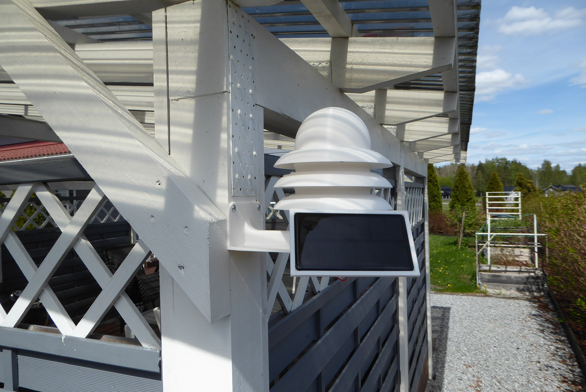
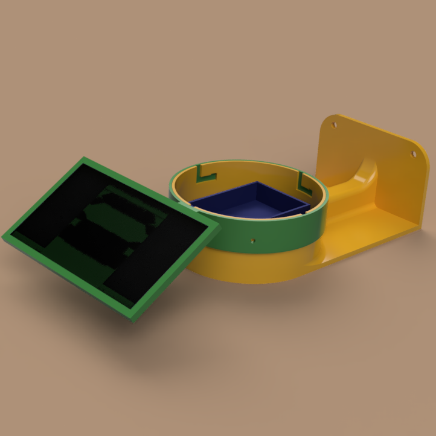
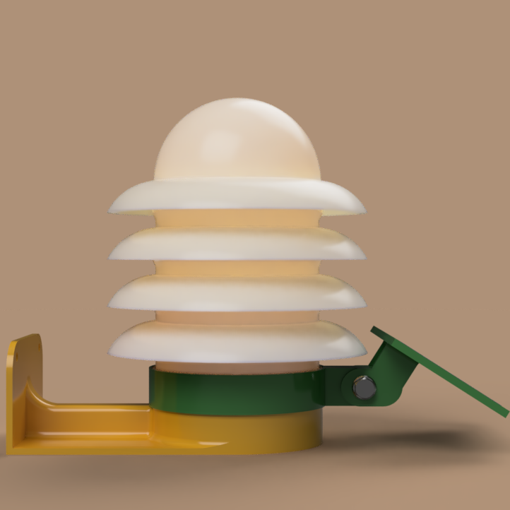
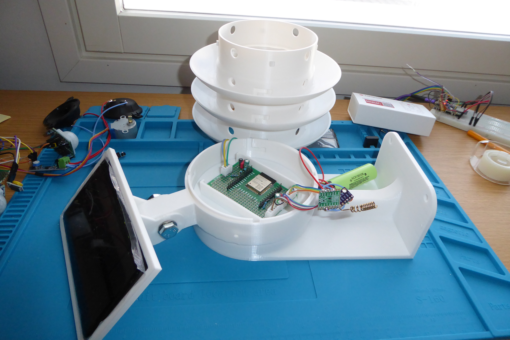
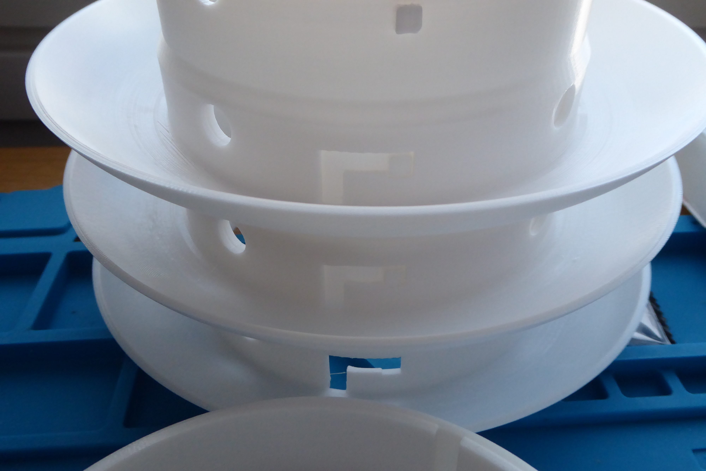
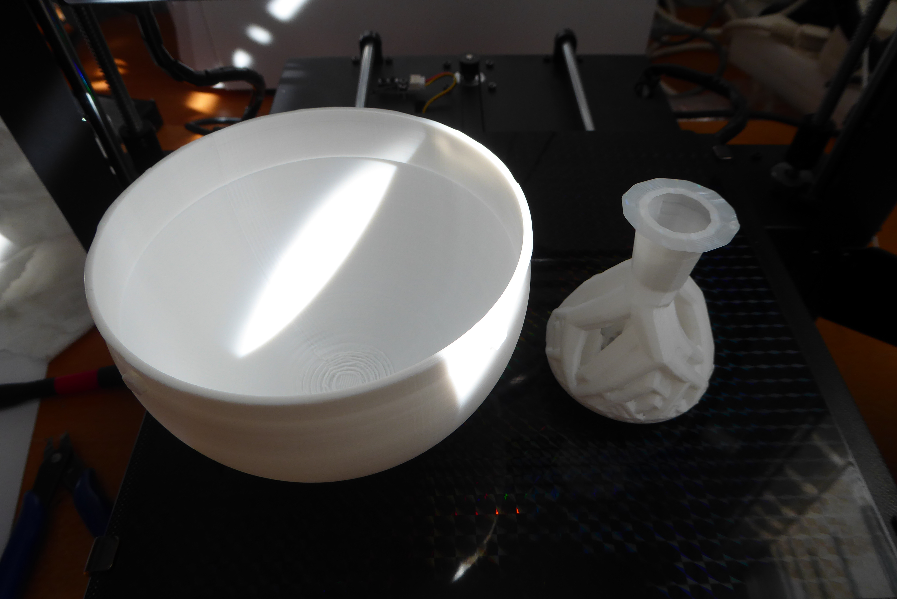

This is the **enclosure for my ESP32-based LoRaWAN weather station project**. Ultra Low Power electronics, firmware (C++), schematics, and build instructions can be found in the [LoRaWAN repository](https://github.com/ollavarma-create/lorawan).

This post focuses on **mechanical design**: a Stevenson shield for sensors, designed in Fusion360 for FDM 3D printing.

*Station just installed to final location.*

## What is a Stevenson Shield?

A Stevenson shield (or Stevenson screen) is a standard meteorological enclosure that protects sensors from rain and solar radiation while allowing free airflow. Thanks to its louvered structure, the sensor remains shaded and at ambient air temperature, which is essential for accurate temperature and humidity measurements. In this design, the same principle is implemented as a wall-mounted, 3D-printable solution with an integrated electronics enclosure and solar power.

## Electronics

The electronics are described in more detail in the [LoRaWAN repository](https://github.com/ollavarma-create/lorawan). In short:

* **MCU:** ESP32-WROOM32 SMD in ultra-low-power (ULP) mode
* **Radio:** RFM95W 868 MHz LoRa module
* **Sensor:** BME280 — temperature, humidity, pressure
* **Power:** CN3791 MPPT solar charger controller + NCR18650 cell + 6V 133×73 mm mono solar panel
* **Regulator:** HT7833 3.3V LDO

*KiCad schematic — ESP32 ULP + RFM95W + BME280, Rev 3, 28 Apr 2026*

*First prototype PCB*

**The CN3791 MPPT Adjustable Solar Charger module available on AliExpress has a serious design flaw! On the solar panel connector, the negative pin is on the side, while on the battery connector, the negative pin is in the center. The same connector type fits both ports, meaning the red wire will actually be negative instead of positive if you use the wrong cable! Always double-check the pinout before connecting! The correct connection sequence is: connect the battery first, then the solar panel. The module burns out very easily!**

## Mechanical Design

*Full assembly — four louvers, dome lid, wall mount, and solar panel at a default tilt of 40°*

### Parametric Fusion360 Model

The design is largely parametric. Tube diameter, clearance, spacing between louvers, wall thickness — all are defined in a parameter table. The geometry is linked via projections and structural constraints (midpoint, parallel, coincident), so changing a single value updates the entire model automatically.

In practice: download the F3D file and change the tube diameter — the bayonet lock, clearances, and all mating surfaces update accordingly.

### Parts

The assembly consists of eight printable parts:

1. ElectronicLid.stl
2. EspPCBHolder.stl
3. SensorLid.stl
4. SolarPanelJoint.stl
5. SolarPanelSupport.stl
6. StevensonShield.stl
7. TopLid.stl
8. WallSupport.stl

Printing works on a 210×210 mm FDM 3D printer.

---

**1. ElectronicLid.stl**

A protective lid for the electronics (white part in the center). The sides of the lid have 3 mm gaps for upward sensor wiring and lower battery-level wiring. The idea is to prevent water from damaging the electronics.

| Measurement | Value        |
| ----------- | ------------ |
| Area        | 17054.72 mm² |
| Mass        | 17.477 g     |
| Volume      | 16487.52 mm³ |
| Length      | 80.40 mm     |
| Width       | 61.40 mm     |
| Height      | 14.00 mm     |

*Rendered image showing the white lid that covers and seals the electronics.*

---

**2. EspPCBHolder.stl**

The electronics housing (blue part in the center) is designed according to a prototyping PCB. The lid above sits on top of this housing and prevents water ingress. After wiring, the gaps should be sealed, for example with hot glue.

| Measurement | Value         |
| ----------- | ------------- |
| Area        | 24405.294 mm² |
| Mass        | 24.911 g      |
| Volume      | 23500.657 mm³ |
| Length      | 109.60 mm     |
| Width       | 109.60 mm     |
| Height      | 17.00 mm      |

*Rendered image showing the placement of the ESP32 prototype board and other electronics.*

---

**3. SensorLid.stl**

The sensor layer is a symmetrical plate that fits inside a louver. It includes recesses for the BME280 sensor and the RFM95W transmitter. If you want the transmitter and sensor on separate levels (e.g., due to EMI/RF considerations), print a second lid. They are symmetrical.

| Measurement | Value         |
| ----------- | ------------- |
| Area        | 20253.453 mm² |
| Mass        | 20.169 g      |
| Volume      | 19026.976 mm³ |
| Length      | 109.60 mm     |
| Width       | 109.60 mm     |
| Height      | 15.00 mm      |

*Rendered image showing the sensor layer, with the RFM95W module at the back and the BME280 sensor in front.*

---

**4. SolarPanelJoint.stl**

The solar panel ring (green part) sits on the lower support and can rotate nearly 360 degrees. The end of the ring connects to a joint attached to the solar panel frame.

| Measurement | Value         |
| ----------- | ------------- |
| Area        | 24365.588 mm² |
| Mass        | 43.362 g      |
| Volume      | 40907.664 mm³ |
| Length      | 168.40 mm     |
| Width       | 118.40 mm     |
| Height      | 25.00 mm      |

*Rendered image showing vertical and horizontal adjustment of the solar panel.*

---

**5. SolarPanelSupport.stl**

The solar panel frame (green part) is designed for a 6V panel, attached with glue. Wiring runs through a hole underneath, using a drip loop to prevent water ingress. The angle is set once during installation toward the south at an appropriate tilt angle for the latitude (in Finland ~40–55°). In practice, Ultra Low Power electronics consume so little energy that the angle is not critical for battery charging.

| Measurement | Value         |
| ----------- | ------------- |
| Area        | 24898.965 mm² |
| Mass        | 30.913 g      |
| Volume      | 29162.85 mm³  |
| Length      | 99.989 mm     |
| Width       | 143.80 mm     |
| Height      | 48.999 mm     |

*Rendered image showing a threaded hole for an ISO M4x3 screw used to lock horizontal adjustment.*

*Printed solarpanel, ready for electronic setup.*

---

**6. StevensonShield.stl**

Print 3 or more louvers depending on how high you want the sensor and transmitter relative to the base.

| Measurement | Value         |
| ----------- | ------------- |
| Area        | 72039.593 mm² |
| Mass        | 73.786 g      |
| Volume      | 69609.584 mm³ |
| Length      | 174.00 mm     |
| Width       | 174.00 mm     |
| Height      | 52.50 mm      |

*Rendered image of a single louver from below — bayonet locking tabs and ventilation openings visible.*

The louvers telescope into each other: the top is slightly narrower, fitting into the one below and locking with a bayonet mechanism. With four louvers, the total height is about 230 mm. The louvers are symmetrical, so you can print as many as needed and stack them to the desired height. The bayonet locking tabs are visible inside the tube.

Remove supports carefully. Any support material remaining on the bayonet nubs will prevent the louvers from connecting properly, as all four bayonets must align correctly for the joint to work.

---

**7. TopLid.stl**

The dome-shaped lid (topmost in the image) is about to be glued to top so that bajonet openings are filled, but you can also change design so that the lid fits to bajonet openings.

| Measurement | Value         |
| ----------- | ------------- |
| Area        | 52827.623 mm² |
| Mass        | 57.819 g      |
| Volume      | 54546.476 mm³ |
| Length      | 112.00 mm     |
| Width       | 112.00 mm     |
| Height      | 73.50 mm      |

*Rendered image of the full assembly with the lid on top.*

*The lid printed.*

*Middle support looks funny.*

---

**8. WallSupport.stl**

The wall-mounted base integrates the ESP32 PCB, 18650 battery (placed at the bottom to optimize center of gravity), CN3791 MPPT module, and HT7833 regulator. A separate PCB platform holds the electronics in place, with a lid above to keep water out.

The wall mount arm and base are 4 mm thick and support the entire assembly. Screw holes are visible in the renders. Solar panel wiring uses a drip loop: the cable runs downward and then back up before entering the enclosure, preventing capillary water ingress.

| Measurement | Value         |
| ----------- | ------------- |
| Area        | 1.023E+05 mm² |
| Mass        | 183.596 g     |
| Volume      | 1.732E+05 mm³ |
| Length      | 201.00 mm     |
| Width       | 114.00 mm     |
| Height      | 70.00 mm      |

*Rendered image of the wall mount.*

*Wall mount printed, with charge controller and battery installed.*

---

## Printing

| Parameter         | Value                                                        |
| ----------------- | ------------------------------------------------------------ |
| Material          | White PETG                                                   |
| Reason            | Reflects sunlight, withstands outdoor temperature variations |
| Resolution        | 0.2 mm                                                       |
| Infill            | 10 % is sufficient                                                       |
| Infill pattern    | Gyroid                                              |
| Support structure | Tree                                                         |
| Shell thickness   | vertical and horizontal 1.2 mm                               |

Clearance is parameterized at 0.2 mm throughout the design. This should be sufficient for PETG, PLA, and other filaments.

Print the WallSupport first, then one louver, and verify the bayonet fit before printing all four louvers and the lid.

## Print Times

Printing is time-consuming. It is worth checking bed leveling and other printer settings before starting long prints. Especially with PETG, monitor bed adhesion. A magnetic PEI sheet works well with PETG.

Print times depend on your FDM printer, filament, and other factors.

Example print times and material usage:

| Part                     | Print Time | Grams | Meters |
| ------------------------ | ---------- | ----- | ------ |
| 1. ElectronicLid.stl     | 2h 10m     | 21    | 6.93   |
| 2. EspPCBHolder.stl      | 3h 42m     | 33    | 11.04  |
| 3. SensorLid.stl         | 2h 58m     | 23    | 7.83   |
| 4. SolarPanelJoint.stl   | Rendered image showing a threaded hole for an ISO M4x3 screw used to lock horizontal adjustment.5h 39m     | 44    | 14.74  |
| 5. SolarPanelSupport.stl | 2h 52m     | 36    | 12.08  |
| 6. StevensonShield.stl   | 8h 46m     | 99    | 33.23  |
| 7. TopLid.stl            | 6h 7m      | 78    | 26.03  |
| 8. WallSupport.stl       | 17h 11m    | 164   | 54.88  |

In total, you can estimate a print time of 49 hours and 25 minutes with one louver, filament consumption of 558 grams, and 166.74 meters. Each additional louver (StevensonShield.stl) adds to the print time and filament consumption.

A couple of examples of part placement on the print bed:

In this image taken from Cura slicer, tree supports and one Stevenson Shield louver are arranged on the print bed. This saves filament but makes the top surface slightly rougher, as the support and adhesion do not detach cleanly. You can refine the finish with sandpaper.

In this image taken from Cura slicer, tree support and the lid are shown. In this case, it is advisable to also use adhesion, as the contact surface is small.

*Screenshot from Cura slicer showing tree supports and one Stevenson shield louver on the print bed.*

*Cura slicer screenshot showing tree supports and the lid. Adhesion is recommended due to the small contact area.*

## Download

The Fusion360 design file (F3D) is available here:

**[Autodesk360 — Stevenson Shield ESP32](https://outlook37929.autodesk360.com/g/shares/SH90d2dQT28d5b602811ac630ee472134f83)**

From there, you can export STL files for the parts you want and slice them in your own slicer. All parts are modeled in print orientation — no need to rotate them.

Pre-generated STL files are also available here:
**[StevensonShield_ESP32_BME280_RFM95W_18650](https://www.printables.com/model/1851996-parametric-stevenson-shield-for-esp32-weather-stat)**

## License

All design files are released under **[CC BY-NC 4.0](https://creativecommons.org/licenses/by-nc/4.0/)** — free to use, modify, and share for non-commercial purposes with attribution.
