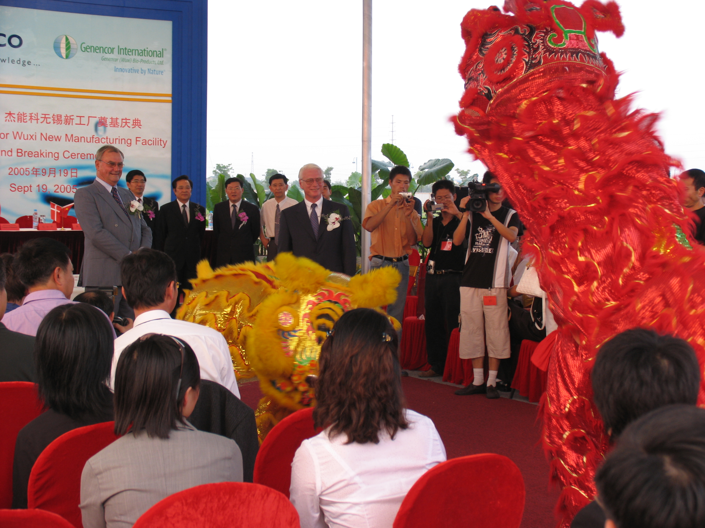
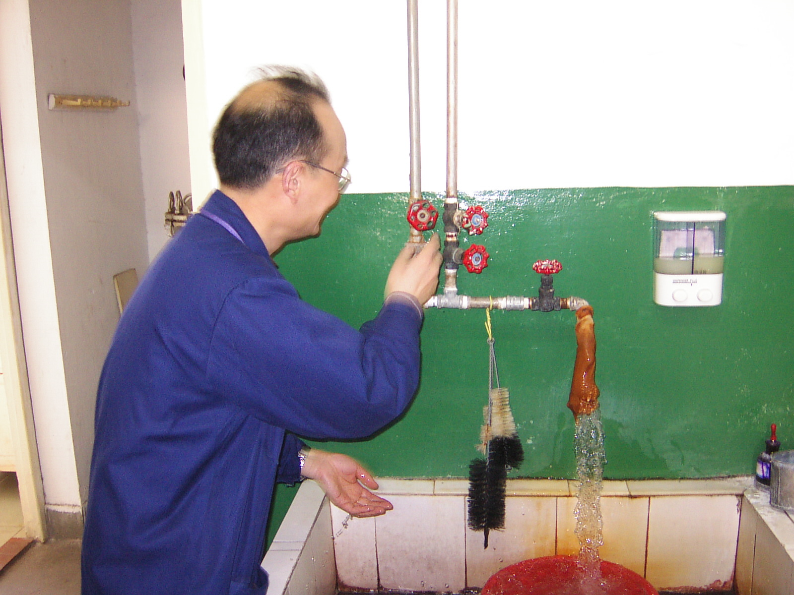
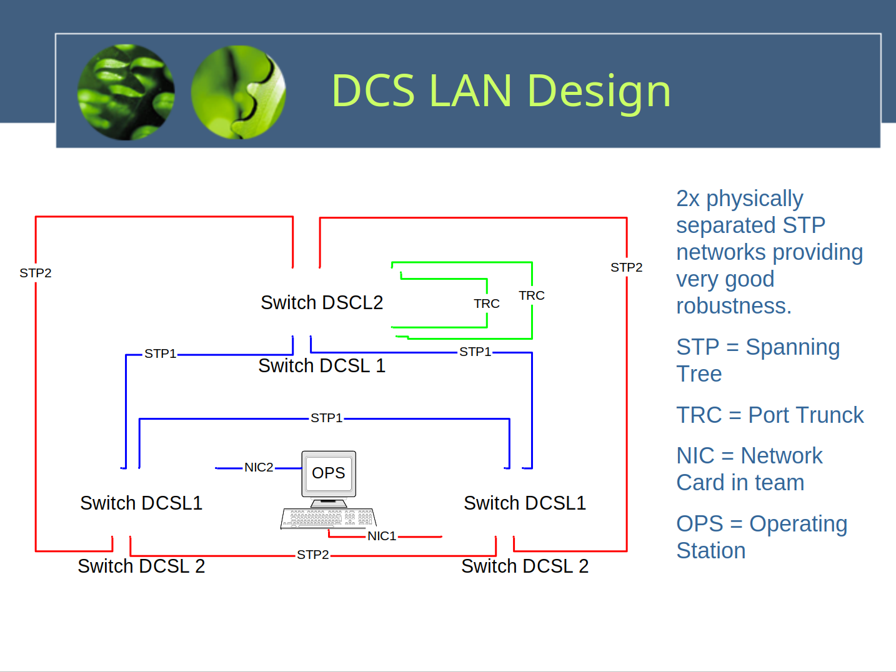
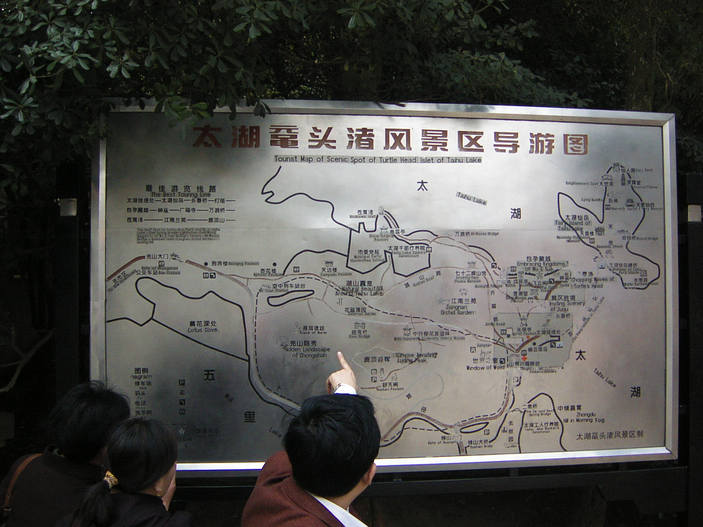

*Technology changes. Responsibility does not disappear.*

*Groundbreaking ceremony at Wuxi - China.*

In 2005, I was involved in building a new enzyme production facility in Wuxi, China. My responsibilities included planning and integrating information technology and industrial automation, as well as defining security requirements. The job involved far more than servers and switches: it meant aligning international specialists, local practices, business needs and industrial processes.

More than twenty years later, we are talking about AI agents, automated cyberattacks and vulnerabilities in critical infrastructure. These conversations keep bringing me back to one question: **what have we actually learned?**

## When automation met IT

Industrial automation was moving away from relatively closed, vendor-specific systems toward PC technology, standard networks and integration with business applications. Production data was becoming useful for maintenance, quality management and enterprise planning. ERP, LIMS, MES and process historians were increasingly part of the same conversation.

*Cold water meets steam in a remarkably simple hot-water arrangement.*

In a presentation I prepared in March 2005, I summed up the trend in one sentence: *“Automation and ICT technologies are merging.”* That created opportunities, but also new risks. Once a production network starts communicating with an office network, problems originating in the office environment may reach the production floor.

That is why separating automation networks from office networks, controlling firewall rules, monitoring traffic and managing access rights were not fashionable security ideas discovered years later. They were basic design principles. Around that period, I also commissioned an engineering thesis about protecting automation networks and detecting intrusions using tools such as Snort. I have not yet managed to recover the thesis from my archives.

Availability mattered just as much in Wuxi. Our design included two physically separate networks for the distributed control system (DCS), while network management was intended to support proactive maintenance and alarms. **Resilience and security are not identical, however:** a redundant network can still be insecure if access and communication paths are not controlled.

*Two physically separate, redundant DCS networks.*

## A standard protects nothing unless it is implemented

We worked with security principles associated with BS 7799. Its legacy lives on in ISO/IEC 27001, while IEC 62443 addresses cybersecurity in industrial automation and control systems. The terminology and technical tools have evolved, but the essential questions are familiar: who can access what, which connections are necessary, how are changes controlled, and how do we detect incidents?

The new Wuxi facility followed the principles we had defined. A separate challenge involved an older plant and a local engineering partner that needed access to valuable technical information to help design the new facility.

Communications were difficult too. Encrypted VPN connections between China and the United States were repeatedly interrupted, and making them reliable required local negotiations. A beautiful technical architecture was of little use if the teams could not exchange information in practice.

When I audited the engineering partner's security, I found that some concepts familiar to Western IT professionals were not yet well understood locally. People might answer that they had a firewall, antivirus protection or a security policy. Only a practical demonstration showed what had actually been implemented.

I learned a rule that has stayed with me: **do not settle for “yes.” Ask people to show you how it works.**

## The audit that stopped the work

After the first audit, I accepted the situation. On a later visit, however, I found malware on servers. The partner held information whose confidentiality was extremely important to us. Finding malware did not prove that data had been stolen, but I could no longer treat the environment as trustworthy.

That discovery led to difficult discussions with project management. Work at an engineering office of roughly 300 people was suspended, and we seriously considered ending the collaboration. This was not an ordinary IT support ticket. A factory project worth tens of millions was at stake.

Eventually, the partner's management decided to replace the computers and start again from a clean baseline. The project was able to continue.

I am deliberately leaving the company's name out of this account. The point is not to single out an organization. It is that **passing an audit provides evidence about a moment in time, not a permanent guarantee. Trust requires continuous verification.**

## When the pressure finally broke in Wuxi

By the time we reached a solution, I was exhausted. I ended up at the Barrel Bar in Wuxi, ordered a wildly excessive amount of vodka and decided, for one evening, not to think about firewalls, audits or project schedules. Hardly a model stress-management strategy, but an honest memory of how much the episode had taken out of me.

I was the only Westerner in the bar. In my state of mind, the local music was getting on my nerves, so I went to a nearby hotel, retrieved an AC/DC CD and asked the staff to play *Thunderstruck*. I was enthusiastically rocking along. The other customers mostly looked astonished.

During the day, we had been dealing with a serious security crisis in an international factory project. That evening brought a rather different kind of cross-cultural encounter.

Twenty years later, I turned the memory into a rock song using Suno: *Wuxi Voltage*. You can listen to the song at the end of this article. The lyrics are deliberately dramatized, not a literal incident report. 

## In 2026, the attacker may also be an agent

Today, the same security problem has acquired a new layer. AI can help examine logs, identify anomalies and suggest responses. The same technology can also be used to search for vulnerabilities and automate parts of an attack.

Not every alarming AI scenario is a documented real-world event. We should distinguish human-directed attacks assisted by AI, unexpected agent behavior observed in testing, and the much more speculative idea of a fully autonomous system escaping human control. A compelling scenario is not evidence that it has happened.

Yet one question is already practical: **if AI interprets network traffic, decides what deserves an alert and recommends corrective actions, who verifies that its picture of reality is correct?**

There is a risk of losing deep technical expertise. Someone may become excellent at operating a polished dashboard without understanding what happens beneath it. We still need people who can inspect raw packets, read logs, understand protocols and challenge automated conclusions.

Not everyone needs to be a Wireshark wizard. But an organization must retain **an independent ability to verify what its systems claim**. AI agents also need limited privileges, monitoring and a reliable way to stop their actions. The same trust-boundary principle that once separated the automation network from the office network now applies to agent permissions.

## Twenty years later

Europe has introduced new requirements, including the EU Cyber Resilience Act, and industrial cybersecurity has developed its own standards. That is progress. But neither regulations nor standards can replace practical testing, continuous monitoring and difficult decisions.

In 2005, I had to stop work because I could not trust a system. In the future, someone may face the same decision while an AI system insists that everything is fine.

**Security does not come from a system claiming to be secure. It comes from being able to verify that claim.**

Ultimately, someone must be willing to act when the report and reality disagree.

*Technology changes. Responsibility does not disappear. And behind it all, we are still only human.*

---

### Postscript: Wuxi Voltage

Some memories deserve their own soundtrack.

What I remember most from those years is the importance of people. Contracts, firewalls and standards were essential, but the project moved forward because difficult issues could be negotiated and agreed corrections were actually carried out.

Twenty years later, I turned that unforgettable evening in Wuxi into a rock song using Suno AI. The lyrics are a dramatized interpretation of real events, not a literal incident report.

These days, I would probably choose a quieter way to unwind. But sometimes, a little rock and roll is exactly what a memory needs.

<audio controls preload="none" style="width:100%">
  <source src="wuxi-voltage.mp3" type="audio/mpeg">
  Your browser does not support audio playback.
</audio>
