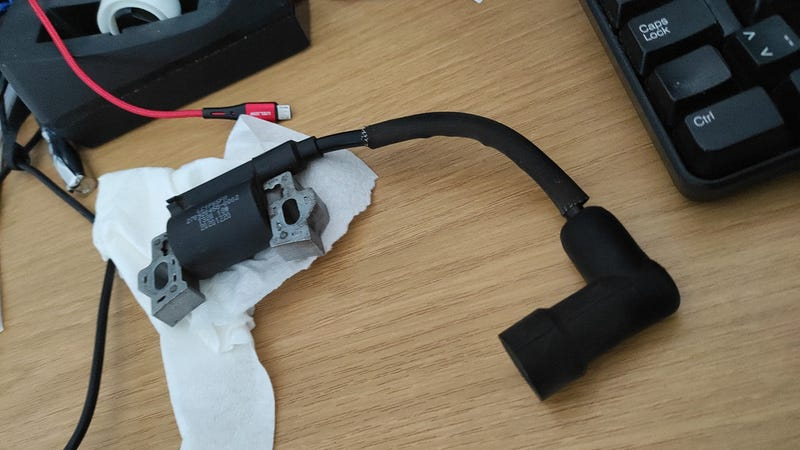
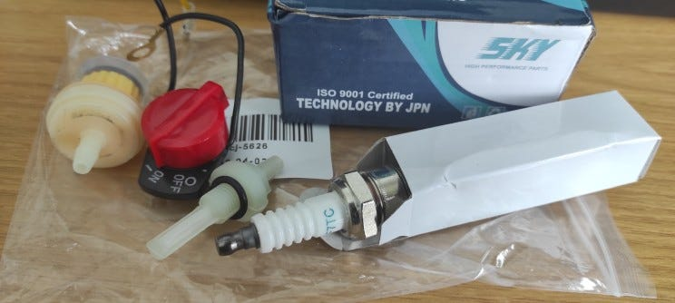
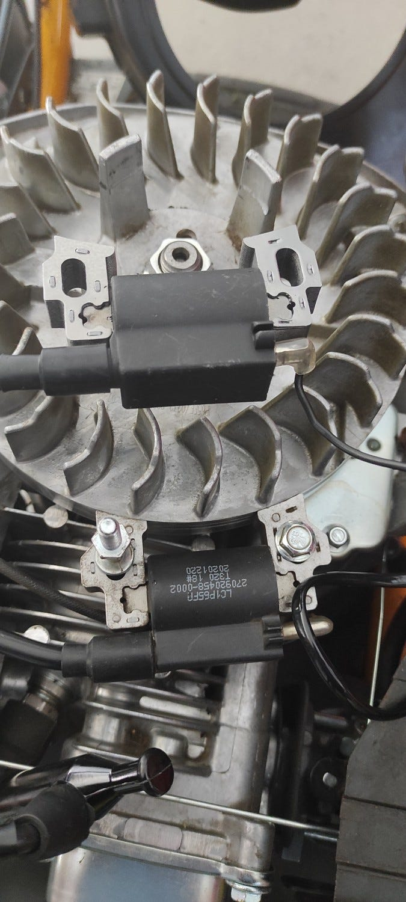
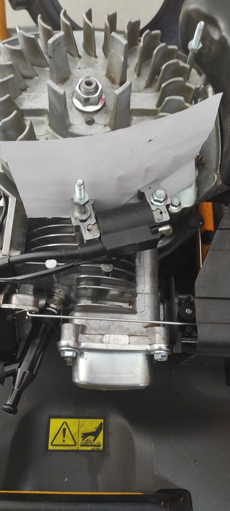
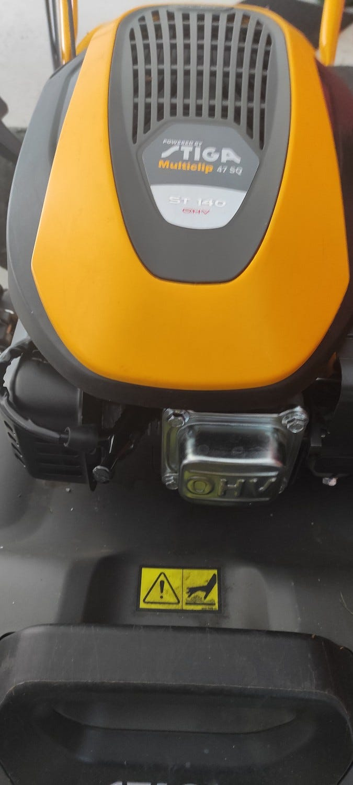
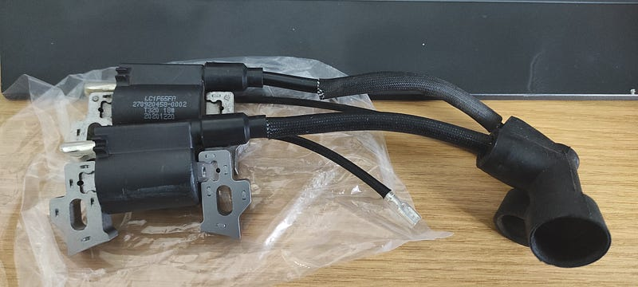

A roughly 3-year-old Stiga lawnmower with an OHV 140 engine, also known as the WBE140 Stage V, started up fine when cold, but once warmed, no start or spark.

---

### Troubleshooting and Repairing a Stiga Lawnmower: How I Saved Money by Finding Compatible Parts from Different Brands

A roughly 3-year-old [Stiga](https://www.stiga.com/fi/) lawnmower with an OHV 140 engine, also known as the WBE140 Stage V, started up fine when cold, but once warm, the idle fluctuated, the ignition misfired, and it couldn’t be started when hot. The issue wasn’t related to fuel or adjustments. The only possible culprit left was the ignition coil, which is marked LC1P65FA.

According to Stiga’s engine diagram, the part number is 118551475/0, and the OEM number is 270920458–0002. Apparently, Stiga’s original ignition coil is defective, and the warranty has just conveniently expired. Perhaps the winding of the coil is poor, and when it heats up, the inductance fluctuates.

I discovered that this coil is not available from local small engine repair shops. I could have ordered the part online for a price of €58, with shipping costs around €10, **making a total of €68.** Since the part isn’t available locally and the online price seemed high, I decided to investigate further.

Lawnmowers are generally quite similar, and I was certain that Stiga doesn’t manufacture its own engines. I started looking into what LC1P65FA means, and it turned out that it refers to a major manufacturer called [Loncin at China](https://www.loncinindustries.com/en/engine/Products.aspx?catid=8-15-16-60-61-0). Thus, it seems logical to assume that the ignition coil is also available from other brands.

Upon further investigation, it became clear that Loncin has copied Honda engines. In this case, a suitable ignition coil would be from the **Honda GX200 model**. So, I started searching for where to get one of those be safe, I ordered the same ignition coil from two different places.

From CDON, I ordered a 168f-170f 2kw/3kw coil ([Ignition Coil, 168f-170f Replacement Generator Parts 168f-170f 2kw/3kw Gasoline Generator Lawn Mower Accessories 1 piece](https://cdon.fi/kodit-ja-puutarhat/sytytyspuola-168f-170f-sytytyspuolan-vaihtogeneraattorin-osat-168f-170f-2kw-3kw-bensiinigeneraattorille-ruohonleikkurin-tarvikkeet1kpl-tao-p168454742)) which happened to be on sale for half price, and the **final cost was only €13.97**, including shipping. I placed the order on August 10, 2024, and the order arrived today, August 27, 2024, via PostNord.

After opening the package, I was a bit surprised because, in addition to the ignition coil, as shown in the picture, there was also a spark plug, fuel filter, and on-off switch! All this for only €13.97!

Visually, the ignition coil seemed to fit, but the only way to know for sure was to try it out. So, I removed the lawnmower’s cover, unscrewed the three 10 mm nuts, and removed the old ignition coil.

Next, I installed the new GX200 ignition coil, connected the shut-off wire, placed a piece of paper between the flywheel and the ignition coil for proper spacing, and then put the cover back on.

And just like that, the job was done! 😊

***On the first pull, the engine started right up, ran smoothly, and no longer misfired! Incredible.***

For a test drive, I decided to mow some damp, long grass to see if the engine had enough power. No issues whatsoever! Starts warm too!

***By doing this, I saved a whopping €54.03***, and now I have a spare spark plug, a fuel filter, and an unnecessary on-off switch! Selling those could even make a profit on this repair. Funny.

---

**Another option**

This arrived today and it seems to fit. Shut-off wire is a little bit shorter than in original. Cost was 24 USD including shipping. [Purchased from eBay](https://www.ebay.com/itm/156256238027?mkcid=16&mkevt=1&mkrid=711-127632-2357-0&ssspo=fZkFZuSOQma&sssrc=2047675&ssuid=6vQ3yW5XSW2&widget_ver=artemis&media=COPY).

