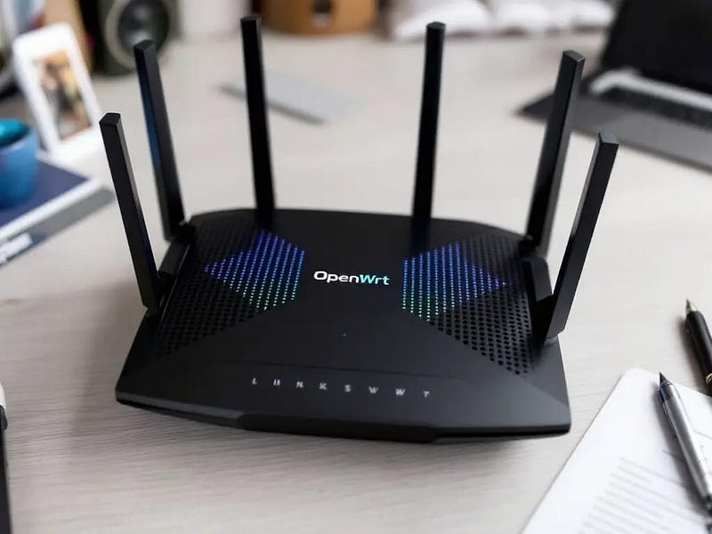
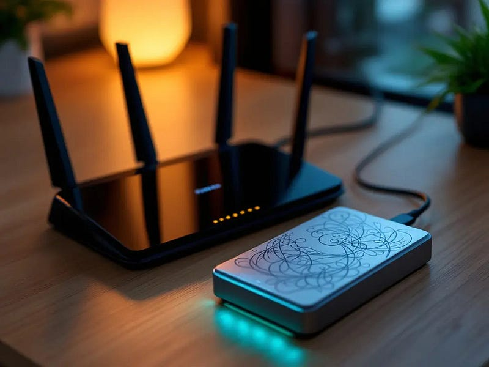
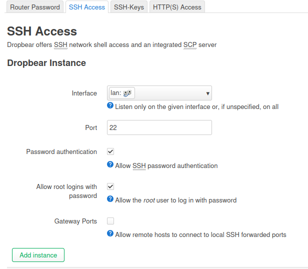
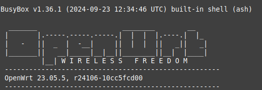
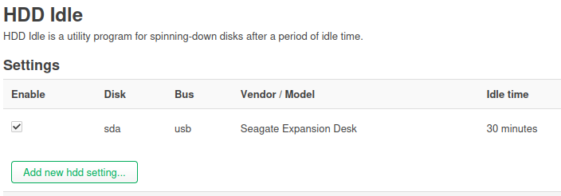
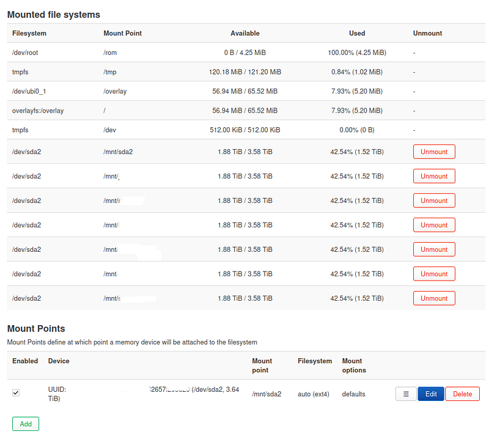
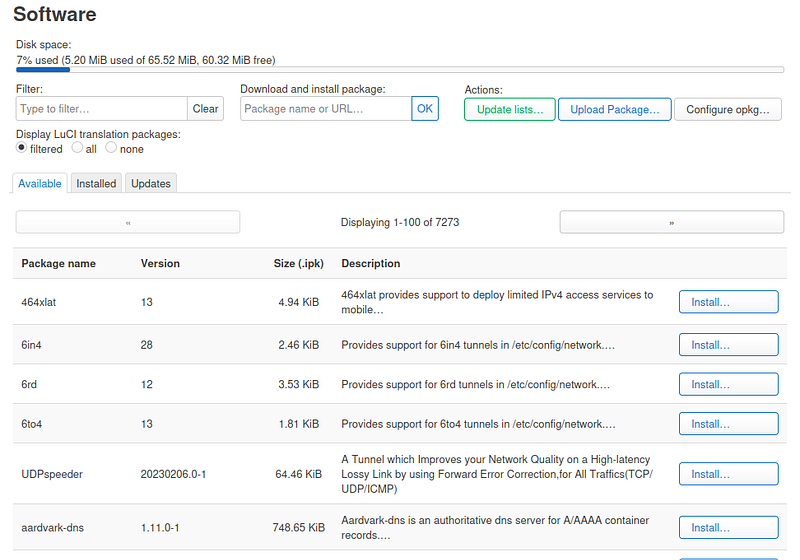

Network File System (NFS) is a versatile protocol for sharing directories across Linux systems.

---

### Understanding and Implementing NFS on OpenWrt and Linux Workstations

### Introduction

Network File System (NFS) is a versatile protocol for sharing directories across Linux systems. Combined with [OpenWrt](https://openwrt.org/) — a highly customizable, Linux-based operating system for routers — you can turn your router into a lightweight NAS (Network Attached Storage). This article explores the basics of NFS, setting up NFS on OpenWrt, preparing a USB drive for storage, and accessing shared directories from Linux workstations.

When might OpenWrt be a good option for you? For instance, Linksys, D-Link and many other manufacturers often discontinue firmware updates for their routers after 2–3 years from the date of manufacture. This means that even if you have a router with a great processor and plenty of memory, it may become obsolete if the manufacturer doesn’t provide updates for new security standards, such as WPA3.

In such cases, you can replace the original firmware with OpenWrt and continue using your hardware for years to come. This not only extends the life of your device but also contributes to a healthier planet. By using older routers, we can help reduce e-waste and lower the demand for newly manufactured devices, ultimately decreasing pollution.



---

### What is OpenWrt?

[OpenWrt](https://openwrt.org/) transforms routers into powerful, multi-purpose devices capable of running various software. Key features include:

- **Extensibility**: Install typical Linux packages, Samba server for Windows workstations and Android which do not support NFS, or `nfs-kernel-server` for Linux workstations.
- **Flexibility**: Use the router as a NAS, firewall, or VPN server and more.
- **Community Support**: Continuous updates and a wide range of documentation.

---

### Basics of NFS

#### How NFS Works

NFS enables networked file sharing with the following components:

- **Exports**: Define shared directories in `/etc/exports`.
- **Access Controls**: Specify client IPs or subnets and their permissions (e.g., read-only or read-write). Typical access control is based on IP-addresses, but could be extended with other type of authentication services, such as Kerberos.
- **Mount Points**: Organize shared directories using persistent mounts in `/etc/fstab`.

Example case: you have an external hard drive containing pictures, movies, and your personal documents. You would like to share the pictures and movies with everyone using Linux workstations on your local network but restrict access to your personal documents. The simplest way to do this is to assign a static IP address to the workstation that needs access to your personal documents and use DHCP addresses for the rest of the workstations. Restrictions are defined in `/etc/exports`. But before we go there, let’s look at how to set up access to the external USB drive and mount the subsequent directories properly.

---

### Setting Up an External USB Drive in OpenWrt

At this point you have installed OpenWrt to your router. If not, check if OpenWrt is supported from [this page](https://firmware-selector.openwrt.org/) and install OpenWrt as instructed. Supported router list in [this link](https://openwrt.org/supported_devices).




#### Step 1: Connect the USB Drive

- Read instructions [Using storage devices](https://openwrt.org/docs/guide-user/storage/usb-drives).
- Plug the USB external drive into your OpenWrt router. If the router has USB3 (blue port), favor that.
- Check from Web access (called LuCi) that you have enabled SSH Access on LAN interface (never enable WAN interface unless you want someone gets access from the Internet):



- SSH to the router with command root@ip-address of the router.



- Verify that hard drive is recognized:

```
ls /dev/sd*
```

- Example output:

```
/dev/sda /dev/sda1 /dev/sda2
```

#### Step 2: Install USB and Filesystem Support

The installation process depends on whether you already have formatted storage. If you prefer to have both NFS and Samba (for Windows and Android) shares, you can use the NTFS or exFAT file systems, but it may be slower than EXT4. If you need to detach the drive and connect it to Windows, then use NTFS or exFAT and install the necessary libraries. Ensure that OpenWrt has the necessary packages for USB and common file systems. In this example I use only ext4.

```
opkg update\
opkg install kmod-usb-storage block-mount kmod-fs-ext4 e2fsprogs\
\
# if you have SSD or USB thumb drive\
opkg install f2fs-tools\
opkg install kmod-fs-f2fs\
\
# if you have exFat drive\
opkg install kmod-fs-exfat
```

#### Step 3: Format the Drive (Optional if you have empty drive)

To format the drive as `ext4`:

```
mkfs.ext4 /dev/sda1
```

#### Step 4: Mount the Drive

You should see existing partition with UUID with command:

```
block info | grep "/dev/sd"
```

- Create a directory for the mount point:

```
mkdir -p /mnt/storage
```

- Mount the drive:

```
mount /dev/sda1 /mnt/storage
```

#### Step 5: Make the Mount Persistent

Add the mount to `/etc/config/fstab` for persistence:

```
block detect | uci import fstab\
uci set fstab.@mount[-1].enabled='1'\
uci commit fstab
```

With command mount -a you can mount fstab entries, but in this case we need to check that mount is persistent. So, reboot the router and check that you see mount:

```
uci show fstab
```

You should see `/mnt/storage` listed as part of the output and last enabled 1 meaning it is enabled.

```
stab.@global[0]=global\
fstab.@global[0].anon_swap='0'\
fstab.@global[0].anon_mount='1'\
fstab.@global[0].auto_swap='1'\
fstab.@global[0].auto_mount='1'\
fstab.@global[0].delay_root='5'\
fstab.@global[0].check_fs='1'\
fstab.@mount[0]=mount\
fstab.@mount[0].target='/mnt/sda2'\
fstab.@mount[0].uuid='cebc39cf-23c3-4e52-92c3-62d57f2998f0'\
fstab.@mount[0].enabled='1'
```

If your external drive is noisy and you like to shut it down if not used, install luci (web-interface) version of the hd-idle:

```
opkg update && opkg install luci-app-hd-idle
```




Last boot the service:

```
service fstab boot
```

---

### Setting Up NFS on OpenWrt

#### Step 1: Install NFS Server

Read instructions [Network File System (NFS)](https://openwrt.org/docs/guide-user/services/nas/nfs.server)

```
opkg update\
opkg install nfs-kernel-server nfs-kernel-server-utils
```

#### Step 2: Define Exports

In `/etc/exports`, configure which directories to share. Example:

```
/mnt/storage/shared   10.0.0.2(rw,sync,no_subtree_check,fsid=0)\
/mnt/storage/media    10.0.0.3(rw,sync,no_subtree_check,fsid=1)\
/mnt/storage/photos   10.0.0.4(rw,sync,no_subtree_check,fsid=2)
```

You can also use CIDR-format. As an example, you may define public access to your DHCP scope and then use static addresses for workstations needing better security. NFS supports Kerberos etc. authentication too, but most likely such setup is overhead for small setups.

Another way is to define in the OpenWrt fstab several mountpoints by first creating directories with mkdir -p /mnt/ command and then define mountpoints in the fstab:

```
# <file system> <mount point> <type> <options> <dump> <pass>\
/mnt/sda2/secret /mnt/secret none bind 0 0\
/mnt/sda2/shared /mnt/shared none bind 0 0\
/mnt/sda2/media /mnt/media none bind 0 0\
/mnt/sda2/photos /mnt/photos none bind 0 0
```

and with mount -a test that mountpoints works as they should.

Then in /etc/exports- file of the OpenWrt define access per mountpoint (note secret is set accessible only to one ip, others are CIDR subnets):

```
/mnt/secret   10.0.0.2(rw,sync,no_subtree_check,fsid=0) \
/mnt/shared   10.0.0.0/24(rw,sync,no_subtree_check,fsid=1)\
/mnt/media   10.0.0.0/24(ro,sync,no_subtree_check,fsid=2)\
/mnt/photos   10.0.0.0/24(ro,sync,no_subtree_check,fsid=3)
```

#### Step 3: Enable NFS Service

Start and enable the NFS service and perhaps check from the LuCi do you see mountpoints:

```
/etc/init.d/nfsd start\
/etc/init.d/nfsd enable
```




### Accessing NFS Shares from Linux Workstations

#### Step 1: Discover Available Shares

On a Linux client, list NFS shares from the OpenWrt server:

```
showmount -e <OpenWrt Server1_IP>
```

#### Step 2: Mount a Share

Manually mount a share:

```
sudo mount -t nfs <Server1_IP>:/mnt/storage/shared /mnt/shared
```

For persistent mounts, add to `/etc/fstab` (check [man page](https://manpages.ubuntu.com/manpages/jammy/man5/nfs.5.html) about parameters):

```
server1 ip:/mnt/secret /mnt/secret nfs rw,hard,intr,timeo=900,retrans=5,bg 0 0\
server1 ip:/mnt/shared /mnt/shared nfs rw,hard,intr,timeo=900,retrans=5,bg 0 0\
server1 ip:/mnt/media /mnt/media nfs rw,hard,intr,timeo=900,retrans=5,bg 0 0\
server1 ip:/mnt/photos /mnt/photos nfs rw,hard,intr,timeo=900,retrans=5,bg 0 0
```

Apply the changes and check mounts:

```
mount -a\
mount -l | grep nfs\
\
# note: nfs negotiates best nfs version (3 or 4) if you used defaults
```

Now you should have fully functioning NAS with NFS shares and workstation automagically mounting those shares for you.

Remember that you could install and upgrade software from the LuCi too:



Enjoy!
