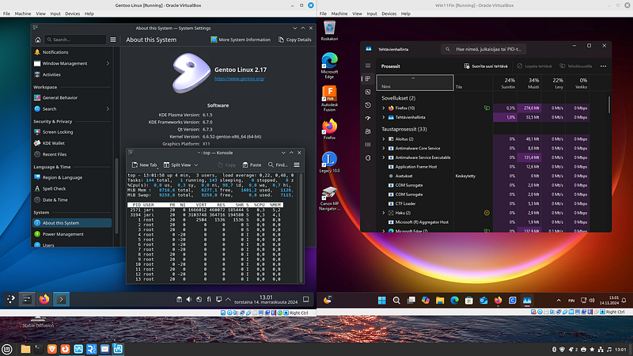
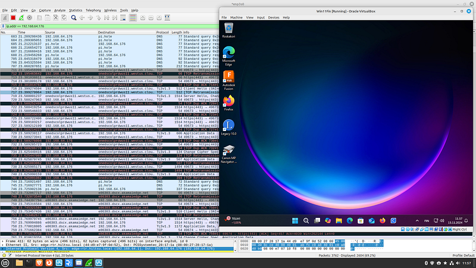
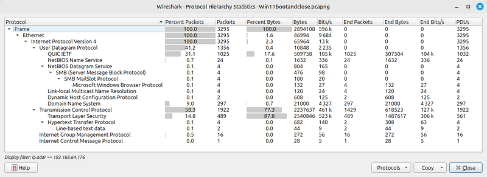
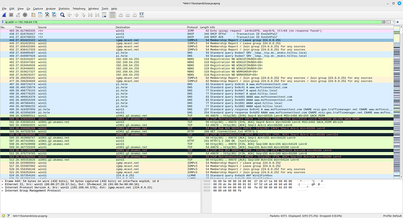
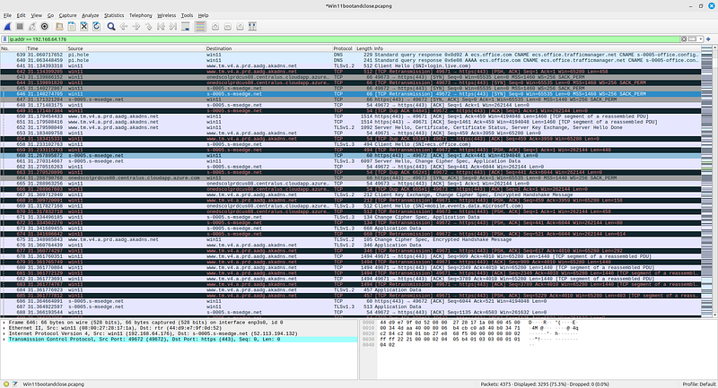
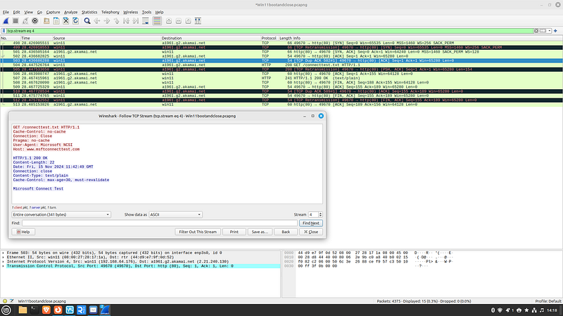
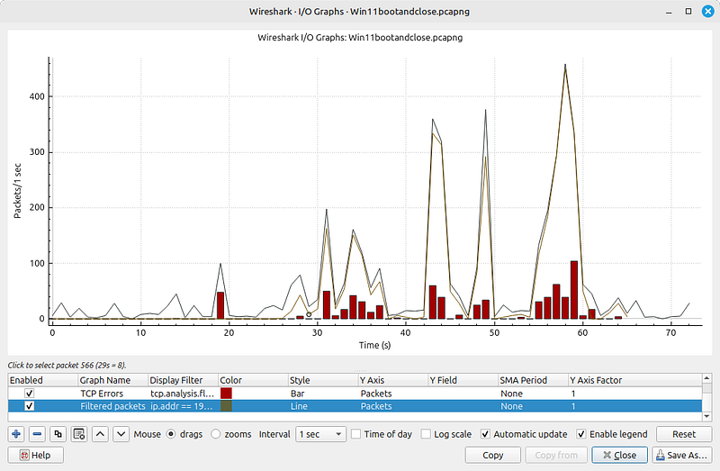
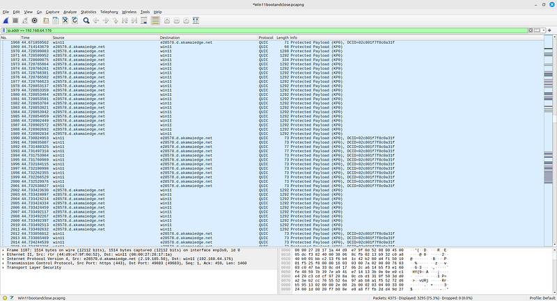
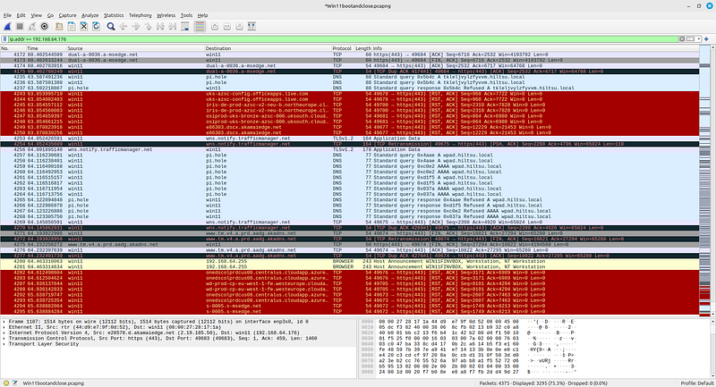

In recent months, I noticed a peculiar difference in performance while using Firefox on LinkedIn: it ran noticeably faster on a Linux.

---

### Why Windows 11 Feels Slower Than Linux: A Technical Exploration

In recent months, I noticed a peculiar difference in performance while using Firefox on LinkedIn: it ran noticeably faster on a Linux machine than on Windows 11. This observation led me to question why two widely-used operating systems would differ so greatly in speed for everyday browsing. Though the exact root cause wasn’t immediately clear, I hypothesized that Windows 11’s reliance on extensive cloud services and telemetry might be contributing to its sluggishness.

To dig deeper into this phenomenon, I set up a virtualized environment using Oracle VirtualBox in my test lab. This setup included a Linux Mint host and a Windows 11 guest OS, configured with a bridged network interface. By monitoring network traffic using Wireshark, I aimed to capture and analyze the data communication behavior of Windows 11 compared to Linux.

### The Hidden Cost of Background Network Activity in Windows 11

One of the most striking findings from the Wireshark captures was the volume of outbound traffic from the Windows 11 system. Even in an idle state, Windows 11 consistently communicated with various Microsoft servers. This is likely due to its built-in telemetry and cloud integration features, including services like Windows Update, Microsoft Defender, and OneDrive synchronization. Studies have shown that Windows’ telemetry services can consume significant network bandwidth and system resources, which may degrade performance, especially on systems with limited hardware resources (​[InterWorks](https://interworks.com/blog/2021/02/11/put-to-the-test-is-windows-or-linux-faster/)).

Linux distributions, by contrast, are generally lighter on background network usage. The absence of mandatory telemetry in many Linux distros allows for more efficient use of network resources, translating to faster browsing and application performance. Research comparing Windows and Linux network overhead has consistently shown that Linux’s leaner architecture results in lower latency and faster data throughput, especially in network-intensive applications​ ([InterWorks](https://interworks.com/blog/2021/02/11/put-to-the-test-is-windows-or-linux-faster/)) .

---

### Networking Stack Differences: Linux vs. Windows

A deeper dive into the networking stacks of both operating systems reveals significant differences in how packets are processed and handled. Windows 11 uses a proprietary TCP/IP stack that prioritizes compatibility and security but can introduce additional latency due to its complex buffering mechanisms. Linux, on the other hand, is renowned for its streamlined and customizable networking stack, allowing users to optimize parameters like TCP window sizes and buffer limits for maximum efficiency.

According to research on TCP/IP performance, Linux often outperforms Windows in scenarios requiring high throughput and low latency. The open-source nature of Linux allows for continuous optimizations, giving it an edge in handling simultaneous connections and high-speed data transfers​ ([InterWorks](https://interworks.com/blog/2021/02/11/put-to-the-test-is-windows-or-linux-faster/)).



### Impact of System Resource Management on Performance

Another factor contributing to the perceived slowness of Windows 11 is its resource management. Windows tends to allocate more CPU and memory to background processes, especially those related to system updates and security scans. This can leave less processing power available for user applications, thereby slowing down performance. On the other hand, Linux distributions like Linux Mint are designed to be lightweight and efficient, with better control over resource allocation.

Virtualization benchmarks have shown that Linux often performs better than Windows in virtual environments, partly due to its efficient use of system resources. This is particularly noticeable in disk I/O operations and memory management, where Linux’s streamlined architecture provides a tangible performance boost​ ([InterWorks](https://interworks.com/blog/2021/02/11/put-to-the-test-is-windows-or-linux-faster/)).

### Monitoring Windows 11’s Network Behavior: A Case Study

For a more controlled analysis, I configured the Windows 11 guest OS to run side-by-side with a Linux Mint host, capturing all outbound and inbound traffic using Wireshark. The results were telling: Windows 11 generated a significantly higher volume of traffic related to system updates, cloud synchronization, and telemetry, even when no user applications were actively using the network.



The Windows system’s reliance on cloud services not only increases network traffic but also consumes additional CPU cycles, which can negatively impact the responsiveness of other applications. In contrast, Linux systems are more efficient, as they only communicate with the network when explicitly instructed to do so by the user or applications.

---

### Analyzing Windows 11 Network Activity During Boot and Shutdown

In the following set of Wireshark captures, we will examine the network activity that occurs between the bootup and shutdown of a Windows 11 system. The sequence begins with the initial startup of Windows, followed by a manual shutdown shortly after the desktop environment fully loads.

The first capture shows a DHCP query and offer process, where Windows requests an IP address from the network, followed by the response from the DHCP server. Subsequently, Windows initiates a series of DNS queries, including requests for the Web Proxy Auto-Discovery Protocol (WPAD). Additionally, the system queries my lab network’s Pi-hole for several DNS addresses, which are likely related to Microsoft’s telemetry and update services.

During Windows startup and shutdown process Windows communicated to the Internet with quite a few servers:

```
c-msn-com-nsatc.trafficmanager.net\
dual-a-0036.a-msedge.net\
e14263.dscx.akamaiedge.net\
e28578.d.akamaiedge.net\
e4113.dscd.akamaiedge.net\
e81481.dsca.akamaiedge.net\
e86303.dscx.akamaiedge.net\
iris-de-prod-azsc-v2-neu-b.northeurope.cloudapp.azure.com\
iris-de-prod-azsc-v2-weu-b.westeurope.cloudapp.azure.com\
mdns.mcast.net\
onedscolprdcus08.centralus.cloudapp.azure.com\
osiprod-frc-bronze-azsc-000.francecentral.cloudapp.azure.com\
osiprod-uks-bronze-azsc-000.uksouth.cloudapp.azure.com\
s-0005.s-msedge.net\
server-3-164-68-9.hel51.r.cloudfront.net\
uks-azsc-config.officeapps.live.com\
wd-prod-cp-eu-west-1-fe.westeurope.cloudapp.azure.com\
wns.notify.trafficmanager.net\
www.tm.v4.a.prd.aadg.akadns.net
```




First Windows sends DHCP query and receives an ip-address, then my lab pi-hole responds to DNS queries:




Starting from packet #499, I observed the first TCP retransmission to `a1961.g2.akamai.net`. From this point onward, there were numerous retransmissions occurring whenever the data load increased:




1-wUpAx7i4LV8dtMc5rLT0vw-aa46c378
Retransmissions in the I/O Graph explains why they occur in a heavy load, but occurence is not linear:



After a quite a few DNS queries and QUIC protocol handshakes plenty of protected payload on QUIC protocol:



---

### Examining Network Activity During Windows 11 Shutdown

To further explore Windows 11’s network behavior, I captured the last packets exchanged during its shutdown process using Wireshark. As seen in the screenshot below, even at the final stages of shutting down, Windows continues to communicate with various external servers.

1. **TCP Connection Terminations**: Starting from packet #4253, Windows sends a series of TCP Reset (RST) packets to close ongoing sessions with Microsoft and Akamai servers (`centralus.cloudapp.azure.com`, `a-msedge.net`). This abrupt termination of network connections is standard during a shutdown, but the sheer number of RST packets raises questions about the volume of persistent connections Windows maintains in the background.
2. **Persistent DNS Traffic**: Despite initiating a shutdown, the system continues to query DNS records, notably for `wpad.hiltsu.local` (related to proxy settings) and `wns.notify.trafficmanager.net` (used for Windows notification services). These requests suggest that Windows attempts to finalize network-related tasks, such as syncing or telemetry updates, even as it powers down.
3. **Cloud and Telemetry Communications**: Notably, there are TLS-encrypted data exchanges with Microsoft’s cloud services, indicating that Windows might still be uploading telemetry data during the shutdown sequence. This behavior could contribute to longer shutdown times, especially on systems with slower network connections.

These findings suggest that part of Windows 11’s perceived slowness, both during active use and shutdown, might be attributed to its extensive background communications with Microsoft servers. In contrast, a Linux system configured with minimal background services would be more efficient, resulting in a faster and more responsive user experience.




### Conclusion: Is Linux a Better Choice for Network-Heavy Workloads?

Based on my observations and network analysis, it is clear that Linux has several advantages over Windows 11 when it comes to network performance and resource efficiency. The reduced background traffic, efficient networking stack, and leaner system architecture make Linux a compelling choice for users who prioritize speed and responsiveness.