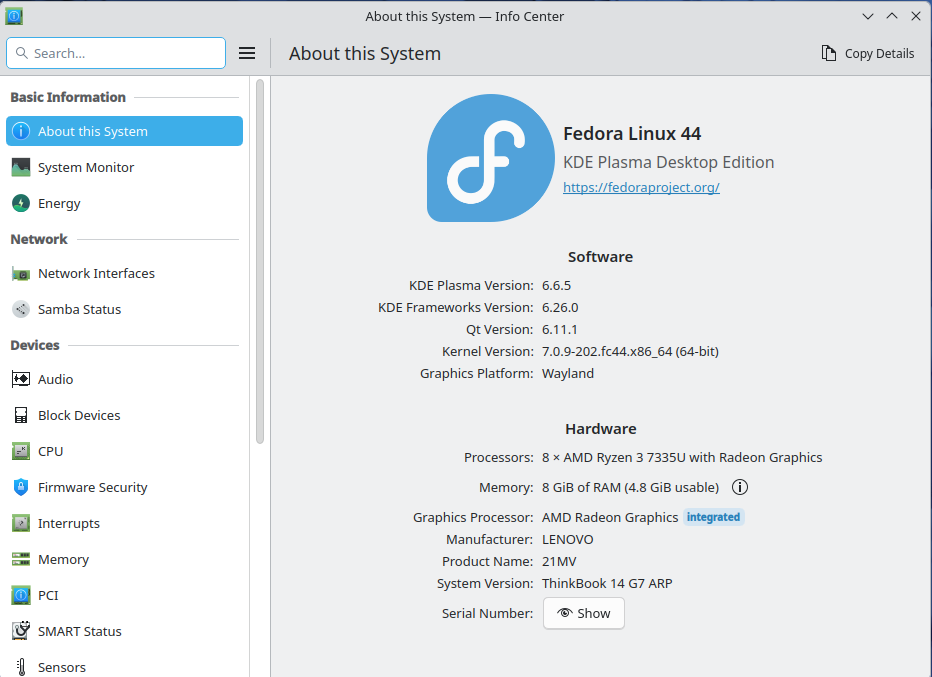
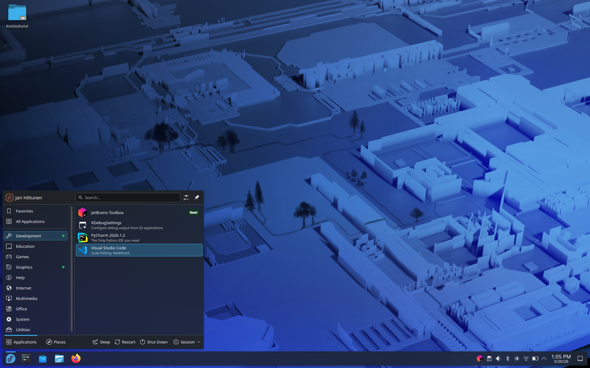

# Installing Fedora Linux 44 (KDE Plasma) Alongside Windows 11 – Complete Guide

**Device used in this example:** Lenovo ThinkBook 14 G7 - 14" laptop, Windows 11 Home (21MV00AGMX). The device was installed with default settings, and the BIOS and other Lenovo Vantage-managed settings were updated. The OEM installation creates an EFI partition that is too small by default, which is solved in this guide by creating a separate EFI partition for Fedora.

# Installation Steps

## 1. Preparations in Windows 11

- Free up disk space using Windows Disk Management
- Create at least 50–100 GB of free space for Linux
- Do not touch the Windows EFI partition (approx. 100–260 MB, FAT32)
- Temporarily disable BitLocker
- Disable Fastboot in power settings and ensure Windows shuts down completely with Power Off
- Temporarily disable real-time antivirus protection, as it may corrupt the ISO extraction process to the USB drive
- Download [Rufus](https://rufus.ie/en/#download) and [Fedora KDE Plasma Desktop 44 Live ISO](https://fedoraproject.org/kde/download/)
- Install the ISO with Rufus to the USB drive
- Shut down the computer, press Enter during boot, and select your USB drive from the F12 boot menu.

## 2. Boot Fedora Live USB

At startup, select "Start Fedora-KDE-Live", choose your language and keyboard layout, and connect to Wi-Fi or plug in an Ethernet cable:

>**Important note about keyboards and passwords:** even if you switch the keyboard layout to Finnish (FI), special characters in passwords (#@[]{} etc.) may not work as expected. This happens because the system may still use the US keyboard layout in the background even after you have "removed" it.
> **Solution:** select the keyboard layout twice – do not trust the first setting alone. Use the eye icon 👁️ when entering your password so you can see the typed characters and verify them. Test special characters before confirming the password by typing them visibly and ensuring the correct characters appear.
> **Example:** If you want to type @, on a US keyboard it is Shift+2, while on a Finnish keyboard it is AltGR+2. The difference also affects characters such as #, }, {, |, etc.

## 3. Partition the Disk with KDE Partition Manager

Open KDE Partition Manager and create the following partitions in the free space:

### A: EFI Partition for Linux

- Size: 1024 MB (1 GB)
- File system: FAT32
- Label: EFI4Linux
- Flags: boot (on GPT disks this means EFI System Partition)
- Let Partition Manager format the partition as FAT32. Do not select reformatting again in the Anaconda installer.

### B: /boot Partition

- Size: 2048 MB (2 GB)
- File system: ext4
- No encryption! (required for booting before LUKS unlock)

### C: LUKS Encrypted Root Partition

- Size: Remaining space (at least 30–50 GB)
- File system: btrfs (or ext4)
- Encryption: LUKS2
- Label: cryptroot
- Permissions: Only Root
- Password: Use the eye icon and verify special characters! 
- Press Apply (green checkmark) to execute the changes.

>**Note! Linux EFI: make sure the EFI partition has the correct flag:**

- Right-click the new 1 GB EFI partition (EFI4Linux)
- Select Properties or Manage Flags
- Check the boot flag
- Press OK and Apply

## 4. Start the Installation

> Note! If your device has an NVIDIA graphics card, the slitherer process used by the installer crashes with a segmentation fault (Signal 11 SEGV). **Fix:** force the installer to use Firefox: ```sudo nano /usr/libexec/anaconda/webui-desktop``` and change the line: ```DEFAULT_BROWSER_CMD=firefox```

- Select "Installation method"
- Select "Mount point assignment" (manual partitioning)

>Note! If you get the warning "Your boot partition is less than 500 MiB which is lower than...", do not continue! This means you have not created a separate larger EFI partition for Linux or expanded the Windows EFI partition of approx. 260 MiB.

## 5. Configure Mount Points

|Mount Point|Device|Notes|
|--|--|--|
|/| cryptroot (LUKS partition)|Prompts for LUKS password|
|/boot/efi|nvme0n1p5 (1 GB EFI)|Your new EFI partition|
|/boot|nvme0n1p6 (2 GB ext4)|Separate boot partition|

## 6. Protect the Windows EFI Partition!!

>**IMPORTANT STEP!** Fedora may try to format the Windows EFI partition (nvme0n1p1, approx. 273 MB). Prevent this:

- Press "Add mount"
- Select the Windows EFI partition (nvme0n1p1)
- Set the mount point to something like /mnt/windows_efi
- This prevents formatting – the partition will only be mounted, not formatted!

## 7. Verify Before Installation

On the Review and install page, you should see:

```bash
nvme0n1p1    273 MB    mount              /mnt/windows_efi 
nvme0n1p5    1.07 GB   mount              /boot/efi         
nvme0n1p6    2.07 GB   mount              /boot             
nvme0n1p7    103 GB    format as btrfs    / (encrypt)       
```

>**If you see "format as efi" on the Windows EFI partition, DO NOT CONTINUE! Cancel and add a mount point.**


*Working partition table of the installed system*

## 8. Install

- Press "Begin Installation"
- Wait for the installation to complete
- >Note! If you get the error "Installation failed: Storing configuration files", but the installation completed otherwise, the system will most likely still work.

## 9. First Boot

- Restart the computer
- Select Fedora Linux or Windows Boot Manager from the GRUB menu.
- Unlock your encrypted disk and log in. Done!


*Info Center view*

---
# After Installation

## Update the System:
```bash
sudo dnf update
sudo dnf groupupdate core
```

Kernel and driver sizes have increased, which means the old default 1 GB boot partition is starting to become insufficient. If you created the recommended 2 GB boot partition above, this is not a problem.

If necessary, limit how many kernels are kept installed: ```sudo nano /etc/dnf/dnf.conf```. Add or modify the line in the [main] section: ```installonly_limit=2```


## Add Swap

A swap file provides the system with a "safety valve": when RAM runs out, less frequently used data is moved to disk instead of processes being abruptly terminated or KDE freezing the entire user interface. Btrfs requires specific settings for swap files because its Copy-on-Write (CoW) mechanism is incompatible with swap:

- NODATACOW: The swap file must have the CoW attribute disabled (chattr +C)
- No holes: The file must be pre-allocated (fallocate)
- No compression: The subvolume containing the swap file must not use btrfs compression
- Single device/profile: The swap file's extents must reside on a single device

**Practical guide:** Creating a swap file on Fedora with btrfs:

1. Create a dedicated subvolume for swap (simplifies maintenance and prevents snapshot issues): ```sudo btrfs subvolume create /var/swap```
2. Create the swap file using btrfs' native tool (handles NODATACOW + pre-allocation automatically). For example, 8 GB: ```sudo btrfs filesystem mkswapfile --size 8G /var/swap/swapfile```
3. Set secure permissions: ```sudo chmod 600 /var/swap/swapfile```
4. Enable swap immediately: ```sudo swapon /var/swap/swapfile```
5. Add SELinux context (important on Fedora!): ```sudo semanage fcontext -a -t swapfile_t '/var/swap(/.*)?```and ```sudo restorecon -RF /var/swap``` 
6. Add to /etc/fstab for persistent mounting (low priority so zram is used first): ```echo '/var/swap/swapfile none swap defaults,pri=0 0 0' | sudo tee -a /etc/fstab```

**Verification and monitoring:**

Show swap devices and priorities (zram should have higher priority, e.g., 100): ```swapon --show```

Detailed real-time monitoring (press 'M' to sort by memory usage): ```htop```

**Important notes for btrfs maintenance!**

Since your swap file now resides on a btrfs volume, keep these two points in mind for the future:

1. *Filesystem checks* (btrfs scrub / balance):If you run these commands, it is recommended to temporarily disable swap during the operation to ensure all blocks are processed:

```bash
sudo swapoff /var/swap/swapfile
sudo btrfs scrub start /
# ...after the operation completes...
sudo swapon /var/swap/swapfile
```

2. *Snapshots:* Because we created a dedicated subvolume for swap (/var/swap), it will likely be excluded from the system's normal root snapshots. This is desirable, as including a swap file in snapshots can cause issues during restoration scenarios.


## Install H.264 codec support for video playback:

```bash
sudo dnf install https://mirrors.rpmfusion.org/free/fedora/rpmfusion-free-release-$(rpm -E %fedora).noarch.rpm \
                 https://mirrors.rpmfusion.org/nonfree/fedora/rpmfusion-nonfree-release-$(rpm -E %fedora).noarch.rpm
```

```bash
sudo dnf install rpmfusion-free-release rpmfusion-nonfree-release
sudo dnf install ffmpeg vlc
```

Adds H.264/H.265 support without removing ffmpeg-free. Works for most users: ```sudo dnf install libavcodec-freeworld ```

If you need the full ffmpeg command-line tool for encoding/conversion: ```sudo dnf swap ffmpeg-free ffmpeg --allowerasing```

For GStreamer applications (Totem, Rhythmbox, browsers):
```bash
sudo dnf update @multimedia --setopt="install_weak_deps=False" --exclude=PackageKit-gstreamer-plugin
```

## VS Code Installation (for developers)

1. Add the Flathub repository (asks for your sudo password) ```flatpak remote-add --if-not-exists flathub https://dl.flathub.org/repo/flathub.flatpakrepo```

2. Update repository information (ensures new packages are visible) ```flatpak update```

3. Install VS Code (exact package name: com.visualstudio.code) ```flatpak install flathub com.visualstudio.code ```

4. Launch Flatpak VS Code ```flatpak run com.visualstudio.code ``` or search for it from the application menu.

5. Grant VS Code access to USB devices (ESP32 flashing) ```flatpak override --user --device=all com.visualstudio.code```

6. If needed ```sudo usermod -a -G dialout $USER ```


*Visual Code and PyCharm installed*

## PyCharm Installation (for developers)

1. Download the latest [JetBrains Toolbox App](https://www.jetbrains.com/toolbox-app/)
2. Extract and move it: ```tar -xzf jetbrains-toolbox-*.tar.gz ```, ```mkdir -p ~/apps ``` and ```mv jetbrains-toolbox-* ~/apps/jetbrains-toolbox```
3. Create a desktop launcher: ```~/apps/jetbrains-toolbox/bin/jetbrains-toolbox --install-desktop-entry```

---

# Troubleshooting

## Windows Does Not Boot from GRUB

- Enter BIOS/UEFI (F2/F12)
- Make sure Windows Boot Manager is present in the boot list
- Try sudo os-prober and sudo grub2-mkconfig -o /boot/grub2/grub.cfg

## Password Does Not Work

- Did you verify special characters using the eye icon?
- FI and US keyboards produce different characters with the same key combinations
