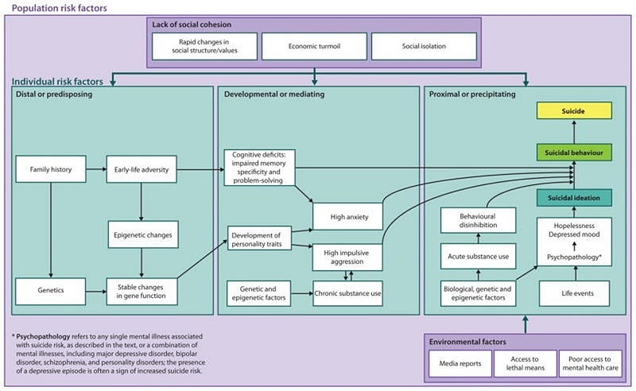
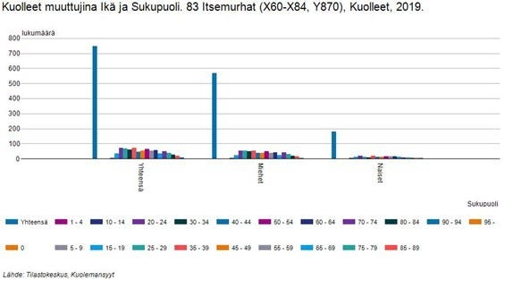

Anyone Can Volunteer as a Crisis Helper, but What Is It Really Like?

---

### Working as a volunteer at crisis phone and chat

### Anyone Can Volunteer as a Crisis Helper, but What Is It Really Like?

Anyone can become a crisis helper, but what is it truly like in practice? How does it feel to meet people through chat and try to assist them in their most vulnerable moments? It’s important to note that volunteering in crisis work isn’t something one can just step into without preparation. For example, a comprehensive understanding of the operational methods and ethical principles of [crisis helplines](https://mieli.fi/tukea-ja-apua/kriisipuhelin/) (MIELI kriisipuhelin) and the [Sekasin chat](https://sekasin.fi/) (Sekasin247) is essential. In both cases, training and formal approval as an on-call operator are required prerequisites.

In this report, I share my experiences as a first-time volunteer working in both chat-based and phone-based crisis services. I reflect on various interaction scenarios, my own ability to cope as a crisis helper, and the challenges posed by clients dealing with self-harm, mental health issues, and broader societal difficulties that are often highlighted in crisis work.

Volunteering in the Sekasin chat required approximately 10 hours of basic training, along with the approval of a mentor (Sekasin, 2021). In contrast, working for the crisis helpline involved completing 35 hours of face-to-face instruction, spread across seven different training sessions (Etappi, 2021). After completing the training, I was awarded a certificate that is recognized at all MIELI Mental Health Finland crisis service points across the country. Both training programs were primarily based on materials developed by MIELI Mental Health Finland. Additionally, during the crisis helpline training, we engaged in practical exercises, considered how to handle challenging callers, and received valuable insights from experienced helpline workers.

### Presentation of Activities

The Sekasin chat is a service coordinated by the Sekasin Collective (2021), which is managed by MIELI Mental Health Finland, the Finnish Red Cross, the Settlement Office, and SOS Children’s Villages. The Finnish Red Cross, one of the largest NGOs in Finland, plays a central role in this effort. It focuses on supporting the most vulnerable members of society, offering aid during crises and accidents, regardless of a person’s age or background.

The Red Cross provides both training and assistance, helping individuals care for others as well as themselves. Emphasizing humanity and compassion, the organization encourages people to recognize and respond to the suffering of others. The Finnish Red Cross Youth Shelter offers round-the-clock, free, and immediate support, advice, and care to young people and their loved ones.

The primary goal of the Sekasin chat is to provide a platform for young people aged 12 to 29 to engage in anonymous discussions about any issue they may be facing. The chat service operates daily, with hours running from 9 a.m. to midnight on weekdays and from 3 p.m. to 11 p.m. on weekends. In 2019 alone, the service received nearly 136,000 contact attempts, but only 20,695 discussions took place, leaving 115,052 requests unanswered due to capacity constraints. The average queue time was 1 hour and 11 minutes. Sixty percent of users reached out to the Sekasin chat due to negative emotions, and one in five returned for further assistance.

On average, self-harm was discussed eight times a day. The reasons for contacting the service included anxiety, depression, fear, physical and emotional pain, and eating disorders, which together accounted for 45% of the discussions. Other reasons included relationship problems (19%), self-harm (14%), academic or school-related concerns (9%), issues with identity and self-image (8%), and loneliness (5%). According to the clients’ self-reports, 4% of contacts had been diagnosed with a mental disorder (Sekasin, 2021a).

The crisis helpline, in contrast, aims to prevent suicide and serves individuals of all ages. Approximately 900 trained crisis professionals and volunteers work for the helpline, including myself. There are 27 crisis service points across Finland, including one in my hometown of Salo.

In 2020, crisis helpline operators managed to answer more than 90,000 calls out of over 280,000 call attempts, leaving many calls unanswered due to the high demand. Both the on-call operator and the caller remain anonymous to each other throughout the interaction (Mind, 2021a).

Both the Sekasin chat and the crisis helpline require volunteers to present a criminal background check, as both services involve working with minors.

### Mission Statement

The mission of the Sekasin chat and crisis helpline is to offer support for issues related to adolescence and parenthood, both in person and virtually. The Sekasin chat, in particular, plays a vital role in fulfilling this virtual mission. Young people, their parents, or even their partners can seek assistance, initiating a process in which suitable support options for various life situations are discussed together.

The activities are centered on the customer’s voluntary participation. From the perspective of a welfare society, the Sekasin chat can be seen as a low-threshold resource, providing anonymous support for a wide range of challenges in life. The key principle is to empower the recipient. When it comes to addressing disadvantage, many factors can intervene to disrupt processes leading to further disadvantage, such as providing guidance on how to cope with bullying, when to seek help for mental health issues, or how to handle child welfare concerns. Young people, in particular, face challenges in navigating a delicate stage of self-development amidst the harsh values of society, and insights from an external on-call worker can provide critical support in overcoming life’s obstacles.

Both the Sekasin chat and the crisis helpline enable empathetic, non-judgmental encounters with society’s most vulnerable individuals, offering a glimpse into the lives of young people in need. According to Saari and Rönkkö (2015), the concept of disadvantage within social science has evolved through moral philosophy and theories of justice. These social divisions, often serving the interests of the elite, have led to increased social distancing, empathy gaps, and deficits in solidarity, all of which are evident in both the Sekasin chat and the crisis helpline.

Social distancing, as defined by Saari et al. (2015), refers to the way in which the elite treats the less fortunate, often perceiving them as outsiders in society, a concept framed by Georg Simmel. The elite may not always intend to reduce disadvantage, as doing so could undermine their control. Disadvantage, in this context, refers to multiple layers of inequality, which are often measured through various indicators such as relative poverty (e.g., living on 60% of the average income), absolute poverty, or financial imbalance due to disparities between income and expenses. Saari et al. (2015) also describe the “empathy gap” as a mechanism that regulates social distancing, reflecting society’s limited capacity to understand and empathize with disadvantaged groups. These groups are often stigmatized as unworthy recipients of benefits or accused of living parasitically off society.

The Sekasin chat and crisis helpline also serve as tools to help halt the intergenerational transmission of disadvantage. According to Saari, Eskelinen, and Björklund (2020), intergenerational disadvantage is linked to deficits in life prerequisites and social capital. These deficits create mechanisms that weaken self-efficacy, such as constant stress, short-term thinking, performance anxiety, and difficulty adapting to various life situations. By empowering clients — whether through tackling performance anxiety or other challenges — the Sekasin chat and crisis helpline offer new tools for managing life, tools that can be passed on to future generations, potentially breaking cycles of disadvantage.

### Red Cross Values and Ethical Principles

The operations of the Red Cross are guided by seven fundamental principles: humanity, impartiality, neutrality, independence, voluntarism, universality, and unity. The organization’s primary mission is to prevent and alleviate human suffering in every possible way. The Red Cross seeks to protect life, health, and dignity, fostering understanding, friendship, cooperation, and lasting peace among people. The principle of equity is upheld by providing assistance solely based on the need for help, without consideration of nationality, religion, race, political beliefs, or social status, ensuring that those most in need receive priority (Red Cross, 2021).

The Red Cross also upholds five core ethical principles: recognizing and adhering to Red Cross values, respecting others, motivating and inspiring people, acting openly and responsibly, using the Red Cross emblem correctly, and intervening when it is misused. At the heart of these principles is the concept of humanity. Voluntarism and universality ensure that everyone has the opportunity to contribute to promoting humanity. The other principles support the Red Cross’s ability to provide assistance in the broadest range of circumstances, adapting to a wide variety of needs and challenges (Red Cross, 2021).

### Customer Process

The customer process is relatively straightforward in both the Sekasin chat and the crisis hotline. In both services, the primary assumption is that the customer is experiencing distress, but contact may sometimes be driven by loneliness or the desire to seek advice on specific issues.

In the crisis hotline, the first available on-call operator answers the phone, regardless of their location in Finland. While the queue length is unpredictable, calls are typically answered within a minute, regardless of the time of day. The operator answers with, “Crisis helpline, volunteer.”

There is no set limit on call duration, but it is recommended that calls be kept to an average of around 20 minutes. However, one-hour calls are not uncommon in severe crises, such as when someone has self-harmed or is experiencing an acute suicidal episode.

On-call shifts last between two and four hours, depending on the operator’s well-being, with a recommendation to volunteer a few times per month.

In the Sekasin chat, customers are selected from the queue, where wait times can vary significantly. Based on my observations, queues are often longer in the mornings between 9 a.m. and 10 a.m., with more than 10 people waiting, while midday between 11 a.m. and 1 p.m. can sometimes see shorter queues, and occasionally, no waiting time at all when many operators are online. In the afternoon and evening, queues can swell to over 30 people. Discussions are conducted on the Ninchat platform (2021).

Simultaneously, members of the Sekasin team and professional staff are present in the chat and are available to assist when needed. For certain reasons, such as when a customer expresses a preference to speak with a female operator, the conversation can be transferred to a colleague. Each chat is limited to a maximum of 45 minutes, which is communicated to the customer at the start with a greeting like, “Hey, glad you came to the chat. We have about 45 minutes. How are you?”

After each customer interaction, statistics are compiled based on the conversation. The process is similar for both the crisis hotline and the Sekasin chat. Specific information, as outlined in Appendix 2, is entered into a web form. While the customer’s statements are recorded, the conversation’s impact may be based on the operator’s own judgment. Any details that are uncertain, such as the reason for contact, are marked as “no information.” Even if the customer seems clearly depressed, this is not recorded in the statistics unless the customer explicitly mentions their depression. The same applies to data such as age, gender, and other personal details.

In the Sekasin chat, compiling statistics is somewhat easier than in the crisis hotline because the customer has already provided basic information such as gender and age range via the initial contact form. Additionally, since the conversation remains visible on the computer screen, operators can review it when filling out statistics to determine whether the customer was anxious, had suicidal thoughts, or benefited from the discussion. Feedback from customers is also easily linked to the operator in the Sekasin chat system.

However, with the crisis hotline, the situation is more challenging. Some callers may be experiencing psychosis and speaking at a rapid pace (up to 200 words per minute), making it difficult to capture all the necessary details. In these cases, operators often need to jot down notes during the call to aid in compiling statistics and structuring the conversation. These notes are shredded at the end of the shift. While customers can provide feedback on the call, it is more difficult to ensure that the feedback is directed to the appropriate operator.

### Construction of the Interaction Situation

Often, negative emotions arise when a person focuses on fears or distressing thoughts within their own mind. When the internal world becomes dominant, the external world can feel overwhelming. If these conscious thoughts persist for a long time, they may shift into the unconscious, leaving the source of the negative feelings unclear. When individuals are aware of the emotions causing their distress, reflecting on those feelings with another person becomes easier and more crucial. If no one is available to talk to, services like the Sekasin chat and the crisis helpline offer spaces for individuals to reflect on their emotions. Both services aim to normalize these emotions by assuring clients that feelings such as anxiety are normal and will eventually pass.

Similarly, suicidal thoughts are acknowledged as common, but if a client has a specific plan, method, and timeline for suicide, the situation must be taken very seriously. Every effort should be made to prevent self-harm. However, merely reflecting on a client’s negative emotional states may not necessarily improve their condition. Focusing solely on emotions without a solution-oriented approach may be ineffective. To address this, I sometimes employed methods from positive psychology when dealing with clients experiencing severe anxiety or distress. At critical moments, I would ask the client if they could recall a positive memory.

For instance, during an autumn holiday week, I might ask if something enjoyable happened during the holiday. If the client could recall a positive experience, I would deliberately shift the conversation toward that memory. This almost always resulted in a reduction in anxiety and negative emotions. In fact, by the end of the conversation, clients often laughed about how much their initial distress had dominated their thoughts.

According to Mönkkönen (2018), client encounters involve human interaction skills that require the ability to engage in a reciprocal exchange of ideas with clients, their loved ones, or other professionals. The key is for the expert to reflect on their own competencies, recognizing their strengths and weaknesses while ensuring the client’s voice is heard. The essence of this process is dialogue — not just discussion, but a true exchange of ideas aimed at finding a shared understanding that benefits the client.

### Putting Emotions into Words and Normalizing Them

In the context of dialogue and mutual understanding, the Sekasin chat operates through textual communication, where clients and operators are strangers to one another. Text-based interaction limits the ability to convey emotions compared to in-person or spoken communication, which can include facial expressions, tone of voice, and other non-verbal cues.

The on-call worker must undertake a significant cognitive effort to interpret the emotions conveyed by the client’s words. At the same time, they must tailor their responses to match the client’s level of understanding, ensuring that the client grasps the meaning of the conversation and that emotions are normalized.

The client’s ability to comprehend may vary depending on their age, background, and life experiences. For example, a young person might mention “scootering,” which an older operator may not immediately understand. In such cases, it’s important to ask for clarification. Similarly, with older clients, operators must consider how best to present information to ensure mutual understanding.

### Building Trust

According to Mönkkönen (2018), building trust is central to establishing a dialogical connection. In both the Sekasin chat and crisis helpline, anonymity facilitates this trust-building process. Clients do not risk losing face when they share something that may be shameful, distressing, or frightening to them.

In some cases, clients are forthcoming from the outset about their reasons for seeking help. Others may engage in lengthy conversations before revealing more serious issues, such as domestic violence or self-harm. Some clients require an empathetic presence for a longer period to develop a sense of trust.

### The Guidance Situation

The customer interaction can also be understood as a guidance situation. Mönkkönen (2018) describes this as a situation where the on-call worker offers their time and undivided attention, making the client feel truly heard. This requires genuine presence and focus, which encourages the client to open up about their difficulties and personal matters. The respectful atmosphere created through this process empowers the client to discover their own resources and solutions. During these discussions, various potential solutions presented by the client are explored, and the on-call worker reinforces them based on the client’s capabilities.

In both the Sekasin chat and crisis helpline, I occasionally overlooked the importance of this guidance process. While I listened to the client, I sometimes jumped too quickly to offering alternatives, such as self-care guides, or suggested possible reasons for their feelings. For example, when I recognized that a client was in crisis, I would explain the different stages of a crisis and why they might be feeling angry or confused. While this approach often helped clients understand their situation and offered hope that things would improve, it may have limited their ability to arrive at their own conclusions. This tendency might stem from my extensive experiential and theoretical knowledge in areas like adult education and psychology.

On the positive side, my knowledge allowed me to explore issues more deeply, and clients frequently provided feedback indicating they gained new perspectives from our conversations. However, in hindsight, it would have been more empowering for the clients to discover solutions on their own. This aligns with Mönkkönen’s (2018) concept of dialogue and guidance. Even when you know the solution, it’s more beneficial to guide the client’s thought process so that they arrive at the solution independently. This way, the client forms an emotional connection to the solution and becomes more motivated to implement it. The challenge with this approach is understanding the client’s conceptual framework and perception of the issue, as emotions like anxiety can mean different things to different people.

### Professional Ethical Perspectives

A bachelor of social services working as an on-call crisis worker must be well-versed in the guidelines and principles of professional ethics within the social services field. As Mönkkönen (2018) points out, the ultimate purpose of these principles is to support the most vulnerable and those in need of assistance. She highlights the importance of the **Code of Professional Ethics in the Social Sector**, which emphasizes key values such as respect for human dignity and human rights, the promotion of self-determination, social inclusion, and a comprehensive approach to individuals and their resources, all while advancing social justice.

One of the most challenging aspects of these ethical principles is respecting the client’s right to self-determination, particularly in situations where the client is suicidal. In the Sekasin chat, this issue becomes especially complicated when an adult customer has engaged in self-harm — such as slashing their wrists — and refuses further help. In these cases, the on-call worker is ethically bound to respect the individual’s autonomy, even if that means accepting their decision to end their own life. The limitations of what the worker can do are starkly apparent. I will delve deeper into the ethical implications of such situations later in the section on ethical reflection.

During my time on the chat and hotline, I encountered several cases of self-harm like this. These were some of the most emotionally intense and distressing situations I faced as a volunteer. Through debriefing discussions and work supervision, I learned to approach these encounters with a clearer understanding of my limitations as a helper and the boundaries of what can be done in a service like Sekasin chat or the crisis hotline.

Over time, I became more accustomed to the emotional toll of these encounters. Initially, I worried that my changing attitudes toward self-harm indicated growing cynicism, but in reality, it was part of normal professional development. The shift in my perspective was largely due to the strengthening of psychological defense mechanisms. It would only become cynicism if I lost my ability to empathize with the situation and ceased to care about the client’s well-being.

### Socratic Dialogue at the Heart of Open Questions

Both the Sekasin chat and crisis helpline training materials, as well as Mönkkönen (2018), emphasize that a client’s resources and solutions to problems can be enhanced by using open-ended questions. These questions typically begin with words such as “what,” “where,” “when,” “how,” and “who.” The use of open-ended questions is closely linked to **Socratic dialogue**, also known as the method of midwifery (maieutikos).

By employing Socratic dialogue, the on-call operator essentially guides the client in exploring their own thoughts and finding solutions. Examples of such questions might include:

- “What do you think about it?”

- “What does this mean to you?”

- “What went through your mind?”

- “What supports that thought?”

- “How else could you view this?”

- “If that were true, what would it mean to you?”

- “What other possibilities do you see?”

- “How do you explain that?”

- “What are the pros and cons of your choice?”

- “How do you understand this situation?”

- “How have you dealt with a similar situation before?”

Socratic dialogue facilitates a one-on-one exchange of ideas that encourages clients to justify their thinking, reflect more deeply, ask further questions, examine their assumptions, and open up concepts in a collaborative way.

In contrast, closed questions — those that can be answered with a simple “yes” or “no” — often limit the client’s engagement. For example, questions like “Am I right?” or “Did you really do that?” tend to make the client more passive, creating a dynamic where the on-call operator becomes the expert and the client the listener. This dynamic can stifle the conversation and prevent meaningful progress.

### Personality Factors in Building a Trustworthy and Open Atmosphere

From a self-reflective perspective, I believe my personality plays a significant role in helping people feel comfortable enough to open up and share their thoughts. This has been evident in my everyday life, where many people describe me as a good and calm listener.

I’ve often considered how personality factors shape my interactions, and I believe I’ve benefited from good genetics, a supportive upbringing, and ample opportunities — factors which, according to Metsäpelto and Feldt (2015), are crucial in shaping personality. Many describe me as extroverted, a trait Pulkkinen (2015) attributes to proactive temperament, characterized by energy, sociability, and expressiveness. Additionally, I exhibit conscientiousness, self-discipline, attentiveness, and perseverance. Perhaps most notably, I’m often seen as a positive person — helpful, nurturing, and committed to maintaining balanced relationships with others. I am also open to new experiences, eager to learn, and quick to adapt. However, these strengths can also be potential vulnerabilities that others may try to exploit.

When it comes to genetics, I have spent time considering where I inherited particular traits. In 2009, I founded the Hiltunen DNA project (Hiltunen, 2021) and conducted extensive genealogical research. I found that many behaviors linked to empathy seem to have been passed down from my mother’s side, influenced largely by Siggo Qvist (later Frondelius), a vicar of Impilahti. Traits related to loyalty and a strong sense of justice appear to come from my father’s Hiltunen lineage.

While neither the Sekasin chat nor the crisis helpline offers formal therapy, it’s not always necessary to fully understand a client’s psychological state to offer support. However, my background in psychology has proven helpful when clients ask about their situation, diagnosis, or seek advice on self-care practices. For this reason, I believe it’s essential to include some psychological background in this report, touching on one or two of the key points I’ve identified, even though this wasn’t a direct focus of my training.

### Self-Harm

Suicidal thoughts, attempted suicides, and suicides are all directly related to self-destruction. Indirect self-destruction involves unconscious risk-taking behaviors that threaten an individual’s health and well-being, and their recurrence increases the likelihood of death.

Suicidal thoughts can serve as a predictor of suicide and may range from fleeting, unstructured thoughts to detailed, well-planned actions. Individuals experiencing suicidal thoughts often suffer from psychological distress, feelings of helplessness, irritability, or hopelessness.

The emergence of suicidal thoughts is a clear cry for help, and it should be addressed immediately. A suicide attempt occurs when suicidal thoughts evolve into suicidal actions. Although some attempts may be impulsive or involve non-lethal acts, such as self-injury, any behavior that suggests an intent to die — such as pointing an unloaded gun to one’s head — can be classified as a suicide attempt, even if it does not result in physical harm or death.

Suicide is formally defined by a forensic doctor as an act committed by an individual who knew or believed that the act would likely result in their own death (Lönnqvist, Henriksson, Isometsä, & Marttunen, 2012, pp. 501–502). The factors leading to suicide are multifaceted and involve individual characteristics such as mental and physical health, genetic predispositions, a lack of protective factors against illness, social status, and the presence or absence of a support network. Factors like a person’s living environment, the availability of healthcare, and access to means of suicide also contribute. Mental disorders, however, are the most significant risk factor, with approximately 93% of those who commit suicide having been diagnosed with a mental health condition (Lönnqvist et al., 2012, pp. 504–511). This contrasts with the viewpoint from Mind (2021b), which suggests that suicide often occurs in a crisis rather than as a result of a long-standing mental illness. In their view, while mental health diagnoses such as depression can be effectively treated, individuals may still take their own lives despite successful interventions.

Hereditary factors explain between 20% and 50% of suicide risk at the population level. The lifetime risk of suicide for those with major depression and personality disorders is 5–10%, while for individuals with schizophrenia, the risk is around 5%. Additionally, alcohol and drug use are associated with more than half of all suicide cases. Chronic pain and feelings of hopelessness linked to physical illnesses also increase suicide risk. Geographically, the Swedish-speaking minority in Finland has the lowest suicide rates, while Eastern and Northern Finland experience the highest rates (Lönnqvist et al., 2012, pp. 504–511).

The process leading to suicide can be understood as a gradual progression, as outlined by Turecki and Brent (2015).

In 2019, self-harm was the reason for contacting the Sekasin chat in 2,859 instances (Sekasin, 2021a). That same year, there were 746 recorded suicides in Finland, of which 567 were men and 179 were women. The age distribution of these suicides shows that there were 4 suicides among individuals aged 10 to 14, 34 suicides among those aged 15 to 19, 71 suicides in the 20 to 24 age group, and 67 suicides among those aged 25 to 29 (Statistics Finland, 2021).

According to statistics, girls account for approximately one-third of suicides, but in my experience, their representation among suicidal clients in the Sekasin chat is notably higher. Additionally, the clients I consider to have “lost” — those who did not receive the help they needed — were mostly girls.

The primary goal of these discussions is to encourage the client to seek help or, if necessary, provide their contact information so the Sekasin team can follow up. However, if a client refuses help, there is often little more that can be done. I encountered several such cases, and initially, they bothered me because it was difficult to discern whether the situation was an attention-seeking behavior or a genuine crisis.

For instance, I had a case with a male client who self-harmed annually. After much persuasion, he finally agreed to call emergency services (112). On the other hand, the female clients who engaged in self-harm often either abandoned the idea of cutting or, if they had already cut themselves and were bleeding, refused to seek medical assistance. Perhaps they felt confident they could handle the situation on their own, as some had accumulated hundreds of scars over the years from previous incidents, and the tendency to cut had persisted throughout their youth.

Although girls were overrepresented among my clients, statistically, they are less likely to follow through with suicide than boys. It’s also possible that the conversations helped prevent them from taking their own lives. In my experience, genuinely suicidal individuals often exhibit certain behavioral traits — they are absent-minded, determined, and respond quietly to questions, almost as if resigned to their fate.

In the Sekasin chat, I also communicated with several individuals receiving care in psychiatric wards, where, fortunately, they were safe. For example, one patient with an eating disorder explained that they had stopped drinking fluids because they no longer wanted to live. They expressed a fear that if they lost consciousness, medical staff would intervene by rehydrating them.

The most concerning clients were those who had previously attempted suicide and were planning to attempt it again. These clients often felt hopeless, believing that psychiatric care had failed them or that being sent home after only one night of observation offered no real solution. Suicides are deeply traumatizing not only for those close to the individual but also for the emergency workers involved. Typically, suicide does not occur on the first attempt but after several prior attempts.

According to Mieli (2021b), it is estimated that 6 to 12 people are severely traumatized for every individual who attempts or commits suicide. Given that there were 746 recorded suicides and an estimated 30 attempts for each death, that amounts to approximately 134,280 severely traumatized individuals each year. Therefore, it is essential that on-call workers undergo debriefing discussions and supervision to process the emotions generated by these interactions and prevent lasting trauma.

### Fear of Social Situations, Loneliness, Anxiety, and Fears

Fear of social situations is a common issue among many clients, often linked to loneliness. The anxiety surrounding social interactions prevents clients from meeting people, leading to a lack of social connections. This fear, as described by Davison et al. (Kring, A. M., Johnson, S. L., Davison, G. C., and Neale, J. M., 2010), is frequently connected to anxiety disorders. Many clients report such feelings of anxiety at the outset of our conversations.

When a client expresses anxiety, I typically ask where in their body they feel it. I then guide them through a breathing exercise, asking them to focus on breathing in for a count of eight and out for a count of ten. This method engages the autonomic nervous system and helps shift their thoughts from distressing issues to the neutral action of breathing. This technique can also be effective for panic disorders, which can be difficult to distinguish from general anxiety.

In terms of social anxiety, conditions such as “coffee cup neurosis,” where hand tremors occur in public situations, are examples of social fear (Lönnqvist, J., 2014). This fear often stems from the potential for humiliation, as noted by Ranta et al. (2016), where individuals worry that others will judge them based on their visible anxiety symptoms. This social anxiety often begins during adolescence, particularly in school settings, which many Sekasin chat clients are still navigating. Central to the disorder is the repetitive fear of social situations and the tendency to overinterpret these situations as overly threatening, leading to reduced functioning and increased suffering (Lönnqvist, 2014; Davison et al., 2010).

Rationalizing this overinterpretation is often a focus of conversations in the Sekasin chat, and these discussions can help build courage in clients to confront their fears. Children and adolescents who suffer from social fear often experience loneliness, social helplessness, and discrimination from their peers (Ranta et al., 2016). While it’s impossible to know whether clients’ experiences of discrimination are objective, we can discuss group dynamics and the factors that influence them, thereby normalizing their experiences.

According to Isometsä (2014), only a minority of those suffering from social fear seek help from healthcare professionals due to the shame associated with authority figures, such as doctors. Many clients worry that a psychiatric diagnosis might stigmatize them as “crazy.” This fear often arises in conversations. If the client has not sought treatment or been diagnosed with a mental health issue, I encourage them to consult with a Mieli Ry crisis therapist or visit a Red Cross health point. However, many clients already have a mental health diagnosis. Social fear often coexists with other mental health disorders, affecting 70–80% of individuals with social fear (Isometsä, 2014). Mieli Ry will not accept clients with existing treatment contacts, as non-governmental organizations are not permitted to compete with healthcare systems. From a therapeutic perspective, there should be more low-threshold anonymous services that do not require official diagnoses.

Sometimes a simple link to a self-care program from the Mental Health Centre is enough to help the client (Mental Health Centre, 2021). Regarding fear from a neurobiological standpoint, Davison et al. (2010) and Isometsä (2014) explain that fear conditioning activates the amygdala — the brain’s fear center — and its hyperactivity. Neurotic personality traits double the risk of developing social anxiety disorder (Davison et al., 2010). Wahlström (2014) refers to social anxiety as “over-mentalization,” where individuals overanalyze how their actions appear to others and how they affect others. Davison et al. (2010) confirm this, noting that those with social anxiety tend to overanalyze their internal states. Common defense mechanisms in social situations include avoiding eye contact and withdrawing from conversations and groups.

If a client describes such defenses, I recommend resources from the Mental Health Centre that might help them.

### Ethical Consideration of Customer Situations

Each customer situation is unique, though I often encountered familiar clients, even though the chances of reconnecting should be slim. This could be due to the timing of the on-call duty or technical reasons. As an example, I’ll share a conversation that stands out, reflecting on it from an ethical perspective while omitting identifying details.

- **Me:** “Hey, glad you came to talk. We have about 45 minutes. How are you?”

- **Customer:** “It’s bad.”

- **Me:** “Oh, sorry to hear that. Could you tell me more about what’s making you feel bad?”

- **Customer:** “Everything is black. I can’t live. I’m a totally worthless person.”

- **Me:** “That sounds really heavy. Do you have suicidal thoughts?”

- **Customer:** “I tried to kill myself four weeks ago but didn’t succeed. The thoughts are still there.”

- **Me:** “So, you’re thinking about trying to kill yourself again? Do you have plans or a set time?”

- **Customer:** “Yes. I won’t be here tomorrow.”

- At this point, I consulted the Sekasin chat team for advice and asked them to monitor the conversation.

- **Me:** “What you’re saying sounds really tough. How would you feel about calling 112? We all have the right to health, and healthcare is there to help you.”

- **Customer:** “It’s no use. I know what it is… I work in healthcare myself. I don’t want to fail again and have my coworkers mock me.”

- **Me:** “So, you’re a nurse? Would it be possible to seek help in a different location?”

- **Customer:** “No. I’ve had the best care — a great psychologist, a great psychiatrist — but my life doesn’t improve.”

- **Me:** “What you’re telling me is making me anxious. It’s heartbreaking to hear you want to end your life because you feel treatment hasn’t worked. Have you started any new medications that might explain your current feelings?”

- **Customer:** “Sorry, I didn’t mean to make you feel bad. I’ve tried all kinds of medications, but nothing helps.”

- **Me:** “I’m really sorry to hear that the medications haven’t helped. Have you considered other treatments, like electrotherapy?”

- **Customer:** “I haven’t, and I won’t. I’ve made up my mind. Everything is ready, and I don’t even know why I came here.”

- **Me:** “Is there anything I can do to help?”

- **Customer:** “No, there isn’t.”

Normally, Sekasin chat conversations progress at a pace of about one comment per minute, but in the case of suicidal individuals, responses are often delayed — sometimes arriving only once every five minutes. In this instance, the client was lucid but deeply committed to self-destruction. The Sekasin chat team eventually advised ending the conversation, concluding that the client was “in waters too deep to be helped.”

This example clearly illustrates the ethical conflict between respecting a client’s autonomy, particularly when they are an adult intent on suicide, and attempting to intervene. The challenge is to balance respecting their will while grappling with the moral responsibility to prevent harm.

Emotionally, situations like this are incredibly challenging, especially during the first few encounters. There is little literature discussing how to handle such cases from an ethical standpoint. The debate surrounding suicide is closely tied to moral philosophy, akin to discussions around assisted dying or euthanasia. According to Talentia (2021), the principles of ethics emphasize the right to life but do not directly address the right to die.

In cases involving suicidal individuals, the principle of self-determination is paramount. However, according to Talentia (2021), this right can be questioned if the individual lacks the capacity to make life-related decisions, as is often the case with those who have severe intellectual disabilities.

When weighing self-determination and the ability to make decisions, the client’s mental health must be considered. According to the World Health Organization (2018), mental health is defined as a state of well-being in which an individual realizes their abilities, can cope with life’s challenges, works productively, and contributes to their community. By this definition, the client described above struggles with life’s challenges but may otherwise be considered mentally healthy. In such cases, their rational decision to end their life may need to be respected.

The Finnish Medical Association (2021) emphasizes that even if a client is persuaded to seek treatment, they retain the right to refuse any planned or ongoing treatments. Duodecim (2018) supports this, stating that even if a client were referred to a hospital for observation, they could still refuse treatment unless they were deemed mentally ill. Involuntary treatment can only be administered in cases of non-psychotic, severe mental health disorders such as extreme self-harm or substance abuse with a strong risk of suicide (Duodecim, 2018). This distinction is particularly evident in how attitudes toward self-harm differ between adults and minors in the Sekasin chat.

From an ethical standpoint, respecting the client’s decision, even if it leads to their death, may feel distressing and wrong for the on-call worker but might be the only appropriate course of action.

### The Importance of Coping, Debriefing Discussions, and Work Supervision

Before I applied to work as an on-call worker for the Sekasin chat, I had discussions with both my tutor teacher and my Red Cross instructor about whether the position would be a good fit for me. From the very beginning, they fostered an open and trusting dialogic atmosphere, which made it easier for me to speak openly about my background. This environment gave me the feeling of being truly listened to and trusted. Beyond assessing my suitability for the role, these conversations also ensured that the prerequisites for my well-being at work were in place from the start.

### Well-Being at Work

According to the Finnish Institute of Occupational Health (2021), well-being at work is characterized by safe, healthy, meaningful, rewarding, and productive work that supports life management and is performed by skilled employees within well-managed organizations. A healthy work community, they explain, is marked by openness and trust, enthusiasm and encouragement, collaboration, positive feedback, balanced workloads, the courage to address difficult issues, and the ability to maintain functional capacity during times of change. In such environments, employees are motivated, responsible, and able to utilize their strengths and skills effectively. They understand the goals of their work, receive feedback, feel needed, and experience independence, cohesion, and engagement.

For an on-call worker at the crisis helpline or Sekasin chat, the meaningfulness of the work is almost self-evident. If the work were not both meaningful and motivating, it would be difficult to maintain the energy needed to invest in it. The significance of the work is amplified by the fact that it is voluntary and unpaid, which further heightens the sense of purpose and commitment.

The most rewarding aspect of the role often comes from the positive feedback received from customers, such as, “Thank you for allowing me to talk to you. I feel much better now, and I’m not going to hurt myself anymore.”

### Work Engagement and Productivity

In the Sekasin chat, it often feels as though there’s never enough time to help everyone, especially as the queue seems to continually grow. While the queue isn’t visible on the crisis hotline, the general advice is to prioritize quality over quantity — focusing on a few high-quality conversations rather than rushing through several shorter, lower-quality interactions.

The quality of work significantly contributes to the pull of engagement. According to Mäkikangas (2005), work engagement can be defined in multiple ways. One interpretation sees it as the opposite of burnout, characterized by energy, commitment, and a sense of self-efficacy. It also includes feelings of vigor, dedication, and “absorption,” where one becomes deeply immersed in the work.

In both the Sekasin chat and the crisis hotline, the on-call worker must empathize with the client’s situation, requiring complete focus and detachment from personal distractions. This involves reflecting on the client’s emotions through the lens of empathy and guiding the client’s thoughts in a way that helps alleviate their distress and potentially empowers them through the conversation.

Often, simply providing an empathetic, emotionally validating presence is enough, but there are times when practical advice is needed — such as teaching breathing techniques for anxiety or panic attacks, or offering referrals to other services. The approach depends on whether the conversation is solution-oriented or informed by positive psychology. In practice, these approaches may shift several times during a single conversation as the situation evolves.

Though these conversations can be stressful, they also generate positive emotions for the on-call worker, which can lead to a state of “flow.” Hertel and Wittchen (2008) describe this as a state where the worker is fully engaged and motivated, driven by the perception of fair goals and a belief in the possibility of success. While flow is more temporary than long-term work engagement, it is often highly rewarding in the short term.

However, there are risks associated with deep work engagement. Mäkikangas (2005) notes that intense engagement can sometimes lead to strong work commitment, which has been linked to health risks. In particular, the energy that fuels work engagement can also contribute to burnout if not managed properly.

Mauno (2005) views work engagement as the opposite of burnout from a stress-theory perspective, though he also notes that job insecurity can influence engagement. In fixed-term roles, insecurity may be lower than in permanent roles, although this conclusion is somewhat complicated by the tendency of temporary workers to avoid behaviors that could be perceived negatively, such as taking sick leave. Furthermore, many studies on work engagement have been cross-sectional, meaning the long-term sustainability of engagement isn’t fully understood, and key definitions and indicators have yet to be solidified.

In voluntary roles such as Sekasin chat and the crisis helpline, Mauno’s (2005) view on work engagement might not apply directly. However, some on-call workers may approach their shifts as mandatory evidence for another task, such as an internship or other obligations.

For me, this role was part of my internship, and the feedback I received could impact my future job prospects. However, it’s difficult to determine the significance of this at this point. In both Sekasin chat and the crisis hotline, it’s easy to slip into a state of flow, where the on-call operator feels so absorbed in the conversations that breaks are neglected, and the desire to help as many people as possible becomes overwhelming. The downside is that this can lead to stress and depleted energy levels, highlighting the importance of self-awareness and emotional regulation.

### Stress

Life events that trigger fear, a sense of uncontrollability, unpredictability, or internal conflict — such as unresolved conscious or unconscious issues — can activate the stress response. The most serious stressors include traumatic events like the death of a loved one, divorce, accidents, natural disasters, abuse, and war. Social pressures, such as competing with others while simultaneously collaborating, can also contribute to stress.

At its worst, stress weakens cognitive capacity. In severe cases, an on-call worker may develop post-traumatic stress disorder (PTSD), which can result in emotional numbness and detachment. Stress can lead on-call workers to lose interest in activities that once brought them joy, including relationships with family and friends (Smith, E., Nolen-Hoeksema, S., Fredrickson, L., and Loftus, G., 2002, pp. 494–502).

The nature of the conversations on the crisis helpline or Sekasin chat can often evoke memories of previous stressful experiences, potentially triggering a stress response in the on-call worker. For example, encountering a suicidal client may bring back feelings related to a past suicide in the worker’s own life. In such cases, the emotional burden can overpower rational thought, reducing cognitive capacity and making it difficult to respond objectively.

Under stress, the body activates a series of “fight-or-flight” responses. This reaction originates in the brain’s hypothalamus, which controls neural and endocrine functions to prepare the body for action. The hypothalamus activates the sympathetic nervous system and suppresses the parasympathetic system, which controls endocrine functions. This results in an increased heart rate, elevated blood sugar levels, higher stress hormone production, and pupil dilation. Secondary functions such as digestion and saliva production slow down, while adrenaline widens skeletal muscles’ blood vessels and narrows intestinal blood vessels. The body even prepares for potential injury by releasing endorphins, increasing red blood cells, and boosting anti-inflammatory white blood cells.

Chronic stress can lead to physical illnesses, including stomach ulcers, hypertension, and heart disease, and it can weaken the immune system (Smith et al., 2002, pp. 502–505). For some on-call workers, stress becomes a constant presence, with breaks becoming infrequent and emotional strain building up. This can be compounded by work engagement or flow states, where even stress-free moments might feel uncomfortable after periods of high emotional involvement.

To manage this, early intervention from supervisors or team leaders is critical. During my internship, I developed an Excel template to monitor my work and stress levels. This tool not only tracked my hours but also allowed me to reflect on the stress I experienced, the lessons I learned, and my overall well-being. My Red Cross instructor reached out several times to encourage me to better utilize the Sekasin team and to keep an eye on my own well-being, especially after handling more than 160 conversations in just over a month. Although my work quality remained high and client feedback was generally positive, the team expressed concerns about my ability to cope.

Looking forward, the stress data recorded in statistics could be better utilized to inform debriefing discussions and work supervision, especially in the Sekasin chat. While all conversations may require processing, it’s typically the heavier conversations that stay with an on-call worker, impacting their day-to-day life and, in the worst cases, leading to trauma.

### Debriefing Discussions

Debriefing discussions serve as essential opportunities to release emotions generated by customer interactions and reflect on how conversations might have been better handled. These discussions are especially crucial after suicidal incidents, where emotions can surface and linger long after the interaction has ended.

I’ve personally experienced multiple cases involving suicidal clients, and despite having debriefing sessions, I’ve occasionally found myself losing sleep over particularly intense conversations. Initially, there are more debriefing sessions as the emotional load from these discussions is new, but over time, the on-call worker adapts, and fewer debriefings are needed as emotions become more manageable. This emotional adjustment often correlates with the ability to forget previous conversations over time.

Debriefing sessions and regular breaks are vital for preventing the over- or underinterpretation of customer situations. Early in an on-call worker’s experience, self-harm may be overinterpreted, with the assumption that the client is at immediate risk of suicide. Over time, the worker develops a routine response to such feelings, using them as a protective mechanism. Conversely, underinterpretation may occur if the worker has recently encountered clients who threaten self-harm primarily as a way to seek attention. This can lead to insufficient empathy or care when dealing with genuinely suicidal clients.

### Work Supervision

Alongside debriefing sessions, regular work supervision is mandatory. According to Talentia (2021b), work supervision involves the development of one’s professional role through the evaluation of feelings and experiences arising from work. Supervision focuses on both the worker’s role and the functionality of the broader work community. The process is centered on confidential interaction and personal insights from the supervisees, including on-call workers. Supervision takes place through regular meetings, which may be held individually or in groups, depending on the format chosen.

The benefits of work supervision are significant, ranging from clearer definitions of basic work tasks to a strengthened professional identity. This, in turn, leads to enhanced job satisfaction, improved work quality, and better coping mechanisms.

### Conclusion: The Importance of Managing Stress, Debriefing, and Supervision for On-Call Workers

The work of on-call workers in crisis helplines, such as Sekasin chat, is both meaningful and challenging. It requires a high degree of emotional engagement, empathy, and mental resilience. However, these very qualities can also make the work emotionally taxing, leading to stress, burnout, and even trauma if not properly managed.

Stress in on-call work often arises from the emotionally charged nature of the conversations and the unpredictable circumstances of clients in crisis. Whether triggered by past experiences or the immediate demands of helping suicidal or anxious clients, stress can have a profound impact on both cognitive functioning and emotional well-being. Therefore, understanding how to recognize and manage stress responses is essential for maintaining both personal well-being and professional effectiveness.

Debriefing discussions serve as an important outlet for processing emotions and reflecting on difficult interactions. These sessions help workers decompress and avoid the buildup of emotional strain that can lead to burnout or compassion fatigue. Over time, as workers become more accustomed to handling stressful situations, they may require fewer debriefings, but these sessions remain a crucial tool for long-term emotional health.

Work supervision is equally vital, providing a structured space for reflection, professional growth, and support. Supervision ensures that on-call workers not only cope with the emotional toll of their work but also continuously develop their skills and maintain their professional identity. Regular supervision enhances job satisfaction and improves the quality of care provided to clients.

In conclusion, the intersection of stress management, debriefing, and supervision creates a foundation of support for on-call workers, allowing them to remain effective in their roles while safeguarding their mental and emotional well-being. Through these processes, they can continue to provide compassionate, high-quality assistance to those in crisis while also ensuring their own sustainability in this demanding field.

### Bibliography

Davison ym. 2010. Abnormal psychology (11th edition). Kring, A. M., Johnson, S. L., Davison, G. C. ja Neale, J. M. Jefferson City: John Wiley & Sons, Inc.

Duodecim. 2018. Involuntary psychiatric hospitalization. . Available in: <https://www.terveyskirjasto.fi/dlk00512>

Stage. 2021. Becoming a feel-good volunteer crisis helpline helpline. Available in: <https://www.mielenterveysseurat.fi/salo/2021/08/09/hyvan-mielen-kriisiauttaja-kriisipuhelinpaivystykseen/>

Hertel, G. ja Wittchen, M. 2008. Work Motivation. Teoksessa Chimel, N. (toim.). An introduction to work and organizational psychology. A European perspective (s. 29 –55). (2nd edition). Carlton, Victoria, Australia: Blackwell Publishing Ltd.

Hiltunen. 2021. Hiltunen’s DNA project. Available in: <https://www.familytreedna.com/groups/hiltunen/about/background>

Isometsä, E. 2014. Anxiety disorders. In Lönnqvist, J., Henriksson, M., Marttunen and Partonen, T. (eds.). Psychiatry (pp. 287–323). Helsinki: Duodecim Publishing Company.

Medical Association. 2021. Euthanasia and assisted suicide. Available: <https://www.laakariliitto.fi/laakarin-etiikka/elaman-loppu/eutanasia-ja-avustettu-itsemurha/>

Lönnqvist, J. & Marttunen, M. &; Pylkkänen, K. 2012. Psychotherapeutic treatment of psychiatric disorders. In J. Lönnqvist (ed.) Psychiatry (pp. 658–715). Helsinki: Duodecim Publishing Company.

Lönnqvist, J. 2014. Diagnostics and classification of mental disorders. In Lönnqvist, J., Henriksson, M., Marttunen, M. and Partonen, T. (eds.). Psychiatry (pp. 57–69). Helsinki: Duodecim Publishing Company.

Mauno, b. 2005. Work insecurity, unemployment and well-being. In Kinnunen, U., Feldt, T., Mauno, S. (eds.) Work as a bread (pp. 167–199). Keuruu: PS-kustannus

Metsäpelto, R-L, Feldt, T. 2015. Psychological foundations of personality. Riitta-Leena Metsäpelto &; Taru Feldt (eds.). PS Cost. Jyvaskyla.

Mind (Mieli). 2021a. The crisis helpline is on call in four languages. Available in: <https://mieli.fi/mieli-ry/organisaatio/tietoakriisipuhelimesta/>

Mind (Mieli). 2021b. MIELI Suicide Prevention Centre. Powerpoint: Suicide, self-harm, speaking up. Pasila 8.9.2020.

Mental Health House. 2021. Self-help program for social tension. Available: <https://www.mielenterveystalo.fi/aikuiset/itsehoito-ja-oppaat/itsehoito/sosiaalisen_jannituksen_omahoito/Pages/default.aspx>

Mäkikangas, A. 2005. Positive psychology perspectives on work and well-being at work*.* In Kinnunen, U., Feldt, T., Mauno, S. (eds.) Work as a bread (pp. 56–74). Keuruu: PS-kustannus

Mönkkönen, K. 2018. Interaction in customer work : Customer encounters in the social and health care sector (1st edition). Gaudeamus.

Red cross. 2021. Red Cross principles. Available: <https://www.punainenristi.fi/tyomme/periaatteet/>

Pulkkinen, L. 2015. From child to adult, but how and how? From Development and Social Perspective on Personality Metsäpelto, R-L, Feldt, T. 2015. Psychological Foundations of Personality (ed.). PS Cost. Jyvaskyla.

Beach etc. 2016. Anxiety disorders. In Kumpulainen, K.; Aronen, E., Ebeling, H., Laukkanen, E., Marttunen, M., Puura, K. and Sourander, A. (eds.) Child psychiatry and adolescent psychiatry (pp. 276–280). Helsinki: Duodecim Publishing Company.

Rednet. 2013. Code of Ethics. Available: <https://rednet.punainenristi.fi/node/26573>

Saari, J., Eskelinen, N. and Björklund, L. 2020. Heavy inheritance. Intergenerational disadvantage in Finland. Gaudeamus. Tallinn.

Saari, J, Rönkkö, H. 2015. Disadvantaged — Conditions for life at the bottom of society. Gaudeamus. Tallinn.

Sekasin247. 2021a. Info. Available in: <https://sekasin247.fi/>

Mieli Collective. 2021. <https://mieli.fi/uutiset/sekasin-kollektiivi-vastaa-nuorten-kasvavaan-avun-tarpeeseen/?ref=ninchat>

Smith, E. & Nolen-Hoeksema, S. & Fredrickson, B. & Loftus, G. 2002. Stress, Health and Coping & Psychological Disorders & Treatment of Psychological Disorders. Teoksessa Atkinson & Hilgard’s Introduction to Psychology. 2002, 493–602.

Talent. 2021. Everyday life, values and ethics. Available: <https://talentia.e-julkaisu.com/2017/eettiset-ohjeet/>

Talentia. 2021b. Work supervision. Available: <https://www.talentia.fi/tyoelamainfo/hyvan-tyopaikan-kriteerit/tyonohjaus/>

Statistics. 2021. Statistical database StatFin. Suicides committed in 2019 Available in: <https://pxnet2.stat.fi:443/PXWeb/sq/8ee08221-a0cf-4d20-9d7e-8b9896d3ef9e>

THL. 2021. The chemistry of falling in love. Available: <https://thl.fi/fi/ajankohtaista/kampanjat/kesaterveys/rakastumisen-kemiaa>

Turecki, G., Brent, A. 2015. Suicide and suicidal behaviour. Available: <https://pubmed.ncbi.nlm.nih.gov/26385066/>

Finnish Institute of Occupational Health. 2021. Well-being at work. Available: <https://www.ttl.fi/tyoyhteiso/tyohyvinvointi/>

Wahlström, J. 2014. Lectures: “What is psychotherapy? (10.11.2014)”, “What helps in psychotherapy? (11.11.2014)” and “Psychotherapy as a treatment of disorders of being in a relationship (11. 11 2014)”. University of Jyväskylä.

WHO. 2018. Mental health: strengthening our response. Available: <https://www.who.int/en/news-room/fact-sheets/detail/mental-health-strengthening-our-response>
