# Kilpirauhasen toiminta

**Lukijalle**

Olen tehnyt tämän dokumentin oppiakseni. Ilman korvausta. Jaan tämän dokumentin siksi, että muutkin voisivat oppia uutta. Dokumentin vastikkeellinen hyödyntäminen on ehdottomasti kielletty. En ota vastuuta mahdollisista virheistä. Tekstin ymmärrettävyyden vuoksi olen linkittänyt tekstiin internetistä löytyviä selvityksiä termien ja asioiden jatkotutkimusta ajatellen. Linkki näkyy sinisenä alleviivattuna tekstinä. Olen tarkoituksella jättänyt pois joitakin yleisesti tiedossa olevia perusasioita.

Hormonaalisen säätelyn lähteenä olen käyttänyt kirjan [Campbel Biology](https://www.pearson.com/us/higher-education/product/Reece-Campbell-Biology-10th-Edition/9780321775658.html) 9th edition kirjaa (Campbell Biology 2011, 1020-1034). Kirjoittajana hormonisäätelyn osalle 7 on [Masashi Yanagisawa](http://sleepymouse.tsukuba.ac.jp/english.html) . Kuvien käyttöluvan olen saanut kustantajalta Pearson / Malgorzata Chudzinska / ref 500B0DTPME. Olen suomentanut kuvat parhaaksi katsomallani tavalla. Osalle sanoista ei ole olemassa suomennosta.

Solubiologian, genetiikan ja elämän kemian opinnot auttavat ymmärtämään paremmin solutason tapahtumia. Sivuan aihetta hieman lainatessani Biokemian ja solubiologian perusteita. Hormonit aiheuttavat aina myös käytösvasteita, mutta niitä en ole avannut tässä dokumentissa. Psykologian perusopinnoista voi saada jonkin verran lisävalaistusta asiaan, jos sellainen jotakuta kiinnostaa. Hyvä tietolähde on psykologiliiton [We Are Only Human](https://www.psychologicalscience.org/news/were-only-human).

Olen kirjoittanut tähän dokumenttiin joitakin ajatuksia siitä, miten geneettistä tietoa, laboratoriotuloksia, koneoppimista ja keinoälyä voitaisiin hyödyntää. Tietoa meillä alkaa olla todella paljon, mutta tiedon hyödyntäminen on vielä kovin vajavaista. Ihminen ei kuitenkaan ole kone ja biologisten asioiden abstrahointi tietotekniikalle on suuri haaste. Tärkeää on kuitenkin yrittää.

Sellainen ihminen, joka ymmärtää keinoälyä, koneoppimista ja biologisia prosesseja voi käyttää esimerkiksi [BioPythonia](http://biopython.org/) suurien tietomassojen analysointiin. Myös IBM:n [SPSS](https://www.ibm.com/analytics/us/en/technology/spss/) toimii korrelaatioiden ja kausaliteettien etsimisessä, mutta ongelmana on tiedon mallintaminen pelkästään numeroiden avulla, jolloin abstrahointi hankaloituu entisestään.

Microsoftin lanseerattua [Azuren](https://azure.microsoft.com/en-gb/?&wt.mc_id=AID623274_SEM_) on heilläkin uusia työkaluja koneoppimisen ja keinoälyn rintamalla. Myös Excelin Data Modeliin on odotettavissa koneoppimiseen liittyviä lisäosia, joilla Excelin avulla tietoja voidaan paremmin analysoida. Esimerkin siitä miten Exceliä voi hyödyntää koneoppimisessa voit katsoa tekemästäni " [Virtuaalitohtorista](https://github.com/divergentti/Excel-putput/tree/main/Virtual-doctor)". Virtuaalitohtorin taustalla toimii 4396 sairautta ja niiden oiretta. Käytännössä Excelin rajoitteista johtuen mallia ei voi opettaa siten kuin koneoppimisessa olisi tarkoitus, mutta esimerkistä näet, että Excelilläkin saa aikaan hyvin mielenkiintoisia asioita ja yllättävän helposti.

Aloitan kertaamalla hormoneihin ja umpieritysjärjestelmään liittyvät perusasiat. Perusasioiden jälkeen siirryn tarkastelemaan asioita hieman syvällisemmin paneutumalla kuljetusproteiineihin ja potilasesimerkkiin. Neuroendokrinologiaa en käsittele tässä dokumentissa.

Nautinnollisia lukuhetkiä!

# Hormonit ja umpieritysjärjestelmä

Ymmärtääksemme mitä hormonit ovat ja miten ne toimivat, käydään aluksi läpi perusteita. [Endokrinologia](https://fi.wikipedia.org/wiki/Endokrinologia) eli umpieritysoppi, on tieteenala, joka tutkii umpieritysjärjestelmää, sen erittämiä hormoneja ja niihin liittyviä tauteja ja sairauksia

Sana hormoni tulee kreikan sanasta "horman", joka tarkoittaa "saada innostumaan". [Hormonit](https://fi.wikipedia.org/wiki/Hormoni) ovat hitaita viestinviejiä kehossamme. Hormonit kiertävät [verenkierrossamme](https://fi.wikipedia.org/wiki/Verenkierto), solujen ulkopuolisessa nesteessä.

Meissä on verta noin 5,6 litraa ja sitä kierrätetään aktiivisuudesta riippuen noin 7600 litraa vuorokaudessa kehossamme. Normaalitilassa kestää noin minuutin, että veri kiertää sydämestä kehon kautta takaisin sydämeen.

Jokaisella hormonilla on sille ominainen [reseptori](https://fi.wikipedia.org/wiki/Reseptori_(biokemia)) kehossamme. Solu, jossa on hormonille sopivia reseptoreita vastaa hormonin läsnäololle, mutta solu, jossa ei ole sopivia reseptoreita, ei tee mitään. Hormonin ja reseptorin voi ymmärtää legopalikoina: mikäli legopalikat sopivat yhteen, käynnistyy jokin biologinen prosessi.

Reseptoreiden toimintaan voidaan vaikuttaa lääkkeillä. Reseptoreita aktivoivia lääkkeitä kutsutaan [agonisteiksi](https://fi.wikipedia.org/wiki/Agonisti) ja reseptoreiden toimintaa salpaavia lääkkeitä [antagonisteiksi](https://fi.wikipedia.org/wiki/Antagonisti_(l%C3%A4%C3%A4ketiede)).

Hormoneita tuottavat [umpieritys](https://fi.wikipedia.org/wiki/Umpieritysj%C3%A4rjestelm%C3%A4) (endokriiniset) solut säätelevät [aineenvaihduntaa](https://fi.wikipedia.org/wiki/Aineenvaihdunta), kasvua, lisääntymistä ja käyttäytymistä. Suomentamisessa olen käyttänyt sekä sanaa endokriininen että umpieritys kuvaamaan samaa asiaa. Yleisesti endokriinisten rauhasten toiminnasta voit opiskella [Solunetistä](http://www.solunetti.fi/fi/histologia/endokriiniset_rauhaset/). Aineenvaihdunnasta tarkemmin myöhemmin tässä dokumentissa.

Hormonien ja niitä lukevien reseptorien lisäksi tärkeä säätelyjärjestelmä on [hermosto](https://fi.wikipedia.org/wiki/Hermosto), erikoistuneiden hermosolujen verkosto. Ne viestittävät niille määrittyneissä kanavissaan. Nämä viestit säätelevät [hermosoluja](https://fi.wikipedia.org/wiki/Neuroni), [lihassoluja](https://fi.wikipedia.org/wiki/Lihassolu) [^1] ja myös umpierityssoluja.

Koska hermosolujen avulla tapahtuva viestintä voi säädellä hormonien vapautumista, voivat hermosto ja umpieritysjärjestelmä toimia päällekkäin kuitenkin siten, että umpieritysrauhasia voi ohjata joko [parasympaattinen](https://fi.wikipedia.org/wiki/Parasympaattinen_hermosto) tai [sympaattinen](https://fi.wikipedia.org/wiki/Sympaattinen_hermosto) hermosto kerrallaan (ei siis yhtä aikaa) [^2]. Hermoston umpieritystä (hermohormoneja) ja hormonien vaikutusta keskushermostoon tutkii neuroendokrinologia.

Kehossamme on useita eri säätelyjärjestelmiä. Yhteistä useimmille niistä on pyrkimys tasapainoon. Tästä pääsemmekin [homeostaasiin](https://peda.net/p/Sj%C3%B6blom%2C%20Jessica/eiehsmtl/eieh).

## Homeostaasi

Homeostaasilla (homeo = muuttumaton, statis = pysähdys) tarkoitetaan lyhyesti sitä, että järjestelmä pyrkii hakeutumaan tasapainotilaan. Helpointa on tarkastella verensokerin, eli [glukoosin](https://fi.wikipedia.org/wiki/Glukoosi), homeostaasia:

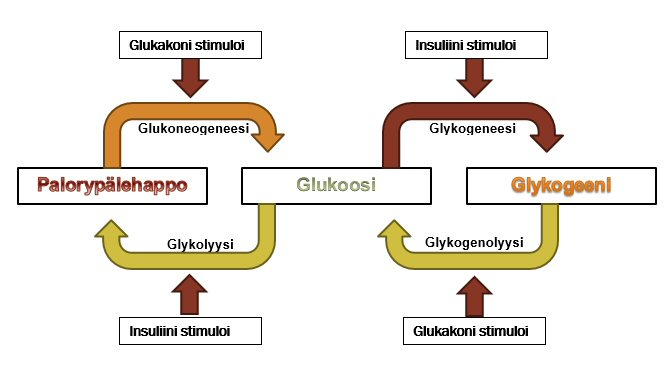

[]Kuva - Verensokerin eli glukoosin säätely

Glukoosi on energian siirtoon tarkoitettu hiilihydraatti, jonka [konsentraatio](https://fi.wikipedia.org/wiki/Konsentraatio) verenkierrossa, eli "pitoisuus" vaikuttaa jokaiseen soluun. Verensokerin eli glukoosin pitoisuus on tarkoin kontrolloitua välillä 80-100 mg/100 cm. Matala verensokeri johtaa [hypoglykemiaan](https://fi.wikipedia.org/wiki/Hypoglykemia) ja korkea verensokeri johtaa [hyperglykemiaan](https://fi.wikipedia.org/wiki/Hyperglykemia), jotka ovat molemmat vakavia ja voivat johtaa kuolemaan. [^3]

Ruokailun jälkeen glukoosi imeytyy vatsalaukusta [porttilaskimoon](https://fi.wikipedia.org/wiki/Porttilaskimoj%C3%A4rjestelm%C3%A4) lisäten veren glukoosipitoisuutta (verensokeria). [Haima](https://fi.wikipedia.org/wiki/Haima) havaitsee glukoosin (eli verensokerin) nousun, joka alkaa erittämään insuliinia β-soluista, eli betasoluista. Insuliinin ilmestyminen verenkirtoon käynnistää maksassa biokemiallisen reaktion, joka muuttaa glukoosin [glykogeeniksi](https://fi.wikipedia.org/wiki/Glykogeeni). Tämä vähentää glukoosia verenkierrossa, joka taas saa aikaan insuliinin erityksen loppumisen haimassa. Mikäli verensokeri laskee liian alhaiseksi, haima havaitsee tämän ja vapauttaa [glukagoneja](https://fi.wikipedia.org/wiki/Glukagoni) haiman α-soluista, eli alfasoluista. Glukagonin ilmestyminen verenkiertoon käynnistää maksassa biokemiallisen prosessin, joka tuottaa glykogeenivarastostaan glukoosia, joka siirtyy verenkiertoon. Kun verensokeri, eli glukoosin määrä, nousee, haima lopettaa glukagonin tuoton. Haima havaitsee siis ns. negatiivisen kytkennän kautta mitä haiman tulee kulloinkin tehdä (negatiivinen kytkentä selitetty myöhemmin).

[Diabetes](https://fi.wikipedia.org/wiki/Diabetes) on siis glukoositasapainon (homeostaasin) ongelma. Diabetes tyyppi 1 on sellainen diabeteksen tyyppi, jossa haiman beta-solut ovat tuhotuneet [autoimmuunisairauden](https://fi.wikipedia.org/wiki/Autoimmuunisairaus) vuoksi. Diabetes tyyppi 2 (DT2M) on sellainen, jossa insuliinia lukevat reseptorit eivät toimi eivätkä poista ylimääräistä glukoosia verestä esimerkiksi rasvasoluihin, sillä rasvasolu vähentää insuliinireseptoreitaan täyttyessään eikä se voi vastaanottaa ylimääräenergiaa tallennettavaksi.

Mistä glukoosi sitten tulee? Esimerkiksi kasvit tuottavat yhteyttämällä tärkkelystä, joka koostuu yhteensidotuista glukoosimolekyyleistä [^4]. Yhteyttämisessä hiili kiertää, eli uloshengittämämme CO2 napataan pois C (osaksi sokeriketjua) ja kasvi tuottaa tarvitsemaamme O2:ta ilmakehään. Näin sokerit lähtevät kiertoon ravintopyramidissa (jokaisessa tasossa häviää n. 90% energiasta ja biomassasta).

Elämän kemian kurssit auttavat ymmärtämään elämänkiertoa tarkemmin.

Aineenvaihduntaa, joka on myös tärkeä osa kilpirauhasen toiminnoista voimme tarkastella ATP:n kautta.

Kiireinen englantia osaava lukija voi katsoa [tämän](https://www.youtube.com/watch?v=iNrUpBwU3q0) videon " How does the thyroid manage your metabolism? - Emma Bryce"

## Metabolia eli aineenvaihdunta

Kaikki solut tarvitsevat elääkseen energiaa. Soluille tärkeä energian muoto on kemiallinen energia, joka on varastoitu molekyyleissä atomien keskinäiseen ryhmittymiseen. Ravintoaineiden sisältämä kemiallinen energia voidaan muuntaa toiseksi energiamuodoksi. Solut hajottavat ravintoaineet yksinkertaisimmiksi aineiksi ja käyttävät tässä prosessissa vapautuvan energian uusien molekyylien synteesiin (tuottamiseen) esimerkiksi liikkeen synnyttämiseen. Osa energiasta vapautuu lämpönä. Tätä tietoa kutsutaan aineenvaihdunnaksi eli [metaboliaksi](https://www.solunetti.fi/fi/solubiologia/metabolia/).

## Pienikokoinen orgaaninen molekyyli ATP

Soluilla on kaksi strategiaa vapaan energian saamiseksi ympäristöstä: ne ottavat ympäristöstä sopivia ravintomolekyylejä ja hyödyntävät niihin sisältyvää vapaata energiaa ( [kemotrofinen](https://fi.wikipedia.org/wiki/Kemotrofi) elämänmuoto) [^5] tai vangitsevat valoenergiaa ja muuntavat sitä kemialliseksi energiaksi ( [fototrofinen](https://fi.wikipedia.org/wiki/Fototrofi) elämänmuoto).

Maapallolla molemmat mainitut energialähteet ovat pääasiassa peräisin auringossa tapahtuvista ydinreaktioista, joissa vedyn potentiaalienergia muuttuu säteilyksi. Riippumatta energialähteestä on energian talteenotossa soluissa sama mekanismi: energiaa saadaan elektronien virtaamisesta.

[Fotosynteesiä](https://fi.wikipedia.org/wiki/Fotosynteesi) harjoittavat solut käyttävät valoenergiaa elektronien liikutteluun. Muut solut ja eliöt saavat energiansa polttoainemolekyylien hapetuksen liittyvistä elektronien siirtymisistä. Polttoainemolekyylien elektronit liikkuvat asteittain molekyyliltä toiselle kohti happea ja tämä virtaus hyödynnetään solujen energiantuotannossa.

> Esimerkki: Fotosynteesi tuottaa auringosta säteilleestä energiasta > pelkistyneitä hiiliyhdisteitä (sokeriketjuja), joita ihminen "polttaa" > tuottaen hiilidioksidia (CO2) [^6].

Ravintoainemolekyylien hapetuksessa soluissa elektronien perimmäinen vastaanottaja on tavallisesti happi, mutta hapetus tapahtuu epäsuorasti välittävien reaktioiden kautta. Joissakin tapauksissa elektronit joutuvat lopulta jollekin muulle aineelle kuin hapelle. Silloin kyseessä on [anaerobinen](https://fi.wikipedia.org/wiki/Anaerobinen_eli%C3%B6) eli hapettomasti tapahtuva metabolia, jota harjoittavat mm. hapettomissa oloissa elävät bakteerit.

Virtaavan veden energian muuntamiseksi sähköksi tarvitaan muuntolaite, esimerkiksi voimalaitos turbiineineen. Kytkentämekanismi solun energiaa tuottavien ja energiaa vaativien reaktioiden välillä perustuu siihen, että eräs molekyyli osallistuu välittäjänä molempiin reaktioihin. Tämä välittäjä on pienikokoinen orgaaninen molekyyli, [adenosiinitrifosfaatti](https://fi.wikipedia.org/wiki/Adenosiinitrifosfaatti), ATP. [^7]

Anaerobinen (hapeton) soluhengitys: ATP luovuttaa [fosfaatin](https://fi.wikipedia.org/wiki/Fosfaatti) toiselle molekyylille. Glukoosin hajoamisreitissä eli [glykolyysissä](https://fi.wikipedia.org/wiki/Glykolyysi) josta saadaan glukoosi-6-fosfaattia (ATP + glukoosi -\> ADP + glukoosi-6-fosfaatti).

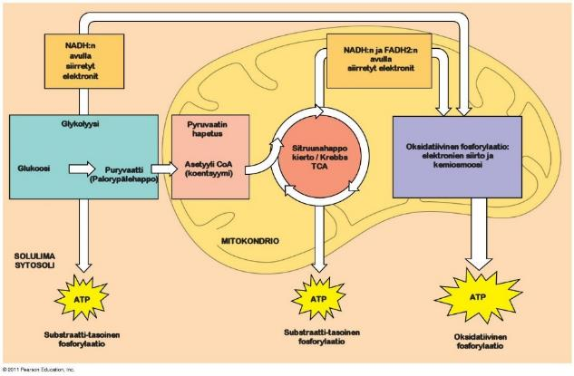

ATP pystyy aktivoimaan muita yhdisteitä luovuttamalla niille fosfaattiryhmän. Tällöin yhdisteestä tulee pysymätön, jolloin se voi helpommin osallistua muihin kemiallisiin muunnoksiin. ATP on solujen kytkentämekanismi energiaa vapauttavien ja energiaa vaativien tapahtumien välillä. Glukoosin hapetuksessa vapautuva energia taltioidaan ATP:nä. ATP on sitten mukana, kun solu valmistaa rakennusosista uusia molekyylejä. Fosfaatin siirtäminen ATP:sta aktivoitavalle molekyylille on tärkeä mutta ei ainoa tapa, jolla ATP toimii välittäjänä (GTP on lähes sama kuin ATP, guaniini-emäs korvaa adeiinin) (Heino ja Vuento 2008).

Alla olevasta havaintokuvasta näet tarkemmin aerobisen soluhengityksen tapahtumat.

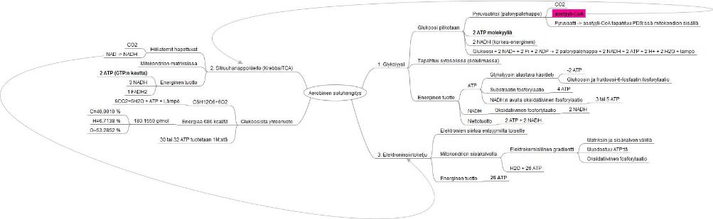

[]Kuva - Aerobinen soluhengitys

1. Glykolyysissä: glukoosi pilkotaan solulimassa pyruvaatiksi (palorypälehappo) josta tulee CO2 ja asetyyli-CoA (pyruvaatti -\> asetyyli-CoA tapahtuu PDS:ssä mitokondion sisällä). Tästä muodostuu: 2xATP molekyyliä ja 2xNADH (korkea-energinen).

2. Sitruuhanappokierrossa (Krebbs/TCA) lähtöaineena toimii asetyyli-CoA. Reaktio tapahtuu mitokondrion matriksissa. Hiiliatomin hapettuvat, jolloin tuotetaan CO2 ja NAD:sta tulee NADH:ta. Energinen tuotto on 2x ATP (GTP:n kautta), 3xNADH ja 1xFADH2.

3. Elektroninsiirtoketjussa tapahtuu elektronien siirtoa entsyymiltä toiselle. Reaktio tapahtuu [mitokondrion](https://fi.wikipedia.org/wiki/Mitokondrio) sisäkalvolla elektrokemiallisen gradientin avulla, matriksin ja sisäkalvon välillä ( [oksidatiivinen fosforylaatio](https://fi.wikipedia.org/wiki/Oksidatiivinen_fosforylaatio)). Reaktiosta muodostuu vettä H2O ja 26 ATP-molekyyliä. Tuloksena on C6H12O6+6O2 -\> 6CO2+6H2O + ATP + Lämpö [^8]. Energiaa sisältyy 686 kcal/M. Glukoosin atomipaino 180,1559 g/mol, josta C=40,0010 %, H=6,7138 % ja O=53,2852 % ja yhdestä moolista glukoosia tuotetaan 30 tai 32 ATP:tä.

## Makromolekyylit

Solun makromolekyylit rakentuvat muutamasta harvasta tyypistä yksinkertaisia [monomeerejä](https://fi.wikipedia.org/wiki/Monomeeri). Osa kemiallisista aineista on varsin pieniä, kuten vesimolekyyli ja epäorgaaniset ionit, esimerkiksi Na+, K+ ja Ca2+ ja fosfaatti [^9]. Soluissa on myös hyvin suuria molekyylejä, joita kutsutaan [makromolekyyleiksi](https://fi.wikipedia.org/wiki/Makromolekyyli). Näitä ovat [proteiinit](https://fi.wikipedia.org/wiki/Proteiini), [nukleiinihapot](https://fi.wikipedia.org/wiki/Nukleiinihappo) ja [polysakkaridit](https://fi.wikipedia.org/wiki/Polysakkaridit). Makromolekyylit yhdistyvät suuremmiksi rakenteiksi. Makromolekyyleillä on yhteinen rakennusperiaate: ne ovat [polymeerejä](https://fi.wikipedia.org/wiki/Polymeeri). Nimi tarkoittaa monikertaa, jotka muodostavat lukuisista kappaleista muutamaa harvaa rakennusosatyyppiä, monomeeriä. Eri makromolekyylien monomeerit ovat kemiallisesti erilaisia. Esimerkiksi proteiinien monomeerejä ovat [aminohapot](https://fi.wikipedia.org/wiki/Aminohapot), joita proteiineissä esiintyy kahtakymmentä erilaista. Aminohapot muodostavat proteiinissa ketjun, jossa niiden keskinäinen järjestys määrittelee proteiinin niin kutsutun [primaarirakenteen](https://fi.wikipedia.org/wiki/Proteiinin_rakenne#Primaarirakenne) (Heino ja Vuento 2008).

## Solun kemia

Soluissa esiintyy eniten hiiltä C, vetyä H, happea O ja typpeä N. Nämä neljä alkuainetta muodostavat mielellään [kovalenttisia](https://fi.wikipedia.org/wiki/Kovalenttinen_sidos) yhdisteitä. Erityisesti hiilen kovalenttiset yhdisteet ovat maapallolla vallitsevissa olosuhteissa kestäviä ja hiiliatomeilla on hyvin monipuolinen kyky muodostaa erilaisia molekyylejä. Ihmiskehon alkuaineet ovat:

------------------------------------------------------------------------ Symboli Alkuaine Osuus % --------------------- ---------------------------- --------------------- O Happi 65

C Hiili 18,5

H Vety 9,5

N Typpi 3,3

Ca Kalsium 1,5

P Fosfori 1,0

K Kalium 0,4

S Rikki 0,3

Na Natrium 0,2

Cl Kloori 0,2

Mg Magnesium 0,1 ------------------------------------------------------------------------

Lisäksi tärkeitä ovat [Hivenaineet](https://fi.wikipedia.org/wiki/Hivenaine) (eli vähemmän kuin 0,1%): boori B, fluori F, kromi Cr, jodi I, koboltti Co, kupari Cu, mangaani Mn, molybdeeni Mo, pii Si, rauta Fe, seleeni Se, sinkki Zn, tina Sn ja vandiini V. Nämä edellä luetellut seikat selittävät, miksi biomolekyylit ovat hiiliyhdisteitä. Veden ja hapen suuren osuuden selittää osaksi se, että eliöissä biologisten yhdisteiden [liuottimena](https://fi.wikipedia.org/wiki/Liuotin) on vesi. Ihmisruumiista 70% on vettä (Heino ja Vuento 2008).

Metabolian, eli aineenvaihdunnan kannalta entsyymit näyttelevät keskeistä tekijää.

## Entsyymit

Biokemiallista reaktioita valikoivasti kiihdyttävät [entsyymit](http://fi.wikipedia.org/wiki/Entsyymi) ovat pääsääntöisesti proteiineja. Entsyymit katalysoivat useita eri reaktiotyyppejä ja tätä käytetäänkin entsyymien luokittelun pohjana. Entsyymejä nimettäessä on yritetty ilmaista sekä molekyyli, johon entsyymin toiminta kohdistuu (ns. substraatti) sekä entsyymin substraatille tekemän kemiallisen muunnoksen laatu.

Entsyymien nimien loppuosat päättyvät kirjainyhdistelmään "aasi". Siten esimerkiksi [hydrolaasit](https://fi.wikipedia.org/wiki/Hydrolaasit) katalysoivat hydrolyyttistä hajoamisreaktiota, synte**aasi**t synteesireaktioita, oksidoredukt**aasi**t hapetus-pelkistysreaktioita, ly**aasi**t reaktoita, joissa kovalenttinen sidos katkeaa ja lig**aasi**t reaktioita, joissa sellainen muodostuu.

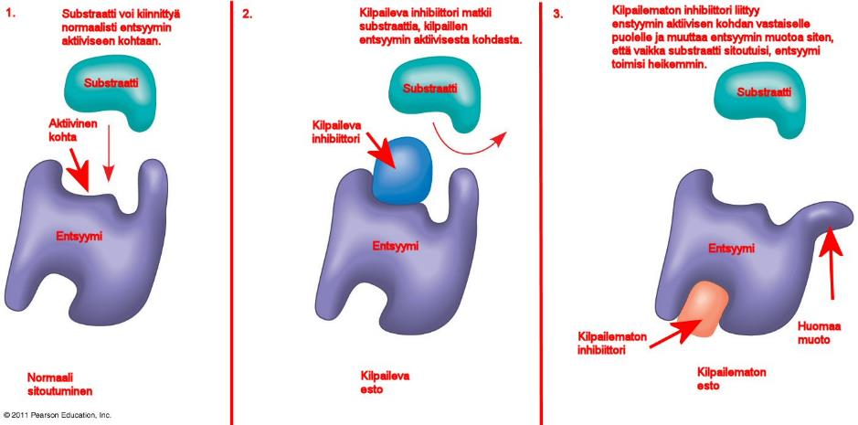

[]Kuva - Entsyymin aktivaatio

Esimerkiksi juodessasi maitoa, maidon sokeri, eli laktoosi [^10], pilkotaan sisälläsi sekä glukoosiksi että [galaktoosiksi](https://fi.wikipedia.org/wiki/Galaktoosi) [laktaasin](https://fi.wikipedia.org/wiki/Laktaasi) avulla. Laktaasi-entsyymi tuotetaan ohutsuolen suolinukan [villuksissa](https://en.wikipedia.org/wiki/Intestinal_villus).

Entsyymi vähentää katalysoimansa reaktion aktivaatioenergia ja kiihdyttää tällöin reaktion nopeutta katalysoimattomaan reaktioon verrattuna jopa 10\^17 kertaisesti. Nopeimmat entsyymit kykenevät muuntamaan sekunnissa jopa 40 miljoonaa molekyyliä reaktiotuotteiksi. Katalyysin olemukseen kuuluu, ettei entsyymiä kulu katalysoidussa reaktiossa. Entsyymi sitoutuu kohdemolekyyliinsä ja saa aikaan sen kemiallisen muuntumisen reaktiotuotteeksi. Sen jälkeen reaktiotuote irtoaa entsyymistä ja entsyymi on vapaa käynnistämään uuden toimintakierroksen.

Entsyymit ovat pääsääntöisesti proteiineja. Solu sisältää tuhansia erilaisia entsyymejä, jotka katalysoivat kukin omaa tyypillistä reaktiotaan. Jotkin entsyymit katalysoivat molekyylien hydrolyyttistä pilkkoutumista hydrolaateiksi. Toiset entsyymit, esimerkiksi oksidoreduktaasit, katalysoivat hapetus-pelkistysreaktioita. Syntetaasit katalysoivat molekyylien synteesiä käyttäen ATP:tä energianlähteenä. Entsyymit tunnistavat valikoivasti molekyylin, jonka reaktioita ne katalysoivat. Ne eivät hyväksy "asiakkaikseen" väärää molekyyliä. Tämä valikoivuus onkin reaktion kiihdyttämisen ohella entsyymin tärkeimpiä ominaisuuksia. Solun reaktioiden valikoiva katalyysi luo järjestystä solun metaboliaan. Varsin usein entsyymimolekyylissä sellaisenaan ei ole katalyysiin tarvittavia atomiryhmiä, koostuuhan entsyymi proteiinina periaatteessa vain aminohapoista, joiden kemialliset ominaisuudet ovat rajoitetut. Näissä tapauksissa entsyymi ottaa avuksi [kofaktorin](http://fi.wikipedia.org/wiki/Kofaktori) eli orgaanisen molekyylin tai metalli-ionin. Orgaanista kofaktoria kutsutaan [koentsyymiksi](https://fi.wikipedia.org/wiki/Koentsyymi). Koentsyymi voi olla molekyyli, joka kiinnittyy löyhästi entsyymin katalyysitapahtuman ajaksi, tai se voi olla pysyvästi ja tiukasti sidottuna entsyymiin, jolloin sitä kutsutaan [prosteettiseksi ryhmäksi](http://fi.wikipedia.org/wiki/Prosteettinen_ryhm%C3%A4). Koentsyymit ovat usein [vitamiinien](http://fi.wikipedia.org/wiki/Vitamiini) johdannaisia. Sana vitamiini tarkoittaa ihmiselle tärkeää [amiinia](http://fi.wikipedia.org/wiki/Amiini). Kaikki vitamiinit eivät kuitenkaan ole amiineja (Heino ja Vuento 2008).

Ruoansulatuksessa entsyymeillä on keskeinen merkitys. Mikäli entsyymi puuttuu, esimerkiksi laktaasin puuttuessa, tuloksena on laktoosi-intoleranssi. Fruktoosi-intoleranssissa aldolaasin heikentynyt toiminta. Ruoansulatusentsyymit löydät [tästä](https://fi.wikipedia.org/wiki/Luokka:Ruoansulatusentsyymit) ja huomaa, että niitä eritetään tarpeen mukaan kulloistakin tapahtumaa varten. Erityksen käynnistää solussa aktivoituva dna-transkriptio. Laktoosi-intoleranssi on helppo todeta mittaamalla verensokerin eli glukoosin pitoisuutta. Mikäli syö tai juo jotain laktoosia sisältävää, tulee verensokerin nousta ensimmäisen tunnin aikana. Mikäli verensokeri ei nouse, puuttuu laktaasi-entsyymi tai se ei toimi tehokkaasti. [Laktaasi](https://fi.wikipedia.org/wiki/Laktaasi) katalysoi laktoosin kahdeksi monosakkaridiksi, eli galaktoosiksi ja glukoosiksi. Glukoosi on se jota verensokerimittarilla mitataan. Mikäli laktoosi päätyy sellaisenaan suolistoon, käynnistävät bakteerit lac-operonin [^11] avulla laktoosin hyödyntämisen. Bakteereiden aineenvaihduntatuotteet ovat ne, jotka ärsyttävät vatsaa ja tuottavat paljon suolistokaasuja. Geneettisesti katsottuna ne ihmiset, jotka voivat juoda maitoa aikuisiällä ovat mutantteja. Nisäkkäiden laktaasin eritys loppuu aikuisuuden kynnyksellä [^12]. Mikäli galaktoosin metabolinen reitti geeneineen kiinnostaa, tutustu [tähän](http://www.genome.jp/kegg-bin/show_pathway?ko00052) KEGG kuvaajaan. Muitakin entsyymiaktiivisuuden tai entsyymipuutteen ongelmia on olemassa. Niiden taustalla voi olla geneettinen virhe entsyymiä tuottavassa dna/rna-koodissa tai esimerkiksi soluvaurio. Entsyymipuutos, johon myydään kaikenlaisia tuotteita, ei välttämättä aina kestä tieteellistä tarkastelua. Mikäli esimerkiksi haima tuottaa ruoansulatusentsyymin tarpeen mukaan, onko entsyymin nauttiminen pillerinä järkevä ratkaisu?

Entsyymien toiminnan ymmärtäminen on olennaista myös lääkeaineiden toiminnan ymmärtämisessä. Esimerkkinä sytokromi P450 entsyymi lääkeaineiden metaboliassa [^13] & [^14].

## Hormonit, reseptorit ja soluvasteet

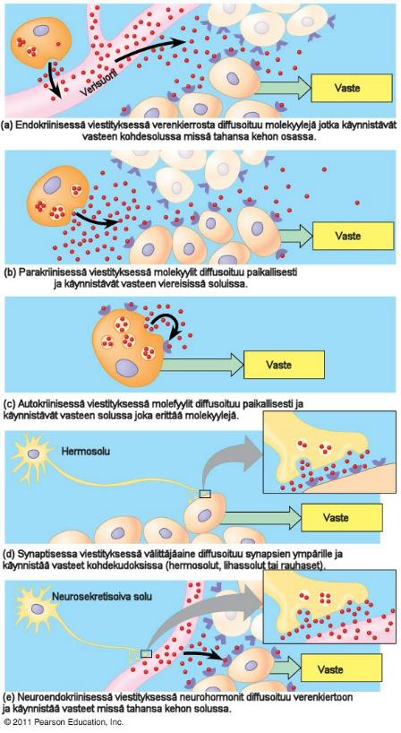Solunsisäisessä kommunikaatiossa voidaan erotella kaksi eri tapaa viestin välittymiselle: solu erittää molekyylejä ja mitä reittiä viesti saavuttaa kohteensa.

(a) Endokriinisessä (umpieritys) viestityksessä solun ulkopuoliseen nesteeseen eritetty hormoni saavuttaa kohteensa verenkierron kautta. Endokriininen viestitys ylläpitää [homeostaasia](https://fi.wikipedia.org/wiki/Homeostaasi) (tasapainotilaa), joka vastaa ympäristön vaikutukseen. Esimerkiksi hormonit säätelevät kehon vastetta stressiin, kuivumiseen ja alhaiseen verensokeriin. Ne myös käynnistävät käytökseen ja fyysiseen toimintaan liittyviä toimintoja.

(b) ja (c) Parakriininen ja autokriininen viestitys tuottaa paikalliseen säätelyyn liittyviä molekyylejä. Ne toimivat lyhyillä etäisyyksillä. Esimerkkinä [sytokiinit](https://fi.wikipedia.org/wiki/Sytokiini) [^15], jotka mahdollistavat immuunisolujen välisen viestityksen. Riippuen kohdesolusta, viestitys voi olla parakriinista (para = yhdellä puolella) tai autokriinisia (auto = itse).

(d) ja (e) [Synaptisessa](https://fi.wikipedia.org/wiki/Synapsi) viestityksessä hermosolut muodostavat risteyksiä nimeltään synapsit kohdesolujen kanssa, kuten toiset synapsit tai lihassolut. Synapseissa hermosolut tuottavat [neurovälittäjäaineita](https://fi.wikipedia.org/wiki/Hermoston_v%C3%A4litt%C3%A4j%C3%A4aine)    (hermoston välittäjäaine), jotka toimivat hyvin lyhyellä matkalla ja sitoutuvat kohdesoluihin. Neurovälittäjät ovat keskeisiä tuntemuksissa, muistissa, älyssä ja liikkumisessa. Neuroendokriinisessa viestityksessä tuotetaan neurosekretisoivasta solusta [neurohormoneja](https://fi.wikipedia.org/wiki/Neurohormoni)    verenkiertoon, kuten [ADH eli vasopressiini](https://fi.wikipedia.org/wiki/Antidiureettinen_hormoni). Kaikki viestittävät molekyylit eivät toimi kehon sisällä.    Esimerkiksi [feromonit](https://fi.wikipedia.org/wiki/Feromoni) toimivat ulkoisina viestinvälittäjinä.

## Umpierityskudokset ja elimet

Joitakin umpieritysjärjestelmän soluja löytyy elimistä, jotka ovat osana jotain toista elintä. Esimerkiksi vatsalaukussa sijaitsee umpierityssoluja. Umpierityssolut ovat myös kasaantuneena umpieritysrauhasiksi, kuten kilpirauhanen ja lisäkilpirauhanen kaulallamme.

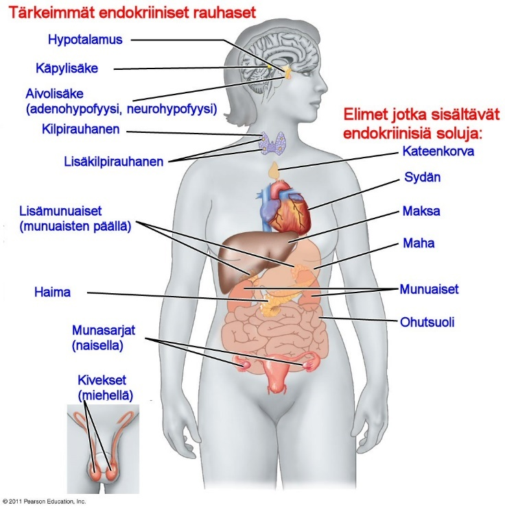Huomaa, että umpieritysrauhaset erittävät hormoneita suoraan ympäröivään nesteeseen.

Ulkoeritysrauhaset kuten sylkirauhaset tuottavat eritettä kehon pinnoille ja kehon onteloihin.

## Hormonien kemiallinen luokittelu

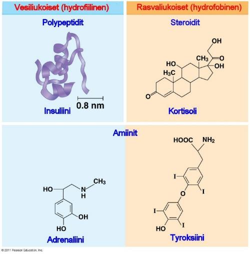Hormonimolekyylit poikkeavat toisistaan koon ja kemiallisten ominaisuuksien mukaan. Jotkin näistä eroavaisuuksia ovat ilmiselviä kolmessa luokassa: [polypeptidi](https://fi.wikipedia.org/wiki/Peptidi)t (proteiinit ja peptidit), [steroidit](https://fi.wikipedia.org/wiki/Steroidit) ja [amiinit](https://fi.wikipedia.org/wiki/Amiinit).

Esimerkiksi [Insuliini](https://fi.wikipedia.org/wiki/Insuliini) tuotetaan kahdesta polypeptidiketjusta. Kuten suurin osa tämän ryhmän hormoneista, insuliini tuotetaan yhdestä pitkästä polypeptidiketjusta lohkomalla. Steroidihormoni, kuten "stressihormoni" [kortisoli](https://fi.wikipedia.org/wiki/Kortisoli), on [lipidi](https://fi.wikipedia.org/wiki/Lipidi), joka sisältää neljä yhteen sulautunutta hiilirengasta. [Adrenaliini](https://fi.wikipedia.org/wiki/Adrenaliini) ja [tyroksiini](https://fi.wikipedia.org/wiki/Tyroksiini) ovat amiinihormoneita, jotka syntetisoidaan yhdestä aminohaposta, joko [tyrosiinista](https://fi.wikipedia.org/wiki/Tyrosiini) tai [tryptofaanista](https://fi.wikipedia.org/wiki/Tryptofaani) [^16].

## Solun reagointireitit

[Vesiliukoisten](https://fi.wikipedia.org/wiki/Liukoisuus) ja rasvaliukoisten hormoneiden välillä on eroja siinä, miten solu niihin reagoi. Yksi ero liittyy myös kohdesolun reseptorien sijaintiin. Solukalvoa ja aineinen siirtymistä ajatellen on hyvä opiskella myös [diffuusio](http://www.solunetti.fi/fi/solubiologia/diffuusio/2/), [osmoosi](http://www.solunetti.fi/fi/solubiologia/osmoosi/2/) ja solujen [ionikanavat.](http://www.solunetti.fi/fi/solubiologia/aineiden_kuljetus_solukalvon_lapi/2/)

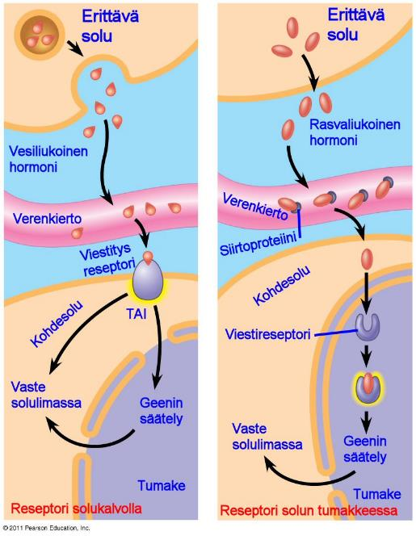Vesiliukoiset hormonit eritetään [eksosytoosissa](https://fi.wikipedia.org/wiki/Eksosytoosi) ja ne kulkevat vapaasti verenkierrossa ja sitoutuvat solun pinnalla oleviin reseptoreihin. Kun hormoni sitoutuu reseptoriin, aiheuttaa se muutoksia [soluliman](https://fi.wikipedia.org/wiki/Solulima) molekyyleihin ja toisinaan myös muuttaa geenien [transkriptiota](https://fi.wikipedia.org/wiki/Transkriptio) (lähetti [RNA](https://fi.wikipedia.org/wiki/L%C3%A4hetti-RNA)-molekyylien [synteesiä](https://fi.wikipedia.org/wiki/Biosynteesi)) [^17].

Vesiliukoiset hormonit [diffusoituva](https://fi.wikipedia.org/wiki/Diffuusio)t umpierityssolujen pinnalta.Solun ulkopuolella ne sitoutuvat kuljetusproteiineihin (kuvassa siirtoproteiini), jotka pitävät ne liukoisena vettä sisältävässä verenkierrossa.

Siirryttyään verenkierrosta diffusoitumalla solun sisälle, sitoutuvat ne solun sisäiseen viestireseptoriin ja säätelevät solun geenien toimintaa.

Vesiliukoisen hormonin sitouduttua solun reseptoriin käynnistää se soluvasteen. Vaste voi olla esimerkiksi [entsyymin](https://fi.wikipedia.org/wiki/Entsyymi) aktivaatio, tiettyjen molekyylien tuottaminen tai sisäänotto soluun tai esimerkiksi [solutukirangan](https://fi.wikipedia.org/wiki/Solun_tukiranka) muutokset.

Jotkut solun pinnan reseptorit saavat aikaan soluliman proteiinien siirtymisen [tumaan](https://fi.wikipedia.org/wiki/Tuma) muokaten tiettyjen geenien toimintaa. Sarjoittaista tapahtumaa, jossa solun ulkopuolinen kemiallinen signaali käynnistää solun sisällä muutoksia kutsutaan signaalinvälitykseksi ( [signal transduction](https://en.wikipedia.org/wiki/Signal_transduction)).

Signaalinvälityksestä pohdi sitä mitä lyhytkestoinen [stressi](https://fi.wikipedia.org/wiki/Stressi), esimerkiksi linja-auton kiinnijuoksu aiheuttaa: [lisämunuaisesi](https://fi.wikipedia.org/wiki/Lis%C3%A4munuainen) tuottavat [adrenaliinia](https://fi.wikipedia.org/wiki/Adrenaliini). Kun adrenaliini saavuttaa [maksan](https://fi.wikipedia.org/wiki/Maksa), se sitoutuu kohdesolujen [G-proteiinikytkentäiseen-reseptoriin](https://fi.wikipedia.org/wiki/G-proteiinikytkent%C3%A4inen_reseptori) [^18].

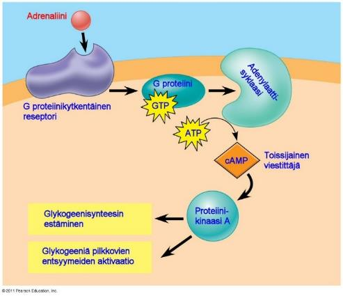Sitoutunut hormoni käynnistää tapahtumasarjan, jossa syklistä AMP:tä ( [cAMP](https://fi.wikipedia.org/wiki/Syklinen_adenosiinimonofosfaatti)) tuotetaan lyhytkestoiseksi sekundaariseksi viestinviejäksi.

Proteiinikinaasi A:n ( [PKA](https://fi.wikipedia.org/wiki/Proteiinikinaasi_A)) aktivaatio cAMP:n avulla johtaa [glykogeeniä](https://fi.wikipedia.org/wiki/Glykogeeni) pilkkovan entsyymin aktivoitumiseen ja glykogeenisynteesiin osallistuvan entsyymin inaktivoitumiseen. Tällöin maksa tuottaa [glukoosia](https://fi.wikipedia.org/wiki/Glukoosi) (verensokeria) verenkiertoon jotta saat energiaa juostaksesi linja-auton kiinni.

Rasvaliukoisissa hormoneissa käynnistetään lähes aina [geeniekspressio](https://fi.wikipedia.org/wiki/Genotyyppi) käyttämällä solun sisäistä signaalinvälitystä.

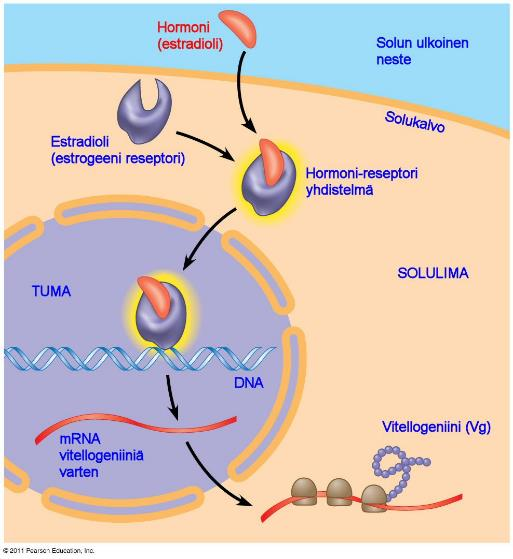Oikealla olevassa kuvassa näkyy [estradioli](https://fi.wikipedia.org/wiki/Estradioli)n käynnistämä [vitellogeniinin](https://fi.wikipedia.org/wiki/Vitellogeniini) tuotanto (vitellogeniini ei liity ihmiseen). Esimerkiksi testosteroni tuotetaan täysin samalla tavalla.

Steroidihormonien reseptorit sijaitsevat solulimassa, jossa ne ovat valmiita sitoutumaa hormoniin.

Kun steroidihormoni sitoutuu reseptoriin, muodostuu hormonin ja reseptorin muodostava yhdistelmä, joka liikkuu tuman sisälle.

Tuman sisällä reseptoriosuus muokkaa geenien transkriptiota tuottaen tarvittavaa lähetti RNA:ta, josta muodostetaan polypeptidiketjuja.

Tyroksiinin, D-vitamiinin (joka on oikeasti hormoni) ja muiden rasvaliukoisten hormonien, jotka eivät ole steroideja, reseptorit sijaitsevat tumassa. Reseptori sitoutuu hormonimolekyyleihin jotka diffusoituvat verenkierrosta solukalvon kautta. Sitouduttuaan reseptori sitoutuu [DNA](https://fi.wikipedia.org/wiki/DNA):n tiettyihin kohtiin ja käynnistää geenin [transkription](https://fi.wikipedia.org/wiki/Transkriptio).

On olemassa myös merkkejä siitä, että [estrogeenit](https://fi.wikipedia.org/wiki/Estrogeenit) ja jotkin rasvaliukoiset hormonit voivat joskus käynnistää reaktion solun pinnalla ilman, että ne menisivät solun sisälle. Tapahtuman tarkempi selvittely on aktiivisen tutkimuksen kohteena.

Hormonihäiritsijät, kuten [bisfenoli-A](https://fi.wikipedia.org/wiki/Bisfenoli-A) ja muut vastaavat sekoittavat näitä tapahtumia. Tämän vuoksi voi olla hyvin vaikeaa löytää juurisyy hormonaalisen säätelyn ongelmalle.

Useat hormonit tuottavat enemmän kuin yhden vasteen kehossamme. Hormonin vaikutus voi vaihdella kohdesolun sen mukaisesti millaisia molekyylejä se tuottaa hormonin vastaanoton seurauksena.

Esimerkkinä adrenaliini aiheuttaa yhtäaikaisesti [glykogeenin](https://fi.wikipedia.org/wiki/Glykogeeni) pilkkomisen glukoosiksi maksassa, lisää verenkiertoa [luurankolihaksille](https://fi.wikipedia.org/wiki/Luurankolihas) ja vähentää verenkiertoa [ruoansulatukselle](https://fi.wikipedia.org/wiki/Ruoansulatus). Nämä saman hormonin erilaiset vasteet tuottavat hätäpoistumiseen tarvittavat reaktiot kehossamme.

Kudokset eroavat adrenaliiniin hormonivasteiltaan, koska niiden reseptorit ja viestinvälityskanavat poikkeavat toisistaan. Adrenaliinin kohdesolussa tulee olla G-kytkentäinen reseptori.

Maksasolussa on β-tyyppinen adrenaliinireseptori joka aktivoi proteiinikinaasi A:n entsyymit, jotka siis säätelevät glykogeenimetaboliaa.

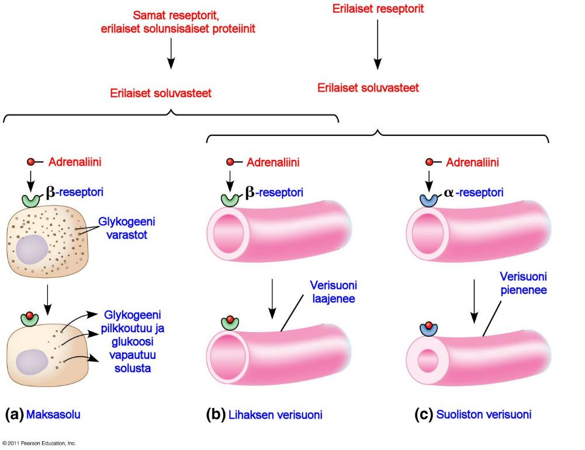Paikallisina säätelijöinä toimivat läheisten solujen kesken parakriinisesti tai autokriinisesti. Kun molekyylejä tuotetaan, reagoivat ne nopeasti kohdesoluissa sekunneissa tai jopa millisekunneissa. Tällä tavoin ne poikkeavat hormoneista, joiden vaste on hitaampi, mutta soluvaste syntyy samalla tavoin kuin hormoneillakin.

Muutamat erilaiset kemialliset yhdisteet toimivat paikallisina säätelijöinä. Polypeptideissä paikallisina säätelijöinä toimivat sytokiinit ja suurin osa kasvutekijöistä, jotka aikaansaavat solun erikoistumisen ja kasvun. Monet solut kasvavat, jakaantuvat ja kehittyvät vain silloin kun kasvutekijät ovat läsnä niiden ympäristössä.

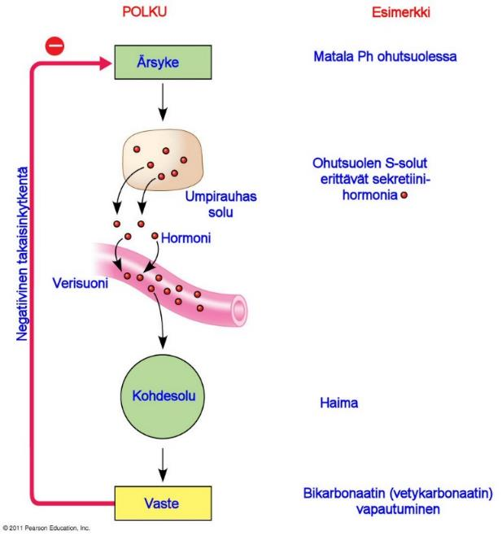Kaasuista [typpioksidi](https://fi.wikipedia.org/wiki/Typpihappo) (NO) toimii kehossa niin neurovälittäjänä kuin paikallisena säätelijänä.

Silloin kun [hapen](https://fi.wikipedia.org/wiki/Happi) (O2) määrä veressä laskee, [endoteelin](https://fi.wikipedia.org/wiki/Endoteeli) (verisuonien sisäpinnan yhdenkertainen solukerros) solut syntetisoivat ja tuottavat typpioksidia (NO).

Typpioksidi aktivoi entsyymin, joka rentouttaa ympäröivät pehmeät lihassolut, aiheuttaen verisuonen laajentumisen (vasodilaatio), joka parantaa veren kulkeutumista kudoksiin.

Todella reaktiivisena ja myös myrkyllisenä typpioksidi (NO) käynnistää yleensä reaktion kohdesolussa muutamassa sekunnissa ja sen jälkeen pilkkoutuu pois.

Miehillä typpioksidi aiheuttaa peniksen jäykistymisen. Lääkkeet kuten [Viagra](https://fi.wikipedia.org/wiki/Sildenafiili) (sildanafiilisitraatti) pidentää tätä typpioksidin ylläpitämää tilaa estämällä typpioksidin pilkkoutumista [^19].

Muita vastaavia esimerkkejä ovat [prostaglandiinit](https://fi.wikipedia.org/wiki/Prostaglandiinit), jotka ovat muokattuja [rasvahappoja](https://fi.wikipedia.org/wiki/Rasvahapot). Niillä on monia eri tehtäviä kuten esimerkiksi [immuunijärjestelmässä](https://fi.wikipedia.org/wiki/Immuunij%C3%A4rjestelm%C3%A4) ne lisäävät kuumetta, tulehdusta sekä kivun tuntoherkkyyttä.

[Tulehduskipulääkkeet](https://fi.wikipedia.org/wiki/Tulehduskipul%C3%A4%C3%A4kkeet) kuten aspiriini ja ibuprofeeni (Ibumax, Burana jne) estävät mm. prostaglandiinien tuottoa (synteesiä). Prostaglandiinit säätelevät myös [verihiutaleiden](https://fi.wikipedia.org/wiki/Verihiutale) kerääntymistä toisiinsa, joka on yksi vaihe veritukosten syntymisessä. Koska tukokset voivat aiheuttaa sydänkohtauksen sulkemalla verenkierron sydämeen johtavissa verisuonissa, jotkin lääkärit suosittelevat aspiriinin syömistä ennaltaehkäisevästi. Pitkäaikainen käyttö vahingoittaa kuitenkin vatsaa. Huomaa, että tulehduskipulääkkeiden toimintaa ei vielä täysin tunneta. [^20]

## Hormonien vastavaikuttavat takaisinkytkennät

Yksinkertaisessa hormonaalisessa säätelyssä toimii [takaisinkytkentä](https://fi.wikipedia.org/wiki/Takaisinkytkent%C3%A4), jossa umpirauhassolut erittävät hormonia ulkoisen tai sisäisen ärsykkeen johdosta.

Hormoni matkaa verenkierrossa kohdesoluihinsa, joissa on hormonille sopivia reseptoreita. Tämä käynnistää fysiologiset vasteet kohdesolussa viestinvälitysketjun mukaisesti.

Esimerkiksi pohjukaissuoli ja ohutsuoli säätelevät [Ph:ta](https://fi.wikipedia.org/wiki/Happamuus) siten, että matala Ph stimuloi erityisiä S-soluja tuottamaan [sektretiini](https://fi.wikipedia.org/wiki/Sekretiini)-nimistä hormonia. Sekretiini erittyy verenkiertoon ja menee [haimaan](https://fi.wikipedia.org/wiki/Haima). Haiman kohdesolut erittävät [vetykarbonaattia](https://fi.wikipedia.org/wiki/Vetykarbonaatti) ohutsuoleen meneviin kanaviin, jolloin Ph nousee.

Yksinkertaisessa hormonaalisessa säätelyssä aistihermosolun vastaanottama ärsyke johtaa neurosekretorisen solun aktivoitumiseen.

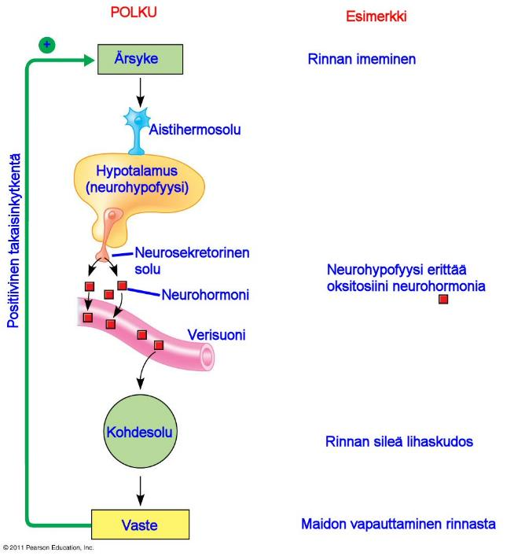Esimerkiksi imettämisessä tapahtuu siten, että imeminen aiheuttaa nännin aistinhermosoluille ärsykkeen, joka lähettää viestin hermojärjestelmän kautta viestin [hypotalamukseen](https://fi.wikipedia.org/wiki/Hypotalamus).

Hypotalamuksessa vastaanotettu viesti käynnistää neurohormoni [oksitosiinin](https://fi.wikipedia.org/wiki/Oksitosiini) tuotannon [neurohypofyysissä](https://fi.wikipedia.org/wiki/Neurohypofyysi).

Oksitosiinin [^21] ilmestyessä verenkiertoon maitorauhaset alkavat erittää maitoa.

Tämä esimerkki on harvinaisempi positiivinen takaisinkytkentä, jossa ärsyke saa aikaa positiivisen vasteen. Negatiivinen takaisinkytkentä on yleisin säätelyjärjestelmä, kuten edellisessä sekretiini-esimerkissä.

Negatiivisessa takaisinkytkennässä hormonin tuotanto vaimenee ärsykkeen ja hormonin tuottamisen jälkeen. Positiivisessa takaisinkytkennässä ärsyke vahvistaa hormonin tuotantoa entisestään.

Imetysesimerkissä imeminen tuottaa enemmän oksitosiinia ja maitoa niin pitkään, kunnes imeminen jatkuu. Oksitosiini saa myös synnytyksessä kohdun lihakset supistelemaan niin pitkään, kunnes synnytys on ohitse. Oksitosiini tuottaa myös käytösmuutoksia, jotka vaikuttavat haluun hoivata lasta, parinmuodostukseen ja seksuaalisuuteen. Positiivinen takaisinkytkentä siis vahvistaa sekä ärsykettä että vastetta, kun taas negatiivinen takaisinkytkentä pyrkii palauttamaan aiemman tilan. Homeostaasiin pyrkivät hormonaaliset säätelyjärjestelmät käyttävätkin pääasiassa negatiivista takaisinkytkentää. Esimerkkeinä aiemmin kuvattu verensokerin eli glukoosikonsentraation ylläpito.

## Hypotalamuksen ja aivolisäkkeen merkitys umpierityksen säätelyssä

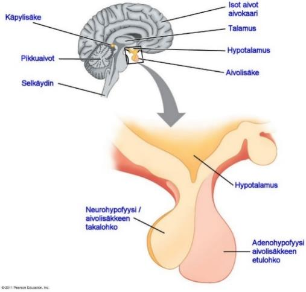 [Hermojärjestelmällä](https://fi.wikipedia.org/wiki/Hermosto) on keskeinen merkitys hormonaalisessa säätelyssä [^22]. Hypotalamus on keskeisessä osassa endokriinisen (umpierityksen) ja hermoston yhdistämisessä.

Hypotalamus on yksi keskeisistä aivojen umpieritysrauhasista. Hypotalamus vastaanottaa hermostolta viestin. Vasteena viestille hypotalamus aktivoi ympäristöön sopivan endokriinisen viestinnän. Hypotalamuksesta lähtevät viestit kulkevat aivolisäkkeeseen.

Aivolisäke on kooltaan noin herneen kokoinen. Siinä sijaitsevat etummainen ja taaimmainen lohko, joita kutsutaan [adenohypofyysiksi](https://fi.wikipedia.org/wiki/Adenohypofyysi) ja [neurohypofyysiksi](https://fi.wikipedia.org/wiki/Neurohypofyysi).

Molemmat erittävät erilaisia hormoneita. Neurohypofyysi on hypotalamuksen jatkeena.

Hypotalaamiset [aksonit](https://fi.wikipedia.org/wiki/Viej%C3%A4haarake), jotka menevät neurohypofyysiin, tuottavat hypotalamuksessa tuotettuja [neurohormoneita](https://fi.wikipedia.org/wiki/Neurohormoni). Adenohypofyysi tuottaa hormoneita hypotalamuksesta tulevien viestin mukaisesti. Monet adenohypofyysin tuottamista hormoneista ovat trooppisia hormoneita, joka tarkoittaa sitä, että ne säätelevät muita umpierityssoluja ja rauhasia.

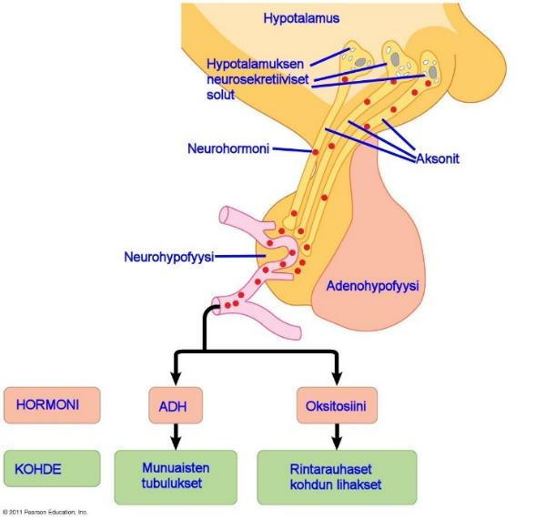Hypotalamuksen neurosekretiiviset solut tuottavat kahta neurohypofyysin hormonia: oksitosiini ja vasopressiiniä, eli antidiureettista hormonia (ADH).

Kuljettuaan neurosekretiivisten solujen pitkiä aksoneita pitkin aivolisäkkeen takalohkoon eli neurohypofyysiin, säilötään hormonit odottamaan hypotalamukselta tulevaa käskyä vapauttaa hormoneita verenkiertoon.

ADH eli vasopressiini ylläpitää munuaisten avulla kehon vesibalanssia ja veren osmolaarisuutta, mutta se vaikuttaa myös sosiaaliseen käyttäytymiseen. [^23]

Adenohypofyysi tuottaa hormoneita hypotalamukselta tulevien viestien perusteella. Jokainen adenohypofyysin tuottama hormoni on joko umpieritysrauhasessa tuotettavan hormonin vapautumista lisäävä tai estävä hormoni.

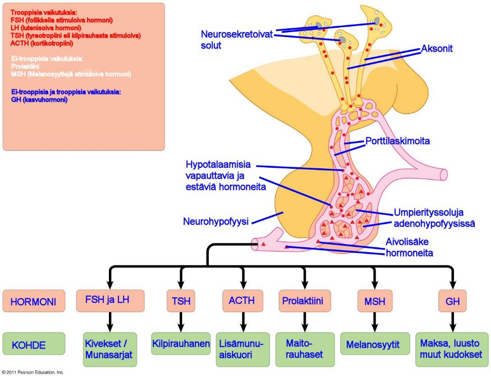

[]Kuva - Neurohypofyysi

Hypotalaamiset hormonit eritetään hypotalamuksen pohjan [kapillaareissa](https://fi.wikipedia.org/wiki/Hiussuoni). Kapilaarit laskevat lyhyisiin verisuoniin.

Termi kilpirauhashormoni todellisuudessa viittaa kahteen hyvin samanlaiseen hormoniin, joita tuotetaan aminohaposta nimeltään [tyrosiini.](https://fi.wikipedia.org/wiki/Tyrosiini) Tyrosiinista tuotetaan myös aivojen dopaminergeettisissä soluissa [L-DOPA](https://fi.wikipedia.org/wiki/L-dopa):ksi tyrosiini hydroksylaasi-entsyymillä (TH). TH siis osallistuu neurovällittäjäaineen dopamiinin tuotantoon [^24]. Dopamiini voidaan konvertoida [katekoliamiiniksi](https://fi.wikipedia.org/wiki/Katekoliamiinit) kuten noradrenaliiniksi ja adrenaaliksi.

Olemme ottaneet pintaraapaisun hormonaaliseen säätelyyn ja voimme paneutua seuraavaksi kilpirauhasen pääpiirteittäiseen toimintaan. Lukiessasi voit pyrkiä hahmottamaan missä eri kohdissa homeostaattinen säätelyjärjestelmä voi vikaantua ja mikä asia siihen voisi vaikuttaa.

# Kilpirauhasen toiminnasta tarkemmin

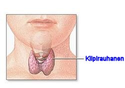Tunnet perhosen mallisen kilpirauhasesi kaulan etuosassa, aataminomenan alapuolella. Terve kilpirauhanen on tasainen.

Kilpirauhasen kuvia löydät Googlen kuvahaulla hakusanalla " thyroid autopsy", mutta varaudu siihen, että kuvat voivat järkyttää, koska ne ovat ruumiinavauksista kuvattuja.

Kilpirauhanen erittää pääosin tyroksiinia (T4) ja kohdesolut muuntavat siitä suurimman osan trijodiyroniiniksi (T3) poistamalla T4:stä yhden jodiatomin (dejodittuminen) [^25].

Hormonit ovat nimeltään [trijodityroniini](https://fi.wikipedia.org/wiki/Trijodityroniini) (T3 eli C~15~H~12~I~3~NO~4~), joka sisältää kolme jodiatomia ja sen liitännäishormoni [tyroksiini](https://fi.wikipedia.org/wiki/Tyroksiini) (T4), joka sisältää neljä jodiatomia. Sama [reseptori](https://ars.els-cdn.com/content/image/1-s2.0-S1873506114000828-gr3.jpg) sitoutuu molempiin hormoneihin.

Kilpirauhasen ylläpitämän tasapainotilan häiriintyminen voi vaikuttaa monien muidenkin hormoneiden toimintaan. Sivuamme myöhemmin laboratoriotuloksia tarkastellessamme [testosteronin](https://pubchem.ncbi.nlm.nih.gov/compound/6013) [C~19~H~28~O~2~](https://pubchem.ncbi.nlm.nih.gov/search/#collection=compounds&query_type=mf&query=C19H28O2&sort=mw&sort_dir=asc) tuotannon ja kilpirauhashormonien välistä yhteyttä.

Esimerkiksi sekä kilpirauhasta ohjaava [TSH](https://fi.wikipedia.org/wiki/Tyreotropiini) että kiveksiä ohjaavat [FSH](https://fi.wikipedia.org/wiki/FSH) ja [LH](https://fi.wikipedia.org/wiki/Luteinisoiva_hormoni) eritetään adenohypofyysissä ja säätelyjärjestelmän häiriöitä tutkittaessa voi olla syytä tutkia myös syitä miksi esimerkiksi tyroksiinilääkitys ( [levotyroksiinin [C~15~H~11~I~4~NO~4~](https://pubchem.ncbi.nlm.nih.gov/search/#collection=compounds&query_type=mf&query=C15H11I4NO4&sort=mw&sort_dir=asc) kemiallinen rakenne](https://pubchem.ncbi.nlm.nih.gov/compound/L-thyroxine)) voi vaikuttaa muihin adenohypofyysissä tuotettujen aivolisäkehormonien tuotantoon.

TRH:n eli tyreotropiinin [C~16~H~22~N~6~O~4~](https://pubchem.ncbi.nlm.nih.gov/search/#collection=compounds&query_type=mf&query=C16H22N6O4&sort=mw&sort_dir=asc) kemiallisen rakenteen näet [tästä](https://pubchem.ncbi.nlm.nih.gov/compound/32281).

Opimme aiemmin mitä tarkoittaa negatiivinen takaisinkytkentä. Tarkastellaan takaisinkytkentää kilpirauhashormoneiden kannalta.

## Kilpirauhashormonien erityksen negatiivinen takaisinkytkentä

Hypotalamuksesta lähtien, adenohypofyysi ja kohteena olevat umpieritysrauhaset muodostavat hormonaalisen säätelyjärjestelmän. Aivoihin menevät viestit kiihdyttävät hypotalamusta tuottamaan hormoneita, jotka joko lisäävät tai vähentävät trooppisia adenohypofyysistä vapautuvia hormoneita. Adenohypofyysistä vapautetut hormonit toimivat kohdekudoksessa, lisäten toisen hormonin tuotantoa.

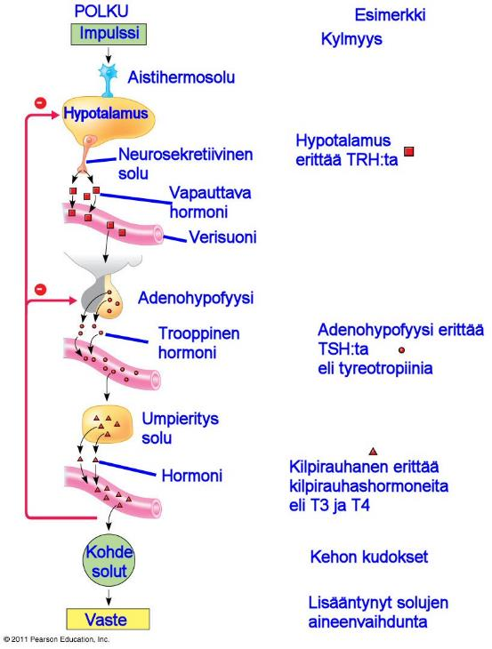Esimerkiksi voidaan ottaa palelu ja kilpirauhasen toiminta lapsilla. Kun lapsen kehon lämpötila laskee, hypotalamus erittää TRH:ta eli tyreotropiinin vapauttajahormonia. Adenohyposyysi vastaa TRH:n nousuun vapauttamalla TSH:ta eli kilpirauhasta stimuloivaa hormonia eli tyreotropiinia.

TSH stimuloi kilpirauhashormonien vapautumista kilpirauhasesta, joka sijaitsee perhosmaisena kurkkutorven kohdilla.

Kun kilpirauhashormonin määrä kasvaa, lisää se aineenvaihduntaa lisäten lämpöenergiaa, joka nostaa kehon lämpötilaa.

Kuten negatiivisissa takaisinkytkennöissä yleensä, hormonisäätely (kaskadi) toimii siten, että vapautettu hormoni itsessään toimii negatiivisena palautteena.

Koska kilpirauhashormoni itsessään estää TSH:n vapautumista adenohypofyysistä ja TRH:n vapautumista hypotalamuksesta, negatiivinen takaisinkytkentälooppi estää kilpirauhashormonin ylituotannon. Tällä tavoin hormonin säätelyjärjestelmä palauttaa aiemman tilan.

Kilpirauhashormoni säätelee verenpainetta, sydämen sykenopeutta, lihasten kiinteyttä, ruoansulatusta ja lisääntymiseen liittyviä toimintoja. Liian paljon tai liian vähän kilpirauhashormonia voi johtaa vakaviin aineenvaihduntahäiriöihin.

Polkua aivoista kilpirauhaseen kutsutaan hypotalamus-aivolisäke-kilpirauhas-radaksi.

## Kilpirauhashormonin tuotanto

Alla olevassa havaintokuvassa näet millä tavoin T4 ja T3-hormoneita tuotetaan ja miten ne käynnistävät kohdesolussa proteiinisynteesin (DNA -\> RNA -\> Polypeptidit). Kohdesolun D1-D3 ovat dejodioitumiseen liittyviä entsyymeitä ( [Iodothyronine deiodinase](https://en.wikipedia.org/wiki/Iodothyronine_deiodinase)). Esimerkiksi T4:stä tuotetaan T3:sta D1/D2 avulla, T4:stä rT3:sta D3:n avulla jne.

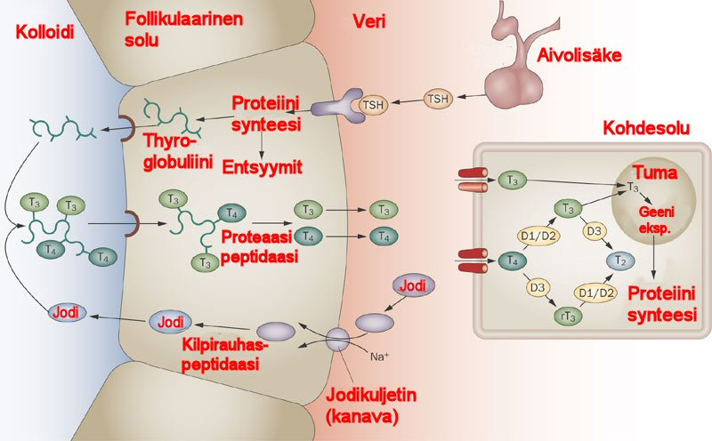

[]Kuva - Kilpirauhashormoneiden tuotanto

[Tyroperoksidaasi](https://en.wikipedia.org/wiki/Thyroid_peroxidase) (TPO [^26]) on pääosin kilpirauhasessa kolloidiin tuotettu entsyymi. TPO hapettaa jodidia tuottaakseen jodiatomeja. Jodiatomit lisätään tyrosiinin jäänteisiin tyroglobuliinilla tyroksiinin (T4) tai trijodityroniinin (T3) tuottamiseksi (yhdessä kilpirauhashormonit).

Ihmisellä tyroperoksidaasia koodaa [TPO-geeni](http://www.genecards.org/cgi-bin/carddisp.pl?gene=TPO). TPO-geenin aktiivisuutta säätelee TSH, jonka lisääntyminen lisää geeniekspressiota. Tyroperoksidaasin tuotanto voidaan inaktivoida tiamiinilääkkeillä, kuten propyylitiourasiili tai metimatsoli (hypertyreoosissa eli kilpirauhasen liikatoiminnassa tai vastaavissa tiloissa).

Tarkemmin voimme tarkastella kilpirauhashormonien tuotantoa alla olevasta [KEGG](http://www.genome.jp/kegg-bin/show_pathway?map=hsa04918&show_description=show):n kaaviokuvasta. Lukemisen helpottamiseksi olen suomentanut joiltakin osin kaaviokuvaa. Tarkemmin eri vaiheet, geenien toiminnan ja perinnölliset geeniperimään liittyvät mutaatiot löydät englanniksi [tästä](http://www.genome.jp/dbget-bin/www_bget?pathway+hsa04918) linkistä. Prenataalivaiheen (ennen syntymää) häiriöissä kyse voi olla myös jodin puutteesta.

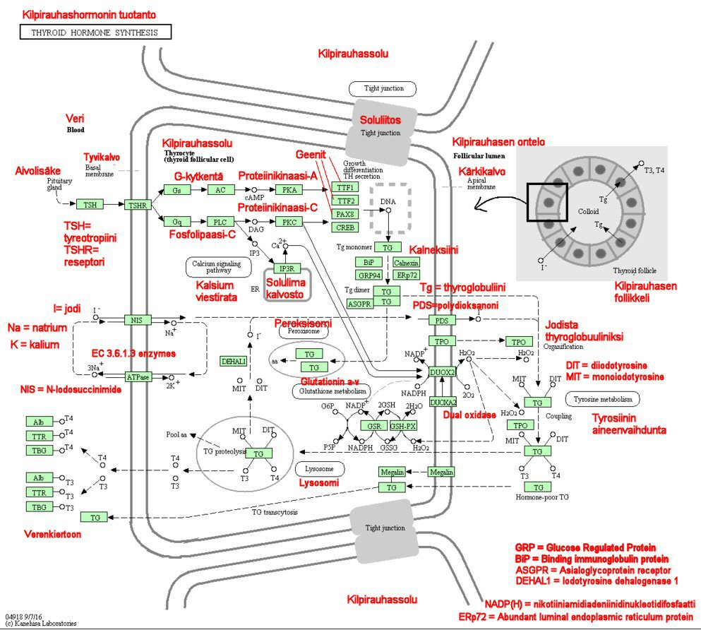Kilpirauhassolun aktiivinen osa on follikkeli (oikealla ylhäällä follikkeli), jota jakaa tyrosyyttien monomolekylaarinen kerros.

Polarisoituneet tyrosyytit ympäröivät follikkelin luumenia siten, että niiden pohja- ja kärkipinnat ovat verenkiertoon ja luumenin suuntaisesti. Kilpirauhashormonien tuottamiseksi tyrosyytit ottavat jodin niiden pohjapuolella ja väkevöittää niitä luumenin puolelle. Ne myös erittävät luumenissa thyroglobuliinia (Tg) joka toimii hormoneiden varastona.

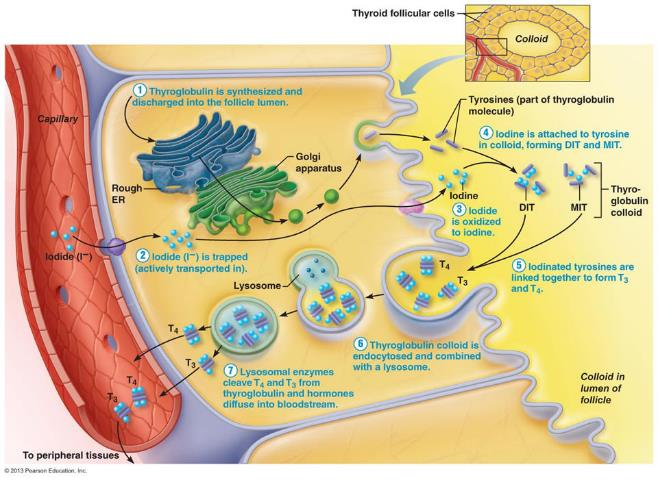Follikkelin luumenissa jodin hapetus (oksidaatio), tyrosiinin jodioiminen (MIT, 3-monoiodotyrosine; DIT, 3,5-diiodotyrosine) ja jodityrosiinien kytkentä tyrosiinin jäännöksistä thyroglobuliinissa (Tg) tuottaa T3 ja T4 tuotannon (synteesin).

Jodioitu Tg resorboidaan (imetään itseensä) pintakerroksen lävitse ja poistetaan T3 ja T4 muodostamiseksi lysosomeissa. Tämän jälkeen T3 ja T4 eritetään solun tyvikalvon kautta verenkiertoon.

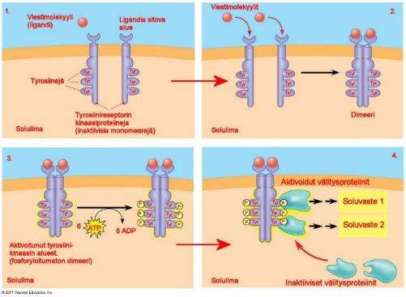Reseptoreiden (kuten tyreotropiinireseptori TSHR) toiminta perustuu reseptorityrosiinikinaaseinin.

Reseptorityrosiinikinaasit (RTK) kuuluvat solukalvon pääreseptoriluokkaan, joissa tapahtuu entsymaatisia reaktioita. Kinaasi (aasi loppuiset ovat entsyymeitä) on enstyymi, joka katalysoi fosfaattiryhmän siirtoa. Reseptoriproteiinin osa jatkuu solulimaan (sytoplasmaan) toimien tyrosiinikinaasina, entsyyminä, joka katalysoi fosfaattiryhmän ATP:stä tyrosiiniksi (aminihappo) kantajaproteiinin päällä. Reseptorityrosiinikinaasit ovat siis solukalvon reseptoreita, jotka liittävät fosfaatteja tyrosiiniin.

Yksi reseptorityrosiinikinaasi kokonaisuus voi aktivoida kymmeniä erilaisia reaktioreittejä ja soluvasteita. Erona G-proteiinikytkentäiseen reseptoriin tällainen ligandiin sitoutuva reseptori voi siis käynnistää useita tapahtumia yhtä aikaa. Monissa syövissä tavataan epänormaaleita reseptorityrosiinikinaaseja, jotka toimivat ilman, että niihin on sitoutunut viestimolekyyliä.

Kuvan 22 sisällä olevat tapaukset:

- Tapauksessa 1 näemme tilanteen, jossa viestimolekyyli ei ole sitoutunut reseptorityrosiinikinaasiin. Tällöin ne toimivat erillisinä toisistaan riippumattomina mononeereinä. Solukalvoon jäävä alue, alfahelixi, erottaa solukalvon päällisen ja sisäisen osan.

- Tapauksessa 2 näemme tilanteen, jossa kaksi viestimolekyyliä on liittynyt reseptoriin ja tällöin reseptorimonomeerit yhdistyvä dimeeriksi (dimerisaatio).

- Tapauksessa 3 dimerisaatio aktivoi tyrosiinikinaasin osan jokaisessa monomeerissä. Jokainen tyrosiinikinaasi lisää fosfaatin ATP-molekyylistä tyrosiiniin jokaisen monomeerin päähän.

- Tapaukasessa 4 reseptori on täysin aktivoitunut ja se tunnistetaan erityisissä proteiineissa solun sisällä. Jokainen tällainen proteiini sitoutuu fosforyloituneeseen tyrosiiniin, tuottaen rakenteellisia muutoksia jotka aktivoivat sitovan proteiinin sitoutumisen. Jokainen aktivoitunut välitysproteiini käynnistää transduktioreitin, tuottaen soluvasteen.

## Kilpirauhashormoneiden kuljetus/siirtoproteiinit

Aiemmasta muistamme kilpirauhashormoneiden olevan rasvaliukoisia amiineita, jotka käynnistävät kohdesolussa geenitranskription signaalivälitysreitin avulla. Seuraavassa käsittelen kuljetusproteiineja lainaten [Thyroid Managerissa](http://www.thyroidmanager.org/) (englanniksi) käsiteltyjä artikkeleita.

Kilpirauhashormonin (TH) tuottamat vasteet ovat riippuvaisia siitä minkä verran hormonia kulkeutuu kudoksiin, hormonin aktivaatiosta ja vastaanottavien solujen muuttumattomista kilpirauhashormonien reseptoreista. Koska kilpirauhashormoni kulkeutuu soluun sitoutumattomana, vapaan hormonin konsentraatio kertoo enemmän kuin kokonaishormonin määrä, jos tarkastellaan kilpirauhashormonista riippuvia prosesseja. Normaaleissa olosuhteissa vapaan hormonitason vaihtelut johtuvat hormonin tuotannosta ja kierrosta poistamisen aktiviteeteistä (= hormonin pilkkominen [entsymaattisesti](http://www.solunetti.fi/fi/solubiologia/entsyymikinetiikkaa/2/)). Kilpirauhashormonin kokonaistaso on normaalisti suhteessa kuljetusproteiinien konsentraatioon, joka ylläpitää jatkuvaa vapaata hormonitasoa. Laboratoriotesteissä kirjain V kuvaa vapaata hormonitasoa, esimerkiksi T4V tai T3V.

Kuljetusproteiineihin liittyvät muutokset seerumin kokonaishormonitasossa johtuvat ennemmin hormonisidosproteiinien määrästä ja muutoksista kuin hormoniin liittyvästä [affiniteetistä](https://fi.wiktionary.org/wiki/affiniteetti). Koska suuretkaan muutokset kilpirauhasproteiinien kuljetusproteiineista eivät vaikuta hormonaaliseen taseeseen tai aineenvaihdunnalliseen tilanteeseen, ovat niiden toiminnat spekulatiivisia.

Kuljetusproteiinit vastaavat laajasta kilpirauhasen ulkopuolisesta kilpirauhashormonivarastosta, josta alle 0,5% on vapaata hormonia ja heti käytettävissä kudoksille. Voidaan arvioida, että sitovien proteiinien puuttuessa pieni kilpirauhasen ulkopuolinen T4 varasto vähenee merkittävästi, ellei kokonaan tyhjene, muutamassa tunnissa hormonin erityksen loppumisen jälkeen. Vertailun vuoksi, normaalien T4:n sitoutuvien proteiinien pitoisuus, erityisesti tyroksiiniin sitoutuvan proteiinin (thyroxine-binding globulin TGB), 24-tunnin hormonin erityksen estymisen aikana T4 ja T3 pitoisuudet laskevat ainoastaan 10 ja 40 prosenttia. Näyttäisi siis loogiselta olettaa, että yksi T4-sitoutuvan proteiinin tehtävä seerumissa on varmistaa kehon hormonaalinen toiminta hormonaalisen erityksen häiriön aikana. Toinen todennäköinen tehtävä T4-sitoutuville seerumin proteiineille on toimia lisäsuojana jodihukalle antamalla makromolekylaarisia ominaisuuksia pienille jodityroniinimolekyyleille niiden vähentäessä jodin erittymistä virtsaan.

Maksatutkimusten perusteella voidaan todeta toimintatapa, jossa muutokset verenkierron kilpirauhashormonitasossa aiheuttavat välittömän viestityksen kaikille muille kudoksen soluille. Lisäksi toimintatapa, joka löydettiin [kortikosteroidiin](https://fi.wikipedia.org/wiki/Kortikosteroidi) sitoutuvan globuliinin mallintamisen avulla, oli TBG:n liittyvä entsyymiaktiivisuuden muutos. [Neutrofiilin](http://www.solunetti.fi/fi/histologia/neutrofiilit/) aikaansaama [elastaasi](https://fi.wikipedia.org/wiki/Elastaasi) muuttaa TBG:n kuumankestäväksi, vapautuneeksi muodoksi, muodoksi jossa T4 sitoutuvuus (affiniteetti) on vähentynyt. Tällä voi olla merkitystä esimerkiksi kivesten kokoonkin, kuten villisioilla tehdyissä tutkimuksissa on osoitettu.

Normaalilla miehellä on noin 0,03 prosenttia T4:ää kokonaisseerumista ja 0,3 prosenttia T3:a kokonaisseerumista vapaana sitoutumattomana muotona (T4V ja T3V). Pääasiallisia kilpirauhashormonia sitovia proteiineja ovat tyroksiinia sitova globuliini ( [TBG](https://en.wikipedia.org/wiki/Thyroxine-binding_globulin) tai thyropexin), [transthyretin](https://en.wikipedia.org/wiki/Transthyretin) (TTR tai thyroxine-binding prealbumin TBPA) ja [albumiini](https://fi.wikipedia.org/wiki/Albumiini) (HSA, ihmisen seerumin albumiini). Muutama muu seerumin proteiini, erityisesti [HDL](https://fi.wikipedia.org/wiki/HDL) (high density lipoproteiini), sitoutuvat T4:ään ja T3:n sekä rT3:n mutta niiden osuus hormoneiden kuljetuksessa on merkityksetöntä sekä fysiologisesti että patologisesti.

HSA:n relatiivinen runsaussuhde seerumissa on noin 100-kertrainen verrattuna TTR:n ja noin 2000-kertainen verrattuna TGB:hen. TBG:llä on kuitenkin korkein affiniteetti T4:n, joka on 50 kertaa suurempi kuin TTR ja 7000 kertaa suurempi kuin HSA. Näin ollen TBG sitoutuu 75% seerumista, kun taas TTR sitoutuu 20% ja HSA sitoutuu 5%. Evoluutionäkökulmasta kolme jodityroniiniä sitovaa proteiinia kehittyivät käänteisessä järjestyksessä niiden T4 affiniteetin suhteen, HSA:n ollessa vanhin.

Perittyjä kilpirauhashormoneita (TH) sitovien proteiinien epänormaaliuksia tunnistettiin jo vuonna 1959 perheestä, joilla oli TBG-ylimäärää, mutta kesti 30 vuotta ennen kuin mutaatio TBG-geenissä (serine protease inhibitor, [SERPIN A7](https://ghr.nlm.nih.gov/gene/SERPINA7)) löydettiin. Geneettisiä kilpirauhashormoneita sitovien proteiinien variantteja, joilla on erilaisia kapasiteetteja ja affiniteetteja niiden ligandeille, tuottavat eutyreoosissa (terveessä kilpirauhasessa) hyper- tai hypo- iodothyroninemiaa.

## Tyroksiinia sitova globuliini TBG

TBG on 54 kD hapan [glykoproteiini](https://fi.wikipedia.org/wiki/Glykoproteiini), joka liikkuu inter-α-globuliinin tavanomaisessa [elektroforeesissa](http://www.solunetti.fi/fi/solubiologia/elektroforeesi/) 8,6 Ph:ssa. Termi "tyroksiinia sitova globuliini" on harhaanjohtava, koska molekyyli sitoutuu myös T3:n ja rT3:n. Se löydettiin ensimmäisen kerran vuonna 1952 ja todettiin toimivan kilpirauhashormonin kuljetusproteiinina. Koska TBG sitoo 75% seerumin T4:sta ja T3:sta, määrälliset ja laadulliset poikkeavuudet aiheuttavat suurimmat jodityroniinin tason poikkeavuudet seerumissa. TBG:n päärakenne pääteltiin vuonna 1989 TBG:n [cDNA](https://fi.wikipedia.org/wiki/CDNA):n [nukleotidisekvenssistä](https://fi.wikipedia.org/wiki/Proteiinisynteesi). Kesti kuitenkin 17 vuotta määritellä kolmiulotteinen rakenne [kristallografisella](https://fi.wikipedia.org/wiki/Kristallografia) analyysillä.

TBG tuotetaan maksassa yhdeksi [polypeptidiketjuksi](https://fi.wikipedia.org/wiki/Peptidi) 415 aminohaposta. Valmis molekyyli vähennettynä viestipeptidistä, rakentuu 395 aminohaposta (44 kD) and neljästä heterosakkaridiyksiköstä, joiden päissä 5-9 [sialihappomolekyyliä](https://fi.wikipedia.org/wiki/N-asetyylineuramiinihappo). Hiilihydraattiketjuja ei tarvita hormonin sitomiseen, mutta ne ovat tärkeitä transkription jälkeiseen laskostukseen ja molekyylin eritykseen niiden vastatessa myös monista TBG:n isoformeista (microheterogeneity) isoelektrisessä kohdistuksessa. TBG:n normaali [isoelektrinen piste](https://fi.wikipedia.org/wiki/Isoelektrinen_piste) liikkuu välillä pH 4,2 -- 4,6 mutta kuitenkin siten, että se nousee arvoon pH 6,0 silloin kun sialihapon jäänteet poistuvat.

Proteiini on hyvin vakaa seerumissa, mutta denaturoituu hormonia sitomattomaksi nopeasti yli 55 asteessa ja alle 4 happamuudessa. [Denaturaation](https://fi.wikipedia.org/wiki/Denaturoituminen) puoliintumisaika 60 asteessa on noin 7 minuuttia, mutta T4:ään sitoutuminen lisää TBG:n stabiilisuutta. TBG:tä voidaan mitata immunometrisillä tekniikoilla tai saturaatioanalyysillä käyttäen yhtä iodothyroniini ligandia.

Tertiaarinen TBG:n rakenne selvitettiin co-kristallisaatiota [in-vitrossa](https://fi.wikipedia.org/wiki/In_vitro) syntetisoitua glykolysoitumatonta molekyyliä ja T4:ää tarkastelemalla. Molekyyli kuljettaa T4:ää pinnalla olevissa taskuissa hydrofobisten vaikutusten avulla. TBG poikkeaa muista [SERPIN:stä](https://en.wikipedia.org/wiki/Serpin) siinä, että sen ylempi puolikas ß-sivusta on kokonaan auki. Tämä mahdollistaa reaktiivisen peptidikeskuksen silmukan liikkumisen sisään ja ulos sivun kautta, mahdollistaen ligandin sitoutumisen ja vapauttamisen ilman TBG:n jakautumista. Molekyyli voi myös omaksua korkean tai matalan sitoutuvuuden (affiniteetin) muodot. Tämä on mahdollista ainutlaatuisen P8 [proliinin](https://fi.wikipedia.org/wiki/Proliini) avulla, eikä [treoniinin](https://fi.wikipedia.org/wiki/Treoniini) avulla kuten muissa SERPIN:ssä, joissa säädellään silmukan sisään laittoa.

Tarkemmin geenien rakenteesta, geeniekspressiosta ja muista kuljetusproteiineista voit lukea [^27] [Thyroid Managerista](http://www.thyroidmanager.org/) (Endocrine Education Inc. 2016).

# Laboratoriokokeista

Olemme opiskelleet pääpiirteittäin kilpirauhasen toiminnan perusperiaatteet. Kuten huomaamme, kilpirauhashormonien säätelyyn liittyy monia tunnettuja tekijöitä. Paljon on myös tutkittavaa.

Vaikka negatiivinen takaisinkytkentä vaikuttaakin yksinkertaiselta, on siinäkin kolme keskeistä kohdetta, 1. TRH, 2. TSH ja 3. kilpirauhanen, jotka voivat toimia väärin.

Negatiivisessa säätelyjärjestelmässä esimerkiksi TSH-arvon noustessa terve kilpirauhanen tuottaa enemmän kilpirauhashormoneita T4 ja T3 verenkiertoon suurimmaksi osin kuljetusproteiineihin sitoutuneena ja sen jälkeen, kun hypotalamuksen aistihermosolu havaitsee hormonitason nousun, ohjataan TRH:n avulla TSH-arvoa pienemmälle, jolloin myös kilpirauhasen tulee vähentää kilpirauhashormoneiden tuotantoa.

Pelkällä TSH-arvon mittaamisella voi pyrkiä päättelemään vajaa- tai liikatoimintaa, mutta se ei kerro tarkemmin siitä missä ongelma varsinaisesti sijaitsee.

Mikäli esimerkiksi adenohypofyysi ei syystä tai toisesta aktivoidu TRH:sta, tuotetaan koko ajan liikaa TSH:ta, joka piiskaa kilpirauhasta tuottamaan aina vain enemmän kilpirauhashormoneita. Hormonia tuottava elin kasvaa ja lopulta jossain vaiheessa hormonin osalta mennään myrkylliselle tasolle, aluksi liikatuotannolle, eli hypertyreoottiselle tasolle ja myöhemmin voi tulla pysyviä soluvaurioita.

Kilpirauhasen vajaatoiminnassa, eli hypotyreoosissa kilpirauhanen ei tuota tarpeeksi hormoneita, vaikka TSH-arvo olisikin korkea.

Vajaatoimintaa hoidetaan vuonna 1914 löydetyllä ja vuonna 1927 ensimmäistä kertaa syntetisoidulla levotyroksiinilääkityksellä (Thyroxin jne). Levotyroksiinin puoliintumisaika on terveillä 6-7 päivää, hypotyreoosissa 9-10 päivää ja hypertyreoosissa 3-4 päivää. Lääke eliminoituu munuaisissa (noin 80%) ja poistuu virtsan mukana. Loput 20% poistuu ulosteiden mukana. Lääke [tuotetaan](https://www.ncbi.nlm.nih.gov/pubmed/17221195) kolibakteerilla, josta on muokattu kolmea eri geeniä. Tilan hoitamiseen on olemassa myös eläinperäisiä lääkkeitä, joissa usein on mukana T3:a.

Suomessa yleisin lääke on Orionin valmistama Tyroksiini, joka maksaa noin 9 euroa kolmessa kuukaudessa. Sidosaineissa on käytetty laktoosia, joka on edullinen sokeri. Laktoosin määrä voi aiheuttaa herkimmille laktoosi-intolerantikoille ongelmia.

Tämän lisäksi hormonit voivat olla väärin muodostuneita geenivirheen vuoksi, verenkiertoon tuotettu hormonimäärä voi olla liian vähäistä tai liian suurta, kuljetusproteiinit voivat olla väärin muodostuneita. Myös reaktioihin osallistuvat entsyymit voivat olla aktiivisuudeltaan erilaisia.

Kohdesoluissa, joissa kilpirauhashormonit vaikuttavat, voi niissäkin olla ongelmia esimerkiksi dejodioitumisen kanssa, tai tuotettu kilpirauhashormoni ei vaikuta solussa siten kuin pitäisi. Myös verivolyymi ja ihmisen solujen määrä voivat vaikuttaa hormonaaliseen säätelyyn. Samoin myös solun pinnan reseptoriaffiniteetti, eli se millä tavoin reseptori toimii hormonin kanssa yhteen voi olla häiriintynyttä.

Ulkoisiakaan tekijöitä, kuten [RNA-interferenssi](https://fi.wikipedia.org/wiki/RNA-interferenssi) eli RNA:n häirintää ei voida laskea pois. Oma ja vähän tutkittu alueensa ovat virusten, suolistomikrobien, ympäristön homeiden ja muiden mikrobien vaikutus. Lisäkilpirauhasen tuottamaa [kalsitoniinia](https://fi.wikipedia.org/wiki/Kalsitoniini) ja sitä miten D-vitamiini (hormoni) säätelee veren kalsiumpitoisuutta en käsittele tässä yhteydessä.

Yleiskatsauksen kilpirauhasen tyypillisistä sairauksista näet parhaiten [Terveyskirjastosta.](https://www.terveyskirjasto.fi/dlk00033)

Ennen kilpirauhassairauksien moninaisten ja epäspesifisien käytökseen ja tuntemuksiin liittyvien asioiden läpikäymistä on syytä tarkastella laboratoriomittauksia, joilla kliinikot todentavat kilpirauhassairauden. [Verinäytteen](https://fi.wikipedia.org/wiki/Verikoe) ensimmäinen kirjain S laboratoriomittauksen yhteydessä tarkoittaa seerumia. Muita tavanomaisia ovat B eli kokoveri ja P eli veriplasma. Laboratorioista riippuen viitearvot hieman vaihtelevat. Mikäli ilmoitat jotain laboratoriomittausta, muista aina ilmoittaa myös käytetty viitealue. Alla muutamia esimerkkejä (alun perin [Synlabin](https://www.synlab.fi/) määritelmiä).

### S-TSH: Tyreotropiini

Tyreotropiinilla (TSH) on selvä vuorokausivaihtelu. Iltapäivällä veren TSH-pitoisuus alkaa kohota ja on korkeimmillaan yöllä, minkä jälkeen sen pitoisuus laskee takaisin entiselle tasolle aamulla. Miehillä ja naisilla ei ole eroa vuorokausiaikavaihtelussa.

Viitearvot:

- Lapset 2 -- 11 v: 0,6 -- 6,3 mIU/l, Lapset 12 -- 17 v: 0,5 -- 4,9 mIU/l

-   Aikuiset ≥ 18 v: 0,4 -- 4,0 mIU/l

- 95% terveistä henkilöistä seerumin TSH-arvo on välillä 0,4-2,5 mIU/L.

Korkeat TSH-arvot (yli 2,5):

- Primaarinen (ensisijainen) hypotyreoosi: TSH-pitoisuus voi kasvaa jo subkliinisessä (vähäoireinen, piilevä) tilassa, kun kilpirauhasen hormonien konsentraatiot ovat vielä viitearvojen välillä.

-   Autoimmuunityreoidiitti.

- Sekundaarinen (toissijainen eli jonkin muun aiheuttama) hypertyreoosi: kilpirauhasen hyperstimulaatio johtuu hypotalamuksen tai hypofyysin vauriosta.

-   Akuutti tulehdus tai sairaus.

-   Yli 65-vuotiailla henkilöillä.

- TSH-reseptoreiden vasta-aineet (S-TSHRAb): hypofyysi on resistentti kilpirauhasen hormoneille.

- Heterofiiliset (ulkoisten [antigeenien](https://fi.wikipedia.org/wiki/Antigeeni) aiheuttamat) vasta-aineet: tyroksiinihoito ei anna tuloksia.

Matalat TSH-arvot:

- Primaarinen hypertyreoosi: TSH-konsentraatio on laskenut (\<0,03 mIU/L) T3:n ja T4:n liikatuotannon vuoksi.

- Sekundaarinen tai tertiaarinen hypotyreoidismi: hypofyysistä tai hypotalamuksesta johtuva hypotyreoosi. Kilpirauhasen hormonituotanto myös alhainen.

-   Kyhmystruuma.

-   Hoidettu Basedowin (Gravesin) tauti.

- [Toksinen](https://fi.wikipedia.org/wiki/Myrkyllisyys) (myrkyllinen) kilpirauhasen [adenooma](https://fi.wikipedia.org/wiki/Adenooma) (hyvälaatuinen rauhaskasvain).

- Potilailla, joilla TSH-konsentraatio on suurempi kuin 2,0 mIU/L, on lisääntynyt riski sairastua seuraavien 20 vuoden aikana.

### S-T4V: vapaa tyroksiini

Viitearvo: 10 -- 21 pmol/l

Tyroksiini (tetrajodityroniini): tärkein kilpirauhashormoni, on tyrosiini-aminohapon johdannainen, joka sisältää neljä jodiatomia. Synteesiä ja vapautumista valvoo hypofyysin etulohkon hormoni TSH. 99,9% tyroksiinista kiertää elimistössä kuljettajaproteiineihin (kuten TBG) sitoutuneena. T4:n kokonaismäärä riippuu näiden kuljettajaproteiinien määrästä.

Kilpirauhasen toiminnallisen tilan arviointia varten tulisi käyttää vapaan tyroksiinin määrittämistä, koska sen pitoisuuteen kuljettajaproteiinien määrän muutokset vaikuttavat huomattavasti vähemmän.

Vapaan T4:n määrittäminen on tärkeää, jos muut indikaattorit (esim. S-TSH) ovat raja-arvoissa tai ilmenee ristiriitaisuuksia niiden tulosten tulkinnassa. Tulkintaa vaikeuttaa kuljettajaproteiinien konsentraatiomuutokset (raskaus, estrogeenihoito).

Kilpirauhasen tilan arviointia vaikeuttaa myös jokin muu samanaikainen (ei kilpirauhasesta johtuva) akuutti sairaus, sillä joillakin potilailla siihen voi liittyä primaarinen hypotyreoosi tai kompensatorinen sekundaarinen hypotyreoosi. Tällaisessa tilanteessa on suositeltavaa määrittää lisäksi TSH:n konsentraatio.

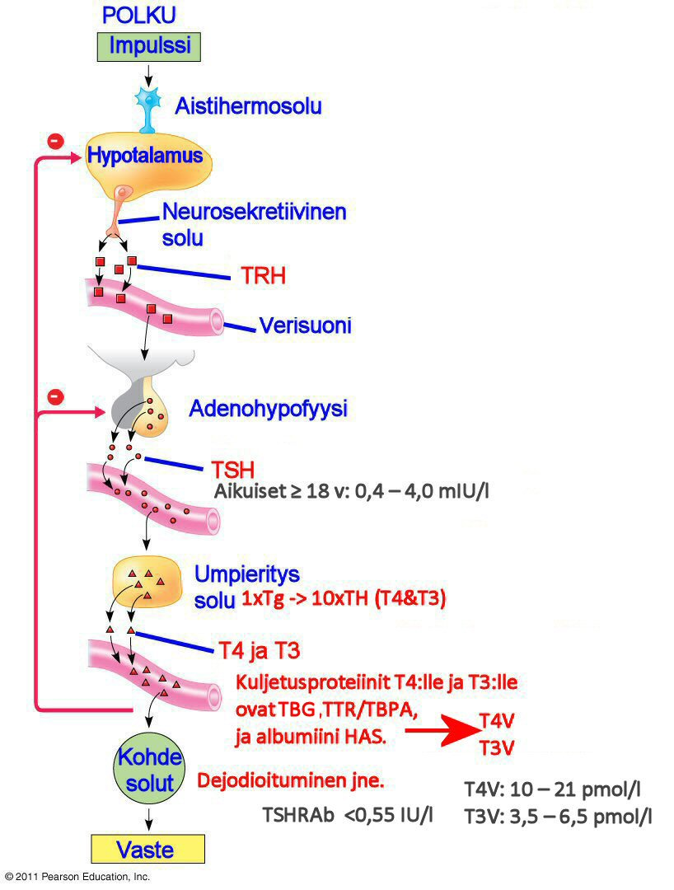**T4V:n korkeat arvot**:

-   Hypertyreoosi (liikatoiminta).

-   Synnytyksen jälkeinen kausi.

-   [Hepariinihoito](http://www.kaypahoito.fi/web/kh/suositukset/suositus?id=hoi50022).

-   [Amiodaronihoito](http://www.kaypahoito.fi/web/kh/suositukset/suositus;jsessionid=97F133E4E25805B84C1333E72B3BA429?id=nak04917).

-   Sairaudet, joihin liittyy vapaiden rasvahappojen pitoisuuden nousu.

-   Suvuittainen dysalbumineeminen hypertyroksinemia.

**T4Vn matalat arvot:**

-   Hypotyreoosi (vajaatoiminta).

- Raskaus (loppuvaiheessa), mutta harvoin alle alemman viitearvon rajan.

-   Difenyylihydantoiinihoito (epilepsia).

- [Fenytoiini](https://fi.wikipedia.org/wiki/Fenytoiini)- ja [karbamatsepiinihoito](https://fi.wikipedia.org/wiki/Karbamatsepiini).

Menestyksekkään tyroksiinikorvaushoidon aikana S-T4-V on noin 20% eutyreoottista (kilpirauhasen normaalitoimintaa) korkeampi.

Normaali S-T4-V-pitoisuus voi olla aliravitsemuksen tunnus. S-T4-V:n määrittämistä häiritsevät reumatoiditekijä (S --IgM), heterofiiliset- ja T4-vasta-aineet, hepariinihoito, albumiinin sitomiskyvyn poikkeamat [(perinnöllinen dysalbumineeminen hypertyroksinemia](http://finto.fi/mesh/fi/page/D050010)). Nämä tulisi ottaa huomioon, kun potilaan kliininen kuvaus ei vastaa analyysituloksia.

### S-TSHRAb TSHR reseptori vasta-aineet

Viitearvo: \<0,55 IU/l

Basedowin taudin / [eksoftalmus-oireyhtymän](http://www.duodecimlehti.fi/lehti/2010/20/duo99131) (silmäoireyhtymä) diagnostiikka. Hypertyreoosin erotusdiagnostiikka. Raskauden aikainen ja vastasyntyneen hypertyreoosi. Hypertyreoosin seuranta hoidon aikana.

Kohonnut pitoisuus viittaa vahvasti Basedowin tautiin. Basedowin [^28] tauti (kuten Hashimoton tyreoidiitti) voi aktivoitua raskauden aikana, jolloin [IgG-luokan](https://fi.wikipedia.org/wiki/Immunoglobuliini_G) TSHR [^29]-vasta-aineet voivat kulkeua istukan läpi ja aiheuttaa sikiölle tai vastasyntyneelle hypertyreoosin. Vasta- aineiden seurannasta on hyötyä myös tyreostaattihoidon aikana. Hoidon onnistuessa vasta-ainepitoisuudet laskevat, mutta uudelleenaktivoitumisen yhteydessä pitoisuudet pysyvät ennallaan.

Tyroksiinilla (T4) eli kilpirauhashormonilla ei ole vuorokausirytmiä. Trijodityroniini (T3) kilpirauhashormonilla on vastaavan kaltainen vuorokausirytmi kuin TSH:lla mutta sen muutokset tapahtuvat vuorokauden sisällä myöhemmin ja niiden laajuus on myös pienempi.

### S-T3V vapaa Trijodityroniini

Viitearvo: 3,5 -- 6,5 pmol/l

Trijodityroniini, toinen kahdesta tärkeimmästä kilpirauhashormonista, joka on tyroniini-aminohapon jodipitoinen johdannainen. Sitä syntetisoidaan vähäisessä määrin kilpirauhasessa, pääasiassa kuitenkin perifeerisissä (ääreis-) kudoksissa T4-stä. S-T3-V on trijodityroniinin kantajaproteiineihin sitoutumaton osa. Se on ehkä herkin yksittäinen hypertyreoosin (liikatoiminnan) indikaattori.

Indikaatiot: Hypo- ja hypertyreoosin diagnostiikka. Hypertyreoosiepäilys (TSH↓), mutta S-T4-V normaali. T3 hypertyreoosin monitorointi.

- Korkeat vapaan T3:n arvot: Hypertyreoosi. T3-toksikoosi -- 10-20%:lla hypertyreoositapauksista esiintyy T3 intoksikaatio -- S-T3-V:n nousu normaalin S-T4-V-arvon kohdalla.

- Matalat vapaan T3:n arvot: Hypotyreoosi -- ei voi käyttää hypotyreoosin diagnosointiin, koska S-T3-V pysyy normaalina silloinkin, kun S-T4-V-pitoisuus vähenee

# Ruokavalio ja kilpirauhanen

Hippokrates (n. 460 -- 377eaa) lausui "**Olkoon ruoka lääkkeesi**". Uusimpien suolistomikrobien tutkimuksen kannalta hän ei voisi olla enempää oikeassa: mikäli tila voidaan parantaa ruokavaliolla, niin kannattaa tehdä.

Vääränlainen ruokavalio voi myös aiheuttaa ongelmia kilpirauhashormoneiden tuotantoon. Tämä johtuu kilpirauhashormoneiden rakenteesta. Jodinpuute siinä määrin että se aiheuttaisi struumaa on harvinaista. [Finravinto 2012](https://www.julkari.fi/bitstream/handle/10024/110839/THL_RAP2013_016_%26sliitteet.pdf) tutkimuksen mukaan keskimäärin jodia saa miehet 209-235 μg ja naiset 173-190 μg ikäryhmästä riippuen vuorokaudessa. Suositus molemmille on 150 μg vuorokaudessa (THL 2013, 81).

Mikäli haluat analysoida minkä verran sinä saat ruokavaliossasi jodia, voit käyttää hyväksesi esimerkiksi Finellin [ruokapäiväkirjaa](https://fineli.fi/fineli/fi/ruokapaivakirja). Pidä esimerkiksi viikon ajan tarkasti päiväkirjaa kaikesta mitä syöt esimerkiksi näin:

[]Kuva - Ruokapäiväkirja

ja siirrä kaikki kirjaamasi tiedot päiväkirjaan. Tämän jälkeen voit ladata tiedot esimerkiksi Exceliin ja jakamalla kokonaisarvot ruokapäiväkirjan päivillä (esim. viikko 7:llä) saat kesimääräiset päivittäiset arvosi. Alla olevassa kolmen päivän esimerkissä jää esimerkiksi jodin saanti jopa 75% alle saantisuositusten [^30].

[]Kuva - Ruokapäiväkirjasta tehty Excel

Keskimääräisiä mittauksia katsoessasi on tärkeää ottaa huomioon myös kehon koko ja henkilön aktiivisuus.

Energiankulutuksessa BMR eli perusaineenvaihdunta on ns. koomakulutus, jonka kehon biokemialliset reaktiot käyttävät paikallaan ollessasi. Aktiivisuus lisää kulutusta siinä missä kilpirauhashormoneilla kiihdytetty aineenvaihdunta. Finravinto ja Finelli saantisuositukset perustuvat 23 kg/m3 (BMI) omaavalle toimistotyötä tekevälle terveelle ihmiselle.

Minulle on epäselvää millä tavoin kehon koko vaikuttaa hormonaaliseen säätelyyn. Kaiken logiikan mukaan isolla ihmisellä on enemmän soluja ja ne tarvitsevat saman määrän hormoneitakin kuin muut toimiakseen. Seerumista otetut näytteet kertovat sen hetkisestä hormonin konsentraatiosta verenkierrossa. Kehon koon luulisi vaikuttavan myös hormonia tuottavan elimen kokoon, sillä mitä enemmän hormonia tuotetaan, sitä suurempi hormonia tuottava elinkin pitäisi olla. Toisaalta reseptorien affiniteetti voi olla poikkeavaa. Näiden matemaattinen mallintaminen olisi mielenkiintoinen haaste. Mikäli tällainen voitaisiin tehdä, auttaisi se koneoppimisella [^31] tehtäviä päätelmiä.

# Tutkimuksia ja tietolähteitä

Mikäli olet englanninkielentaitoinen, paras tietolähde on [Thyroid Manager](http://www.thyroidmanager.org/). Yksittäisiä tutkimuksia ja koonteja löydät myös [Pubmed](https://www.ncbi.nlm.nih.gov/pubmed/):stä. PubMed on biolääketieteen tietokanta, jossa artikkelit ovat kansainvälisistä julkaisuista. Pubmedin käytöstä katso kaksi Turun Yliopiston videota miten tietokantaa käytetään:

- [PubMed perushaku ja automatic term mapping -toiminto (2:21 min)](https://dreambroker.com/channel/2bj1dzbj/t2e9y2fn)

- [PubMed - aineiston paikantaminen (2:06 min)](https://dreambroker.com/channel/2bj1dzbj/2m3lxtpn) (miten löydän kokotekstin)

Alla esimerkiksi muutamia hakusanoja, joilla voit löytää aiheeseen liittyviä tutkimuksia:

1. Kilpirauhanen ja energiabalanssi: " [thyroid energy balance](https://www.ncbi.nlm.nih.gov/pubmed/?term=thyroid+energy+balance)" tuottaa 346 tutkimusta.

2. Kilpirauhanen ja homeostaasi: " [thyroid homeostasis](https://www.ncbi.nlm.nih.gov/pubmed/?term=thyroid+homeostasis)" tuottaa 3311 tutkimusta.

3. Kilpirauhanen ja levotyroksiini: " [thyroid levothyroxin](https://www.ncbi.nlm.nih.gov/pubmed/?term=thyroid+levotyroxin)" tuottaa 35457 tutkimusta.

4. Kilpirauhanen ja keskushermosto " [thyrdoid cns](https://www.ncbi.nlm.nih.gov/pubmed/?term=thyroid+cns)" tuottaa 636 tulosta.

5. Tyroksiini ja lihavuus: " [obesity thyroxine](https://www.ncbi.nlm.nih.gov/pubmed/?term=obesity+%26+thyroxine)" tuottaa 1002 tulosta.

Kuten huomaat, tulee osumia aivan liikaa niiden läpikäymiseksi. Kannattaakin rajata hakua vielä tarkemmilla hauilla. Muitakin tietokantoja on saatavilla.

Mikäli sinulla on yliopiston tai muun vastaavan kautta yhteys [Finnaan](https://www.finna.fi/Content/about), voit etsiä sieltä suomenkielisiä ja englanninkielisiä dokumentteja. Sieltä löydät myös [Cinahl-tietokannan](https://blogs.uef.fi/tiedonhaku-hoitotiede/cinahl/), joka on hoitotieteen ja sen lähialojen tietokanta. [PsycINFO](http://www.apa.org/pubs/databases/psycinfo/index.aspx) on kansainvälinen psykologian ja sen lähialojen tietokanta, mikäli haluat pohdiskella millaisia käytökseen liittyviä asioita kilpirauhassairaudet voivat aiheuttaa [^32].

Tutkimukset kannattaa lukea kokonaan läpi, sillä pelkkä abstract (yhteenveto) ei kerro kaikkea. On myös tärkeää huomata tutkimusolosuhteet ja rajoitukset. Suurinta osaa tutkimuksia ei ole onnistuneesti replikoitu toisen tutkijaryhmän toimesta, joten suhtaudu yksittäiseen tutkimukseen skeptisesti. Tutkimusten tekemisiseen ja luotettavuuteen liittyen voit lukea esimerkiksi kirjan [How to Think Straigth About Psychology](https://www.pearson.com/en-us/subject-catalog/p/how-to-think-straight-about-psychology/P200000003081/9780137505623) (Keith E. Stanovich).

Tutkimuksissa käytetään usein [IMRD-rakennetta](https://fi.wikipedia.org/wiki/IMRD-rakenne). Tutustu vähintään IMRD-rakenteeseen ennen tutkimusten lukemista. Osa tutkimuksista on maksumuurin takana. Voit kiertää ne netistä löytyvällä sivustolla, mutta kiertäminen voi olla laitonta. Avoin tiede (Open Science) tähtää siihen, että kaikki tutkimustulokset olisivat julkisia. Hyvä vertaisarvioitujen tutkimusten Open Access tietolähde on [Frontiers](https://www.frontiersin.org/). Mikäli sinua kiinnostaa meneillään olevat kliiniset kokeet, löydät ne [ClinicalTrials:sta](https://clinicaltrials.gov/).

[Suomen endokrinologiayhdistyksellä](https://www.endo.fi/tietoa-endokrinologisista-sairau/potilasohjeet/basedowin-silmaoireyhtyma/) on jonkin verran tietoa, mutta pidän niitä kovin kapeasti kirjoitettuna.

## Lihavuus ja tyroksiini

Nykyisin on tyypillistä syyllistää ihmisiä sairauksistaan. Yksi tällainen on lihavuus. Lihavuus korreloituu moneen sairauteen, myös hypotyreoosiin, mutta onko lihavuus syy vai seuraus onkin hankalammin todistettavissa. Tarkastellaan hieman mitä lihavuuden ja hypotyreoosin osalta ollaan tutkittu. Olen ottanut muutaman tutkimuksen tähän otantaan. Suomessa lähtökohtana on todeta kaikkien hormonien puutteiden johtuvan lihavuudesta. Tätä selitetään yleensä suuremmalla veritilavuudella, olkoonkin, että lihavilla on enemmän soluja ja pinta-alaa, jotka vaativat saman määrän kaikkea mitä solu tarvitsee, myös hormoneita. Laboratoriomittausten viitearvoissa ei juurikaan oteta BMI:tä huomioon.

Ongelmana tutkimuksia lukiessa on löytää mikä on muna ja mikä kana, eli onko esimerkiksi matalampi T4V pitoisuus seurausta lihavuudesta vai onko lihavuus seurausta alhaisesti T4V-pitoisuudesta [^33].

Thyroid managerin mukaan lihavuus ei vaikuta kilpirauhasen toimintaan:

> "Overfeeding produces an increase in the serum T3 concentration as a > result of an increased conversion of T4 to T3. It is particularly > marked when the excess calories are given in the form of > carbohydrates. Thus, it appears that the effect of overnutrition on > iodothyronine metabolism is the opposite of that of starvation. This > finding gives further credence to the speculation that changes in > thyroid hormone may serve to modulate the homeostasis of energy > expenditure. > > Although it has been reported that serum T3 concentrations correlate > with body weight, it appears that this phenomenon reflects the effect > of an increase in caloric intake on T3 production. Most studies find > that obese subjects have normal thyroid function and hormone > metabolism. Furthermore, **no abnormalities in the > hypothalamic-pituitary-thyroid axis have been demonstrated in obese > subjects**" (Endocrine Education Inc. 2016) kappaleesta "Effects of > the Environment, Chemicals and Drugs on Thyroid Function".

Yksittäisiä tutkimuksia tarkastelemalla ei saa myöskään selvää vastausta. Alla olevat tutkimukset ovat kronologisessa järjestyksessä siksi, että uusimmissa tutkimuksissa on käytetty viimeisimpiä metodeja, mittalaitteita ja tutkimusprotokollia.

Vuonna 2006 julkaistussa [kohorttitutkimuksessa](https://fi.wikipedia.org/wiki/Kohortti_(tutkimusaineisto)), " [Lack of association between serum TSH or free T4 and body mass index in euthyroid subjects](https://www.ncbi.nlm.nih.gov/pubmed/16430708)" tutkittiin 401 terveen kilpirauhasen omaavaa henkilöä, joiden TSH pitoisuus oli normaali (361 naista, 40 miestä, keski-ikä 48,2 vuotta) ja jotka olivat ohjattu klinikalle kilpirauhasessa olleen kyhmyn tai struuman vuoksi. Heiltä mitattiin seerumista TSH ja T4V ja BMI. TSH:n ja T4V:n pitoisuuksia BMI:n vertailtiin. Tutkimuksessa ei löydetty yhteneväisyyttä TSH:n tai T4V:n välillä lihavien ja laihojen välillä.

Vuonna 2008 julkaistussa tutkimuksessa, " [Free T4 is negatively correlated with body mass index in euthyroid women](https://www.ncbi.nlm.nih.gov/pubmed/18646506)" tutkittiin sitä miten T4V ja TSH pitoisuudet vaikuttavat BMI:n ja lipideihin (kolesteroliarvoihin) terveen kilpirauhasen omaavilla henkilöillä. Tutkimuksessa 1572 terveen kilpirauhasen omaavaa naista keski-iältään 46,2 vuotta kävivät kirkon terveyspalveluissa terveystarkastuksessa. Naiset, joilla oli tyroksiinilääkitys tai kilpirauhanen ei toiminut oikein, suljettiin pois tuloksista. Muilta mitattiin TSH, T4V, lipideistä kokonaiskolesteroli, triglyseridit, HDL-C ja LDL-C. Tulosten perusteella terveen kilpirauhasen omaavilla lihavilla naisilla oli pienemmän T4V pitoisuudet kuin laihoilla terveen kilpirauhasen omaavilla naisilla. Kun huomioitiin ikä, tupakoimattomuus, edelleen T4V mutta ei TSH korreloi vahvasti BMI:n kanssa. Kun huomioitiin ikä, tupakoimattomuus ja BMI, T4V korreloi negatiivisesti triglyserideihin merkittävästi. Tutkimuksen perusteella voidaan olettaa matalan T4V:n liittyvän lihavuuteen terveen kilpirauhasen omaavilla henkilöillä.

Vuonna 2010 julkaistussa tutkimuksessa, " [Relationship of thyroid function with body mass index and insulin-resistance in euthyroid obese subjects](https://www.ncbi.nlm.nih.gov/pubmed/20339314)" sitä, että kun tiedetään kilpirauhasen toimimattomuuden liittyvän painon muutoksiin, niin vaikuttavatko pienet muutokset painoon. Tutkimuksen tarkoitus on toimia myös perustana myöhemmille insuliiniresistenssitutkimuksille ja hypotalamus-aivolisäke-kilpirauhasakselin toiminnoille. Tutkimuksessa oli 581 lihavaa henkilöä. Seerumista mitattiin TSH, T4V, antropometrian ja aineenvaihdunnan parametrit. Kaikilla henkilöillä TSH-arvot nousivat portaattomasti lihavuuden ja BMI:n suhteessa (p=0.001, r=0.13) sekä vyötärönympäryksen suhteessa (p=0.02, r=0.11) [^34]. Henkilöt, joilla oli insuliiniresistenssi omasivat korkeammat TSH-pitoisuudet (1.8±1.0 vs 1.6±0.9 μUI/l; p=0.03) ja matalammat T4V-pitoisuudet (13.8±2.3 vs 15.0±2.2 pmol/l; p\<0.001) verrattuna henkilöihin, joilla ei ollut insuliiniresistenssiä. Lisäksi korkeampi TSH korreloi paastoinsuliiniin (p\<0.001, r=0.152) ja insuliiniresistenssin homeostaattiseen arviointimenetelmään (HOMA-IR; p\<0.001, r=0.148) ja negatiivisesti korreloi Quantitative Insulin Sensitivity Check Indeksiin (QUICKI; p\<0.001, r=-0.148). Tyroksiini (T4) oli korreloi negatiivisesti paastoinsuliiniin (p\<0.001, r=-0.287) ja HOMA-IR (p\<0.001, r=-0.295), ja positiivisesti QUICKI (p\<0.001, r=0.295). Tästä voidaan päätellä kilpirauhasen toiminnan ja lihavien henkilöiden välillä olevan selkeä yhteys, pääosin insuliiniresistenssin johdosta. TSH:n ja kilpirauhashormonien välistä variaatiota suhteessa painoon tai voiko lihavuus vaikuttaa kilpirauhasen toimintaan ei voida tästä päätellä.

Vuonna 2011 julkaistussa tutkimuksessa, " [Relationship between thyrotropin and body mass index in euthyroid subjects](https://www.ncbi.nlm.nih.gov/pubmed/21086247)" todetaan, että useammat tutkimukset raportoivat TSH-pitoisuuden olevan hieman korkeammat lihavilla. Tutkimukset eivät kuitenkaan ole löytäneet yhteyttä kilpirauhasen toiminnan ja BMI:n välillä. Tutkimuksen tarkoitus on selvittää TSH:n ja BMI:n välistä yhteyttä tutkimalla terveen kilpirauhasen omaavia henkilöitä. Kohorttitutkimuksessa tarkasteltiin 778 eutyreoottista henkilöä, 488 lihavaa naista joiden keski-ikä oli 58,5 vuotta ja BMI yli 30 ja 319 ylipianoista naista BMI:n ollessa välillä 25-29,9 ja 138 normaalipainoista naista BMI:n ollessa välillä 18,5-24,9. Seerumin TSH-pitoisuudet nousivat merkittävästi painokategorian mukaisesti (normaalipainoiset, mediaani \ [kvartiiliväli\], 1.24 \ [0.94-1.72\]; ylipainoiset, 1.31 \ [1.00-1.93\]; lihavat, 1.66 \ [1.15-2.44\] mU/l; P\<0.001). Vapaan tyroksiinin (T4V) määrä ei tilastollisesti poikennut kategorioiden välillä. Merkittävä korrelaatio löytyi TSH:n ja BMI:n väilillä (r=0.217, P\<0.001). Henkilöt joiden TSH-pitoisuudet olivat korkeimmalla kolmanneksella (1.84-5.0 mU/l) näyttivät kuuluvan BMI-arvoiltaan paljon korkeammalle (30.8 \ [26.9-34.9\] kg/m²), (P\<0.001) kuin henkilöt joiden TSH-pitoisuudet olivat keskivaiheilla (1.13-1.83 mU/l, 28.8 \ [25.8-32.3\] kg/m²) tai alimmalla kolmanneksella (0.4-1.12 mU/l, 27.4 \ [25.4-30.6\] kg/m²). Vapaan tyroksiinin T4V osalta ei löydetty eroja BMI:n suhteen. Kuitenkin tutkittaessa alaryhmää, jossa henkilöitä joilla ei ollut kilpirauhasen kilpirauhasen autoimmuunivasta-aineita (n=375), TSH-pitoisuuksissa ei ollut eroja lihavien (n=106, 1.24 \ [0.90-1.81\] mU/l) ja normaalipainoisten tai ylipainoisten välillä (n=269, 1.23 \ [0.90-1.80\] mU/l). Alaryhmässä ei löydetty korrelaatiota TSH:n ja BMI:n välillä (r=-0.035, NS). Tuloksesta voidaan todeta, että TSH:n ja BMI:n välinen yhteys häviää terveen kilpirauhasen omaavilla henkilöillä joilla ei ole autoimmuunivasta-aineita.

Vuonna 2015 julkaistussa tutkimuksessa, " [Alterations of the thyroid function in patients with morbid obesity](https://www.ncbi.nlm.nih.gov/pubmed/26020658)" todetaan, että sairaalloisen lihavilla (BMI yli 40 kg/m2) hypotalamus-aivolisäke-kilpirauhanen akseli on todettu toimivan virheellisesti, näyttäen korkeaa TSH-, T3- ja T3V-pitoisuutta. Tutkimuksen tarkoituksena oli määritellä sairaalloisen lihavien seerumista mitattavien TSH, kokonais T3, T3V, T4V ja autoimmuunivasta-aineita (TPO). Tutkimus oli prospektiivinen poikittainen havaintotutkimus, jossa oli 52 sairaalloisen endokrinologian klinikalla hoidettua lihavaa henkilöä 2009-2011 välillä. Henkilöt, joilla tiedettiin olevan kilpirauhaseen liittyviä sairauksia tai söivät levotyroksiinia jätettiin pois tutkimuksesta. Tilastollinen analyysi suoritettiin käyttämällä korrelaatiossa central tendency, simple frequencies, percentages and Spearman\'s mittauksia. Tuloksena primaarisen hypotyreoosin esiintyvyys oli 8%, subkliinisen hypotyreoosin 6% ja kilpirauhasen toiminnan muutokset toissijaisesti lihavuuteen oli 23% (korkeampi TSH ja/tai vapaa T4V, kokonais T3 normaalin TPO:n kanssa). Voidaan siis todeta, että sairaalloisen lihavilla ei ole autoimmuunista kilpirauhasen vajaatoimintaa. Kilpirauhaseen liittyvän homeostaasin vaihtelut johtuvat lihavuudesta ja ne voidaan korjata laihduttamisella.

Vuonna 2017 julkaistussa tutkimuksessa, " [Association between Thyroid Function and Body Mass Index: A 10-Year Follow-Up](https://www.ncbi.nlm.nih.gov/pubmed/28618407)" tutkittiin terveen kilpirauhasen toiminnan mittauksin osoitettavia muutoksia ja normaalipainoisten BMI:tä. Tutkimuksessa tarkasteltiin 1100 normaalipainoisen eutyreoottisen henkilön tietoja väestön kohortista, Tehran Thyroid Stydystä. BMI-arvo laskettiin ja seerumin TSH ja T4V määriteltiin vertailukohdassa ja kymmenen vuoden seurannan jälkeen. Tutkimuksessa arvioitiin kilpirauhasen ja lihavuuden välistä yhteyttä kahdella tavalla: binäärinen tulos sen mukaan kuuluiko BMI:ssä alle 25 vai yli 25 ja multinominen tulos normaalipainoisten, ylipainoisten ja lihavien suhteen. Tutkimuksessa tarkasteltiin 569 naista ja 531 miestä, iältään 36,3 ± 13.5 vuotta. Muunneltua Poison-regressioanalyysiä käytettiin binääriseen tulokseen siten, että ikä, sukupuoli, tupakoimattomuus, autoimmuunivasta-aineet eivät liittyneet seerumin tyroksiinipitoisuuden muutoksiin ja BMI:n (relatiivinen riski 0.55 \ [95% CI 0.37-0.80\]) ilman merkittävää yhteyttä TSH-pitoisuuksien tai BMI:n muutokseen. Samoin multinominaalisessa logistisessa regressioanalyysissä yhteyttä seerumin tyroksiinintasojen muutoksien, TSH:n ja BMI-kategorioiden välillä ei löytynyt. Päätelmänä on se, että normaalipainoisilla terveen kilpirauhasen omaavilla henkilöillä seerumin tyroksiinilla, mutta ei TSH:lla, voi olla vaikutusta kehon painoon.

Kuten huomaamme, tutkimuslöydöksissä on vaihtelevuutta ja yhden selvän vahvistuksen saaminen on hankalaa. Savolaisittain voisi sanoa, että voephan se olla niinnii, tai voephan se olla näenkii ... joten jatkotutkimuksia tarvitaan.

Yhteneväistä näyttäisi olevan se, että laihdutus vaikuttaa kilpirauhasarvoihin, mutta tämä asettaa kysymyksen siitä, mikä mekanismi taustalla on ja voisiko kilpirauhaslääkityksestä olla hyötyä laihdutuksessa silloin, jos arvot saadaan pysymään eutyreeootisen kilpirauhasen yläkolmanneksella, eli ettei mennä hypertyreoosin puolelle. Tai voisiko kilpirauhasen toiminta palautua, jos henkilö ottaa hormonia purkista, jolloin kilpirauhasen koko pienenee ja myöhemmin kun lopettaa lääkityksen, palautuuko kilpirauhanen entistä ehompaan tilaan.

## Kilpirauhanen ja genetiikka

Genetiikasta kiinnostunut varmaan kiinnitti huomiota kilpirauhashormonin tuotannosta kertovassa kaaviossa geeneihin, joita transkriptoidaan kilpirauhashormonien tuotannossa.

Kuten tiedämme, voivat kyseiset geenit olla mutatoituneita tai niitä aktioiva epigenomi voi ulkoisten signaalien, kuten saasteiden tai [hormonihäiritsijöiden](http://www.ymparisto.fi/fi-FI/Kulutus_ja_tuotanto/Kemikaalien_ymparistoriskit/Ymparistoon_paatyvat_haitalliset_aineet/Hormonitoimintaa_hairitsevat_yhdisteet) vaikutuksen vuoksi ohjata geeniaktivaatiota väärin. Käyn tässä lyhyesti läpi mitä tällä hetkellä aiheesta löytyy.

Pubmedin [perushaussa](https://www.ncbi.nlm.nih.gov/pubmed?term=(genetics)%20AND%20thyroid) löytyy 39 694 tukimusta. [SNPEdiassa](https://www.snpedia.com/index.php?title=Special%3ASearch&search=thyroid&go=Siirry), jossa on koottuna "snipit" yhteen paikkaan, löytyy sana "thyroid" 660 sivusta (ja tutkimuksesta). [Geenipankista](https://www.ncbi.nlm.nih.gov/nuccore/?term=thyroid) löytyy 587541 sekvenssiä liittyen kilpirauhaseen, mukaan lukien kaikki organismit hiirestä alkaen. [OMIM](https://www.ncbi.nlm.nih.gov/omim/?term=thyroid):ssa on 908 ihmisen kilpirauhasen genetiikkaan liittyvää tutkimusta.

Omista DNA-näytteistäni on tehty useammassa paikassa analyysejä eri tarkoituksiini. Autosomeista parhaiten erilaisia terveyteen liittyviä dna-alueita löysi [23AndMe.com](https://www.23andme.com/) testi, mutta oikeuden päätöksellä he ovat poistaneet tiedot suoraan näkyviltä. Mikäli olet teettänyt autosomitestin esimerkiksi 23AndMe.com:ssa, voit analysoida sen käyttämällä työkaluna [Prometheasea](https://www.snpedia.com/index.php/Promethease), joka kokoaa yhteen eri tutkimukset ja markkerit.

Riskialleeleja tulee arvioida lähinnä siten, että ne voivat ohjata elintapavalintoja, mutta ne eivät tarkoita sitä, että sairauden varmasti saa. Ainoastaan selvästi perinnölliset vallitsevat ja resessiiviset sairaudet ovat sellaisia, joista voi olla varmempi sairauden puhkeamisen suhteen.

Genetiikasta epigenetiikkaan liittyen kilpirauhasen osalta kannattaa lukea [tämä julkaisu](https://www.ncbi.nlm.nih.gov/pmc/articles/PMC4128637/) (englanniksi). [Pubmedissä](https://www.ncbi.nlm.nih.gov/pubmed/?term=thyroid+epigenetics) on tällä hetkellä 996 tutkimusta epigenetiikasta ja kilpirauhasesta.

# Stressi kilpirauhasongelmien juurisyynä

Nyt kun alamme ymmärtämään hieman kilpirauhasen toiminnasta ja mahdollisista kilpirauhaseen liittyvistä häiriöistä, voimme käsitellä kuvitteellista potilasesimerkkiä.

Potilas on obeesi keski-ikäinen mies. Ei perussairauksia. Ei lääkityksiä. Ei polta. Alko satunnaisesti. Oireina väsymystä, näköhäiriöitä, muistihäiriöitä, "aivosumua", hidas ajatuksenjuoksu, rasituksesta palautumisen hitautta. Historiaa homealtistumisesta. Nurmikon leikkaus aiheuttaa tyypillisen allergiavasteen, jossa kuumeinen olo ilman kuumetta ja toisinaan ripulointia. Haistaa esimerkiksi kaupan kassajonossa hometalossa asuvat ihmiset.

Liikunta: kuntoilee kolme kertaa viikossa kuntosalilla ja kävelee koiran kanssa 10-30 kilometriä viikossa.

- 2/2014: Käynti 1: verenpaine 128/78. Laboratoriotulokset TSH 2,47 / T4V 14,8 / T3V 4,8. Hb 163. HKR 48. ALAT 34 / ASAT 30 / AFOS 72. HB1Ac 31,2 mmol/L. KOL 5,5 / HDL 1,1 / LDL 3,8 / Trigly 2,4. Krea 83. Testo 8 [^35]. Todetaan poikkeavuus testosteronissa, joten **päätellään oireiden johtuvan testosteronista**. Hoitopäätös vaatii kuitenkin toisen mittauksen.

- Käynti 2: S-Testo on edelleen 8. SHBG 35, Testo-V 28,1, S-PSA 0,72, S-PRL 3, LHRH 193. Päätetään aloittaa TestoGel korvaushoito.

- Käynti 3: S-Testo 13,9, SHBG 25. Hb 167. HKR 48. Vointi parantunut, jatketaan hoitoa.

- Käynti 4: S-Testo 19, SHBG 31, Testo-V 52,7, Hb 183, HKR 55. Hematokriitti todetaan liian suureksi (max 50), joten päätetään lopettaa TestoGel polysytemian vuoksi. **Päätellään alkusyyn olevan lihavuus**.

- Käynti 5: S-Testo 10,7, SHBG 44, Testo-VL 149, Hb 166, HKR 50. Ei lääkityksiä.

- Käynti 6: S-Testo 5,7, S-E1 248, S-E2 0,13. Aloitetaan uudelleen TestoGel koska S-Testo laskenut huomattavasti alle viitealueen minimin 10. Päätetään venesektioida kun HKR nousee yli 50.

- Vuosi TestoGelillä ja venesektioilla muutaman kuukauden välein. Palautuminen rasituksesta nopeaa, hyvin energiaa, mutta muistin toiminnassa ongelmia. Viimeisin kerta venesektiolla Hb 159, HKR 47 tuottaa huimausta ja sekavuutta. Päätetään lopettaa TestoGel sekundaarisen polysytemian ja huimausoireiden vuoksi. Tutkitaan uudelleen TSH joka on 2,15 ja T4V 11. Päätetään kokeilla tyroksiinihoitoa koska T4V lähellä viittevälin alarajaa (10).

-   Käynti: TSH 1,25 / T4V 12 lääkitys 0,25 μg.

-   Käynti: TSH 2,27 / T4V 12 lääkitys 0,50 μg.

-   Käynti: TSH 1,31 / T4V 12 lääkitys 0,75 μg.

- Käynti: TSH 1,1 / T4V 13 lääkitys 100 μg. Muisti parantunut, näköhäiriöt hävinneet. Palautuminen rasituksesta hidastunut.

- Käynti: TSH 1,1 / T4V 13 lääkitys 100 μg ja S-Testo 13,2. Testosteroni on siis palautunut normaaliksi tyroksiinikorvaushoidon aikana. Hb 165, HKR 46. Transferriinireseptori 1,4. Ferriitti 70. Tyreoksiperoksidaasi vasta-aineet 28. Kortisoli 240.

- Käynti: TSH 0,69 / T4V 13 lääkitys 100 μg. Hb 162, HKR 46. Olo muuten hyvä, mutta rasituksesta palautuminen kestää pitkään ja akillesjänteet kipeytyvät kävellessä. Harvoin "aivosumua".

-   Käynti: TSH 0,72 / T4V 13, lääkitys 125 ug, Hb 169.

-   Käynti: TSH 0,43 / T4V 14, T3V 4,3, Hb 157.

- 10/2017: Käynti: TSH 0,35 / T4V 14,5, ALAT 60, AFOS 86, P-GT 29, Hb1Ac 36, Krea 96, Testo 12,1. Päätetään lopettaa tyroksiinilääkitys portaittain kolmen kuukauden sisällä, koska T4V ei nouse ja tyroksiini näyttäisi aiheuttavan maksavaurioita. **Päätellään alkusyyn olevan edelleen lihavuus**.

Päiväkirjaseuranta tyroksiinin alasajon ajalta 10/2017 alkaen:

-   Lasku 125μg -\> 100 μg.

- Näköongelman paluu, tarkentaminen ei oikein onnistu ja keskittymiskyvyn puutetta.

- Valtavasti kirjoitusvirheitä kirjoittaessa, sanoja puuttuu välistä tai taivutusmuodot väärin. Stressiherkkyys?

- Ajoittain muistihäiriöitä, voisi liittyä heikompaan rasituskestävyyteen (kortisoli?)

-   Lasku 100μg -\> 50μg.

- Muistihäiriötä, kahvipannu unohtunut keittimestä kahvinkeiton aikaan yms.

-   Heikotus, sydämen tiheälyöntisyys, hengenahdistus. Paniikkikohtaus?

-   Selkeitä masennusoireita, vahakasvoisuutta.

-   Lasku 50μg -25μg

- Alilämpöä, heikotusta, väsymystä, sykevälivaihteluita, rintatuntemuksia.

- Alilämpöä, kaupassa ollessa heikotus ja pelko pyörtymisestä, väsymys.

-   Turvotusta, edelleen hidastunut palautuminen rasituksesta.

- \"Elohiiri\" oikeassa pohkeessa, kävellessä meinannut jalka pettää alta, aamulla ja illalla. Alaselän kipua. Hermopinne?

-   Nivelkipua vasemman käden keskisormi ja nimetön.

-   Selvää masennusta ja jaksamattomuutta.

-   Lasku 25 μg -- 0

-   Vasen lonkkakipu helpottaa, alaselkäkipu jatkuu, masennus lievenee.

- Paino laskenut entisestään, liikunta palautunut osin myös vuodenajan vuoksi.

- Harvemmin muisti- ja näköhäiriöitä, selvästi liittyy rasitukseen ja heikkoon rasituksesta palautumiseen. Kilpirauhasen koko palpoiden selvästi isompi kuin lääkittynä.

Ensimmäisen ja viimeisen käynnin välillä on noin neljä vuotta. Kaaviokuvana TSH ja T4V laboratoriomittaukset näyttävät tältä:

[]Kuva - TSH ja T4V

Mittausaikana paino hieman laskenut ja aktiivisuus on pysynyt kutakuinkin samana vuodenaikoihin nähden.

*Tämä tarkoittaa silloin sitä, että alkutilanteen TSH 2,47 ja T4V 14,8 eivät ole laskeneet siksi, että olisi lihottu tai laihduttu, eikä lopputilanteen tyroksiinihoidolla TSH 0,35 ja T4V 14,5 eivät johdu painon muutoksista*. [^36]

**Tärkeimmäksi selittäväksi tekijäksi alkaa muodostua biologisesti heikko stressinsietokyky, jossa alhainen kortisolin perustaso voisi antaa osviittaa stressihormoneiden aiheuttamasta [PTSD tilasta](http://blogs.plos.org/blog/2016/06/08/cortisol-the-intergenerational-transmission-of-stress-and-ptsd-an-interview-with-dr-rachel-yehuda/) (post-traumaattinen-stressi oireyhtymä).**

Onkin syytä kokeilla vaikuttaako irtiotto arjen stressistä kilpirauhastatukseen. Mikäli vaikuttaa, on tässä vaiheessa syytä pohtia mikä elämässä on tärkeää ja pyrkiä vähentämään stressiä.

Merkillepantavaa on se, että alkutilanteessa S-Testo oli kahdessa erillisessä mittauksessa 8, kilpirauhashormoneiden ollessa normaalit. Kun TestoGel-hoito lopetettiin, aiheutui siitä seuraaviin mittauksiin S-Teston lasku siksi, että hormonin tuotannon käynnistyminen kesti oman aikansa. Lopetuksesta aiheutui myös hetkellinen estrodiaolin ylituotanto.

Samaan aikaan aloitettu tyroksiinihoito nosti testosteronin arvoon 13,2. Kuitenkin T4V pitoisuus ei edes lääkityksellä ole noussut takaisin alkutilanteen arvoon 14,8. S-Testo pysyi arvossa 9-13,3 lähes kolme vuotta pelkällä tyroksiinilääkityksellä. Vaihtelua voidaan selittää stressitasojen vaihteluilla.

[]Kuva - S-Testomittaustulokset

Hypotalamus-aivolisäke-kilpirauhanen-akseli näyttäisi toimivan normaalisti, sillä TSH säätyy alaspäin ulkopuolisen tyroksiinihormonin vaikutuksesta. Tämä ei kuitenkaan johda vapaan T4V hormonin lisääntymiseen, vaikka lääkitystä nostettiin 125 ug ja TSH painui lähes mittaamattomiin. Onko kyse kantajaproteiineihin liittyvästä ongelmasta vaiko jostain muusta jää epäselväksi.

Koska tyreoperoksidaari-vasta-aineet ovat normaalit, ei kyse voi olla TPO-geenin aktivaatioon liittyvästä ongelmasta. Kortisolimittaus on alhainen, joka voi johtua post-traumaattisesta stressioireyhtymästä. Myös testosteronin osalta kiveksissä tapahtuvaa tuotantoa ohjaava luteinisoiva hormoni (LH) ja seksuaalihormoneja kuljettava proteiini (SHBG) ovat normaalilla tasolla. Näistä laskettuna vapaan testosteronin (VL) arvo on aluksi matala, mutta myöhemmin normaali. Voidaan todeta, että hypotalamus-aivolisäke-kivekset-akseli toimii oikein.

Homealtistuminen tai jokin muu syy on näillä tiedoilla ja mittauksilla mahdotonta kohdentaa tähän ongelmaan. Suolistobakteereiden ja suoliston muun tilan osuutta ei voida myöskään sulkea pois. Mitä yhteistä on testosteronilla ja kilpirauhashormoneilla jää tässä yhteydessä tarkemmin tarkastelematta. Mekanismeja voi opiskella Thyroid Managerista. Kuljetusproteiinien toimintaa ei voida tällä tavoin tutkia.

Olisi mielenkiintoista tehdä algoritmi koneoppimisella ja pyrkiä löytämään erilaisia metodeja käyttämällä löytyisikö näistä mitatuista tiedoista jotain yhtenevää tekijää, jota ei päättelemällä voi nähdä. Älykkäälle lukijalle voi tulla mieleen pohtia andropaussia, joka vastaa naisen menopaussia. Andropaussia ei kuitenkaan varsinaisesti tunnisteta ja toisaalta laboratoriomittauksilla todetaan testosteronituotannon kasvu, SHBG:n ja LH:n pysytellessä normaaleina koko ajan.

Ylipaino, tupakoimattomuus tai alkoholin käyttö ei näyttäisi vaikuttavan tuloksiin. Kohollaan olevat triglyseridit voisivat olla viite metabolisesta oireyhtymästä [^37].

# Loppusanat

Oma mielenkiintoni kohdistuu genetiikkaan sekä [epigenomiin](http://tieteentermipankki.fi/wiki/Biotekniikka:epigenomi) että proteiineja koodaavan genomiin. [Nutrigenomiikka](http://kehittyvaelintarvike.fi/teemajutut/36-nutrigenomiikka-tutkii-geenien-ja-ravitsemuksen-yhteispelia) on hieman jäänyt kehityksestä, mutta on sekin mielenkiintoinen seurattava. Kaikista mielenkiintoisinta on seurata mikrobiomitutkimusten kehittymistä.

Suolistossamme on kissan aivojen verran hermopäätteitä, joista on yhteyksiä aivoihimme. Suoliston mikrobit ( [mikrobiomi](https://fi.wikipedia.org/wiki/Mikrobiomi)) on ollut viime aikoina pinnalla monessa eri yhteydessä. Esimerkiksi vuonna 2012 neurobiologian professori Robert Sapolsky kertoo [tällä videolla](https://www.youtube.com/watch?v=m3x3TMdkGdQ) siitä miten mikrobit kuten toksoplasma voi vaikuttaa käytökseen. Tarkemmissa analyyseissä on osoittautunut, että toksoplasmassa on samoja geenejä kuin meissä, jotka säätelevät dopamiinitasoa ja täten saa toksoplasman saaneet voivat ottaa enemmmän riskejä ja saattavat käyttäytyä "hullusti".

On myös huomionarvoista, kuinka paljon suolistobakteereihin liittyy hypetystä, joka ei välttämättä osoita [kausaliteettiä](https://fi.wikipedia.org/wiki/Kausaliteetti) ilmiöiden välillä. Korreloimalla, joka ei siis kerro suuntaa miten jokin ilmiö tapahtuu, saadaan toki ainakin mielenkiintoisia uutisia aikaan. Esimerkiksi [tutkimus](https://www.quantamagazine.org/can-microbes-encourage-altruism-20170629/), jossa suolistomikrobien osuutta käyttäytymiseen on tutkittu "Microbes Encourage Altruism?" on aika hassu. Antibiootit muuttavat mikrobiomiamme ja niiden käyttö voi siis johtaa monenlaisiin ongelmiin, mikäli suolistomikrobien tasapaino häiriintyy, mutta ei tämä tutkimus osoita mitään varsinaista todistettavissa olevaa mekanismia käyttäytymisen muuttumiselle, toisin kuin Robert Sapolskyn toksoplasmavideossa. Antibioottien käyttöhistoriaa voisi toki korreloida esilaisten sairauksien, kuten hypotyreoosin esiintymisen suhteen.

Erityisesti laajakirjoiset antibiootit tuhoavat paljon myös meille tärkeitä bakteereita ja lisäävät antibioottiresistenssiä. Samalla kun suoliston epiteeliltä tuhoutuu bakteereita, valtaa kasvualan homesienet. Tässä mielessä onkin mielenkiintoista käyttää [Precosaa](http://www.laakeinfo.fi/Medicine.aspx?m=2172&d=2004295&i=ALGOL+PHARMA_PRECOSA_PRECOSA+kapseli%2C+kova+250+mg) antibiootikuurin aikana estämään antibioottiripulia, joka johtuu [Clostridium difficicle](http://www.terveyskirjasto.fi/terveyskirjasto/tk.koti?p_artikkeli=dlk00806)-bakteerin villiintymistä. Clostridium difficilen suhteen ulosteensiirto terveeltä luovuttajalta vaikuttaa tehokkaimmalta hoidolta. Precosa on hiivasientä nimeltään [Saccharomyces boulardii](https://fi.wikipedia.org/wiki/Saccharomyces_boulardii) (lyo) ja olisikin mielenkiintoista analysoida minkä verran sitä jää kasvamaan suolistoon antibioottihoidon jälkeen.

Voimmekin siis olettaa, että ulkoisen maailman ohjaus geeniemme aktivaatioon on muutakin kuin pelkkää epigenetiikkaa, eli meissä 10x enemmän olevilla mikrobeilla voi olla yllättävän suuri merkitys terveyteemme. Evoluutiossa prokaryootit tulivat ennen aitotumaisia, joten olemme aina joutuneet tulemaan toimeen bakteereidenkin kanssa ja loppujen lopuksi ne ovat meille elintärkeitä patogeenejä lukuun ottamatta.

Olisi myös mielenkiintoista pohtia millä tavoin esimerkiksi hometaloissa asuvien ihmisten terveydentila suhtautuu terveissä taloissa asuneisiin. Ehkä ICD-koodistoa hyväksikäyttämällä voitaisiin löytää algoritmi koneoppimiseen ja mahdollisesti löytää malleja siitä, korreloiko esimerkiksi homeet tai muut VOC:t sairauksiin. VOC:n osuus on kuitenkin hankalaa tutkittavaa, koska esimerkiksi muoviset/komposiittiset vesijohtoputket erittävät VOC-yhdisteitä eikä tällöin mikrobien tuottamat VOC:t ole ainoa sisällemme helposti pääsevät yhdisteet. Ympäristöministeriöltä on onneksi tullut uusia [asetuksia](http://www.ym.fi/fi-FI/Ajankohtaista/Tiedotteet/Ymparistoministeriolta_asetukset_PEXputk(47137)) ja muovisia vesijohtoputkia on vedetty [pois markkinoilta](https://tukes.fi/artikkeli/-/asset_publisher/muovisia-kayttovesiputkia-myyntikieltoon).

Mielestäni meillä alkaa olla todella paljon tietoa saatavilla. Voimme käyttää biopankkeihin tallennettuja kudosnäytteitä, jos haluamme verrata aikoinaan eläneitä ihmisiä ja nykyisin eläviä ihmisisiä. Voimme käyttää lääkeostohistoriaa hyväksemme arvioitaessa esimerkiksi sairauksien esiintyvyyttä antibioottien tai muiden lääkkeiden suhteen.

Potilasasiakirjoistakin voidaan koneoppimisella löytää monenlaisia kiinnostavia asioista. Molekyylibiologiassa mennään jo todella pitkällä eikä DNA-informaation saaminen maksa paljoa. Datatieteilijöillä riittää siis askareita ja uskonkin, että lähivuosina saamme paljon uutta ja objektiivisempaa tietoa myös kilpirauhasen suhteen.

Tässäpä tämän dokumentin tiedot. Kyse on vain pintaraapaisusta, mutta toivoakseni auttaa ymmärtämään meneillään olevaa, yksilöä syyllistävää kilpirauhaskeskustelua.

**Kaikkea hyvää!**

# Luettelo kuvista

[Kuva 1 - Verensokerin eli glukoosin säätely [2](#_Toc114582009)](#_Toc114582009)

[Kuva 2 - Sitruunahappokierto [4](#_Toc114582010)](#)

[Kuva 3 - Aerobinen soluhengitys [5](#_Toc114582011)](#_Toc114582011)

[Kuva 4 - Entsyymin aktivaatio [7](#_Toc114582012)](#_Toc114582012)

[Kuva 5 - Soluvasteet [9](#_Toc114582013)](#)

[Kuva 6 - Endokriiniset rauhaset [10](#_Toc114582014)](#)

[Kuva 7 - hormoneiden kokoja [10](#_Toc114582015)](#)

[Kuva 8 - reseptorin sijainti [11](#_Toc114582016)](#)

[Kuva 9 - G proteiinikytkentä [12](#_Toc114582017)](#)

[Kuva 10 - Estradiaolin tuotanto [13](#_Toc114582018)](#)

[Kuva 11 - Adrenaliinin aiheuttamia vasteita [14](#_Toc114582019)](#)

[Kuva 12 - Negatiivinen takaisinkytkentä [15](#_Toc114582020)](#)

[Kuva 13 - Positiivinen takaisinkytkentä [16](#_Toc114582021)](#)

[Kuva 14 - Hypofyysit [17](#_Toc114582022)](#)

[Kuva 15 - Adenohypofyysi [18](#_Toc114582023)](#)

[Kuva 16 - Neurohypofyysi [19](#_Toc114582024)](#_Toc114582024)

[Kuva 17 - Kilpirauhanen [20](#_Toc114582025)](#)

[Kuva 18 - Kilpirauhashormonin säätely [21](#_Toc114582026)](#)

[Kuva 19 - Kilpirauhashormoneiden tuotanto [22](#_Toc114582027)](#_Toc114582027)

[Kuva 20 - Kilpirauhashormonin tuotantoa [23](#_Toc114582028)](#)

[Kuva 21 - Kilpirauhashormoneiden tuotantoa [24](#_Toc114582029)](#)

[Kuva 22 - Kinaasiproteiinit [24](#_Toc114582030)](#)

[Kuva 23 - T4 ja T3 säätely [31](#_Toc114582031)](#)

[Kuva 24 - Ruokapäiväkirja [33](#_Toc114582032)](#_Toc114582032)

[Kuva 25 - Ruokapäiväkirjasta tehty Excel [34](#_Toc114582033)](#_Toc114582033)

[Kuva 26 - Kromosomipari 9 [39](#_Toc114582034)](#)

[Kuva 27 - TSH ja T4V [42](#_Toc114582035)](#_Toc114582035)

[Kuva 28 - S-Testomittaustulokset [43](#_Toc114582036)](#_Toc114582036)

# Tietoperustan lähteitä

Campbell Biology. *Biology.* San Fransisco: Pearson, 2011.

Duodecim. *Terveyskirjasto.* 08. 05 2017. http://www.terveyskirjasto.fi/terveyskirjasto/tk.koti?p_artikkeli=dlk00667 (haettu 04. 07 2017).

Endocrine Education Inc. *Thyroid Disease Manager.* 07. 06 2016. http://www.thyroidmanager.org/chapter/thyroid-hormone-serum-transport-proteins-2/ (haettu 03. 07 2017).

Heino, ja Vuento. *Biokemian ja solubiologian perusteet.* ISBN 9789510355916, 2008.

THL. *Finravinto 2012 tutkimus.* 2013. https://www.julkari.fi/bitstream/handle/10024/110839/THL_RAP2013_016\_%26sliitteet.pdf (haettu 04. 07 2017).

Suurin osa tietoperustan lähteistä on suorina linkkeinä tekstissä!

[^1]: [Tutustu](http://www.solunetti.fi/fi/histologia/lihassyy/) miten lihassolut toimivat.

[^2]: Stressissä sympaattinen hermosto on aktiivinen. [Tutustu](http://www.health.harvard.edu/staying-healthy/understanding-the-stress-response) miten stressi vaikuttaa ihmiseen (englanniksi).

[^3]: Terveellä ihmisellä maksa tuottaa ketoaineita ja [glukoneogeneesi](https://fi.wikipedia.org/wiki/Glukoneogeneesi) voi tuottaa glukoosia muistakin lähteistä kuin hiilihydraateista.

[^4]: [Tutustu](http://www.solunetti.fi/fi/solubiologia/sokereiden_tehtavia/2/) miksi glukoosi on niin hyvä varastomolekyyli.

[^5]: Ihmisen, aitotumaisten, prokaryoottien ja arkkien elämänmuoto.

[^6]: CO2:ta mittaamalla voidaan tutkia aineenvaihduntaa.

[^7]: Tutustu lihaksen [sarkomeerien ja aktiinin](http://www.solunetti.fi/fi/histologia/sarkomeeri/3/) toimintaan.

[^8]: Osaa ihmisen energiakulutuksesta voidaan mitata lämmön tuotolla. Mitä kylmempi, sitä enemmän energiaa kuluu kehon lämmittämiseksi.

[^9]: Solun ionikanavissa erityisen tärkeä. Tutustu [kanavaproteiineihin](http://www.solunetti.fi/fi/solubiologia/kanavaproteiinit/2/).

[^10]: Huomaa "oosi"-loppu sokereiden, kuten laktoosi, glukoosi, sakkaroosi, galaktoosi, dextroosi loppuina

[^11]: Katso [video](https://www.youtube.com/watch?v=oBwtxdI1zvk) lac-operonin toiminnasta (englanniksi).

[^12]: Tutustu ihmisen laktaasin tuoton [historiaan](https://www.ncbi.nlm.nih.gov/pmc/articles/PMC3048992/) (englanniksi)

[^13]: Sytokromi P450 ja [lääkeaineiden metabolia](https://www.duodecimlehti.fi/duo80230)

[^14]: Tutustu mitä tarkoittaa [farmakokinetiikka ja farmakodynamiikka](https://www.terveyskyla.fi/laaketalo/l%C3%A4%C3%A4kkeiden-k%C3%A4ytt%C3%A4minen/l%C3%A4%C3%A4kkeiden-yhteisvaikutukset/mist%C3%A4-l%C3%A4%C3%A4kkeiden-yhteisvaikutukset-johtuvat)

[^15]: Tutustu miten [lihavuudessa](https://www.ncbi.nlm.nih.gov/pmc/articles/PMC4363366/) sytokiinit käyttäytyvät (englanniksi).

[^16]: Myös testosteroni on rasvaliukoinen hormoni. Huomaa [yhteys](https://www.liebertpub.com/doi/abs/10.1089/105072504323024552?url_ver=Z39.88-2003&rfr_id=ori%3Arid%3Acrossref.org&rfr_dat=cr_pub%3Dpubmed&) tyroksiiniin (englanniksi).

[^17]: Tutustu [RNA-interferenssiin](https://fi.wikipedia.org/wiki/RNA-interferenssi) ja ymmärrät miksi tämä tapahtuma voi häiriintyä.

[^18]: Esimerkiksi testosteronia ja estradiaolia sitoo SHBG eli seksuaalihormoneita sitova proteiini.

[^19]: Viagran toiminta löydettiin vahingossa lääketestien aikana ja se on tutkittu potenssilääkkeeksi. Lääkkeet, joita myydään muuhun kuin tutkittuun käyttöön, kuten ketiapiinia unettomuuteen, myydään [off-labelina](https://fi.wikipedia.org/wiki/Off_label_-k%C3%A4ytt%C3%B6) muuhun kuin testattuun ja hyväksyttyyn käyttöön.

[^20]: Voit tutkia eri lääkeaineita tarkemmin [PubChem-sivustolta](https://pubchem.ncbi.nlm.nih.gov/). Näet täältä myös eri kauppanimet.

[^21]: Synnytys käynnistetään oksitosiinilla. Oksitosiini on myös [rakastumisessa tärkeä](https://thl.fi/fi/ajankohtaista/kampanjat/kesaterveys/rakastumisen-kemiaa).

[^22]: Neuroendokrinologia tutkii tätä aluetta

[^23]: Käyttäytymiseen liittyen kannattaa opiskella yliopistossa psykologian perusopinnot ja erityisesti kognitiivisen ja neuropsykologian perusteet. Kirjat [Toimivat Aivot](https://www.adlibris.com/fi/kirja/toimivat-aivot-9789513768607?gclid=EAIaIQobChMIkaaim7KC3AIVl-FRCh3LWgYUEAAYASAAEgJEX_D_BwE) (Petri Paavilainen) valaisee aivojen toimintaa ja tutkimusta ja [Fundamentals of Cognition](https://www.adlibris.com/fi/kirja/fundamentals-of-cognition-9781138670457) (Michael W. Eysenck ja Marc Brysbaert) valaisee miten käyttäytyminen syntyy mm. oppimisen kautta. Lukiessasi pohdi millä tavoin hormonaaliset toiminnot vaikuttavat käytösvasteisiin mm. aistitoimintojen kautta.

[^24]: Tutki mihin sairauksiin dopamiinivaje liittyy ja millä tavoin esimerkiksi opiaatit vaikuttavat.

[^25]: [Tästä](http://www.genome.jp/kegg-bin/show_pathway?map=hsa04919&show_description=show) KEGG kuvaajasta näet kilpirauhashormonin signaalireitit tarkemmin (englanniksi).

[^26]: Kuvassa kilpirauhaspepsidaasi on sama kuin TPO eli tyropepsidaasi.

[^27]: Lähde on tutkimuksiin perustuva ja ei-kaupallinen, jolloin tiedon voi olettaa olevan objektiivista. Käyttö on ilmaista ja vaatii rekisteröitymisen. Englanniksi.

[^28]: Tunnetaan myös Gravesin tautina

[^29]: TSHR = TSH + reseptori R

[^30]: Mikäli tällainen vaje jatkuisi pitkään, tulisi siitä ongelma. Kannattaa tarkistaa oma ruokavalio ensin.

[^31]: [Koneoppiminen](https://fi.wikipedia.org/wiki/Koneoppiminen) on keinoälyn osa-alue.

[^32]: Muistat varmaan perusteista, miten hormonit saavat aikaan myös muutoksia käyttäytymiseen?

[^33]: Lue tutkimuksia läpi ja muodosta oma mielipiteesi.

[^34]: Tulosten raportointi ja [kirjainten merkitykset](http://www.fsd.uta.fi/menetelmaopetus/raportointi/numerotulokset.html)

[^35]: Viitevälit olen jättänyt pois tilaa säästääkseni.

[^36]: Kiinteytymistä on kuitenkin tapahtunut, eli jokin metaboliassa on muuttunut.

[^37]: Maksa-arvot olivat aluksi hyvät, lääkityksen lopulla tosin hieman nousua, joten rasvamaksa, NAFLD ja NASH voitaneen poissulkea.
