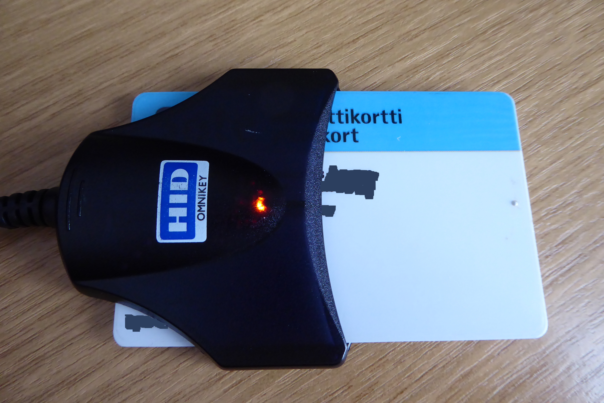
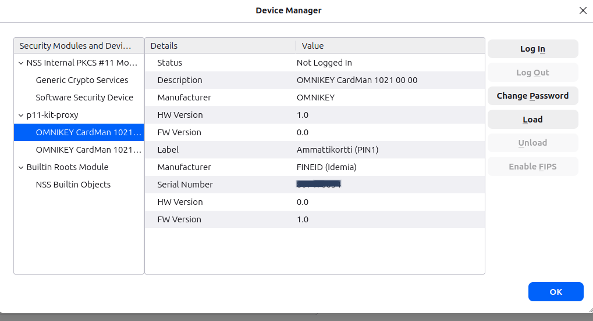
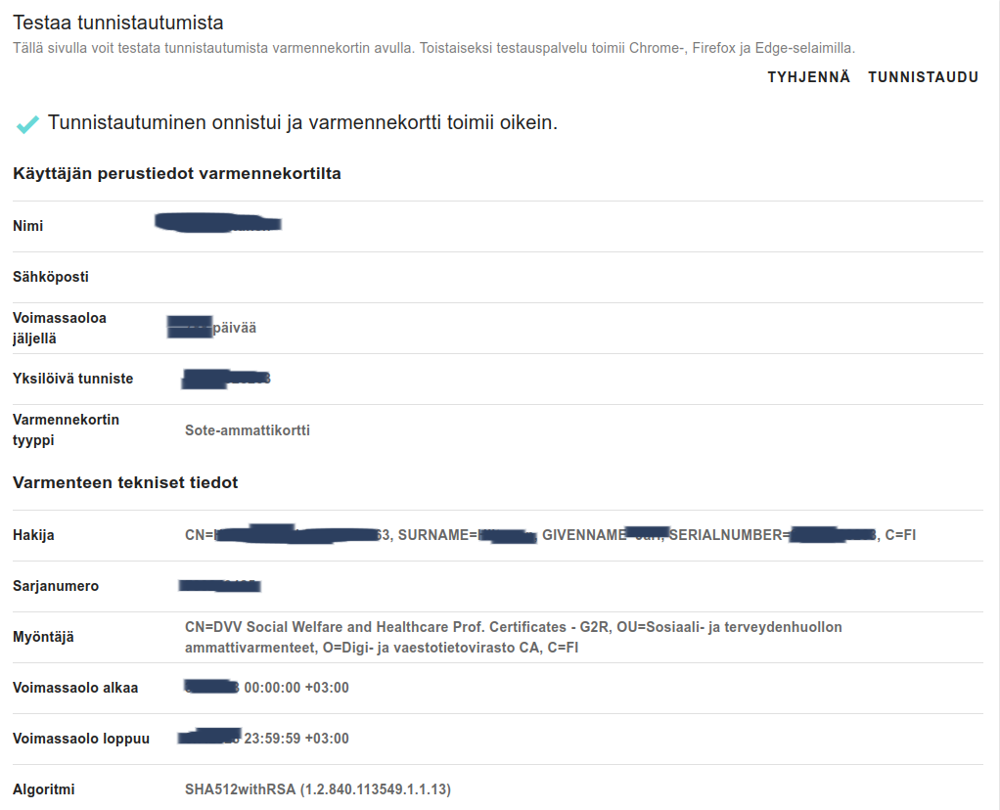
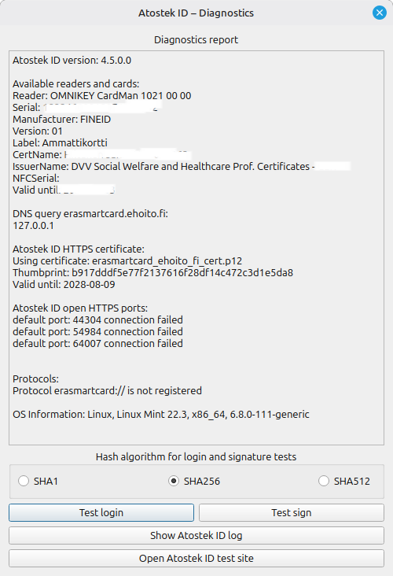

## Johdanto

Tässä blogikirjoituksessa käyn läpi Atostek ID 4.5 -kortinlukijaohjelmiston käyttöönoton Linux Mint 22.3 -järjestelmässä. Prosessi sisälsi useita haasteita, jotka vaativat perusteellista vianmääritystä. Kirjoitus toimii oppaana muille Linux-käyttäjille, jotka kohtaavat samanlaisia ongelmia.

## Ympäristö

- **Käyttöjärjestelmä:** Linux Mint 22.3
- **Ydin:** 6.8.0-111-generic
- **Arkkitehtuuri:** x86_64
- **Selain:** Firefox (ei Snap-versio)
- **Kortinlukija:** OMNIKEY CardMan 1021
- **Varmennekortti:** [DVV Social Welfare and Healthcare Professional Certificate](https://dvv.fi/sote-ammattikortti)




## Tiivistelmä

✅ **Toimii:** DVV-tunnistautuminen, kortin lukeminen Firefoxissa  
❌ **Ei tarvita:** `erasmartcard://`-protokolla (vaikuttaa vain ERA-järjestelmään)  
🔧 **Kriittiset korjaukset:** PKCS#11-rekisteröinti p11-kitiin + Firefoxin .deb-versio

---

## Lähtötilanne

- Linux Mint 22.3, Firefox, Atostek ID 4.5 asennettuna `.deb`-paketista
- Kortti näkyi lukijassa, mutta Firefox ei tunnistanut sitä
- DVV-testi (`https://dvv.fineid.fi/fi/authentication`) epäonnistui

---

## Vaihe 1: PKCS#11-moduulin rekisteröinti p11-kitiin ⚠️ Kriittinen

Tämä **puuttui** oletusasennuksesta ja oli pääsyy ongelmaan:

```bash
# Luo hakemisto p11-kitin määrityksille
sudo install --directory --mode=755 /etc/pkcs11/modules

# Lisää Atostek ID -moduulin määritys
# HUOM: Syntaksi on "module: " (kaksoispiste + välilyönti), EI "="
echo "module: /usr/lib/Atostek-ID-PKCS11.so" | sudo tee /etc/pkcs11/modules/atostek-id.module > /dev/null

# Varmista, että p11-kit näkee moduulin
p11-kit list-modules | grep -A5 -i atostek
```

Onnistunut tuloste:

```bash
module: atostek-id
    path: /usr/lib/Atostek-ID-PKCS11.so
    token: Ammattikortti (PIN1)
    manufacturer: FINEID (Idemia)
```

## Vaihe 2: Firefox – EI Snap-versiota!

Linux Mintin oletus-Firefox on usein Snap-paketti, joka ei toimi PKCS#11-moduulien kanssa.

```bash
# Tarkista versio
which firefox
# Jos tulos sisältää "/snap/" → ongelma!
```

Ratkaisu – asenna Mozillan .deb-versio:

```bash
sudo snap remove firefox
sudo add-apt-repository ppa:mozillateam/ppa
sudo apt update
sudo apt install firefox
```

## Vaihe 3: p11-kit-proxy Firefoxiin

Firefox ei automaattisesti tunnistanut PKCS#11-yhteyttä. Lisäys manuaalisesti:

```bash
# Etsi Firefox-profiilit ja lisää pkcs11.txt-tiedostoon
FIREFOX_PROFILES=$(find ~/.mozilla/firefox -name "cert9.db" -type f)
for db in $FIREFOX_PROFILES; do
    PROFILE_DIR=$(dirname "$db")
    echo "" >> "$PROFILE_DIR/pkcs11.txt"
    echo "name=p11-kit-proxy" >> "$PROFILE_DIR/pkcs11.txt"
    echo "library=p11-kit-proxy.so" >> "$PROFILE_DIR/pkcs11.txt"
done
```

Vaihtoehto: Firefoxin asetuksista → Tietosuoja ja turvallisuus → Turvallisuuslaitteet → Lataa → p11-kit-proxy / p11-kit-proxy.so




## Vaihe 4: SSL-varmenteiden uudelleenluonti

Atostek ID:n localhost-SSL-yhteys epäonnistui(SSL_ERROR_SYSCALL). Syy: korruptoituneet varmenteet.

```bash
# Pysäytä Atostek ID
pkill -9 atostekid

# Varmuuskopioi ja poista vanhat tiedostot
mv ~/.local/share/Atostek\ Oy/Atostek\ ID ~/.local/share/Atostek\ Oy/Atostek\ ID.backup.$(date +%Y%m%d_%H%M)

# Käynnistä uudelleen (luo uudet varmenteet automaattisesti)
atostekid &
sleep 15

# Varmista, että HTTPS-yhteys toimii
curl -k -v --tlsv1.2 https://127.0.0.1:44304 --max-time 10
```

Onnistunut tuloste sisältää:

```bash
SSL connection using TLSv1.3 / TLS_AES_256_GCM_SHA384
Server certificate:
subject: C=FI; O=Atostek; CN=erasmartcard.ehoito.fi
  ```

## Vaihe 5: Testaus

```bash
# Käynnistä komponentit puhtaassa tilassa
pkill -9 firefox
pkill atostekid
sudo systemctl restart pcscd.service

atostekid &
sleep 3
firefox &

# Avaa DVV-testisivu
firefox https://dvv.fineid.fi/fi/authentication
```

Onnistunut tulos:

    Kortti tunnistetaan ✅
    PIN-koodia kysytään ✅
    Tunnistautuminen onnistuu ✅
    Varmennetiedot näkyvät oikein ✅




## Huomio: erasmartcard://-protokolla

Atostek ID:n diagnostiikka näytti edelleen: Protocol erasmartcard:// is not registered



Tämä ei haittaa DVV-tunnistautumista. Protokollaa käytetään vain ERA/eHoito-järjestelmän integraatiossa. PKCS#11/p11-kit-proxy hoitaa mTLS-tunnistautumisen (DVV, suomi.fi) erillään tästä.

## Yhteenveto: Toimiva minimikonfiguraatio

```bash
# 1. PKCS#11 p11-kitiin (pakollinen!)
echo "module: /usr/lib/Atostek-ID-PKCS11.so" | sudo tee /etc/pkcs11/modules/atostek-id.module

# 2. Firefox .deb-versiona (ei Snap)
sudo snap remove firefox && sudo add-apt-repository ppa:mozillateam/ppa && sudo apt install firefox

# 3. p11-kit-proxy Firefoxiin
# Lisää ~/.mozilla/firefox/*/pkcs11.txt:
name=p11-kit-proxy
library=p11-kit-proxy.so

# 4. SSL-varmenteet kuntoon (jos localhost-yhteys epäonnistuu)
pkill atostekid && rm -rf ~/.local/share/Atostek\ Oy/Atostek\ ID && atostekid &
```

