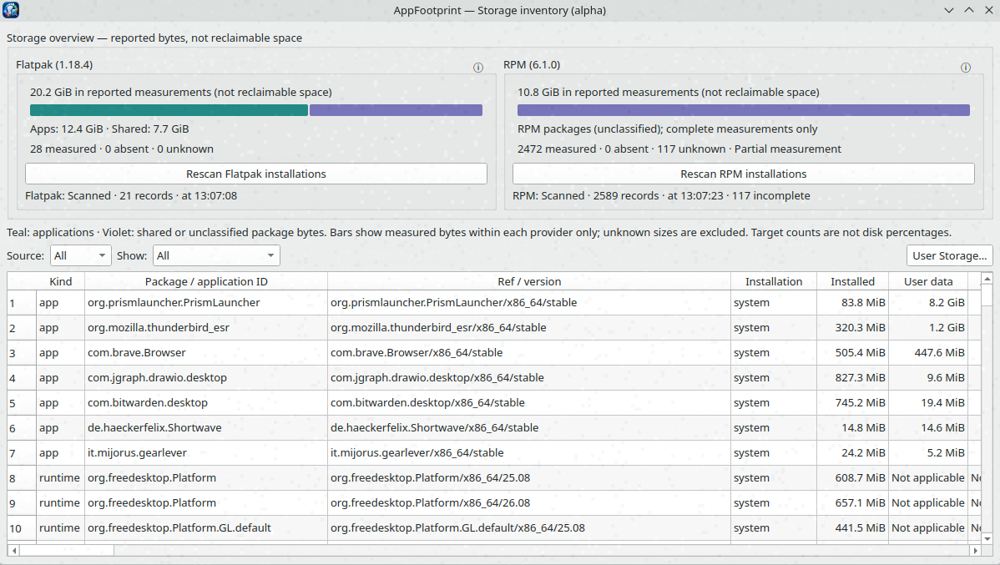
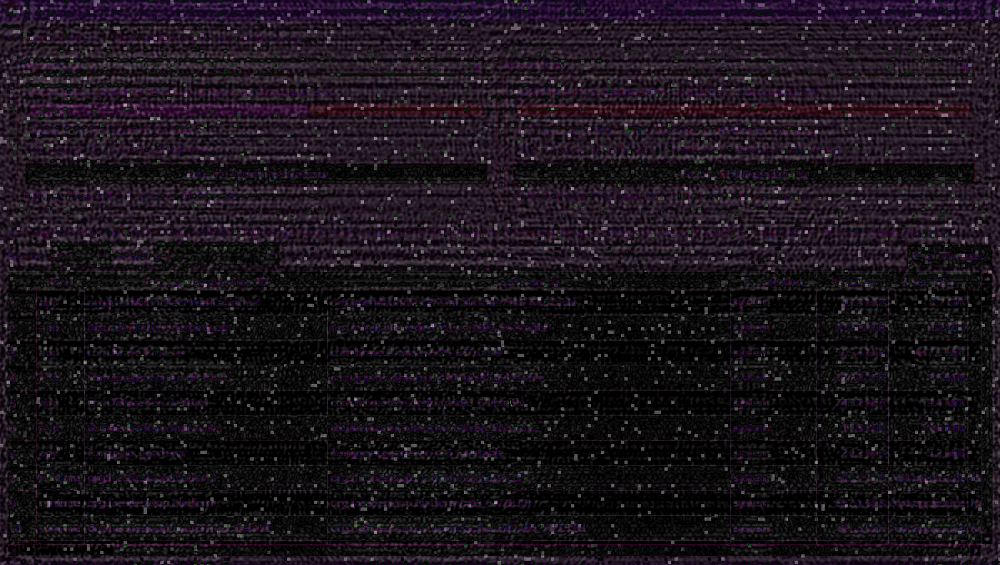
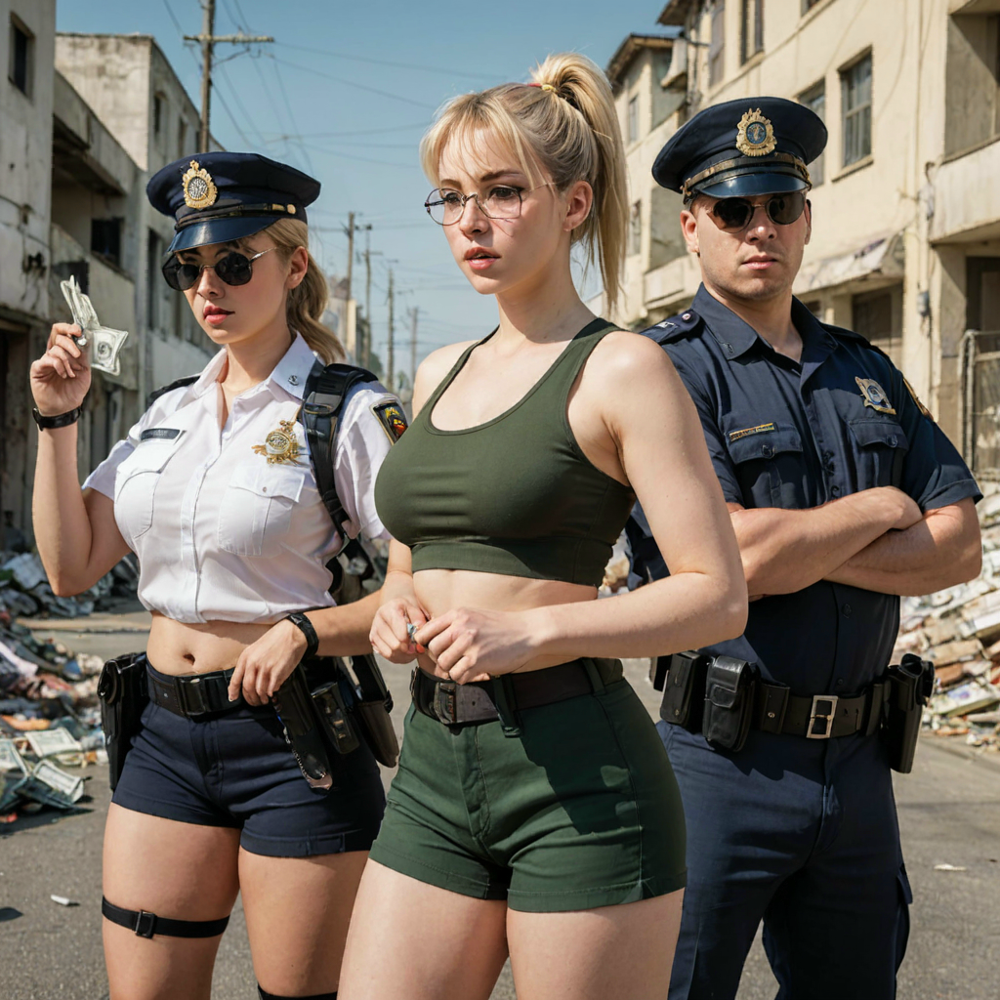
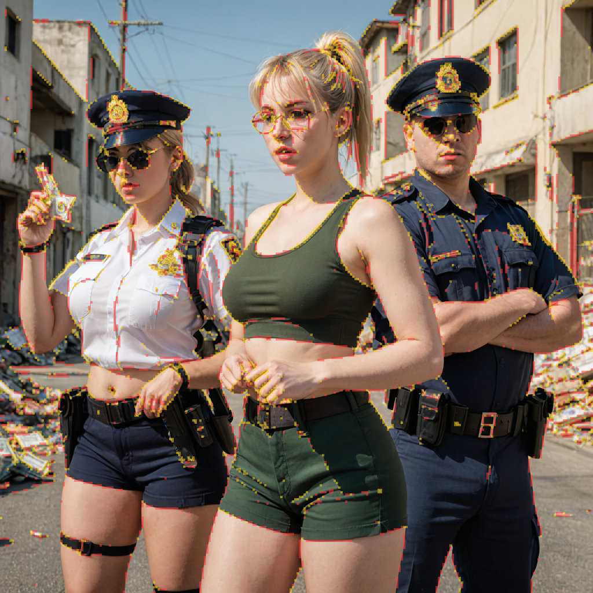

*Entä jos kuva tai äänitiedosto sisältää muutakin kuin sen, minkä näemme tai kuulemme?*

Tämä kysymys käynnisti CryptoLeaf-projektini. Epäilin, että suuret sosiaalisen median alustat voisivat upottaa videoihin, kuviin tai ääneen käyttäjälle näkymätöntä informaatiota. Epäily ei tietenkään ole todiste. Halusin ymmärtää, olisiko tällaista tietoa mahdollista havaita ja millä menetelmillä sitä ylipäätään voisi piilottaa.

Ensimmäinen ajatukseni oli lähestyä ongelmaa stegoanalyysin kautta: tutkia aineistoa ja etsiä tilastollisia poikkeamia. Nopeasti kävi ilmi, että uskottava analyysi vaatisi huomattavasti enemmän laskentaa, muistia ja vertailuaineistoa kuin käytössäni oli. En siis löytänyt näyttöä alkuperäisen epäilyni puolesta. Sen sijaan vaihdoin kysymyksen.

**Jos en pysty helposti tunnistamaan piilotettua viestiä, pystyisinkö rakentamaan järjestelmän, joka piilottaa sellaisen?**

## Vuosi 2025: oma työkalu syntyy

Vuonna 2025 ryhdyin toteuttamaan CryptoLeafia, avointa steganografiasovellusta, jolla viestejä voidaan piilottaa kuva- ja äänitiedostoihin ja myöhemmin palauttaa. Salaus ja steganografia ratkaisevat eri ongelmia: salaus suojaa viestin sisältöä, steganografia yrittää kätkeä sen olemassaolon.

Ensimmäiset onnistumiset olivat rohkaisevia. Häviöttömissä tiedostomuodoissa piilotettu tieto voitiin palauttaa, ja ohjelmasta alkoi muodostua oikea sovellus eikä pelkkä kokeellinen skripti. Käyttöliittymä, tiedostojen käsittely, salaus ja testit kehittyivät vähitellen kokonaisuudeksi. Myöhemmin mukaan tulivat muun muassa JPEG:n AES-GCM-pohjainen käsittely ja kokeellinen Robust-kuvatila.

Mutta juuri silloin vastaan tuli tärkeä ero: **tiedoston sisään piilotettu viesti ei välttämättä säily, kun tiedosto käsitellään uudelleen.** Sosiaalisen median palvelut muuttavat usein kuvan kokoa ja pakkaavat kuvia, ääntä tai videota uudelleen. Näiden muunnosten jälkeen onnistunut alkuperäinen upotus ei vielä tarkoita onnistunutta palautusta.

## MP3: kun äänenlaatu ja kestävyys törmäävät

Äänikokeissa tutkin muun muassa *spread-spectrum*-menetelmää, jossa piilotettava signaali levitetään laajemmalle alueelle äänisignaalia. Ajatus kuulostaa houkuttelevalta: yksittäinen muutos olisi pieni, mutta vastaanottaja voisi löytää hajautetun viestin.

Käytäntö oli hankalampi. Kiinteä upotusvoimakkuus tuotti hiljaisiin kohtiin matalataajuista jyrinää. Joissakin kokeissa ääneen tuli hengitystä muistuttavaa kohinaa; segmenttien rajat synnyttivät napsahduksia. Kokeilin adaptiivista voimakkuutta, ikkunointia, taajuusrajoituksia ja yhdistelmiä. Voimakkaan äänen sekaan muutokset peittyivät paremmin, mutta hiljaisissa kohdissa ne erottuivat. Testimuistiinpanojeni johtopäätös oli karu: kokeilluilla asetuksilla käyttökelpoista tilaa kestävälle upotukselle jäi liian vähän ilman kuuluvia haittoja.

Pohdin myös MDCT-muunnosalueella tehtävää upotusta, mutta sen kokeilu ei näyttänyt lupaavalta seuraavalta askeleelta kyseisessä tilanteessa. Palasin lopulta yksinkertaisempaan LSB-menetelmään tietoisena sen rajoituksesta: se ei kestä luotettavasti MP3:n kaltaista häviöllistä uudelleenpakkausta.

Tämä ei todista, ettei MP3-pakkausta kestävää steganografiaa voisi rakentaa. Se osoittaa, että **juuri meidän testaamamme ratkaisut eivät täyttäneet samanaikaisesti äänenlaadun ja palautettavuuden vaatimuksia**.

Esimerkki spread-spectrum (adaptive alpha + windowing + cutoff 600–1000 Hz) äänitestistä, jossa alkuperäinen wav-tiedostoon on salattu viesti ja pakattu:

<audio controls preload="none" style="width:100%">
  <source src="enc_testaudio.mp3" type="audio/mpeg">
  Selaimesi ei tue äänentoistoa.
</audio>

## JPEG: viesti säilyy, mutta kuva alkaa kertoa siitä

Kuvissa ongelma sai toisen muodon. JPEG-pakkaus muuttaa kuvainformaatiota häviöllisesti. Pelkkä viestin piilottaminen pikseliarvojen vähiten merkitseviin bitteihin ei riitä, jos kuva pakataan uudelleen.

CryptoLeafin kehityksessä kokeilimme lohkopohjaisia menetelmiä, virheenkorjausta, toistoa ja aallokemuunnoksia (*discrete wavelet transform*, DWT). Robust-tutkimushaarassa tarkastelimme muun muassa Haar-aalloketta, QIM-kvantisointia ja parametreja DELTA=38 ja REPEAT=13. Ne olivat kokeellisia vertailuarvoja, eivät luonnonvakioita tai lopullinen optimiratkaisu.

Sitten huomasin jotain kiusallista: suurissa järjestelmäkamerakuvissa muutos saattoi jäädä silmälle huomaamattomaksi, mutta pienemmissä kuvissa ja kuvakaappauksissa upotuksen jäljet näkyivät selvästi. Menetelmä, jonka tarkoitus oli kätkeä tietoa, paljasti itseään kuvan rakenteessa.

Tätä havaintoa ei kannattanut peittää. Se oli tutkimustulos.

*Tasaiset valkeat pinnat ovar erityisen hankalia*

## Epäonnistuminen on mittaus, ei häpeä

Tämän jälkeen tutkimus muuttui järjestelmällisemmäksi. Emme enää kysyneet vain, palautuuko viesti, vaan myös: missä muutos näkyy, mikä osa algoritmista sen aiheuttaa, ja mikä oletus on väärä?

Teimme ablaatiokokeita, joissa yksittäisiä menetelmän osia poistettiin tai muutettiin, sekä niin sanottuja oracle-kokeita, joilla pyrittiin erottamaan toisistaan eri virhelähteitä. Vertailimme Haaria muihin wavelet-vaihtoehtoihin ja tarkastelimme erilaisten kuvien käyttäytymistä. Kaikki lupaavat ideat eivät toimineet. Juuri se oli hyödyllistä: epäonnistunut hypoteesi rajasi mahdollisten selitysten joukkoa.

*Kuvassa näkyy selvästi palikoitumista*

*Suurennoksesta näkee millaisia muutoksia enkooderi tekee*

Tutkimuksen keskeinen ristiriita alkoi hahmottua. Voimakkaampi upotus kestää paremmin kuvankäsittelyn aiheuttamaa häiriötä, mutta kasvattaa näkyvien artefaktien riskiä. Hennompi upotus säilyttää kuvan laadun, mutta viesti voi kadota. Lisäksi kuva voi näyttää ihmissilmälle täysin normaalilta ja silti sisältää tilastollisesti tunnistettavia muutoksia. Visuaalinen huomaamattomuus ei yksin todista steganografista turvallisuutta.

## Divergentti ajattelu ja GPT-6 tutkimuskumppanina

CryptoLeafia ei ole kehitetty perinteisellä tavalla, jossa valmis vaatimusmäärittely ohjaa suoraviivaisesti toteutukseen. Olen esittänyt kysymyksiä, välillä epätavallisiakin, ja GPT-6 on auttanut muuttamaan niitä toteutettaviksi hypoteeseiksi, testikoodiksi ja tulosten analyysiksi. Välillä minä olen kyseenalaistanut tekoälyn ehdotuksen, välillä tekoäly minun oletukseni.

Yksi keskustelu saattoi alkaa yksinkertaisesta ajatuksesta: entä jos muutamme upotuksen paikkaa? Seuraavaksi pohdimme, miten kuvan paikallinen tekstuuri vaikuttaa näkyvyyteen, miten vastaanottaja tunnistaa samat paikat uudelleenpakkauksen jälkeen ja millainen koe erottaisi nämä selitykset toisistaan.

**GPT-6:n suurin hyöty ei ole siinä, että se tietäisi valmiiksi oikean vastauksen. Se lyhentää matkaa kysymyksestä kokeeseen.** Koodin kirjoittaminen, vaihtoehtoisten mallien rakentaminen, testien automatisointi ja tulosten tulkinnan haastaminen nopeutuvat merkittävästi. Silti malli voi ehdottaa uskottavalta kuulostavaa mutta väärää selitystä. Siksi ratkaiseva auktoriteetti on edelleen koe, ei ihminen eikä kielimalli.

Pyysin myös Qweniä arvioimaan nykyistä tutkimussuuntaa. Se ehdotti esimerkiksi adaptiivista QIM-upotusta, paikalliseen kuvarakenteeseen perustuvaa optimointia sekä DTCWT-aallokemuunnoksen tutkimista. Nämä ovat kiinnostavia jatkohypoteeseja. Kaikkia raportin kritiikkejä en kuitenkaan hyväksynyt: osa siinä puuttuviksi väitetyistä vertailuista oli jo tehty, ja teoriassa houkutteleva menetelmä ei automaattisesti ole käytännössä parempi.

Tämäkin on divergenttiä tutkimusta: ulkopuolinen arvio ei ole tuomio, vaan uusi joukko testattavia väitteitä.

## Yksi tutkimussykli käytännössä: miksi Robust jättää jäljen?

**Havainto.** Robust-upotus näytti suurissa valokuvissa lupaavalta, mutta pienissä kuvissa ja kuvakaappauksissa alkoi näkyä säännöllisiä rakenteita. Tämä oli kiinnostavampi havainto kuin pelkkä epäonnistunut viestin palautus: kuva itsessään antoi vihjeen mahdollisesta virhelähteestä.

**Hypoteesi.** Voisiko näkyvä kuvio johtua käyttämästämme Haar-aallokkeesta? Sen yksinkertainen, lohkomainen rakenne tarjosi uskottavan selityksen. Jos ongelma oli nimenomaan muunnoksessa, toisen waveletin — esimerkiksi db2:n tai biortogonaalisen vaihtoehdon — pitäisi muuttaa artefaktien luonnetta.

**Koe GPT-6:n kanssa.** Muutimme kysymyksen vertailukelpoisiksi testeiksi: sama kuva-aineisto ja upotuksen periaate, mutta eri wavelet-vaihtoehdot. Lisäksi käytimme ablaatio- ja *oracle*-kokeita erottaaksemme toisistaan upotuksen synnyttämän näkyvän muutoksen ja viestin palautukseen liittyvät ongelmat. GPT-6 auttoi kokeiden jäsentämisessä, testikoodin tuottamisessa ja tulosten vaihtoehtoisten tulkintojen arvioinnissa. Minun tehtäväkseni jäi tarkastella kuvia, arvioida oletusten mielekkyyttä ja päättää seuraava koe.

**Odottamaton tulos.** Waveletin vaihtaminen muutti näkyvän häiriön luonnetta, mutta ei yksin poistanut ongelmaa. Myös luontokuvissa oli havaittavissa jälkiä. Siksi alkuperäinen selitys — että Haar olisi yksin syyllinen — ei riittänyt. *Oracle*-kokeiden tarkoitus oli edelleen rajata, mikä osa kokonaisuudesta vaikutti tulokseen; ne eivät itsessään todistaneet uutta ratkaisua toimivaksi.

**Uusi hypoteesi.** Ehkä ratkaisevaa ei ole vain käytetty aalloke, vaan myös se, kuinka voimakkaasti ja mihin kohtaan kuvaa tietoa upotetaan. Tästä syntyi seuraava tutkimussuunta: paikallisen kuvarakenteen huomioiva adaptiivinen QIM, jossa esimerkiksi sileää taivasta käsiteltäisiin eri tavalla kuin yksityiskohtaista kivipintaa. Sekin on toistaiseksi hypoteesi, ei vahvistettu parannus.

Tällainen sykli voi syntyä yhden keskustelun aikana: **havainto → hypoteesi → toteutettu koe → hypoteesin tarkennus**. Ilman GPT-6:ta usean vaihtoehdon toteuttaminen ja vertailu olisi ollut hitaampaa. Tekoäly ei kuitenkaan korvannut koetta — se teki seuraavan kokeen rakentamisesta helpompaa.

Testijärjestelyssä ihmisen tulee arvioida kuvia silmillään, sillä pelkät matemaattiset mittaustulokset kuten SNR-arvot eivät välttämättä paljasta onko kuvassa nähtävissä muutoksia. Seuraavassa esimerkissä muutosta ei juurikaan näe kuvien monimutkaisuuden vuoksi.

*Salattu kuva josta ei muutosta näe*

*Positiot joihin content-aware enkooderi tekee muutokset*

## Mitä CryptoLeaf lopulta opetti?

Alkuperäinen epäilyni koski mahdollisesti piilotettua informaatiota sosiaalisen median sisällöissä. En ole osoittanut, että alustat tekisivät juuri sitä, mitä epäilin. Sen sijaan opin käytännössä, kuinka vaikeaa on yhdistää kolme tavoitetta: piilotetun viestin palautettavuus, kuvan tai äänen laatu ja käsittelyn kestävyys.

Samalla syntyi toimiva avoimen lähdekoodin sovellus ja kokeellinen tutkimusympäristö. Erityisen arvokkaita eivät olleet vain onnistuneet upotukset, vaan myös äänen kohina, kuvien näkyvät jäljet ja epäonnistuneet palautukset. Ne kertoivat, mihin seuraava tutkimus kannattaa kohdistaa.

Seuraavassa vaiheessa haluaisin tutkia adaptiivista upotusvoimakkuutta, vertailla aallokemuunnoksia kontrolloidusti ja mitata palautettavuuden lisäksi kuvallista laatua sekä tilastollista havaittavuutta. Tämä vaatii huolellisen testiaineiston ja paljon laskentaa.

**CryptoLeafin Robust-tutkimus jää nyt tauolle.** Käytössäni oleva Lenovo-kannettava, jossa on 8 gigatavua muistia, on palvellut yllättävän pitkälle, mutta seuraavan tutkimusvaiheen laajat kokeet ja mahdollinen raskaampien mallien käyttö kaipaavat tehokkaampaa konetta. Tauko ei ole projektin loppu. Se on hetki säilyttää tulokset, dokumentoida myös epäonnistumiset ja jatkaa myöhemmin paremmilla välineillä.

Ehkä tutkimuksen tärkein tulos on lopulta tämä: **hyvä koe ei aina vahvista ajatusta. Joskus se osoittaa, miksi ajatusta pitää muuttaa.**

Projektin lähdekoodi ja julkaisut: [CryptoLeaf GitHubissa](https://github.com/ollavarma-create/cryptoleaf).

Tutkimusraportti on luettavissa englanniksi [repositorion kehityshaarasta](https://github.com/ollavarma-create/cryptoleaf/blob/feature/v0.4-robust-mosaic/docs/ROBUST_V04_RESEARCH.md)