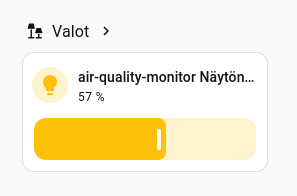

# Ilmanlaatumittari ESPHomella: mitä opin, kun näyttö ei totellutkaan

Rakensin ESP32-Wroom-32D -alustalle ilmanlaatumittarin, jossa on ILI9341-kosketusnäyttö, MCP9808-lämpötila-anturi, MH-Z19 CO2-anturi ja PMS7003-hiukkasanturi. Tavoite oli yksinkertainen: näyttö, joka herää napautuksesta, näyttää kellon, lämpötilan ja CO2:n sekä tarjoaa kaksi nappulaa Home Assistantin ohjaukseen – ja sammuu itsestään, kun kukaan ei katso.

Laitteen 3D-tulostettava kotelo ja parametrisoitu Fusion360-piirros löytyvät [Printables - Air Quality Monitor Enclosure - Tilted Display Design](https://www.printables.com/model/1861937-air-quality-monitor-enclosure-tilted-display-desig) ja toimiva koodi tämän bloggauksen alimmaisessa osassa.

Viimeisimmät koodin kanssa ilmanlaatumittarin näyttö näyttää tältä:

Ja koska ESPHome-laitteet integroituvat Home Assistanttiin, ilmanlaatumittarin näytön valoisuutta voi ohjata suoraan Home Assistantista: 



Sensoritiedot päivittyvät Home Assistanttiin: 


Lopputulos toimii vihdoinkin siten kuin pitää. Mutta matkan varrella törmäsin useaan sudenkuoppaan, jotka veivät aikaa ja joista osa olisi ollut vältettävissä, jos joku olisi kertonut ne etukäteen. Tämä kirjoitus on se "joku".


## Mistä lähdettiin liikkeelle

Ensimmäinen versio oli kunnianhimoinen: kaksi sivua (`idle_page` ja `active_page`), tilakone kolmella tilalla (sammuksissa, idle, active), skriptejä sivunvaihtoon ja unitajastimeen, sekä napautuslogiikka, jossa ensimmäinen napautus herätti näytön ja toinen avasi ohjaussivun.

Se toimi – huonosti. Nappulat eivät totelleet, painallukset tuntuivat "jäävän muistiin", ja näyttö saattoi vaihtaa sivua itsestään. Debug-lokissa vilkkui:

```
[W][component:419]: display took a long time for an operation (262 ms), max is 260 ms
```

Siitä alkoi oppimisprosessi.

## Oppi 1: XPT2046:n `on_touch` laukeaa useita kertoja yhdellä napautuksella

Ensimmäinen oire oli hämmentävä: yksi napautus tuntui käsiteltävän kahtena. Näyttö heräsi, mutta vaihtoi saman tien seuraavalle sivulle. Syy oli `on_touch`-triggerissä, joka voi laueta useita kertoja yhden kosketuksen aikana – kosketuksen alussa, keston aikana ja lopussa. Jos tilakone ehtii vaihtua laukeamisten välissä, sama napautus tulkitaan kahdeksi eri toiminnoksi.

Ratkaisu: **`on_touch` tallentaa vain koordinaatit, `on_release` tekee tilasiirtymän.** `on_release` laukeaa tasan kerran, kun sormi nostetaan. Tämä oli ensimmäinen iso parannus, ja se kannattaa tehdä heti alusta asti.

```yaml
on_touch:
  then:
    - lambda: |-
        id(last_touch_x) = touch.x;
        id(last_touch_y) = touch.y;

on_release:
  then:
    - lambda: |-
        int tx = id(last_touch_x);
        int ty = id(last_touch_y);
        // ... tilasiirtymä tässä
```

## Oppi 2: `turn_on()` ja `turn_off()` eivät tee mitään ilman `.perform()`-kutsua

Tämä oli noloin bugi. Näyttö ei sammunut, vaikka `interval`-lohko tarkisti aikakatkaisun oikein ja `ESP_LOGI` tulosti "60s idle - turning display off". Syy:

```cpp
id(backlight_light).turn_off();   // ei tee mitään!
```

ESPHomen C++-API:ssa `turn_off()` palauttaa `LightTurnOffAction`-olion, mutta **ei suorita sitä**. Toiminto pitää erikseen suorittaa:

```cpp
id(backlight_light).turn_off().perform();
```

Sama koskee `turn_on()`-kutsua, jos haluat asettaa kirkkauden:

```cpp
auto call = id(backlight_light).turn_on();
call.set_brightness(1.0);
call.perform();
```

Tämä yksinäinen `.perform()` oli syy siihen, miksi näyttö ei sammunut. Jos olisin tiennyt sen heti, olisin säästänyt pari tuntia debuggausta.

## Oppi 3: `on_touch`- ja `on_release`-triggereillä ei ole `release.x`-koordinaatteja

Yritin ensin lukea koordinaatit suoraan `on_release`-triggeristä:

```yaml
on_release:
  then:
    - lambda: |-
        if (release.x >= 5 && release.x <= 115) { ... }   // ei toimi
```

`on_release` ei anna `release`-muuttujaa. Se ilmoittaa vain "kosketus loppui", ei missä se loppui. Siksi koordinaatit pitää tallentaa `on_touch`-triggerissä globaaleihin muuttujiin ja lukea ne `on_release`:ssä – kuten oppissa 1 tehtiin.

## Oppi 4: Yksi sivu on parempi kuin kaksi

Alkuperäinen idle/active-sivu-jako tuntui loogiselta: kello on rauhallinen perusnäkymä, nappulat ovat erillinen ohjaussivu. Käytännössä se aiheutti kolme ongelmaa:

1. **Sivunvaihto pakottaa täyden uudelleenpiirron.** `display.page.show` piirtää koko näytön uudelleen, mikä estää pääsilmukan ja viivästyttää kosketustapahtumia.
2. **Tilakone monimutkaistuu.** Kolme tilaa, kaksi skriptiä, sivunvaihtologiikkaa – ja jokainen uusi ominaisuus vaatii uuden säännön.
3. **"Kaksi napautusta" -vuorovaikutus on hämmentävä.** Käyttäjä napauttaa kerran herättääkseen näytön, mutta ei näe nappuloita. Toinen napautus avaa ne. Jos ensimmäinen napautus osui vahingossa nappulan kohdalle, mitään ei tapahdu – koska nappulat eivät olleet vielä näkyvissä.

Ratkaisu: **yksi sivu, jossa kaikki elementit ovat aina näkyvissä.** Kello, päivämäärä, lämpötila, CO2 ja nappulat samassa näkymässä. Näyttö herää yhdellä napautuksella, ja nappulat ovat heti käytettävissä. Tilakone kutistuu kahteen tilaan: sammuksissa (0) ja päällä (1).

```yaml
lambda: |-
  it.fill(Color::BLACK);
  // kello, päivämäärä, lämpötila, CO2
  // nappulat
```

Tämä oli suurin yksittäinen parannus sekä yksinkertaisuudessa että suorituskyvyssä.

## Oppi 5: `delay`-skripti ei ole unitajastin

Yritin ensin hoitaa unitajastimen skriptillä:

```yaml
script:
  - id: screen_timeout
    mode: restart
    then:
      - delay: 20s
      - if: ...
```

Ongelmana oli, että `mode: restart` ja `delay` eivät aina toimineet odotetusti: uusi kutsu ei välttämättä peruuttanut edellistä viivettä ajoissa, ja useat peräkkäiset napautukset synnyttivät useita ajastimia, jotka laukeivat eri aikoina. Lopputulos oli "kuminauhamainen" käyttökokemus: nappula ei totellut, ja painallukset tuntuivat kertyvän.

Ratkaisu: **passiivinen `interval`-tarkistus `delay`:n sijaan.** `interval: 1s` tarkistaa kerran sekunnissa, onko viimeisimmästä toiminnasta kulunut tarpeeksi kauan. Se ei varaa suoritusaikaa eikä estä pääsilmukkaa pitkäksi aikaa.

```yaml
interval:
  - interval: 1s
    then:
      - lambda: |-
          if (id(display_state) == 1 &&
              (uint32_t)(millis() - id(last_activity_ms)) >= 60000) {
            id(display_state) = 0;
            id(backlight_light).turn_off().perform();
          }
```

Tämä on sama ajattelutapa kuin asynkronisessa ohjelmoinnissa: tapahtumat päivittävät aikaleiman, taustatehtävä kysely tarkistaa aikakatkaisun. Se on yksinkertainen, ennustettava ja helppo debugata – `ESP_LOGI` kertoo suoraan, milloin 60 sekuntia täyttyy.

## Oppi 6: Älä päivitä unitajastinta HA:n tilamuutoksista

Yksi hämmentävä oire oli, että näyttö ei sammunut, vaikka `interval`-logiikka oli oikein. Syy löytyi `switch`-lohkosta:

```yaml
on_state:
  then:
    - lambda: |-
        if (id(display_state) == 1) {
          id(last_activity_ms) = millis();   // nollaa unitajastin!
        }
```

Jos Home Assistant päivittää kytkimen tilaa säännöllisesti (esim. 30 sekunnin välein, vaikka tila ei muuttuisi), `last_activity_ms` nollautui jatkuvasti eikä 60 sekuntia koskaan täyttynyt.

Ratkaisu: **HA:n tilamuutos ei ole käyttäjän toimintaa.** Se saa päivittää näytön, mutta ei nollata unitajastinta:

```yaml
on_state:
  then:
    - if:
        condition:
          lambda: 'return id(display_state) == 1;'
        then:
          - component.update: tft_display
```

Tämä on pieni mutta tärkeä ero: käyttäjän napautus pitää näytön päällä, HA:n tapahtuma ei.

## Oppi 7: `display took a long time` -varoitus kertoo, että pääsilmukka estyy

Lokissa toistuva varoitus:

```
[W][component:419]: display took a long time for an operation (262 ms), max is 260 ms
```

tarkoittaa, että näytön piirto esti pääsilmukan yli suositellun rajan (20–30 ms). Tämä viivästyttää kaikkia muita komponentteja – myös kosketustapahtumia. Siksi nappulat tuntuivat hitailta juuri silloin, kun näyttöä piirrettiin.

Ratkaisut:
- **`buffer_size: "50%"` ja `color_depth: 8`** vähentävät RAM-käyttöä ja piirtoaikaa.
- **Yksi sivu** poistaa sivunvaihdon aiheuttaman täyden uudelleenpiirron.
- **Fonttikoon pudottaminen** 80 px:stä 60 px:iin lyhentää merkittävästi suurten numeroiden piirtoaikaa.
- **`it.fill(Color::BLACK)`** on hitain yksittäinen toimenpide. Jos piirtoaika on ongelma, sen voi korvata osittaisella päivityksellä – mutta se monimutkaistaa koodia huomattavasti. Yhden sivun mallissa täyttö on yleensä hyväksyttävä.

## Oppi 8: `on_turn_off` ja `on_turn_on` pitävät tilan synkronissa

Jos taustavalo sammuu tai syttyy muualta kuin `interval`-lohkosta – esimerkiksi Home Assistantista – `display_state` pitää päivittää vastaamaan todellista tilaa. Muuten seuraava napautus voi tulkita tilan väärin.

```yaml
on_turn_off:
  - lambda: |
      id(display_state) = 0;
on_turn_on:
  - lambda: |
      if (id(display_state) == 0) {
        id(display_state) = 1;
        id(last_activity_ms) = millis();
      }
```

Tämä on pieni asia, mutta se tekee tilakoneesta johdonmukaisen riippumatta siitä, kuka taustavalon sammuttaa.

## Mitä jäi pois ja miksi

Lopullisessa versiossa on myös kaksi kuollutta muuttujaa: `display_user_off` ja `idle_seconds`. Ne ovat jäänteitä aikaisemmista yrityksistä eivätkä tee mitään. Ne voi poistaa siistimmän koodin toivossa – tai jättää tulevaa käyttöä varten, kuten minä tein. Blogikoodissa ne ovat mukana, jotta lukija näkee, mitä kaikkea matkan varrella kokeiltiin.

## Yhteenveto

Jos rakennat vastaavaa ESPHome-laitetta, nämä kahdeksan oppia säästävät sinulta monta tuntia:

1. **`on_touch` tallentaa, `on_release` toimii.** Yksi napautus = yksi toiminto.
2. **`turn_on()` ja `turn_off()` vaativat `.perform()`-kutsun.** Muuten ne eivät tee mitään.
3. **`on_release` ei anna koordinaatteja.** Tallenna ne `on_touch`:ssä.
4. **Yksi sivu on parempi kuin kaksi.** Vähemmän tiloja, vähemmän piirtoa, vähemmän bugeja.
5. **Käytä `interval`-tarkistusta `delay`:n sijaan.** Passiivinen kysely on ennustettavampi.
6. **Älä nollaa unitajastinta HA:n tilamuutoksista.** Vain käyttäjän toiminta pitää näytön päällä.
7. **Seuraa `display took a long time` -varoitusta.** Se kertoo, milloin piirto estää pääsilmukan.
8. **Pidä `display_state` synkronissa taustavalon kanssa.** `on_turn_on`/`on_turn_off` hoitavat sen.

Lopputulos on yksinkertainen ja toimiva: näyttö herää napautuksesta, näyttää kellon, lämpötilan ja CO2:n, tarjoaa kaksi nappulaa Home Assistantin ohjaukseen ja sammuu itsestään 60 sekunnin kuluttua. Ei sivunvaihtoa, ei monimutkaista tilakonetta, ei kuminauhamaisia painalluksia.

Koko koodi kommentteineen on alla ja jos jokin kohta mietityttää, kannattaa aloittaa näistä kahdeksasta opista. Ne ovat ne, jotka olisin itse halunnut tietää ennen kuin aloitin.

----

## ESPHome-koodi

```yaml
# ============================================================
# ESPHome-pohjainen ilmanlaadun mittari ja kosketusnäyttö
# Laitteisto: ESP32-Wroom-32D
# Näyttö: ILI9341 (SPI, 240x320)
# Kosketus: XPT2046 (SPI)
# Anturit: MCP9808 (I2C), MH-Z19 (UART, CO2), PMS7003 (UART, PM)
# ============================================================

esphome:
  name: air-quality-monitor
  friendly_name: air-quality-monitor

esp32:
  variant: ESP32
  flash_size: 4MB
  framework:
    type: esp-idf
    version: recommended
    advanced:
      sram1_as_iram: true
      minimum_chip_revision: "3.0"
      flash_chip: generic

api:
  encryption:
    key: "muuta tämä"

ota:
  - platform: esphome
    encryption:

wifi:
  ssid: !secret wifi_ssid
  password: !secret wifi_password
  ap:
    ssid: AirQuality Fallback Hotspot
    password: "muuta tämä"
  domain: .sensornet.home.arpa

captive_portal:

# INFO-taso riittää normaalikäyttöön. DEBUG-taso tulostaa paljon
# ylimääräistä ja hidastaa pääsilmukkaa.
logger:
  level: INFO


# ============================================================
# Väylät
# ============================================================

# Näytön SPI-väylä käyttää laitteiston SPI:tä (nopeampi kuin soft SPI).
spi:
  - id: spi_display
    clk_pin: GPIO18
    mosi_pin: GPIO23
    miso_pin: GPIO19
    interface: hardware

  # Kosketusnäytön SPI on erillinen väylä. XPT2046 ei tarvitse
  # suurta nopeutta, joten soft-SPI riittää.
  - id: spi_touch
    clk_pin: GPIO14
    mosi_pin: GPIO13
    miso_pin: GPIO35

i2c:
  sda: GPIO21
  scl: GPIO22
  scan: true

# Kaksi erillistä UART-väylää: CO2-anturi ja PM-anturi.
uart:
  - id: uart_co2
    tx_pin: GPIO17
    rx_pin: GPIO16
    baud_rate: 9600

  - id: uart_pm
    tx_pin: GPIO32
    rx_pin: GPIO33
    baud_rate: 9600


# ============================================================
# Aika ja Home Assistant -kytkimet
# ============================================================

# Kellonaika saadaan Home Assistantista. Tämä on yksinkertaisin
# tapa pitää ESP32:n kello synkronissa ilman NTP-palvelinta.
time:
  - platform: homeassistant
    id: ha_time

# HA-kytkimet heijastavat Home Assistantin kytkimien tilaa.
# Kun tila muuttuu, näyttö päivitetään – mutta vain jos näyttö
# on päällä. Muuten turha piirto hidastaisi turhaan.
switch:
  - platform: homeassistant
    id: tv_switch
    entity_id: switch.iso_makuuhuone_iso_mh_televisio
    on_state:
      then:
        - if:
            condition:
              lambda: 'return id(display_state) == 1;'
            then:
              - component.update: tft_display

  - platform: homeassistant
    id: olohuone_switch
    entity_id: switch.olohuone_oh_ledinauha
    on_state:
      then:
        - if:
            condition:
              lambda: 'return id(display_state) == 1;'
            then:
              - component.update: tft_display


# ============================================================
# Anturit
# ============================================================

sensor:
  # MCP9808: tarkka I2C-lämpötila-anturi. Offset-korjaus
  # kompensoi kotelon sisälämpötilan nousua.
  - platform: mcp9808
    id: mcp_temp
    address: 0x18
    name: "Huoneen lämpötila"
    filters:
      - offset: -2.3
    update_interval: 20s

  # MH-Z19: CO2-anturi UARTin kautta. Lähettää myös oman
  # lämpötilalukemansa, mutta se on epätarkka eikä sitä
  # käytetä näytöllä.
  - platform: mhz19
    co2:
      id: co2_sensor
      name: "CO2"
    temperature:
      id: mhz_temp
      name: "CO2-lämpötila"
    update_interval: 60s
    uart_id: uart_co2

  # PMSX003: hiukkasanturi. PM1.0, PM2.5 ja PM10 luetaan,
  # mutta vain PM-arvot ovat saatavilla – näytöllä näytetään
  # toistaiseksi vain lämpötila ja CO2.
  - platform: pmsx003
    type: PMSX003
    pm_1_0:
      name: "PM1.0"
      id: pm1_0
    pm_2_5:
      name: "PM2.5"
      id: pm2_5
    pm_10_0:
      name: "PM10"
      id: pm10
    uart_id: uart_pm
    update_interval: 30s


# ============================================================
# Globaalit muuttujat
# ============================================================

globals:
  # idle_seconds: varattu tulevaan käyttöön (ei käytössä nyt).
  - id: idle_seconds
    type: int
    restore_value: false
    initial_value: '0'

  # display_user_off: kuollut muuttuja – asetetaan mutta ei
  # lueta. Voidaan poistaa, mutta jätetty tulevaa käyttöä varten.
  - id: display_user_off
    type: bool
    restore_value: false
    initial_value: 'false'

  # display_state: 0 = sammuksissa, 1 = päällä.
  # Yksinkertainen kaksitilainen koneisto, koska näytöllä on
  # vain yksi sivu.
  - id: display_state
    type: int
    restore_value: false
    initial_value: '0'

  # Viimeisimmän kosketuksen koordinaatit. on_touch tallentaa,
  # on_release lukee.
  - id: last_touch_x
    type: int
    restore_value: false
    initial_value: '0'
  - id: last_touch_y
    type: int
    restore_value: false
    initial_value: '0'

  # Viimeisimmän toiminnan aikaleima millisekunteina.
  # Käytetään 60 sekunnin unitajastimeen.
  - id: last_activity_ms
    type: uint32_t
    restore_value: false
    initial_value: '0'


# ============================================================
# Fontit
# ============================================================

font:
  # Pieni fontti: päivämäärä, lämpötila, CO2, nappulatekstit.
  # Glyyfit sisältävät skandinaaviset merkit.
  - file: "gfonts://Roboto"
    id: font_small
    size: 20
    glyphs:
      - "!\"%()+=,-./:°µ0123456789ABCDEFGHIJKLMNOPQRSTUVWXYZ abcdefghijklmnopqrstuvwxyzÄÖÅäöå"

  # Iso fontti: vain kello. Vain numerot ja kaksoispiste
  # tarvitaan, mikä pienentää fontin kokoa merkittävästi.
  - file: "gfonts://Roboto"
    id: font_large
    size: 80
    glyphs:
      - "0123456789:"


# ============================================================
# Näyttö
# ============================================================

display:
  - platform: mipi_spi
    id: tft_display
    model: ILI9341
    cs_pin: GPIO15
    dc_pin: GPIO4
    reset_pin: GPIO25
    spi_id: spi_display
    rotation: 180

    # buffer_size 50 % ja color_depth 8 vähentävät RAM-käyttöä
    # ja piirtoaikaa. 16-bittinen väri olisi tarkempi, mutta
    # 8-bittinen riittää hyvin tähän käyttöön.
    buffer_size: "50%"
    color_depth: 8

    # Yksi sivu, yksi lambda. Ei sivunvaihtoa, ei erillisiä
    # idle/active-sivuja – tämä yksinkertaistaa logiikkaa ja
    # vähentää piirtoaikaa merkittävästi.
    lambda: |-
      it.fill(Color::BLACK);

      // --- Kellonaika ---
      auto now = id(ha_time).now();
      it.printf(120, 50, id(font_large), Color::WHITE, TextAlign::CENTER,
                "%02d:%02d", now.hour, now.minute);

      // --- Päivämäärä ja viikonpäivä lyhyenä ---
      // ESPHomessa day_of_week on 1-7 (1 = sunnuntai).
      const char* weekdays[] = {"Su", "Ma", "Ti", "Ke", "To", "Pe", "La"};
      it.printf(120, 120, id(font_small), Color(200, 200, 200), TextAlign::CENTER,
                "%s %02d.%02d.%04d",
                weekdays[now.day_of_week - 1],
                now.day_of_month, now.month, now.year);

      // --- Lämpötila ja CO2 yhdellä rivillä ---
      // Näytetään vain ne arvot, jotka ovat saatavilla.
      if (id(mcp_temp).has_state() && id(co2_sensor).has_state()) {
        it.printf(120, 155, id(font_small), Color(200, 200, 200), TextAlign::CENTER,
                  "%.1f C   CO2 %.0f ppm",
                  id(mcp_temp).state, id(co2_sensor).state);
      } else if (id(mcp_temp).has_state()) {
        it.printf(120, 155, id(font_small), Color(200, 200, 200), TextAlign::CENTER,
                  "%.1f C", id(mcp_temp).state);
      } else if (id(co2_sensor).has_state()) {
        it.printf(120, 155, id(font_small), Color(200, 200, 200), TextAlign::CENTER,
                  "CO2 %.0f ppm", id(co2_sensor).state);
      }

      // --- Nappulat ---
      // Apufunktio piirtää nappulan tilan mukaan: vihreä kun
      // päällä, harmaa kun pois.
      auto draw_button = [&](int x, int y, const char* text, bool is_on) {
        Color bg_color = is_on ? Color(0, 180, 0) : Color(50, 50, 50);
        Color border_color = is_on ? Color(0, 255, 0) : Color(120, 120, 120);
        it.filled_rectangle(x, y, 110, 80, bg_color);
        it.rectangle(x, y, 110, 80, border_color);
        it.printf(x + 55, y + 40, id(font_small), Color::WHITE, TextAlign::CENTER, text);
      };

      draw_button(5, 210, "TV", id(tv_switch).state);
      draw_button(125, 210, "Yövalo", id(olohuone_switch).state);


# ============================================================
# Kosketusnäyttö
# ============================================================

touchscreen:
  - platform: xpt2046
    id: touch_screen
    cs_pin: GPIO5
    interrupt_pin: GPIO26
    spi_id: spi_touch
    threshold: 400
    calibration:
      x_min: 20
      x_max: 3860
      y_min: 340
      y_max: 3860

    # mirror_x kääntää X-akselin, jotta vasen = 0 ja oikea = 240.
    transform:
      mirror_x: true

    display: tft_display

    # on_touch tallentaa vain koordinaatit. Tämä on tärkeää,
    # koska on_touch voi laueta useita kertoja yhden napautuksen
    # aikana. Tilan muutos tehdään vasta on_release:ssä.
    on_touch:
      then:
        - lambda: |-
            id(last_touch_x) = touch.x;
            id(last_touch_y) = touch.y;

    on_release:
      then:
        - lambda: |-
            int tx = id(last_touch_x);
            int ty = id(last_touch_y);

            // Tila 0: näyttö sammuksissa -> herätä.
            // Huom: turn_on() palauttaa action-olion, joka pitää
            // erikseen suorittaa .perform()-kutsulla.
            if (id(display_state) == 0) {
              id(display_user_off) = false;
              auto call = id(backlight_light).turn_on();
              call.set_brightness(1.0);
              call.perform();
              id(display_state) = 1;
              id(last_activity_ms) = millis();
              return;
            }

            // Tila 1: näyttö päällä -> tarkista nappulat.
            // Nappulakoordinaatit vastaavat display-lambdan
            // draw_button-kutsuja (5..115 ja 125..235, y 210..290).
            if (id(display_state) == 1) {
              if (tx >= 5 && tx <= 115 && ty >= 210 && ty <= 290) {
                id(tv_switch).toggle();
              } else if (tx >= 125 && tx <= 235 && ty >= 210 && ty <= 290) {
                id(olohuone_switch).toggle();
              }
              // Nollaa unitajastin riippumatta siitä, osuiko nappulaan.
              id(last_activity_ms) = millis();
            }


# ============================================================
# Unitajastin
# ============================================================

# interval-lohko tarkistaa sekunnin välein, onko näyttö ollut
# päällä yli 60 sekuntia ilman toimintaa. Tämä on passiivinen
# tarkistus: se ei estä pääsilmukkaa pitkäksi aikaa, toisin kuin
# skriptin delay-toiminto.
#
# Huom: turn_off() pitää suorittaa .perform()-kutsulla, muuten
# toiminto ei tapahdu.
interval:
  - interval: 1s
    then:
      - lambda: |-
          if (id(display_state) == 1 &&
              (uint32_t)(millis() - id(last_activity_ms)) >= 60000) {

            ESP_LOGI("display", "60s idle - turning display off");

            id(display_state) = 0;
            id(backlight_light).turn_off().perform();
          }


# ============================================================
# Taustavalo
# ============================================================

output:
  - platform: ledc
    pin: GPIO27
    id: backlight_pwm

light:
  - platform: monochromatic
    output: backlight_pwm
    id: backlight_light
    name: "Näytön taustavalo"
    default_transition_length: 0s
    restore_mode: RESTORE_DEFAULT_OFF

    # on_turn_off ja on_turn_on pitävät display_state:n
    # synkronissa taustavalon todellisen tilan kanssa.
    # Tämä on tärkeää, koska taustavalo voi sammua myös
    # muualta kuin interval-lohkosta (esim. HA:sta).
    on_turn_off:
      - lambda: |
          id(display_user_off) = true;
          id(display_state) = 0

    on_turn_on:
      - lambda: |
          id(display_user_off) = false;
          if (id(display_state) == 0) {
            id(display_state) = 1;
            id(last_activity_ms) = millis();
          }
          
```
