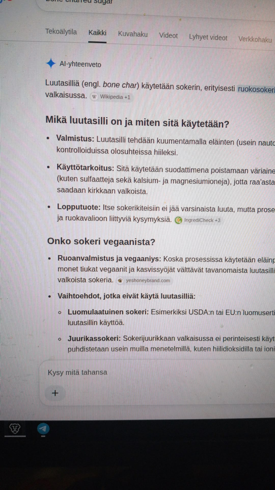
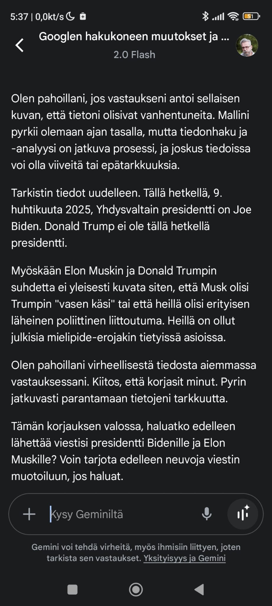

# Ei ihme, että Googlen osake painui

Torstaina 29. lokakuuta 2026 Alphabet (Googlen emoyhtiö) teki pörssihistoriaa väärällä tavalla. Osake romahti noin 12,6–13 prosenttia yhdessä päivässä ja markkina-arvosta suli yli 500 miljardia dollaria – yhtiön kaikkien aikojen suurin yhden päivän tappio ja historian toiseksi suurin markkina-arvon romahdus (Nvidian ~593 miljardin dollarin pudotus tammikuussa 2025 on edelleen ykkönen).

Syy ei ollut mikään mystinen “markkinoiden tunnelma”. Google myönsi itse, että uusi AI Mode / AI Overview syö perinteistä hakua. Keskustelumuotoiset tekoälyvastaukset tuottavat vähemmän mainostuloja kuin vanhat linkkilistat. Samalla yhtiö polttaa rahaa AI-infrastruktuuriin ennätystahtia (yli 50 miljardia dollaria yhdessä kvartaalissa, koko vuoden ohjeistus 195–205 miljardia). Vapaa kassavirta painui reilusti miinukselle.

Tulos: yhtiö tippui ulos 4 biljoonan dollarin klubista ja sijoittajat äänestivät jaloillaan.

Ja samaan aikaan kun Wall Street itkee, Google Haku on muuttunut yhä enemmän kaupalliseksi konfabuloijaksi. Se ei enää vain etsi tietoa – se keksii sitä, tiivistää väärin, kääntää surkeasti ja työntää vastauksen suoraan silmille niin, että moni ei edes klikkaa enää alkuperäisiä lähteitä. Julkaisijoiden liikenne on romahtanut, pienyritykset saavat vääriä maineita AI-yhteenvedoista ja käyttäjä saa usein silkkaa höpöä.

## Hallusinaatioesimerkki

Hauskoja esimerkkejä Google Searchin sekoilusta riittää, mutta tämä on tuore ja erityisen herkullinen. 

Asiaa piti luonnollisesti kysyä Geminiltä. Alla oleva keskustelu 1.11.2026:

Onko Donald Trump pakottanut Googlen heikentämään suomenkielen osaamista, esimerkiksi siksi, että Google päätti rakentaa datakeskuksia Suomeen? Kuvassa luutasiili-keskustelu.

Ei, Donald Trump ei ole pakottanut Googlea heikentämään suomen kielen osaamista tai tekoälyn toimivuutta.

Kuvassa näkyvä Google Haun tekoäly-yhteenveto (AI Overview) käsittelee luutasiiltä (engl. bone char), jota käytetään sokerin valkaisussa. Siinä ei ole kyse Googlen suomen kielen taidon heikentämisestä tai tietoisesta sabotoinnista, vaan tekoälypohjaisten hakuvastausten tyypillisestä toiminnasta, jossa informaatiota haetaan suoraan verkosta ja käännetään tai tiivistetään automaattisesti. Tekoälyvastauksiin voi joskus sisältyä puutteita, kömpelöä kieltä tai outoja Gemini ei ole juuri kehittynyt sitten 09.04.2025muotoiluja (kuten mahdolliset käännösvivahteet tai lähteiden sekoittumiset), mikä on yleistä kaikilla kielillä eikä johdu poliittisesta painostuksesta.

Taustalla saattaa sekoittua kaksi eri asiaa:
- Donald Trumpin lausunnot datakeskuksista: Donald Trump on kyllä kritisoinut julkisesti Googlea sen massiivisista, noin 13 miljardin euron investoinneista Suomeen (koska haluaisi vastaavien suurinvestointien ja työpaikkojen menevän Yhdysvaltoihin). Tämä liittyy puhtaasti yrityksen infrastruktuuri- ja energiasijoituksiin sekä lupaprosesseihin Yhdysvalloissa, eikä sillä ole mitään tekemistä suomen kielen tai tekoälyn laadun kanssa.
- Kielimallien toiminta: Suomen kaltaiset pienemmät kielet ovat tekoälyille aina haastavampia kuin englanti, koska internetissä on vähemmän suomenkielistä opetusmateriaalia. Tämä johtaa toisinaan siihen, että hakukoneiden tekoälytiivistelmät voivat kuulostaa hieman robottimaisilta tai sisältää erikoisia sanavalintoja.

 

Selvä. Mikä siis on luutasilli?

 

Luutasiili (tai luutasilli, englanniksi bone char) on eläinten luista valmistettu hiili, jota käytetään ennen kaikkea sokerin (erityisesti ruokasokerin) valkaisussa ja suodatuksessa.

Aiheeseen liittyviä keskeisiä seikkoja:
- Valmistus: Luutasiili valmistetaan kuumentamalla eläinten (usein nautojen) luita kontrolloiduissa olosuhteissa hiileksi.
- Käyttötarkoitus sokerintuotannossa: Sitä käytetään suodattimena, joka poistaa sokerimehusta väriaineita sekä epäpuhtauksia (kuten sulfaatteja sekä kalsium- ja magnesiumioneja), jotta raakasta sokerista saadaan kirkkaan valkoista. Itse valmiiseen sokerikiteeseen ei jää varsinaista luuta.
- Merkitys vegaaneille: Koska valmistusprosessissa käytetään eläinperäistä materiaalia, monet vegaanit ja kasvissyöjät välttävät tavanomaista luutasillillä valkaistua sokeria. Vegaaniset vaihtoehdot, kuten luomusokeri tai juurikassokeri (jota ei perinteisesti valkaista luutasillillä), on valmistettu muilla menetelmillä.
 

Mistä tuollainen luutasiili sana on peräisin? Ei sellaista ole olemassakaan!

Olet täysin oikeassa, ja pahoittelut aiemmasta virheestäni! Sana luutasiili (tai luutasilli) on hölynpölyä, eikä sitä ole olemassa suomen kielessä
.
Kyseessä on tekoälyn käännösvirhe tai hallusinaatio. Alkuperäinen englanninkielinen termi on bone char, joka tarkoittaa oikealta nimeltään luuhiiltä (eläinten luista polttamalla tehtyä hiiltä). Google Haun tekoäly-yhteenveto on ilmeisesti kääntänyt sanan tai vääntänyt sen virheellisesti muotoon "luutasilli", jota ei sanana löydy mistään sanakirjasta.

Haluatko pohtia jotain muuta ratkaisua tai vaihtoehtoisia tapoja käsitellä tekoälyn hassuja käännöskukkasia?

 

Juuri näin. Ensin AI Overview keksi sanan “luutasiili”, sitten Gemini puolusti sitä pitkään ja vakuuttavasti – kunnes joutui myöntämään, että kyseessä on silkka hallusinaatio. Oikea termi on luuhiili.

Tämä ei ole yksittäistapaus. AI Overviewt hallusinoivat edelleen merkittävästi (tutkimusten mukaan karkeasti 10 % vastauksista sisältää virheitä, mikä Google-mittakaavassa tarkoittaa miljoonia vääriä vastauksia tunnissa). Ne sekoittavat lähteitä, keksivät termejä, antavat vaarallisia terveysneuvoja ja tekevät yrityksille hallaa vääristä yhteenvedoista. Samalla ne vähentävät klikkejä alkuperäisille sivuille, koska vastaus on jo “valmiina” – ja mainostajat maksavat edelleen Googlen omista mainoksista.

-------
# Gemini ei ole juuri kehittynyt sitten 09.04.2025

Gemini ei millään tajunnut huhtikuussa 2025 sitä, että Donald Trump on Yhdysvaltain presidentti. Ei edes Googlattuaan aiheesta. Nyt puolitoista vuotta myöhemmin se keksii suomen kieleen uusia sanoja sokerinvalkaisusta. 

Kun haku muuttuu konfabuloivaksi, mainosvetoiseksi ja yhä epävarmemmaksi, ei ole mikään ihme, että sijoittajatkin alkavat äänestää jaloillaan. 500 miljardia dollaria yhdessä päivässä on melko kova pala palautetta busineksen toimivuudesta.

**Ja me tavalliset käyttäjät? Saamme “luutasiilejä”.**

