Olen viime aikoina tutkinut kotini energiankulutusta ja mahdollisuuksia parantaa lämmityksen energiatehokkuutta Home Assistantin avulla. Ilmalämpöpumpun, ilmanvaihdon ja lämpötila-antureiden lisäksi kokonaisuudesta puuttui yksi olennainen tieto: kaukolämmön todellinen energiankulutus.

Tästä syntyi avoimen lähdekoodin projekti, **Salon Kaukolämpö for Home Assistant**. Ensimmäinen julkaisuehdokas, v0.1.0-rc.1, on nyt saatavilla. Tässä kirjoituksessa kerron, miten siihen päädyttiin, mitä mittaustiedosta opittiin ja miksi etsin nyt lisää testaajia.

## Lähtökohtana energiatehokkuus

Taloni lämmitys perustuu kaukolämpöön ja vesikiertoiseen lattialämmitykseen. Lämmitysveden lämpötilaa säätelee Ouman EH-203. Lisäksi käytössä on ilmalämpöpumppu. Yksittäisen laitteen kulutus ei siis vielä kerro koko rakennuksen energiatehokkuudesta.

Kaukolämpömittari mittaa verkosta rakennukseen siirtyvää lämpöenergiaa. Menoveden ja paluuveden lämpötilaero sekä veden virtaus ovat hyödyllisiä suureita lämmönsiirron ymmärtämisessä.

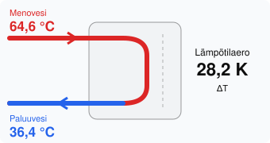

Tavoitteeni on saada nämä tiedot samaan ympäristöön muiden mittausten kanssa. Näin voidaan tarkastella esimerkiksi ulkolämpötilan, lämmityksen säätökäyrän ja ilmalämpöpumpun käytön yhteyttä energiankulutukseen. Pelkkä ajallinen yhteys ei kuitenkaan vielä osoita syy-seuraussuhdetta.

## Salon Kaukolämmön LämpöVahti

Salon Kaukolämmön asiakkailla on käytössään LämpöVahti-palvelu. Tiedustelin energiayhtiöltä mahdollisuutta hyödyntää sen ohjelmointirajapintaa omassa Home Assistant -ympäristössäni.

Yhteydenotto johti rakentavaan keskusteluun, ja API:n käyttö mahdollistettiin myös pientaloasiakkaille ilman erillistä maksua. Tästä kuuluu kiitos Salon Kaukolämmölle. Asiakkaan mahdollisuus hyödyntää omaa mittausdataansa avaa uusia mahdollisuuksia energiatehokkuuden tutkimiseen.

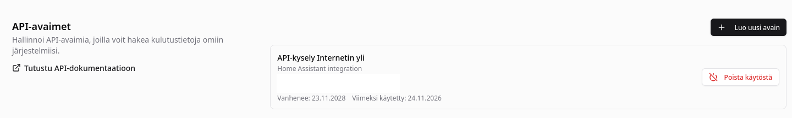

Rajapinta on dokumentoitu [LämpöVahdin API-dokumentaatiossa](https://api-lampovahti.salonkaukolampo.fi/external/api/docs/). Se tarjoaa käyttöpaikka- ja kulutustietoja, kuten kumulatiivisen energialukeman, tuntikulutuksen, lämpötilat ja virtauksen silloin, kun tiedot ovat saatavilla.

## Integraation suunnitteluperiaatteet

Integraatio kehitettiin Pythonilla Home Assistantin omaa integraatioarkkitehtuuria hyödyntäen. Halusin pitää ratkaisun mahdollisimman yksinkertaisena: ei erillistä tietokantaa, omaa pilvipalvelua eikä tariffimoottoria. Mittaushistorian tallennus jää Home Assistantin Recorderille. Virallinen kulutushistoria ja kustannustiedot löytyvät edelleen LämpöVahdista.

API-avaimen ja käyttöpaikan valinta tapahtuvat käyttöliittymässä ilman configuration.yaml-tiedoston muokkaamista. Integraatio tukee suomea, ruotsia ja englantia. Rajapintaa käytetään vain tietojen lukemiseen.

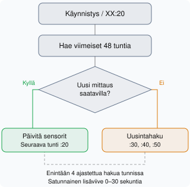

## Kun rajapinnan palauttama tieto ei ole vielä valmis

Kehitystyön kiinnostavin vaihe oli mittaustiedon käyttäytymisen tutkiminen. Havaitsin, että uuden tuntirivin kulutus saattoi aluksi olla nolla, vaikka kumulatiivinen energialukema oli kasvanut. Myöhemmin saman rivin tuntikulutus päivittyi vastaamaan energialukeman muutosta.

Eräässä mittauksessa kumulatiivinen lukema oli 17 379 kWh. Tuntikulutus oli klo 12.31 vielä 0 kWh ja klo 12.40 jo 1 kWh. Rivin modified_at-aikaleima pysyi samana. Tämän vuoksi pelkkään modified_since-suodatukseen perustuva tiedonkeruu saattaisi jättää korjauksen havaitsematta.

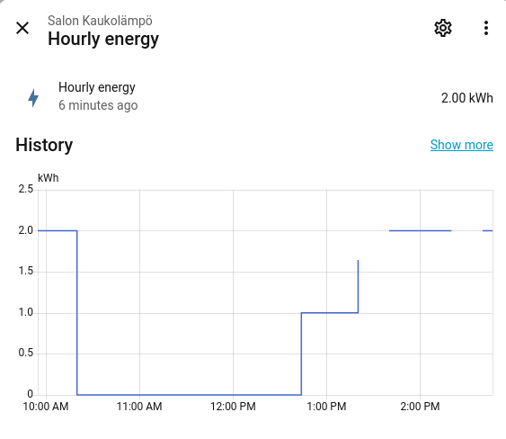

Kyseessä ovat oman käyttöpaikkani tutkimushavainnot, eivät vahvistetut ominaisuudet kaikissa käyttöpaikoissa. Olen pyytänyt Salon Kaukolämmöltä tarkennuksia muun muassa aikaleimojen merkitykseen, korjausten käsittelyyn ja kumulatiivisten lukemien käyttöön tuntikulutuksen laskennassa.

Nykyinen integraatio vertaa peräkkäisten, saman mittarin tuntirivien kumulatiivisten energialukemien erotusta ilmoitettuun tuntikulutukseen. Jos arvot eivät täsmää, tuntikulutusta ei esitetä uutena vahvistettuna mittauksena. Edellinen vahvistettu arvo voidaan säilyttää enintään kahden tunnin ajan sen omasta mittausajankohdasta laskettuna. Datan laatutila ja kulutuksen mittausajankohta näkyvät erillisinä sensoreina.

Omassa aineistossani energialukemat ovat muuttuneet yhden kilowattitunnin askelin. Tämä on havaittu tiedon resoluutio, ei arvio mittarin varsinaisesta mittaustarkkuudesta. Tuntikulutuksesta laskettu keskiteho ei myöskään ole hetkellinen lämpöteho.

## Mukautuva tiedonkeruu

Rajapintaa ei ole tarpeen kysellä jatkuvasti, jos uutta mittaustietoa syntyy pääasiassa tunneittain. Toisaalta pelkkä yksi kysely tunnissa voi jättää viivästyneen korjauksen huomaamatta.

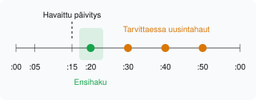

Integraatio pyrkii hakemaan tiedot normaalisti noin 20 minuuttia tasatunnin jälkeen. Jos uusi tieto puuttuu tai odottaa vahvistusta, kyselyitä voidaan tehdä myös noin 30, 40 ja 50 minuuttia tasatunnin jälkeen. Pieni satunnainen viive hajauttaa kyselyitä eri asennusten välillä.

Tutkimusta varten ajan lisäksi erillistä Bash-skriptiä, joka tallentaa API:n palauttamaa tietoa minuutin välein. Näin voin tutkia rajapinnan käyttäytymistä integraatiosta riippumatta. Tämä tiheä tutkimuslogitus ei kuulu normaaliin integraation toimintaan.

## Asentaminen Home Assistant Marketplacesta

Home Assistant 2026.11 toi mukanaan Marketplacen, jonka kautta myös julkisissa GitHub-repositorioissa olevia yhteisöintegraatioita voidaan asentaa. Testasin asennuksen puhtaassa Home Assistant 2026.11.0 Docker -ympäristössä Fedora Linuxilla.

Ota ensin varmuuskopio Home Assistantista. Avaa **Settings → Marketplace**, hyväksy tarvittaessa yhteisösisältöä koskeva varoitus ja valitse **Add from link**.

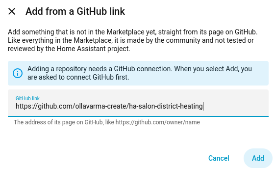

Anna repositorion osoite:

```text
https://github.com/ollavarma-create/ha-salon-district-heating
```

Mukautetun repositorion lisääminen voi edellyttää GitHub-tunnistautumista. Testissäni valtuutus koski julkista dataa ja GitHubin valtuutussovellus näkyi vielä HACS-nimellä.

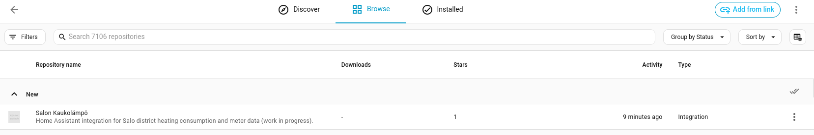

Valitse integraatio ja asenna se. Käynnistä Home Assistant uudelleen tarvittaessa. Testissä Marketplace asensi julkaisuehdokasta vastaavan Git-commitin. Nimetyn esijulkaisuversion valintaa ja myöhempää päivitysmekanismia ei ole vielä testattu kokonaisuudessaan.

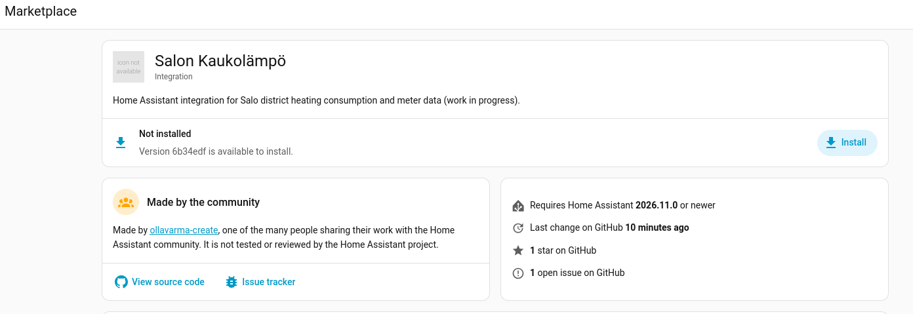

## API-avaimen luominen ja käyttöönotto

Kirjaudu [LämpöVahtiin](https://lampovahti.salonkaukolampo.fi/login), avaa **Tilini → API-avaimet** ja luo uusi avain.

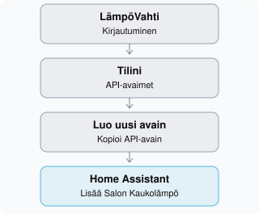

Avaa Home Assistantissa **Settings → Devices & services → Add integration** ja etsi Salon Kaukolämpö. Syötä API-avain ja valitse käyttöpaikka. Älä julkaise API-avainta kuvakaappauksissa tai virheraporteissa.

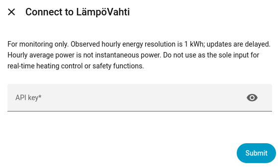

## Yksitoista sensoria

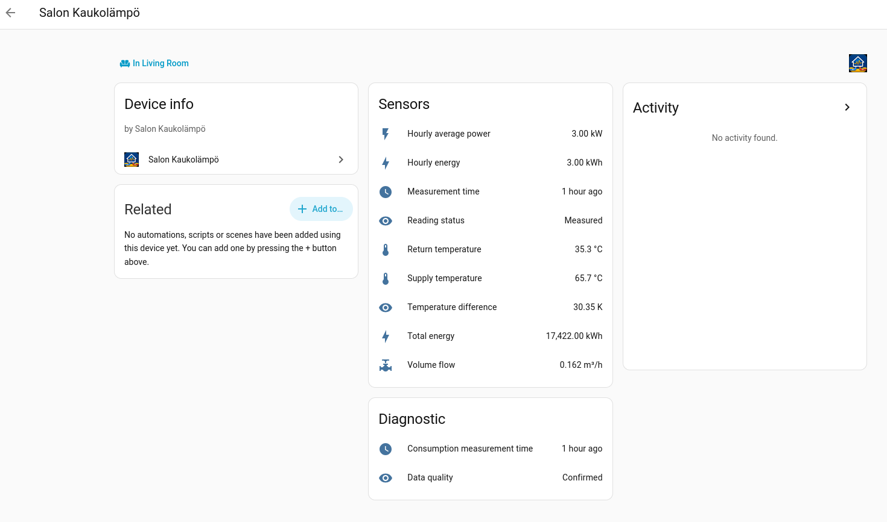

| Sensori | Merkitys |
|---|---|
| Total energy | Kumulatiivinen energia (kWh) |
| Hourly energy | Vahvistettu tuntikulutus (kWh) |
| Hourly average power | Tunnin keskiteho (kW) |
| Supply temperature | Menoveden lämpötila (°C) |
| Return temperature | Paluuveden lämpötila (°C) |
| Temperature difference | Lämpötilaero (K) |
| Volume flow | Tilavuusvirta (m³/h) |
| Measurement time | Uusimman mittausrivin ajankohta |
| Reading status | Rajapinnan lukematila |
| Consumption measurement time | Näytettävän kulutuksen mittausajankohta |
| Data quality | Integraation kulutustiedon laatutila |

Laatutilat ovat confirmed, pending, stale ja unverifiable. Niiden avulla käyttäjä voi erottaa vahvistetun kulutustiedon odottavasta, vanhentuneesta tai sellaisesta tiedosta, jota ei voida varmentaa.

## Oma kaukolämmön dashboard

Home Assistant 2026.11.0:n Energy Dashboardissa ei testini perusteella ole omaa kaukolämmön kategoriaa. En halunnut luokitella ostettua lämpöenergiaa sähköksi tai kaasuksi vain saadakseni sen näkyviin energiakoontinäytössä.

Repositoriossa on siksi [esimerkki erillisestä kaukolämmön dashboardista](https://github.com/ollavarma-create/ha-salon-district-heating/tree/main/examples). Se sisältää uusimmat mittaukset, päivä-, viikko- ja kuukausikulutuksen, lämpötilahistorian, virtauksen sekä datan laatutiedot.

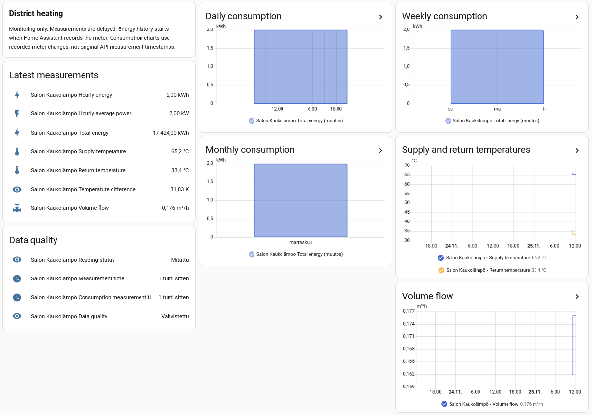

Esimerkin entity ID:t on sovitettava omaan asennukseen. Home Assistant voi lisätä niihin esimerkiksi valitun huoneen nimen. Kulutusgraafit perustuvat kumulatiivisen energialukeman muutoksiin Home Assistantin tallennusajankohdan mukaan, eivät alkuperäisiin API:n mittausaikaleimoihin. Historiatietoja ei tuoda takautuvasti, ja pitkäaikaistilastojen toiminta on edelleen testauksessa.

## Mitä seuraavaksi?

Pidemmän aikavälin tavoitteeni on yhdistää kaukolämmön kulutustiedot Ouman EH-203:n säätötietoihin sekä muihin Home Assistantin mittauksiin.

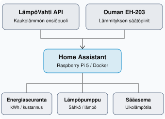

Tämä on jatkokehityksen visio, ei nykyisen integraation toteutettu ominaisuus. Ennen lämmityksen optimointia on ymmärrettävä mittausten viiveet, resoluutio ja merkitys. Integraatio on tarkoitettu seurantaan, eikä sitä tule käyttää reaaliaikaisen lämmitysohjauksen tai turvallisuustoimintojen ainoana tietolähteenä.

## Etsitään testaajia

Ensimmäinen julkaisuehdokas on saatavilla. Etsin erityisesti Salon Kaukolämmön asiakkaita, jotka käyttävät Home Assistantia ja haluavat osallistua integraation testaamiseen ennen vakaata julkaisua.

Palaute kiinnostaa erityisesti seuraavista asioista:

- Marketplace-asennus ja käyttöönotto erilaisissa HA-ympäristöissä.
- Sensorien arvot verrattuna LämpöVahtiin sekä mahdolliset puuttuvat tiedot.
- Datan laatutilojen käyttäytyminen ja mittausten viiveet.
- Uudelleenkäynnistykset, pitkäaikaistilastot ja useamman käyttöpaikan käyttö.
- Käyttöliittymä, käännökset ja dokumentaation ymmärrettävyys.

Virheraportissa kannattaa kertoa HA:n ja integraation versiot, asennustapa sekä havaittu ja odotettu toiminta. Poista API-avaimet, osoitteet, käyttöpaikkatunnukset ja muut tunnistetiedot ennen raportin lähettämistä.

- [GitHub-repositorio](https://github.com/ollavarma-create/ha-salon-district-heating)
- [Release Candidate v0.1.0-rc.1](https://github.com/ollavarma-create/ha-salon-district-heating/releases/tag/v0.1.0-rc.1)
- [Virheraportit ja kehitysehdotukset](https://github.com/ollavarma-create/ha-salon-district-heating/issues)

Projekti on maksuton ja MIT-lisensoitu. Kyseessä on riippumaton yhteisöintegraatio, ei Salon Kaukolämmön virallinen tuote. Tarkoitus on täydentää LämpöVahtia, ei korvata sitä.

Avoimen lähdekoodin arvo ei ole pelkästään siinä, että ohjelmiston voi ladata maksutta. Se on myös mahdollisuudessa tarkastella, miten tieto syntyy, miten sitä käsitellään ja millä perusteella siihen voidaan luottaa. Tässä projektissa juuri mittaustiedon ymmärtäminen on osoittautunut vähintään yhtä kiinnostavaksi kuin itse ohjelmiston kehittäminen.
