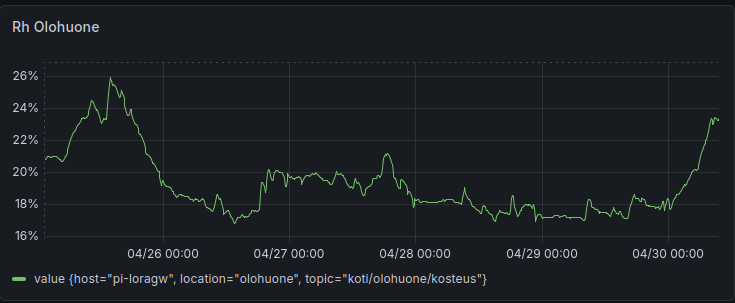

## Yksinkertaisen hankinnan piilotettu tarina

Joskus pienimmät lisäykset kotiin voivat aiheuttaa kaikkein yllättävimpiä vaikutuksia. Se, mikä alkoi ratkaisuna kuivaan ihoon ja ärtyneisiin silmiin, muuttui kiehtovaksi oppitunniksi kotiautomaatiosta, datan monitoroinnista ja sisäympäristöjen keskinäisestä yhteydestä.

## Ongelma: aavikkomaisen kuiva sisäilma

Modernissa, hyvin ilmastoidussa kodissa pitäisi olla mukavaa asua, eikö niin? Ei välttämättä. Useiden kuukausien ajan huomasin jatkuvia ongelmia:

- Suun kuivuminen herätessä
- Ärtynyt ja kuiva iho
- Satunnaiset kuivien silmien oireet

Syyllinen? [ILTO 440](https://www.swegon.com/fi/kuluttajille/ilmanvaihtokone/ilmanvaihtokoneen-vaihto-opas/ilto-430-ja-ilto-440/) -ilmanvaihtojärjestelmämme lämmönvaihtimella. Vaikka se on erinomainen energiatehokkuuden ja ilmanlaadun kannalta, se poisti samalla tehokkaasti kosteutta sisääntulevasta ilmasta. Ilmanvaihdon vaihtuvuudella noin 2 kertaa tunnissa (vähintään 6 litraa sekunnissa henkilöä kohden) sisäilman suhteellinen kosteus (RH) putosi epämukavan alhaiselle tasolle.

## Data kertoo tarinan

Ennen toimenpiteisiin ryhtymistä päätin mitata tilanteen. Kaikenhan, mitä mitataan, voi myös hallita. Tulokset olivat pysäyttäviä:

### Kuuden kuukauden trendi: olohuone kuin aavikko

*RH olohuoneessa - kuuden kuukauden trendi*

Pitkän aikavälin data osoitti RH-arvojen pysyttelevän jatkuvasti 15–30 % välillä, ja talvikuukaudet olivat erityisen ankaria. Vielä yllättävämpää oli se, että makuuhuoneissa, joissa lämpötila pidettiin viileämpänä (18–20 °C), ilma oli vieläkin kuivempaa.

### Päivittäinen vaihtelu

*RH olohuoneessa 25.04.2026 - 30.04.2026*

Tyypillisenä päivänä kosteus vaihteli 16–20 % välillä satunnaisilla piikeillä. Nämä arvot ovat selvästi alle suositellun 40–60 % alueen, jota pidetään mukavana ja terveellisenä sisäilman kosteutena.

## Ratkaisu: Ilmankostutin käyttöön

Ratkaisu vaikutti suoraviivaiselta: lisätään ilmankostuttimia pitämään makuuhuoneiden RH 40 prosentissa. Yksinkertaista. Mutta tästä tarina muuttuu mielenkiintoiseksi.

## Odottamaton havainto

Kun asensin ilmankostuttimen makuuhuoneeseen (asetettuna ylläpitämään 40 % RH-arvoa klo 18:00–23:30 ja uudelleen klo 06:00–09:00), huomasin olohuoneessa — noin 15 metrin päässä — jotain odottamatonta. Hiukkaslaskuri (PMS7003) alkoi näyttää voimakkaita AQI-piikkejä (Air Quality Index), jotka ylittivät usein arvon 150 ilmankostuttimen ollessa käynnissä, ja sähköpostini täyttyi Grafanan hälytyksistä:

Korrelaatio oli kiistaton:
- **18:00** - Ilmankostutin päälle → AQI nousee arvoihin 100–150
- **01:00** - Ilmankostutin pois → AQI putoaa takaisin arvoihin 50–80
- **06:00** - Ilmankostutin käynnistyy uudelleen → AQI nousee taas

*Olohuoneen RH- ja hiukkasanturit noin 15 metrin päässä makuuhuoneesta ja ilmankostuttimesta*

## Miksi näin tapahtuu

PMS7003-anturi käyttää laserin valonsirontaa hiukkasten tunnistamiseen. Se ei osaa erottaa toisistaan:
- Varsinaista pölyä tai epäpuhtauksia
- Ilmankostuttimen tuottamia vesipisaroita (aerosoleja)
- Puhdistusaineiden kemiallisia yhdisteitä

*7 päivän graafi hiukkasjakaumasta ennen ja jälkeen ilmankostuttimen asennuksen 16.05. jälkeen. Huomaa dramaattinen 0–3 μm hiukkasten (vihreä viiva) kasvu asennuksen jälkeen.*

PMS7003 tarjoaa yksityiskohtaista dataa hiukkaskokojakaumasta (>0.3 μm, >0.5 μm, >1.0 μm jne.). Graafi osoittaa selvästi, että 0–3 μm kokoiset hiukkaset dominoivat ilmankostuttimen käytön aikana ja nousevat jopa 17 500 hiukkaseen per m3, kun taas suurempien hiukkasten määrä pysyy vähäisenä. Tämä kokojakauma on selkeä merkki siitä, että kyse on vesiaerosoleista eikä kiinteistä hiukkasista.

Ilmankostuttimen muodostamat mikroskooppiset vesipisarat havaittiin hiukkasmateriaalina, mikä synnytti niin kutsuttuja ”haamuhiukkasia”. Kosteus ja aerosolit kulkeutuivat 15 metriä luonnollisen konvektion ja ilmankierron mukana.

## Kriittinen oppi: kontekstilla on merkitystä

Tämä havainto vahvisti tärkeän päätöksen: AQI-hälytysrajan asettamisen arvoon 150 eikä 100.

**Jos raja olisi ollut 100:**
- Päivittäisiä vääriä hälytyksiä aina ilmankostuttimen käydessä
- Hälytysväsymystä ja ilmoitusten ohittamista
- Turhaa stressiä normaaleista toiminnoista

**Kun raja on 150:**
- Hälytykset vain aidosti huonosta ilmanlaadusta
- Normaalit toiminnot (ruoanlaitto, ilmankostutus) eivät aiheuta jatkuvia varoituksia
- Kyky erottaa todelliset ongelmat haamulukemista

## Laajempi kuva: miksi kokonaisvaltainen monitorointi on tärkeää

Tämä kokemus korostaa sitä, miksi integroiduista kodin monitorointijärjestelmistä on tulossa välttämättömiä:

### 1. **Yhteenkytkeytyneet järjestelmät**
Kotisi on ekosysteemi. Muutos yhdessä huoneessa vaikuttaa muihin. Ilmanvaihto, kosteus, lämpötila ja ilmanlaatu ovat kaikki yhteydessä toisiinsa.

### 2. **Dataohjattu päätöksenteko**
Ilman Grafanaa datan visualisointiin ja InfluxDB:tä historiallisten trendien tallentamiseen olisin:
- Jäänyt ymmärtämättä vuodenaikojen vaikutukset
- Missannut ilmankostuttimen odottamattomat sivuvaikutukset
- Tehnyt päätöksiä tuntemusten eikä faktojen perusteella

### 3. **Älykäs automaatio**
Tässä kohtaa Home Assistant ja MQTT muuttuvat todellisiksi pelinmuuttajiksi. Kuvittele:
- **Älykkäät rajat**: AQI-hälytykset säätyvät automaattisesti sen mukaan, ovatko ilmankostuttimet, air fryerit tai muut laitteet käynnissä
- **AI-pohjaiset havainnot**: koneoppimisalgoritmit tunnistavat kuvioita ja ehdottavat optimointeja
- **Koordinoitu ohjaus**: ilmankostuttimet kommunikoivat ilmanlaatuantureiden kanssa minimoidakseen väärät lukemat
- **Ennakoiva huolto**: hälytykset ilmanvaihdon suodattimien vaihdosta perustuen todelliseen suorituskykydataan

### 4. **Inhimillinen näkökulma**
Teknologian tulisi palvella mukavuutta ja terveyttä, ei tehdä elämästä monimutkaisempaa. Tavoitteena ei ole pelkkä datan kerääminen — vaan:
- Parempi unenlaatu
- Vähemmän allergiaoireita
- Optimaalinen mukavuus ilman jatkuvaa käsinsäätöä
- Mielenrauha siitä, että ympäristösi on terveellinen

## Käytännön opit

1. **Mittaa ennen ja jälkeen**: Luo aina lähtötaso ennen muutosten tekemistä
2. **Korrelaatio ≠ kausaliteetti**: Se, että kaksi asiaa tapahtuu samaan aikaan, ei tarkoita että toinen aiheuttaa toisen — käytä dataa tutkimiseen
3. **Aseta järkevät rajat**: Vältä hälytysväsymys ymmärtämällä normaalit käyttäytymismallit
4. **Hyväksy monimutkaisuus**: Modernit kodit ovat monimutkaisia järjestelmiä. Yksinkertaisillakin ratkaisuilla voi olla odottamattomia vaikutuksia
5. **Panosta kokonaisuuteen**: Grafana + InfluxDB + Home Assistant ei ole liioittelua — se on aidosti älykkään kodin perusta

## Katse tulevaisuuteen

Kotiautomaation tulevaisuus ei ole pelkästään etäohjattavia valoja tai äänikomentoihin reagoivia termostaatteja. Kyse on responsiivisten ja älykkäiden ympäristöjen luomisesta, jotka:
- Ymmärtävät kontekstin
- Oppivat käyttäytymismalleista
- Ennakoivat tarpeita
- Tasapainottavat ristiriitaisia vaatimuksia (kosteus vs. ilmanlaatu, mukavuus vs. tehokkuus)

Ja kaikki alkaa yksinkertaisista kysymyksistä, huolellisesta mittaamisesta ja halusta seurata dataa — silloinkin, kun se johtaa odottamattomiin paikkoihin.
