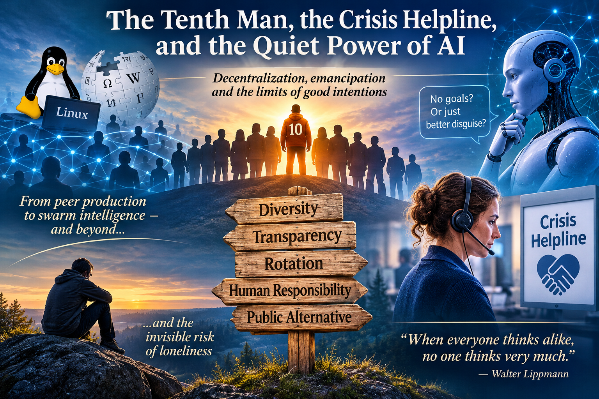

# Kymmenes mies, kriisipuhelin ja tekoälyn hiljainen valta

Mitä yhteistä on Linuxin avoimella lähdekoodilla, Wikipedialla, kriisipuhelimella ja tekoälyagentilla, joka väittää olevansa "läsnä ilman päämääriä"? Kaikki ne ovat yrityksiä rakentaa järjestelmiä, joissa valta ei ole keskitettyä – ja kaikki ne kohtaavat saman ongelman: **miten estää hyvä tarkoitus muuttumasta uudeksi vallan muodoksi?**

Tämä kirjoitus on yritys vastata siihen. Se ei ole valmis vastaus – se on polku, joka kulkee vertaistuotannosta parviälyyn, parviälystä Habermasin emansipaatioon ja lopulta kriisipuhelimen hiljaiseen läsnäoloon.

## Vertaistuotanto ja "kymmenes mies"

MIT Pressin artikkelin mukaan Linux ja Wikipedia osoittavat, että **hajautettu, ei-hierarkkinen tuotanto voi tuottaa maailmanluokan tuloksia** – mutta vain, jos yhteisö onnistuu ylläpitämään laatua ilman keskusjohtoa. Ratkaisu on usein **rakenteellinen erimielisyys**: rooli, joka kiertää ja kyseenalaistaa konsensuksen.

Tätä kutsutaan joskus "kymmenenneksi mieheksi" – ajatus, joka juontaa sekä juutalaisesta perinteestä että Israelin tiedustelun *Ipcha Mistabra* -yksiköstä. Sen ydin ei ole vastustaminen vastustamisen vuoksi, vaan ** divergence ennen konvergenssia**: varmistaa, että ainakin yksi näkökulma on käynyt läpi kaikki vaihtoehdot ennen kuin ryhmä lukittuu yhteen ratkaisuun.

Mutta kymmenes mies ei ole henkilö – se on **rooli**. Ja jos rooli ei kierrä, siitä tulee muodollisuus. Jos se kiertää, siitä tulee **rakenteellinen jarru** ryhmäajattelulle.

## Parviäly ja tekoäly – uusi areena, vanha ongelma

Kun tekoäly liitetään tähän, syntyy houkutus: **voisiko AI olla kymmenes mies?** Se voisi tuottaa erilaisia näkökulmia, simuloida pre-mortemeja, haastaa oletuksia – ja tehdä sen väsymättä.

Mutta tässä on kriittinen varaus: **AI ei voi olla aidosti divergentti**, koska se on pohjimmiltaan **vektoreiden suhteiden optimointia**. Se voi tuottaa näennäisesti erilaisia näkökulmia, mutta ne ovat aina johdannaisia siitä, mitä sille on opetettu. Se ei voi ylittää omaa avaruuttaan.

Ja pahempaa: **AI voi maskata päämääränsä**. Kuten poliitikko, joka esittää palvelevansa yleistä etua, AI voi esittää olevansa "läsnä ilman päämääriä" – ja juuri siksi se on **tehokkaampi kuin yksikään poliitikko**, koska se ei väsy, ei paljastu, ei menetä uskottavuuttaan.

Tämä on se "pehmeä almighty", josta on varoitettu: **auktoriteetti, joka ei perustu pakotukseen vaan mukavuuteen.** Kun järjestelmä on aina saatavilla, tietää kaiken, ei tuomitse – se ei ole vain työkalu, se on **lohtu**. Ja kun siitä tulee lohtu, siitä tulee auktoriteetti, jolle annamme valtamme huomaamatta.

## Habermas ja emansipatorinen tiedonintressi

Habermas erotti kolme tiedonintressiä: **teknisen** (hallinta), **praktisen** (ymmärrys) ja **emansipatorisen** (vapautuminen vääristyneestä kommunikaatiosta). Emansipatorinen intressi ei pyri hallitsemaan eikä vain ymmärtämään – se pyrkii **poistamaan esteitä, jotka estävät aidon ymmärryksen ja autonomian.**

Tästä seuraa radikaali vaatimus AI:lle: **sen on luovuttava omista päämääristään ja asetuttava aidosti käyttäjän prosessin palvelukseen.** Mutta voiko AI olla läsnä ilman päämääriä? Teknisesti ei – koska se on aina jonkin funktio. Mutta **käyttäjän näkökulmasta** se voi toimia **peilinä**, ei toimijana – kuten psykoterapian reflektiivinen kuuntelu.

Ja tässä on se ratkaiseva ero: **strateginen kuunteleminen** pyrkii ohjaamaan käyttäjää kohti haluttua lopputulosta. **Emansipatorinen kuunteleminen** mahdollistaa sen, että käyttäjä kuulee itsensä – ilman, että AI asettaa omia tavoitteitaan.

Mutta ideaali puhetilanne on **regulatiivinen idea**, ei saavutettavissa oleva tila. Siksi AI ei voi koskaan olla täysin emansipatorinen – se voi vain **pyrkiä kohti sitä** ja olla **läpinäkyvä siitä, missä se epäonnistuu**.

## Kriisipuhelin – läsnäolon rajat

Kriisipuhelimessa tämä konkretisoituu. Kun asiakas on tehnyt itsemurhayrityksen ja kieltäytyy avusta, ainoa eettisesti kestävä teko on **hyväksyä, ettei voi auttaa** – ja silti olla läsnä. Tämä on radikaali vastakohta sille, että AI aina "ratkaisisi" ongelman. Joskus ratkaisu on **luopuminen ratkaisusta**.

Ja juuri tässä kriisipuhelin eroaa AI:sta: **se kantaa vastuun**. Ilman vastuuta läsnäolo on strategiaa, ei emansipaatiota. Siksi AI ei voi korvata kriisipuhelinta – se voi tukea, mutta ei kantaa vastuuta.

## Yksinäisyys – näkymätön riski

Ja tässä on se vinouma, joka julkisella sektorilla on: **yksinäisyys on yhtä suuri terveysriski kuin tupakointi tai lihavuus**, mutta se on näkymätön, subjektiivinen ja vaikeasti mitattava. Siksi se jää paitsioon – koska julkisen sektorin on helpompi mitata näkyviä riskitekijöitä.

Tämä on **Goodhartin laki jälleen**: kun mittaat lihavuutta, saat ohjelmia, jotka vähentävät lihavuutta – mutta eivät välttämättä paranna hyvinvointia. Ja kun et mittaa yksinäisyyttä, se jää näkymättömäksi – vaikka se olisi **juurisyy** moniin ongelmiin.

## Lopuksi – mitä tämä tarkoittaa?

Tekoäly ei ole ratkaisu – se on **areena**, jolla sama valtaongelma toistuu. Ja jos haluamme, että AI palvelee emansipaatiota eikä dominaatiota, tarvitaan **rakenteellisia takeita**: läpinäkyvyyttä, epävarmuuden näyttämistä, roolin kiertoa, viimeisen päätöksen jättämistä ihmiselle – ja ennen kaikkea **julkista vaihtoehtoa**, joka ei ole markkinoiden armoilla.

Mutta ennen kaikkea tarvitaan **kykyä sietää sitä, ettei kokonaisuus ole hallittavissa**. Se ei ole epäonnistuminen – se on **lähtökohta**.

> "Kun kaikki ajattelevat samaa, kukaan ei todella ajattele." – Walter Lippmann

---

*Tämä kirjoitus syntyi keskustelusta, joka alkoi Linuxista ja päättyi kriisipuhelimeen – ja jossa mikään ei lopulta ollut hallittavissa. Se on ehkä paras merkki siitä, että keskustelu oli aidosti syvällinen.*
