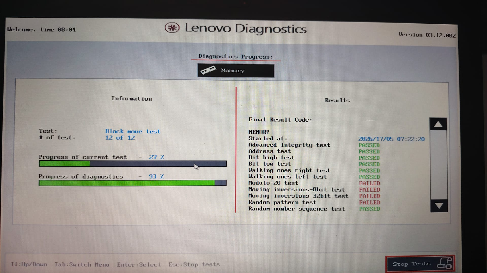
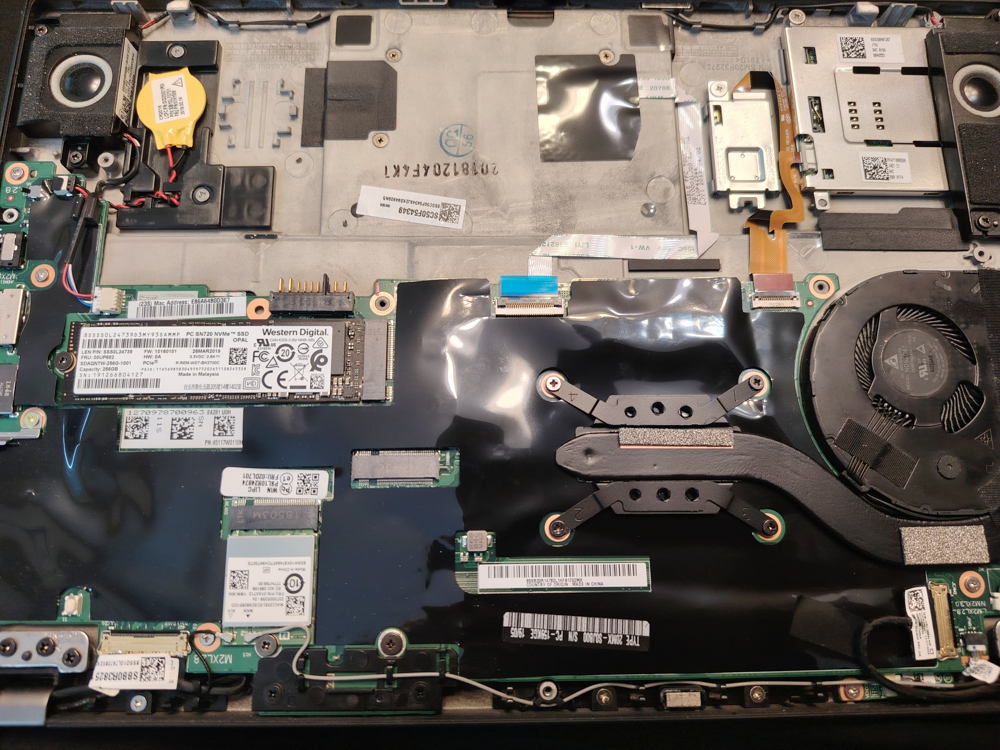
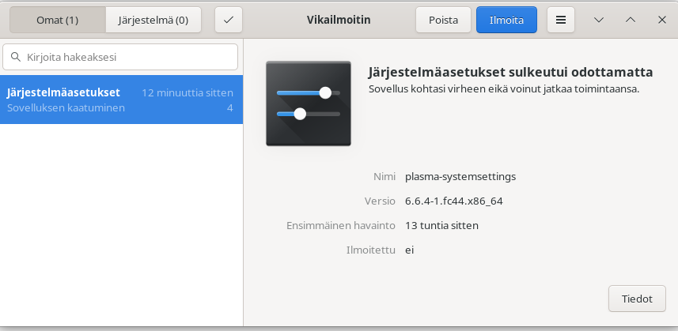

## Johdanto

Tämä artikkeli dokumentoi **vianetsintäprosessin**, jossa Fedora 44 -järjestelmä alkoi näyttää outoja oireita. Aluksi luulin kyseessä olevan päivityksestä johtuva softavirhe, mutta lopulta paljastui vakava laitteistovika: **RAM-muisti oli fyysisesti viallinen**. Yllättävintä oli, että Linux jatkoi toimintaansa melko hyvin vakavista muistivirheistä huolimatta.

> ⚠️ **Varoitus:** Tämä artikkeli kuvaa vakavaa laitteistovikaa.  
> Jos koet samanlaisia oireita:
> 1. Varmuuskopioi tiedot **heti**
> 2. Älä kirjoita levylle (korruptio pahenee)
> 3. Testaa muisti huolellisesti
> 4. Älä yritä korjata juotettua RAMia ilman ammattitaitoa

## Oireiden alkuvaiheet

### Ensimmäiset virheilmoitukset

Ongelmat alkoivat Fedora 44 -päivityksen jälkeen. Järjestelmä alkoi näyttää seuraavia virheitä bootin aikana:

```bash
BTRFS critical (device dm-0): unable to find chunk map for logical 281564888793088 length 16384
BTRFS error (device dm-0): error loading props for ino 6266461 (root 5): -5
```
Lisäksi jotkut sovellukset kaatuilivat oudosti. Aluksi luulin näiden olevan seurausta päivityksen aiheuttamasta ohjelmistovirheestä tai tiedostojärjestelmän korruptiosta, joka liittyisi Fedora KDE 44 päivitykseen.

### Ensimmäiset diagnostiset toimet

Tarkistin levyaseman kunnon SMART-tiedoilla:

```bash
sudo smartctl -a /dev/nvme0n1
```

Tulokset näyttivät hyvältä:

    SMART Health: PASSED
    Media and Data Integrity Errors: 0
    Critical Warning: 0x00

Myös BTRFS:n tilastot olivat puhtaat:
```bash
sudo btrfs device stats /
[/dev/mapper/luks].write_io_errs    0
[/dev/mapper/luks].read_io_errs     0
[/dev/mapper/luks].flush_io_errs    0
[/dev/mapper/luks].corruption_errs  0
```
Ei virheitä. Tämä oli ristiriitaista: järjestelmä raportoi BTRFS-virheitä, mutta levy näytti terveeltä.

Bootissa nähdyt virheet saa näkyviin komennolla:
```bash
sudo dmesg | grep -i "chunk map\|btrfs critical"
```
Koska corruption_errs = 0, BTRFS ei ole menettänyt tai vioittanut yhtään tavua. Järjestelmä toimii normaalisti, koska BTRFS:n fallback-mekanismi ohittaa virheellisen osoitteen ja jatkaa mounttia. Keskeisin huomio on rivi *BTRFS error (device dm-0): error loading props for ino 6266461 (root 5): -5*. 

```bash
sudo find / -xdev -inum 6266461 2>/dev/null
/usr/lib/udev/rules.d/90-alsa-restore.rules
```
Tarkistetaan tiedoston kunto:

```bash
# Tarkista tiedoston eheys
ls -li /usr/lib/udev/rules.d/90-alsa-restore.rules
stat /usr/lib/udev/rules.d/90-alsa-restore.rules

# Varmista, että sisältö on luettavissa
sudo cat /usr/lib/udev/rules.d/90-alsa-restore.rules

# Tarkista onko tiedostolla BTRFS-spesifisiä attribuutteja
sudo btrfs property get /usr/lib/udev/rules.d/90-alsa-restore.rules
```

Tässä tapauksessa:

```bash
stat /usr/lib/udev/rules.d/90-alsa-restore.rules
File: /usr/lib/udev/rules.d/90-alsa-restore.rules
Size: 1638 Blocks: 8 IO Block: 4096 tavallinen tiedosto

sudo cat /usr/lib/udev/rules.d/90-alsa-restore.rules
cat: /usr/lib/udev/rules.d/90-alsa-restore.rules: I/O-virhe

sudo btrfs property get /usr/lib/udev/rules.d/90-alsa-restore.rules
ERROR: failed to get compression for /usr/lib/udev/rules.d/90-alsa-restore.rules: Input/output error
```
Kyseessä on siis todellinen, mutta eristetty tiedostokohtainen korruptio. I/O-virhe sekä cat että btrfs property -komennoissa osoittaa, että **BTRFS ei pysty lukemaan kyseisen inoden (6266461) data- tai metadata-extenttejä**. 

**Korjausyritys** on palauttaa 90-alsa-restore-rules-tiedosto asennuspaketista:

```bash
sudo dnf reinstall $(rpm -qf /usr/lib/udev/rules.d/90-alsa-restore.rules)
```
Palautus kuitenkin kaatuu ja levy asetetaan vain luku-tilaan:

```bash
3/4 Asennetaan uudelleen alsa-utils-0:1.2.15.2-3.fc44.x86_64 100% |  41.6 MiB/s |   2.3 MiB |  00m00s
>>> [RPM] arkiston  tiedostolle /usr/lib/alsa/init/info;6a08bf3d purkaminen epäonnistui: cpio: rename epäonnistui - Kirjoitussuojattu tiedostojärjestelmä
>>> Pakkauksen purkuvirhe: alsa-utils-0:1.2.15.2-3.fc44.x86_64
SQL-lausekkeen arviointi epäonnistui: "
    UPDATE
        "trans"
    SET
        "dt_begin" = 1778958141,
        "dt_end" = 1778958143,
        "rpmdb_version_begin" = '2949bd6b24fa9daffd8bbd9209eb946842b555e647c77feaed0014440d332507',
        "rpmdb_version_end" = '2949bd6b24fa9daffd8bbd9209eb946842b555e647c77feaed0014440d332507',
        "releasever" = '44',
        "user_id" = 1000,
        "description" = 'dnf reinstall alsa-utils-1.2.15.2-3.fc44.x86_64',
        "comment" = '',
        "state_id" = (SELECT "id" FROM "trans_state" WHERE "name" = 'Error')
    WHERE
        "id" = 51
": (8) - attempt to write a readonly database

```
Kun **BTRFS havaitsee vakavan metadata- tai checksum-virheen (kuten tuo I/O-virhe tiedostossa 90-alsa-restore.rules ja chunk map -häiriöt)**, kernel vaihtaa tiedostojärjestelmän automaattisesti read-only-tilaan. Tämä on turvamekanismi, joka estää korruption leviämisen ja datan tuhoutumisen. 

Tilanteen voi varmistaa komennolla (ro on read only, rw on read-write):

```bash
findmnt / -o OPTIONS
```
BTRFS:n remount-viestit:

```bash
sudo dmesg | grep -i "btrfs.*remount\|read-only\|forced readonly"
```
Tulosten jälkeen levyn kunto ei epäilyttänyt, mutta ehkä levylle kirjoitetaan väärää tietoa. *Tästä syntyi epäilys viallisesta RAM-muistista.*

## Muistin testaus: kerros kerrokselta totuuteen

### Vaihe 1: Pikatesti (Lenovo Diagnostics)

Ajoin Lenovon omat pikamuistitestit boottivalikosta. Tulos: PASSED. **Ei virheitä**.

### Vaihe 2: Linux käynnissä ja memtester

Asensin ja ajoin [memtesterin](https://github.com/jnavila/memtester):

```bash
sudo dnf install memtester
sudo memtester 4096 3
```
Tulos: kaikki testit läpäistiin. **Ei virheitä**.
Tässä vaiheessa luulin vielä, että kyseessä on ohjelmistovika.

### Vaihe 3: Lenovon edistynyt muistitesti (3 tuntia)
Ajoin boottivalikosta Lenovon Diagnostics-työkalulla edistyneen muistitestin, joka kesti noin 3 tuntia.

**Ensimmäinen ajo:**

```text
Advanced integrity test        PASSED  
Address test                   PASSED  
Bit high test                  PASSED  
Bit low test                   PASSED  
Walking ones right test        PASSED  
Walking ones left test         PASSED  
Modulo-20 test                 PASSED  
Moving inversions-8bit test    PASSED  
Moving inversions-32bit test   PASSED  
Random pattern test            FAILED ❌  
Random number sequence test    PASSED  
```

**Toinen ajo (tilanne pahentunut):**
```text
Modulo-20 test                FAILED ❌  
Moving inversions-8bit test   FAILED ❌  
Moving inversions-32bit test  FAILED ❌  
Random pattern test           FAILED ❌  
```

*Testit paljastivat vakavan RAM-muistin vian.*


*Ei vaihdettavaa DDR-RAM:a.*

**Huomio hardware-harrastajille:** 

Viallinen DDR4-piiri (`18513t`) sijaitsee:
- NVMe-levyn (Western Digital SN720) alapuolella
- WiFi-moduulin (Intel/Realtek) lähellä
- Juotettu BGA-palloilla emolevylle

Korjausvaatimukset:
- BGA rework -asema (esim. Quick 861DW)
- Mikroskooppi (10–40x)
- Uusi DDR4-2400 SO-DIMM -piiri
- Ammattitaitoinen juotososaaminen

**Kustannusarvio:** ~150–300 € (työ + riski)  
**Suositus:** Harkitse uuden koneen hankintaa 😄

## Miksi Linux toimi muistiviasta huolimatta?

Kernelin virheenkäsittelymekanismit Linux-kernelissä on useita kerroksia virheenkäsittelyä:
   
**ECC-tuki (vaikka muistissa ei olisi ECC:tä)**
  
Modernit x86_64-kernelit käyttävät sisäisiä tarkisteita kriittisissä tietorakenteissa. Kernelin oma data on suojattu paremmin kuin käyttäjäavaruuden data

**Page Fault -käsittely**

Kun muistialue on viallinen, kernel yrittää korjata sen:

```bash
dmesg | grep -i "page fault\|segfault"
```

**OOM Killer ja Memory Management**

Jos muistialue ei vastaa, kernel voi merkata sen "bad page":ksi. Vialliset sivut ohitetaan ja data siirretään ehjille alueille.

**Hardware Error Handling (MCE)**

Machine Check Exception -loki:

```bash
dmesg | grep -i mce
journalctl -k | grep -i "hardware error"
```

**BTRFS:n virheenkäsittely**

BTRFS on suunniteltu havaitsemaan ja korjaamaan datakorruptiota:

- Checksummit kaikelle datalle. 
- Jokaiselle lohkolle lasketaan checksummi kirjoitettaessa.  
- Luettaessa checksummi tarkistetaan ja jos täsmäävyys puuttuu, BTRFS raportoi virheen.

```bash
BTRFS error (device dm-0): error loading props for ino 6266461 (root 5): -5
```

**Copy-on-Write (CoW)**

Kirjoitukset tehdään aina uusiin lohkoihin. Vanha data säilyy kunnes uusi on vahvistettu. Vähentää korruptioriskiä.

**Metadata Duplication**

BTRFS tallentaa metadatan kahteen paikkaan. Jos toinen kopio vaurioituu, toinen on käytettävissä.

**Read-Only Fallback**

Kun BTRFS havaitsee vakavan virheen, kernel vaihtaa tiedostojärjestelmänkirjoitussuojattuun tilaan:

```bash
BTRFS: error (device dm-0) in ... : errno=-5 IO failure
BTRFS info (device dm-0): forced readonly
```
Tämä estää lisäkorruption, mutta sallii datan lukemisen.

**Miksi sovellukset kaatuilivat?**

Käyttäjäavaruuden sovellukset ovat alttiimpia muistivirheille:

- Satunnaiset bittivirheet muuttivat muuttujien arvoja.
- Kirjastojen lataus epäonnistui, jos koodisivu oli viallinen.
- Segmentaatiovirheet syntyivät, kun osoitteet korruptoituivat.

Esimerkki sovelluksen kaatumisesta:


*Kaatunut järjestelmäasetukset (plasma-systemsettings)*

**Miksi memtester ei havainnut vikaa?**

[Memtester 4.7.1](https://github.com/jnavila/memtester) on hyvä, mutta sillä on rajoituksia:
- Testaa vain käytettävissä olevan RAMin (ei koko muistialuetta).
- Lyhyt testiaika ei paljasta lämpöriippuvaisia vikoja.
- Ei testaa kaikkia mahdollisia kuvioita.

[Lenovon](https://support.lenovo.com/fi/fi/solutions/ht506579) edistynyt testi:
- Ajaa tunteja (3+ tuntia).
- Testaa jokaisen muistisolun useilla kuvioilla.
- Käyttää aggressiivisempia testikuvioita (Random pattern, Moving inversions).

USB:lta bootattava Open Source [Memtest86](https://memtest.org/) löytää virheet hyvin:


*Memtest86 löytämät virheet. Virheet viittaa sisäiseen soluvikaan DRAM-piirissä, ei esimerkiksi huonoon kontaktiin emolevyn ja muistipiirin välillä.*

## Diagnostiikan oppitunnit

1. Luota useaan lähteeseen

- SMART-tiedot voivat olla puhtaat vaikka tiedostojärjestelmä on korruptoitunut.
- Pikatesti ei aina riitä.
- Pitkäkestoinen testi on välttämätön satunnaisten virheiden havaitsemiseen.

2. BTRFS-virheet eivät aina tarkoita levyvikaa

```bash
btrfs device stats = 0 (ei levyvirheitä)
MUTTA: BTRFS critical errors (muistista luettu data oli väärää)
```

3. Kernelin logit kertovat totuuden

```bash
dmesg | grep -i "btrfs\|memory\|hardware error"
journalctl -b -1 -p err  # Edellinen boot, vain virheet
```

### Vianetsintä: tärkeimmät komennot

**Muisti**

```bash
# Nopea testi
sudo dnf install memtester
sudo memtester 1024 1
```
Perusteellinen muistitesti (vaatii rebootin): Valitse GRUB-valikosta "Memory test (memtest86+)" jos sellainen on asennettuna. Mikäli ei ole, tee boottaava USB-tikku ja asenna image [MemeTest86+ lataussivuilta](https://memtest.org/)

Lenovon omat testit: käynnistyksen yhteydessä: Enter → F10 (tai F12) → Diagnostics.

**BTRFS:n tarkistus**

```bash
# Tarkista virheet
sudo btrfs device stats /

# Aja scrub (tarkistaa checksummit)
sudo btrfs scrub start -B /

# Tarkista scrub-tila
sudo btrfs scrub status /
```

**Kernelin logit**

```bash
# Etsi muistivirheitä
dmesg | grep -i "memory\|hardware error\|mce"

# Etsi BTRFS-virheitä
dmesg | grep -i "btrfs"

# Tarkista edellinen boot
journalctl -b -1 -p err
```

**SMART-tarkistus**

```bash
# NVMe-levy
sudo smartctl -a /dev/nvme0n1

# Tarkista virheloki
sudo smartctl -l error /dev/nvme0n1
```

## Lopputulos ja suositukset

Mikä neuvoksi?

Koska ThinkPad A285:ssä RAM on juotettu emolevylle:

- Varmuuskopioi tiedot heti (LiveUSB:ltä read-only -tilassa).
- Älä yritä kirjoittaa levylle (korruptio pahenee).
- Harkitse uuden koneen hankintaa (RAM-vika ei korjaannu ohjelmallisesti).
- Valitse kone vaihdettavalla muistilla (esim. ThinkPad T480, Framework)

## Rikkinäisen muistialueen eristäminen

Tässä tapauksessa:
- viallinen alue (~7.75 GB)
- memtest havaitsee, Linux käyttää harvoin
- käytössä oleva alue (<7.75 GB)

Mitä tämä tarkoittaa käytännössä?

|Seuraus|Selitys|
|--|--|
|Linux toimii|Viallinen alue on harvoin käytössä, kernel suojelee kriittistä dataa|
|Sovellukset kaatuilivat|Satunnaisesti sovellus osui vialliseen alueeseen → segfault|
|BTRFS-virheet|Muistikorruptio aiheutti väärän datan kirjoittamisen levylle|
|Memtest86 onnistuu|Testaa koko alueen järjestelmällisesti, havaitsee vian heti|

Mikäli muistivika osuu tiettyyn muistiavaruuden kohtaan kuten tässä tapauksessa, voidaan se jättää pois kernelin (grubin) asetuksissa. Tässä tapauksessa viallinen muistialue alkaa noin 7,5G kohdalta, jolloin helpointa on lisätä GRUB_CMDLINE_LINUX= rivin loppuun **mem=7G**. 

Toinen vaihtoehto on kertoa tarkalleen mikä alue jätetään pois käyttämällä **memmap=512M!7680M** jossa varataan 512 Mt muistia alkaen osoitteesta 7680 Mt (7.5 Gt). Viallinen ~7.75 Gt jää tämän sisälle.

Muutos tehdään tiedostoon grub:

```bash
sudo nano /etc/default/grub
```
ja aktivoidaan riippuen käytätkö BIOS tai EFI-versiota:

```bash
sudo grub2-mkconfig -o /boot/grub2/grub.cfg   # BIOS
# tai
sudo grub2-mkconfig -o /boot/efi/EFI/fedora/grub.cfg  # UEFI

sudo reboot now
```

Voit tarkistaa bootin jälkeen käytetyt asetukset:

```bash
grep GRUB_CMDLINE_LINUX /etc/default/grub

tai

cat /proc/cmdline
 ```

Lisäksi **kannattaa muuttaa BIOS:sta näytönohjaimen käyttämää muistimäärää**. AMD Vega iGPU varaa VRAM:ia, eli ryzen-prosessorin integroitu näytönohjain ottaa osan keskusmuistista näytönpuskuriksi. Oletuksena näytönohjain käyttää 1G verran muistia, mutta käytännössä 256 tai 512 on riittävä kevyeen KDE käyttöön. 

Rajaamalla muisti mem=7G jää kernelille käytettäväksi noin 4,5G jos näytönohaimen käyttämä muistimäärä on 1G. Vapaaksi jäävän muistin voit tarkistaa komennolla:

```bash
free -h
```
Kernelin näkemän muistin voit tarkistaa:

```bash
dmesg | grep -i "memory"
dmesg | grep -i "memblock"
```

Muistikartan näet komennolla:

```bash
cat /proc/iomem | grep -i "system ram"
```

Fedora varaa oletuksena muistia kernel-kaatumislokia varten noin 100-200M. Jos et tarvitse sitä:

```bash
sudo systemctl disable kdump
sudo systemctl stop kdump
```

## Tulevien ongelmien ehkäisy


**Säännölliset muistitestit (esim. kuukausittain)**
```bash
sudo dnf install memtester
sudo memtester 2048 2
```
Tai käynnistä memtest86+ GRUB-valikosta (kerran vuodessa)

**BTRFS-scrub (tarkistaa checksummit)**
```bash
sudo btrfs scrub start /
sudo btrfs scrub status /
```

**Varmuuskopiostrategia**

Vaikka levy on terve, BTRFS+LUKS on monimutkainen pinottu kerros. Suositus:

- Pidä 3-2-1-varmuuskopiokäytäntöä (3 kopiota, 2 eri mediaa, 1 offsite) 
- Käytä btrfs send/receive tai borgbackup/restic tiedostotason varmuuskopioihin  
- Älä luota pelkästään snapshoteihin levyn vaihtoon  

**SMART-tarkkailu**

```bash
sudo dnf install smartmontools
sudo smartctl -a /dev/nvme0n1
```

**Valinnainen sanity check (LiveUSB)**

Jos haluat 100% varmuuden, käynnistä Fedora LiveUSB:ltä ja aja:

```bash
sudo cryptsetup luksOpen /dev/nvme0n1p3 temp-root # jos LUKS2 salaus
sudo btrfs check --readonly /dev/mapper/temp-root
sudo cryptsetup luksClose temp-root # jos LUKS2 salaus
```
Jos --readonly ei raportoi korruptiota, voit unohtaa koko asian huoletta.


## Windows-vertailu: Miksi Linux voitti tämän taiston? 🐧💪

Jos tämä olisi tapahtunut Windowsille:


❌ **BSOD ennen muistitestiä**: "Your PC ran into a problem and needs to restart"  
❌ **Windows Update**: "Getting Windows ready, don't turn off your computer" (kesken datan varmuuskopioinnin)  
❌ **Chkdsk**: "Scanning and repairing drive C: 12% complete" (kestää 8 tuntia)  
❌ **Telemetria**: "Sending diagnostic data to Microsoft" (myös muistivirheen tiedot)  
❌ **Sininen ruutu**: 47 kertaa päivässä  
❌ **Muistinhallinta**: "Standby memory list corrupted" → BSOD  
❌ **Käynnistysaika**: 45 sekuntia (Linux: 2 sekuntia)  

**Bonus:** Windows olisi vaatinut uudelleenkäynnistyksen jokaisen muistitestin jälkeen. Linux testasi muistin taustalla järjestelmän ollessa käynnissä. 😎

*Windows: "We'll restart your computer to fix the problem"*  

*Linux: "I'll just work around it and save your data"* 

## Yhteenveto

Tämä tapaus osoitti, kuinka hyvin Linux selviää vakavista laitteistovioista:


✅ Kernelin virheenkäsittely suojasi kriittisiä järjestelmäosia.    
✅ BTRFS havaitsi korruption ja vaihtoi read-only-tilaan estääkseen lisävahingot.    
✅ Järjestelmä toimi riittävän hyvin datan varmuuskopiointiin.      
❌ Muistivika ei korjaannu ohjelmallisesti.    
❌ Korruptio pahenee jokaisella kirjoituksella.  
❌ Juotettu RAM tekee korjauksen mahdottomaksi.    

Oppitunti: **Luota diagnostiikkaan, mutta älä luota liikaa yhteen testiin**. Jos oireet jatkuvat, testaa muisti huolellisesti – se on usein syyllinen, vaikka levy ja ohjelmistot näyttävät terveiltä.

## Lähteet ja lisälukemista

[BTRFS Documentation](https://btrfs.readthedocs.io/?spm=a2ty_o01.29997173.0.0.5dfe55fb7hZF9B)  
[Memtest86+ Documentation](https://www.memtest.org/?spm=a2ty_o01.29997173.0.0.5dfe55fb7hZF9B)  
[ThinkPad A285 Hardware Maintenance Manual](https://pcsupport.lenovo.com/?spm=a2ty_o01.29997173.0.0.5dfe55fb7hZF9B)  
[Fedora BTRFS Wiki](https://fedoraproject.org/wiki/Btrfs)  


