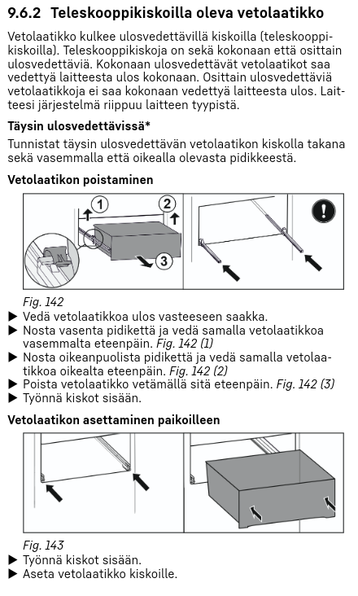
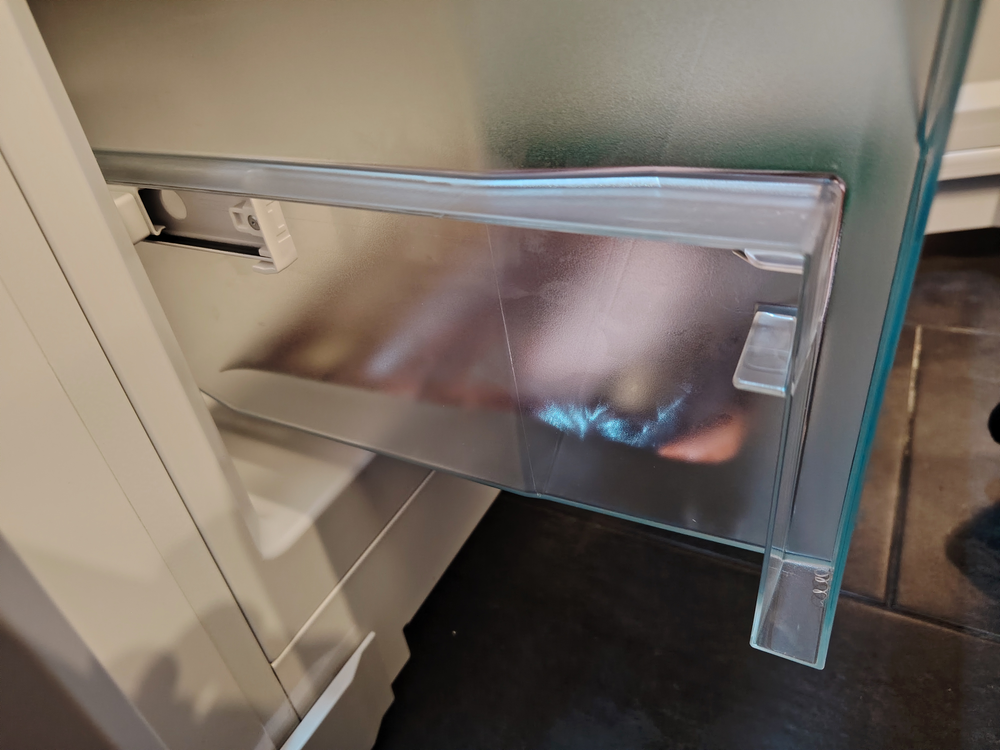
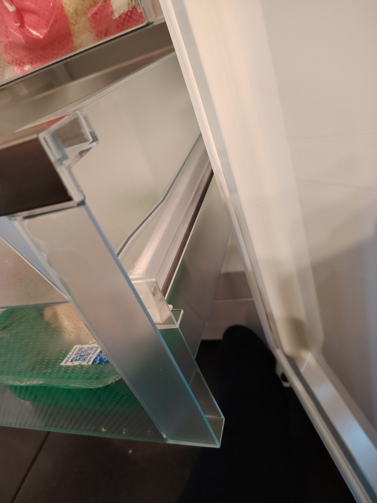
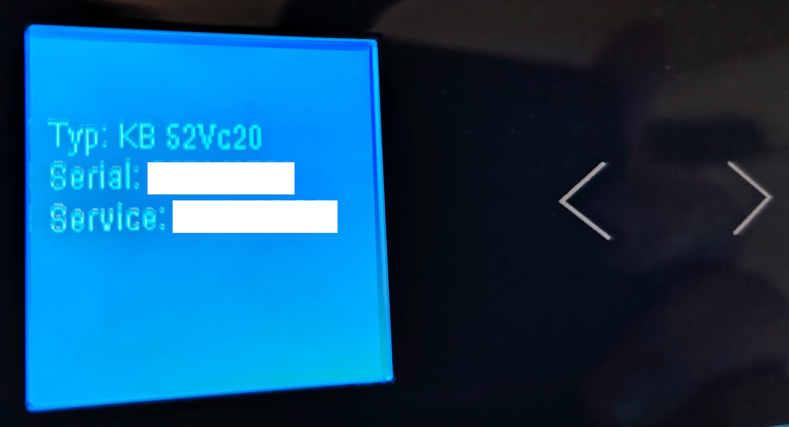

## Liebherr-jääkaapin suomenkieliset ohjekirjat

Lähetin 12.9.2026 Liebherrin tukeen seuraavan viestin:

> "Hei. Ostimme Power Salo (Power-konserni) GN 52VD27-20 ja KB 52VC20-20 -kylmälaitteet. Myyjä väitti, että ne mahtuvat entisten AEG-kylmälaitteiden tilalle tyypilliseen 120 cm:n väliin. Luotimme myyjään, koska teidän **nettisivuiltanne ei voi ladata asennusohjeita ilman laitteen sarjanumeroa**.
>
> Mallinumerolla ei voi ladata mitään, eikä laitteiden mukana tule edes suomenkielistä ohjetta. Onneksi saimme purettua kaapistot ja riittävästi tilaa: 1226 mm + 15 mm sivuille, kuten englanninkielisessä asennusohjeessa vaaditaan. **Teidän olisi korostettava sitä, että kahvattomat mallit eivät mahdu 120 cm:n väliin, ja mahdollistettava asennusoppaiden lataaminen mallinumerolla.**"

Vastausta en saanut koskaan. Korvaukseksi sain Powerilta 100 €:n hyvityksen ostoksistani. Laitteet ovat olleet ihan ok, mutta jos haluan ladata ohjekirjan, tai ostaa IoT-moduulit vihdoin ja viimein, tarvitsen sarjanumeron.

## Sarjanumeron etsintää

Sarjanumero on Liebherrin jääkaapissa alimman laatikon takana. Laatikko on liukukiskoilla, mutta sen oikeanpuoleinen kisko on jumissa eikä sitä saa painettua taakse. Ohjekirjoja ei taas voi ladata ilman sarjanumeroa.

Onneksi netistä löytyy hieman samanlaisten jääkaappien ohjekirjoja, kuten alla olevassa kuvakaappauksessa:

Luvussa 9.5.3 "Teleskooppikiskoilla oleva vetolaatikko" lukee kirjaimellisesti:

> **Kokonaan ulosvedettävät vetolaatikot saa vedettyä laitteesta ulos kokonaan. Osittain ulosvedettäviä vetolaatikkoja ei saa kokonaan vedettyä laitteesta ulos.**

Tämä on oppikirjaesimerkki **tautologiasta ja kääntäjän/kirjoittajan laiskuudesta**. Teksti "selittää" asian sanomalla saman kahdesti ja jättää täysin kertomatta, miten laatikko irrotetaan tai asetetaan takaisin paikoilleen.

Koska en halua hajottaa laatikkoa repimällä sitä täydellä voimalla tai työkaluilla, lähetin tukipyynnön. Tukipyyntöäkään ei voi lähettää ilman sarjanumeroa, mutta onneksi tekoälyllä voi generoida sarjanumeroita, jotta pääsee tukipyynnössä eteenpäin. Liebherrin sivut eivät kuitenkaan toimi oikein: heti kun painaa "lähetä", tulee alla oleva virhe.

Tukipyyntö meni kuitenkin läpi, ja sain yhteydenoton Witt Finlandista, joka lupasi lähettää ohjekirjat ja niin tapahtuikin. Tähän ohjekirjaan on edellä olevaa "huiman älykästä... not" ohjetta parannettu:

Tässä ohjekirjassa pyydetään nostamaan vasenta tai oikeaa pidikettä ja vetämään laatikkoa eteenpäin. Ylemmässä vetolaatikossa tämä onnistuu ok, mutta alimmassa ei sitten millään. Alin laatikko liikkuu normaalisti edes-takaisin, mutta irti sitä ei oikealta puolelta saa millään. Kuvat selittävät asiaa paremmin:

Oikea jumittava pidike:

Ehkä valkoinen kuminen luttero on jotenkin oudosti jumissa. Mitä sitten sarjanumeroon tulee, niin Witt Finland vastasi nopeasti:

>Huollosta tuli viestiä että  tuota lokeroa ei  tarvitse  toki irroittaa nähdäkseen tuotetiedot vaan laitteen näytöltä saa ne haettua mukavammin esiin ja kuvaakin otettua.

ja kas kummaa, todellakin, kun painaa rattaan kuvaa ja kelaa vasemmalle aikansa, saa näkyviin tuotetiedot. WiFi ja Info-valinnoista kuuluu vain "piip" ilmeisesti puuttuvien IoT-moduulien vuoksi. Ehkä tämä ohje voisi olla Liebherrin sivuillakin, olisi säästynyt hieman aikaa ja hermoja.

**Se, miten alimman laatikon saa lopulta irti, jää nähtäväksi.**