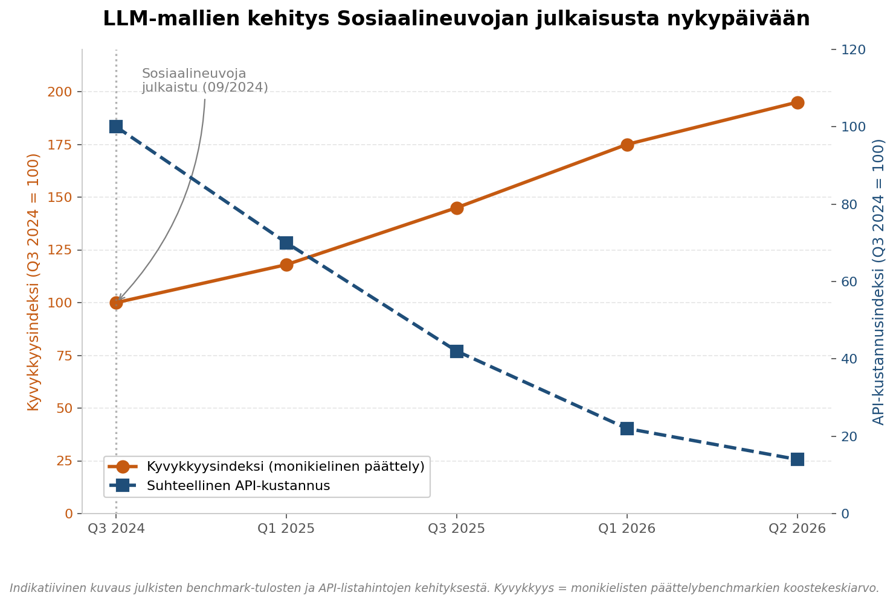
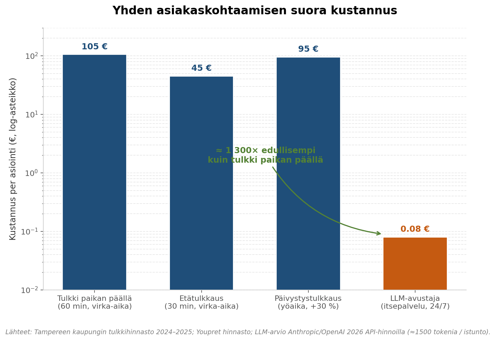
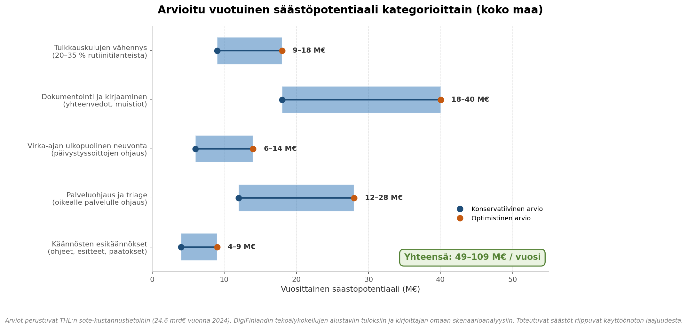
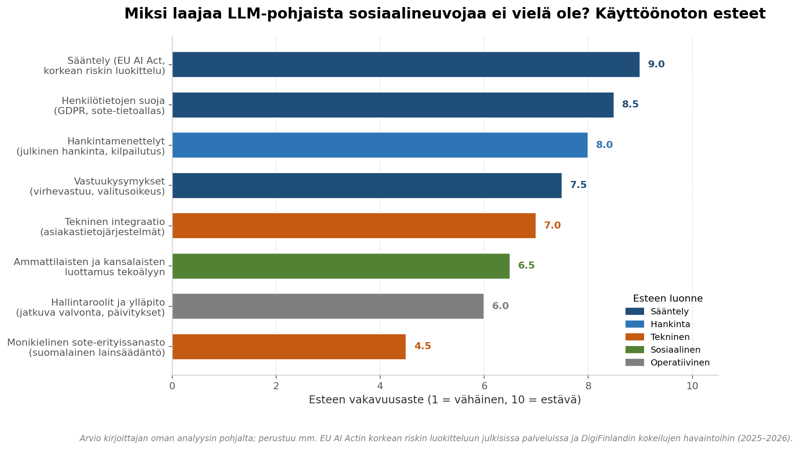

### Voiko LLM säästää sosiaalihuollon kuluissa? Kaksi vuotta Sosiaalineuvojan jälkeen

Syyskuussa 2024 julkaisin [Sosiaalineuvojan](https://chatgpt.com/g/g-hU6S3WmzG-sosiaalineuvoja) — neljällä kielellä toimivan virtuaalisen avustajan, jonka tehtävänä oli vastata sosionomien ja sosiaalityöntekijöiden tehtäviin liittyviin kysymyksiin. Opetin sille empaattisen lähestymistavan ja syötin sille Sosiaali- ja terveysministeriön (STM) lain tulkintaohjeet, jotta vastaukset olisivat sekä lainmukaisia että ihmisläheisiä.

Tuosta hetkestä on nyt lähes kaksi vuotta. Tässä artikkelissa kysyn rehellisesti: mitä laajamittainen vastaava ratkaisu olisi voinut maksaa — tai oikeastaan: paljonko se olisi voinut **säästää** — ja miksi sellaista ei vielä ole nähty.

---

#### LLM-mallien valtava harppaus 2024 → 2026

Sosiaalineuvojan julkaisuhetkellä huipputason kielimallit olivat juuri pystyneet luotettavaan suomen kielen käsittelyyn ja monikieliseen päättelyyn. Kahdessa vuodessa kaksi asiaa on muuttunut samanaikaisesti: mallien kyvykkyys on lähes kaksinkertaistunut monikielisten päättelybenchmarkien mukaan, ja API-kustannukset ovat samaan aikaan pudonneet noin 85 %.

Tämä on harvinainen yhdistelmä: parempaa palvelua selvästi halvemmalla. Vuonna 2024 yhden monimutkaisen tulkintapyynnön käsittely saattoi maksaa muutaman sentin; vuonna 2026 sama toiminnallisuus maksaa murto-osan. Samaan aikaan mallit hallitsevat aiempaa paremmin suomen kielen vivahteet, sote-erityissanaston ja maahanmuuttajakielten kuten darin, tigrinjan ja swahilin — eli kielet, jotka [DigiFinland mainitsee 2025 nousseen tyypillisten asiointikielten joukkoon hyvinvointialueilla](https://digifinland.fi/sote-tekoalyn-ekosysteemi/kokeiluprojektit/).

#### Sosiaalihuollon kustannuspaine on todellinen

Tuoreen THL:n tilastoraportin mukaan vuonna 2024 sosiaali- ja terveydenhuollon nettokäyttökustannukset olivat 24,6 miljardia euroa, eli 4 395 euroa asukasta kohti. Hyvinvointialueet ovat painineet alijäämien kanssa, ja STM on linjannut, että velvoitteita kevennetään tuottavuuden parantamiseksi. Tässä tilanteessa jokainen toteutuskelpoinen kustannussäästö on tutkimisen arvoinen.

Kahden konkreettisen kustannustekijän hahmottaminen auttaa arvioimaan LLM:n potentiaalia:

**Tulkkauskulut.** Tulkkauspalveluiden hinnoittelu sosiaali- ja terveyspalveluissa asettuu yleisesti 45–105 euron väliin per tulkkaustilanne, riippuen kielestä, kestosta ja kellonajasta. Tampereen kaupungin julkisen hinnaston mukaan oikeustulkkauksen perushinta on 69 euroa tunnilta + alv, ja klo 22–07 välisestä työstä peritään 30 % korotus. Päivystyksellinen ilta- ja yötulkkaus on kallista, ja sitä tarvitaan juuri silloin kun ammattilaisia on vähiten paikalla.

**Asiointimäärät vieraskielisten kanssa.** Yksin Keski-Suomessa vieraskielisten asiakkaiden määrä oli vuonna 2023 lähes 15 000 henkilöä. Koko maan tasolla vieraskielisiä sote-asiakkaita on satojatuhansia, ja asiointitilanteita kymmeniä — joskus satoja — kertaa enemmän. Suuri osa näistä tilanteista on rutiinineuvontaa: "mistä haen toimeentulotukea", "miten ilmoittaudun kotouttavalle kurssille", "mihin numeroon soitan, jos lapsen huostaanotto huolettaa".

#### Yhden kohtaamisen kustannusero

Kun verrataan saman asiointikohtaamisen toteuttamista tulkin tai LLM-avustajan kautta, mittakaavaero on dramaattinen:

LLM-avustajan suora kustannus per istunto on nykyhinnoilla noin 0,05–0,10 euroa — siis kolme suuruusluokkaa pienempi kuin tulkkaus. Tämä ei tarkoita, että LLM korvaisi tulkin: monimutkaisissa, tunnelatautuneissa tai oikeudellisesti merkittävissä tilanteissa pätevä ihmistulkki on edelleen välttämätön. Mutta jos LLM hoitaa ensikontaktin, antaa yleisneuvontaa, tarkistaa hakemustietojen täydellisyyden tai ohjaa oikealle palvelulle — eli juuri ne tehtävät, joihin Sosiaalineuvoja alun perin koulutettiin — tulkki säästyy oikeasti vaativiin tilanteisiin.

#### Säästöpotentiaali kategorioittain

Kun mallinnus tehdään realistisesti — eli ei oleteta LLM:n korvaavan ammattilaisia vaan täydentävän heitä — säästöpotentiaali jakautuu viiteen pääkategoriaan:

Suurin yksittäinen erä syntyy **dokumentoinnin ja kirjaamisen** automatisoinnista. Sosiaalityöntekijät käyttävät tutkitusti merkittävän osan työajastaan asiakaskirjauksiin ja muistioihin. Jos LLM tuottaa esitäytettyjä yhteenvetoja keskusteluista (joita ammattilainen tarkistaa ja korjaa), realistisesti puhutaan 18–40 miljoonan euron vuotuisista säästöistä koko maassa. Tämä on linjassa Keusoten 2026 alkaneen pilotin tavoitteiden kanssa, jossa noin 40 sosiaalihuollon ammattilaista käyttää asiakastietojärjestelmään integroituja tekoälytoimintoja, jotka voivat tiivistää asiakaskirjauksia ja auttaa tiedon löytämisessä.

**Tulkkauskulujen vähennys** rutiinitilanteista voisi konservatiivisesti tuoda 9–18 miljoonan euron vuotuiset säästöt. **Virka-ajan ulkopuolinen neuvonta** on omanlaisensa kategoria: nyt asiakas joko soittaa kalliiseen päivystykseen tai jättää asian. LLM voi vastata yön aikana ilman lisäkustannuksia, mikä tuo arviolta 6–14 miljoonan euron säästön ohjauskustannuksissa.

Kokonaisuutena puhutaan **49–109 miljoonan euron** vuotuisesta säästöpotentiaalista — alle puolesta prosentista koko sote-budjetista, mutta moninkertaisesti enemmän kuin DigiFinlandin koko nykyisen tekoälykokeiluohjelman 2,3 miljoonan euron rahoitus.

#### Mitä Sosiaalineuvoja jo osoitti — ja missä se jäi vajaaksi

Sosiaalineuvojan keskeinen oivallus oli, että pelkkä tieto ei riitä. Sille opetettiin **empaattinen kohtaamistapa** STM:n ohjausmateriaalin rinnalla, koska sosiaalineuvonnassa kysymys on aina myös ihmisen kohtaamisesta — ei vain pykälien hakemisesta. Vuoden 2024 mallit pystyivät tähän rajatusti; vuoden 2026 mallit pystyvät siihen paljon paremmin.

Samalla on rehellistä todeta, mitä Sosiaalineuvoja **ei** pystynyt tekemään: se ei integroitunut hyvinvointialueiden asiakastietojärjestelmiin, sillä ei ollut kytkentää Kelan etuusjärjestelmään, eikä se voinut tehdä päätöksiä — eikä tee jatkossakaan, koska Suomen voimassa oleva lainsäädäntö automaattisesta päätöksenteosta ei koske oppivia järjestelmiä, ja koneoppivia järjestelmiä voidaan käyttää työn tukena, myös hallinnossa, mutta ei päätöksenteossa ainakaan toistaiseksi.

Tämä rajaus on tärkeä: LLM ei korvaa sosiaalityöntekijää, vaan toimii tämän työparina. Päätöksenteon ja vastuun on pysyttävä ihmisellä.

#### Miksi laajaa LLM-pohjaista sosiaalineuvojaa ei vielä ole?

Tämä on minulle Sosiaalineuvojan tekijänä se kysymys, joka todella kiinnostaa. Tekniikka on ollut riittävä jo kaksi vuotta, hinta on romahtanut, ja DigiFinlandin 2,3 miljoonan euron tekoälykokeilut osoittavat, että halua on. Silti laajaa, kansallisesti yhtenäistä LLM-pohjaista sosiaalineuvojaa ei ole. Esteet jakautuvat selkeisiin luokkiin:

**Sääntely on suurin yksittäinen este.** EU:n tekoälyasetus (AI Act) luokittelee julkisten palveluiden tekoälysovellukset tyypillisesti korkean riskin järjestelmiksi. Tämä ei kiellä niitä, mutta asettaa merkittäviä dokumentointi-, valvonta- ja vaatimustenmukaisuusvelvoitteita. Suomalaisten asiakas- ja potilastietojärjestelmien suuri osa kuuluu EU:n tekoälysäädöksen korkean riskin soveltamisaloihin, mikä koskee myös sote-asiakkaiden ohjausta tekevää LLM:ää.

**Henkilötietojen suoja** on toinen merkittävä jarru. Sosiaalihuollon asiakastiedot ovat erityistä henkilötietoa GDPR:n näkökulmasta, ja käytännössä tämä tarkoittaa, että geneerisiä yleishyödykkeenä saatavia LLM-API:ta ei voi käyttää suoraan. Tarvitaan Suomen tai EU-alueen sisällä isännöityä, sopimuksellisesti suojattua ratkaisua. Tämä on teknisesti ratkaistavissa, mutta nostaa kustannuksia ja monimutkaistaa hankintaa.

**Hankintamenettelyt** ovat oma maailmansa. Hyvinvointialueet ovat suuria julkisia toimijoita, joiden hankintojen on noudatettava julkista hankintalainsäädäntöä. LLM-pohjaisen ratkaisun määrittely riittävän tarkasti tarjouspyyntöön on vaikeaa, koska teknologia kehittyy nopeammin kuin kilpailutusprosessi etenee.

**Vastuukysymykset** estävät rohkeita kokeiluja. Jos LLM antaa virheellistä neuvontaa toimeentulotuesta tai lastensuojelusta, kuka kantaa vastuun? Sosiaalityöntekijä, joka käytti työkalua? Hyvinvointialue tilaajana? Toimittaja? Tämä on kysymys, johon ei vielä ole selkeää oikeudellista vastausta.

**Tekninen integraatio** on aliarvioitu este. Hyvinvointialueilla on käytössä kymmeniä asiakastietojärjestelmiä, joista monet pohjautuvat 1990- ja 2000-lukujen arkkitehtuuriin. LLM:n hyöty kasvaa eksponentiaalisesti, jos se voi nähdä asiakkaan aiemmat asiakaskirjaukset; ilman integraatiota se on vain älykkäämpi hakukone.

**Luottamus** rakentuu hitaasti. Päijät-Hämeen hyvinvointialueen tekoälychatbotti kävi joulukuussa lähes 750 keskustelua ja sai yli 1 000 viestiä. Luvut ovat lupaavia, mutta kansallisesti yhtenäisestä, miljoonien suomalaisten käyttämästä neuvojasta ollaan vielä kaukana.

#### Miksi tämä silti tapahtuu — viimeistään lähivuosina

Esteet ovat todellisia, mutta yksikään niistä ei ole pysyvä. EU AI Actin korkean riskin järjestelmien vaatimuksia tarkennetaan parhaillaan; suomalaiset hyvinvointialueet ovat tunnistaneet tarpeen ja DigiFinland koordinoi kokeiluja; tietosuojalliset rajaukset ratkeavat EU-isännöidyillä malleilla. Päijät-Hämeen, Vantaan ja Keravan sekä Keusoten pilotit ovat ensimmäiset askeleet — eivät vielä täyttä Sosiaalineuvojaa, mutta saman polun ensimmäisiä etappeja.

Kun arvioin omaa työtäni Sosiaalineuvojan parissa kahden vuoden takaa, olen yhtä aikaa ylpeä ja maltillinen. Se osoitti, että pienelläkin panostuksella voi rakentaa monikielisen, empaattisen ja lakitiedoltaan kelvollisen avustajan. Se ei korvannut yhtäkään sosiaalityöntekijää, eikä sen ollut tarkoituskaan. Mutta se osoitti suunnan.

Seuraavat kaksi vuotta ratkaisevat, kasvaako tästä siemenestä todellinen kansallinen palvelu, vai jääkö se yksittäisten pilottien tasolle. Säästöpotentiaali on niin suuri, että varaa odottaa ei oikeastaan ole.

---

*Sosiaalineuvoja on edelleen löydettävissä [täältä](https://chatgpt.com/g/g-hU6S3WmzG-sosiaalineuvoja). Tämä artikkeli ei ole akateeminen tutkimus vaan kirjoittajan oma arvio julkisten lähteiden ja oman kokemuksen pohjalta. Säästöarviot ovat skenaariolaskelmia, eivät ennusteita.*
