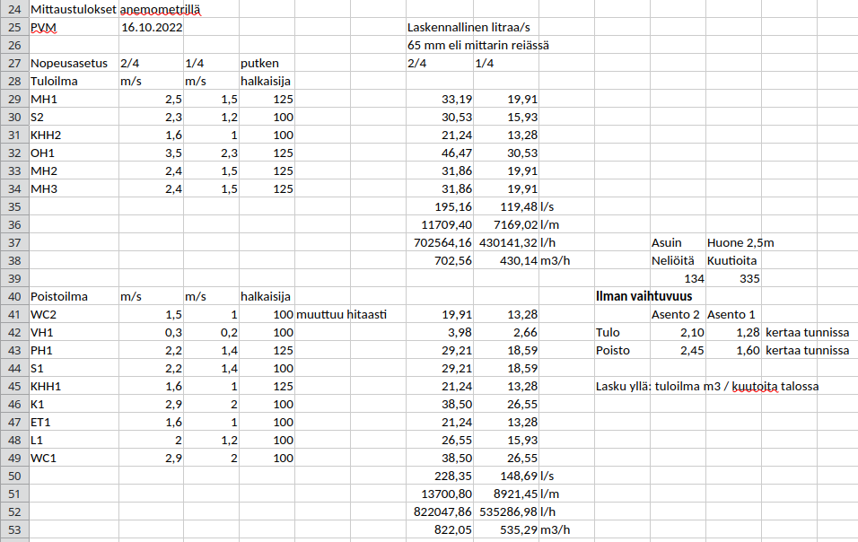
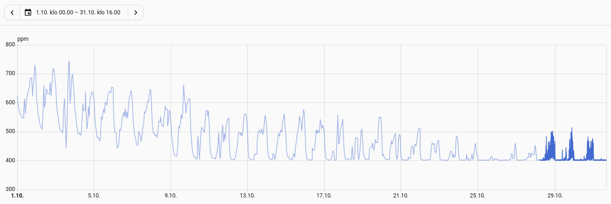
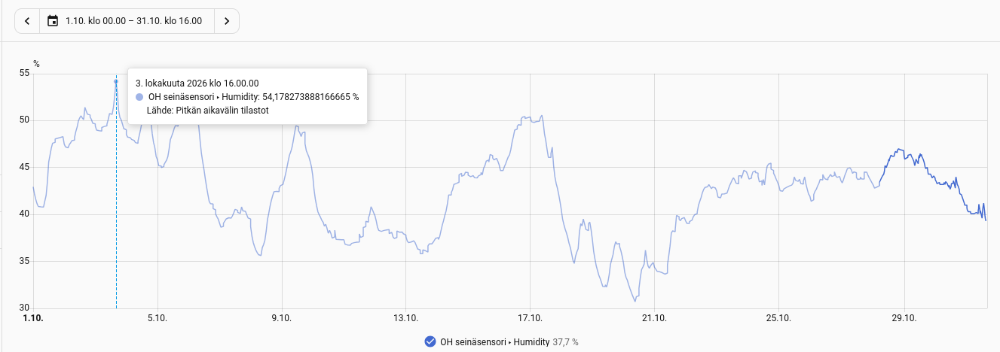
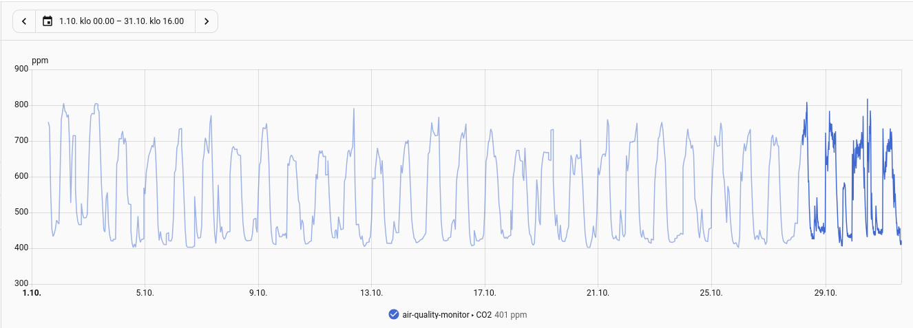
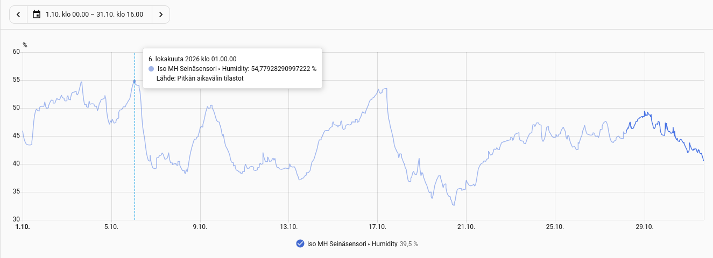
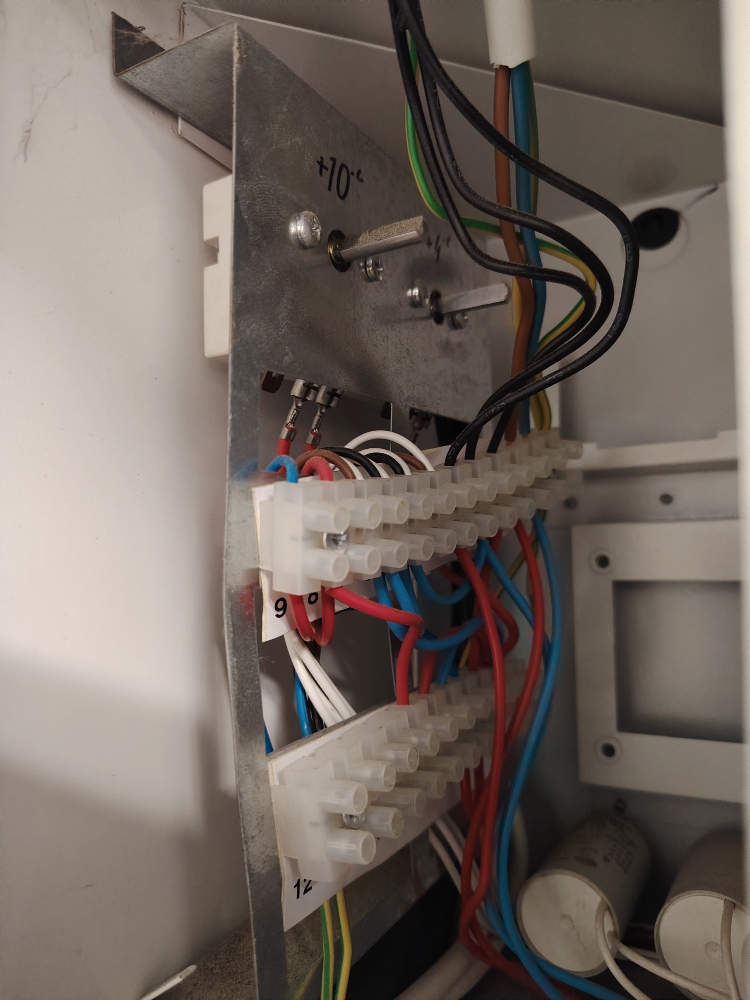
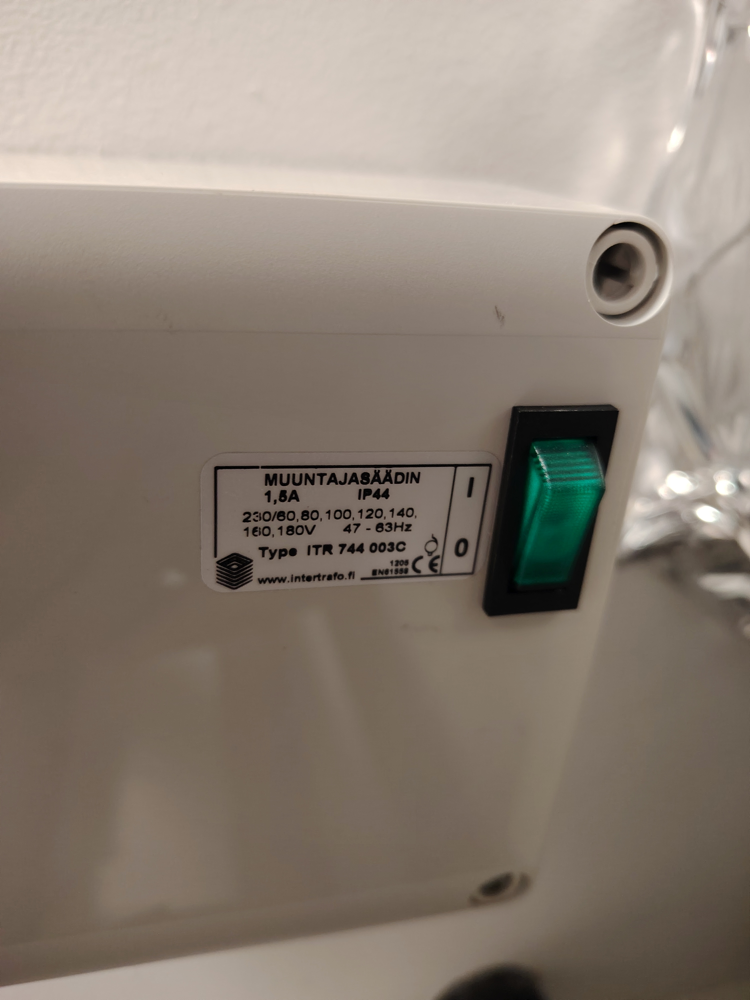
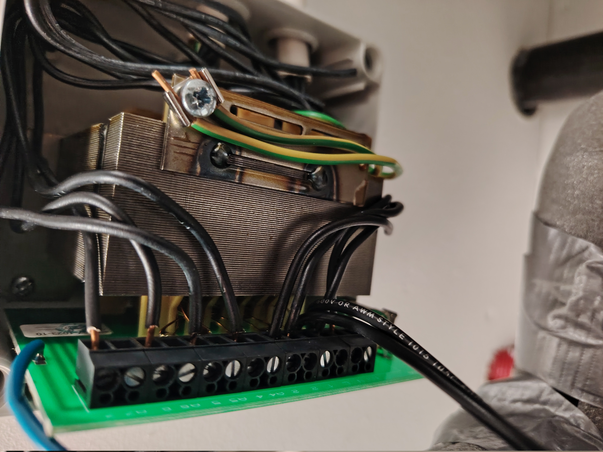
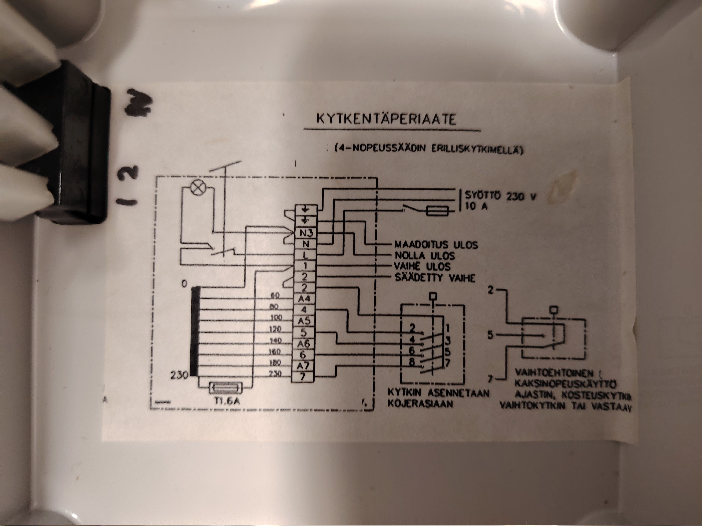

Suunnittelen parhaillani Onnline 130 -ilmanvaihtokoneeni etähallintaa Home Assistantin avulla. Matkan varrella olen törmännyt sekä suunnitteluvirheisiin että puutteelliseen dokumentaatioon, mutta myös oivaltanut, miten laitetta voisi ohjata fiksummin. Tässä tarinassa yhdistyvät datan keruu, purkutyöt ja tulevaisuuden suunnitelmat.

## Liian suuret ilmamäärät

Olen aiemmin käsitellyt ilmanvaihtkoneeseen tekemieni sensoreiden toimintaa englanninkielisissä artikkeleissa [From Hobby Chickens to the IoT World — Part 2](https://ollavarma-create.github.io/blog/en/posts/from-hobby-chickens-to-the-iot-world-part-2/) ja [From Hobby Chickens to the IoT World — Part 4](https://ollavarma-create.github.io/blog/en/posts/from-hobby-chickens-to-the-iot-world-part-4/). Artikkeleissa olen virheellisesti viitannut ILTO440-laitteeseen. Todellisuudessa kyse on **Onnline 130-mallista**, joka on karsittu versio ILTO430:sta. 

Karsitussa mallissa ei ole oikeastaan minkäänlaista automaatiota. Kesäpelti on ruuvattava, ja samalla kun se laitetaan lämmönvaihtokennon päälle, avautuu ohituskanava. Tässä on mielestäni selkeä suunnitteluvirhe: tuloilma virtaa ohituskanavan kautta suoraan tiheään hienosuodattimeen, jolloin kaikki ötökät ja roskat tukkivat sen. Ratkaisin ongelman leikkaamalla sentin paksuista aktiivihiilisuodatinkangasta ja kiinnittämällä sen neodyymimagneeteilla hienosuodattimen eteen. Näin roskat jäävät karkeasuodattimeen.

Lisäksi anemometrillä tekemieni [ilmamäärämittausteni ja laskelmieni](Ilmamaaramittaukset.xlsx) perusteella vaihdettava ilmamäärä on aivan liian suuri alimmalla "kotona"-asetuksella (vaihtokytkimen asento 2/4). Poissaoloasetus on 1/4 ja tehostusasennot ovat 3/4 ja 4/4.

|Suure|	Asento 2 (2/4)|	Asento 1 (1/4)|
|-----|---------------|----------------|
|Tuloilma yhteensä|	~96,7 l/s|	~60,9 l/s|
|Poistoilma yhteensä|	~110,6 l/s|	~70,7 l/s|
|Ilmanvaihtuvuus (tulo)|	~1,15 1/h|	~0,72 1/h|
|Ilmanvaihtuvuus (poisto)|	~1,31 1/h|	~0,84 1/h|

Sisätilan ilma vaihdetaan normaaliasetuksella yli 2,3 kertaa tunnissa ja poissaoloasetuksella noin 1,5 kertaa tunnissa. Suomen rakentamismääräysten mukainen minimipoisto asunnoille on tyypillisesti 0,35–0,5 1/h. Mittausteni mukaan asennossa 1 poisto on jo ~0,84 1/h eli reilusti yli minimin. Asennossa 2 poisto on ~1,31 1/h, mikä on noin 2,5–3 kertaa minimi. Tämä on selvä yliventilointi, koska sisäilman laatu on pysynyt erinomaisena.

Esimerkiksi lokakuu on tyypillisesti kostea kuukausi. Vuonna 2026 mittausten mukaan olohuoneessa on CO2 tasot olleet alle 800 ppm ja laskeneet noin 500 ppm (vaihtelua selittää henkilömäärä ja filttereiden vaihto IV-koneeseen):

Samoin kosteus on pysynyt koko lokakuun alle 55 prosentissa:

Myös makuuhuoneessa tilanne on ollut hyvä. Piikit ovat hieman yli 800 ppm aamuyön tunteina, ja kosteus on hallinnassa. Käytännössä makuuhuoneessa on pakko käyttää kosteutinta, mistä kirjoitinkin artikkelissa [Yksinkertaisen ilmankostuttimen odottamaton vaikutus: datavetoinen matka](https://ollavarma-create.github.io/blog/fi/posts/humidizer-problem/)

Koska minulla on paljon dataa Home Assistantissa, InfluxDB:ssä ja Grafana-laskentaa varten, on luonnollisesti järkevää pohtia, miten voisin optimoida ilmanvaihtoa siten, että energiahukka ja haitat rakennukselle olisivat mahdollisimman pienet. Tavoitteena on pitää epäpuhtaudet poissa, CO2- ja Rh-tasot riittävän matalina ja rakennuksen vaipan paineistus suhteessa ulkoilmaan sopivana.

## Dokumentaation puutteen kanssa painiminen

Ongelmaksi muodostui se, että [Onnline 130 ohjekirjasta](Onnline130Ohjekirja.pdf) miten säätö on toteutettu. Olohuoneen seinässä on neliportainen kiertokytkin (asennot 1–4). Kytkimen kärjet näkyvät ohjekirjan sivulla 9, ja ne menevät Onnline-yksikön kautta X2-riviliittimeen. Sivulla 11 mainitaan, että Onnline-yksiköstä voi valita kolme puhallinnopeutta kuudestatoista. Missään ei kuitenkaan kerrota, mikä tämä ohjausyksikkö on tai voisiko ohjausta korvata esimerkiksi ESP32:lla ja releistyksellä.

Swegonin tuki on pyrkinyt auttamaan parhaansa mukaan, mutta heilläkään ei oikein ole kunnon dokumentaatiota Onnline 130:sta. Mikäli haluaisin vaihtaa koko laitteen, tuen mukaan uudempaa Genius-saneerauskonemallia tullaan myymään vuoden sisällä. Se sopisi samoihin kanavalähtöihin, kun taas muissa konemalleissa joutuisi tekemään kanavamuutoksia.

## Miten säätö on lopulta tehty?

Koska manuaaleista ei ollut apua, oli pakko katkaista virrat ja purkaa hieman ilmanvaihtokonetta. Vasemman paneelin avaamisen jälkeen paljastui pieni "käärmeenpesä", jossa vaikuttavat olevan moottoreiden startterikondensaattorit ja jälkilämmityspatterin termostaatit (säädetty +10 °C ja +4 °C).

Koneen sisältä ei siis löytynyt jumppereita tai asetuksia moottoreiden nopeuden ohjaamiseen. Katosta löytyi kuitenkin ITR 744 003C -merkinnällä varustettu muuntajasäädin.

Säätimen sisältä löytyy yksinkertainen muuntaja, jolle olohuoneen säätimen 7x1.5 MMJ -kaapeli tulee.

Säätimen kannen sisäpuolella on onneksi kytkentäperiaate. Siitä selviää, että muuntajan riviliittimeen tulee jännitteitä 60–230 volttia ja että asennossa 2 kytketään liittimen 4 jännite (80 volttia). Mikäli liittimessä on A-kirjain edessä, se tarkoittaa 20 volttia pienempää jännitettä – esimerkiksi A4 tarkoittaa 60 volttia.

## Tulevat askeleet: Kohti älykästä ohjausta

Loogisinta on tässä vaiheessa laskea kytkimen asennon 2 (läsnäolo, alin nopeus) jännitettä 60 volttiin siirtämällä johto liitinrimalla paikasta 4 paikkaan A4. Tämän lisäksi suunnittelen ESP32:lla toteutettavaa releohjausta, joka kytketään säädinyksikön tehostustulon ohjaukseen. Tehostustulon ohjauksen voi toteuttaa esimerkiksi tarkkailemalla CO2-tasoja, läsnäoloantureiden tietoja tai Rh-tasoja.

Periaatteessa koko 4-asentoinen kytkin olisi korvattavissa sopivalla releistyksellä, mutta single point of failure -näkökulmasta on järkevämpää toteuttaa ohjaus siten, että jos Home Assistant tai releistys vioittuu, pysyy talon ilmanvaihto päällä. Teen toteutuksesta erillisen blogitekstin sitten, kun olen saanut ohjauksen valmiiksi.