Ouman EH-203 on vanha mutta edelleen käyttökelpoinen lämmityksensäädin. Hankin käytetyn säätimen ESPHome- ja [Home Assistant -kehitystä](https://ollavarma-create.github.io/blog/fi/posts/ouman-trend-windows11/) varten ja varasäätimeksi. Säätimiä myydään käytettynä Tori.fi:ssä noin 100-250 euron hintaan, mutta niiden kunnosta ei todellisuudessa tiedä ennen testaamista. Ensimmäinen ostamani laite osoittautui kuitenkin vialliseksi, vaikka myyjä oli vakuuttanut sen toimivan. Ei ollut. Säätimestä puuttui sarjaliikennepiiri SP202ECP, näyttö roikkui irtonaisena pelkän lattakaapelin varassa (kiinnitysrivat katkenneet) ja kaiken lisäksi säädin ei lähtenyt käyntiin joka kerran. Sitten kun lähti käyntiin, sammui itsekseen. Onneksi olin maksanut 100 euroa + 9 euroa Toridiilillä. Lopulta sain laitteesta 100 euroa takaisin. Tappio siis 9 euroa. 

Seuraavaksi tilasin myyjän mukaan toukokuussa 2026 vesilämpöpumpun asennuksen yhteydessä tarpeettomaksi jääneen säätimen. Tämä säädin toimii oikein. Säädin on vuodelta 2010, firmware 2.15.

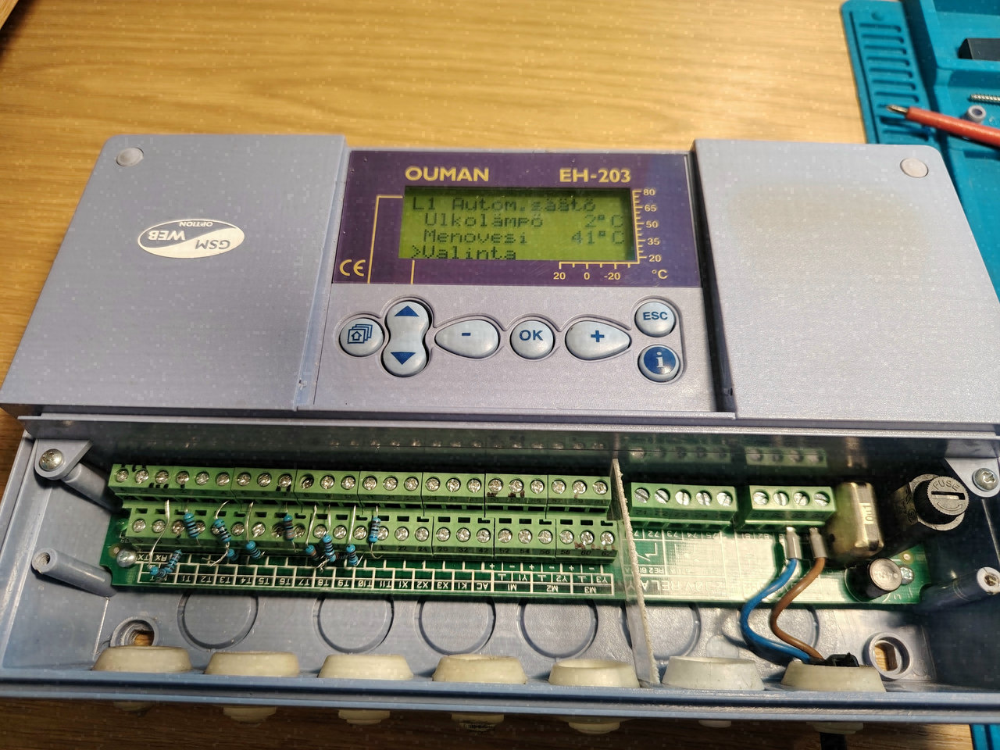
*Varasäädin maksoi postikuluineen 80€ ja vastuksilla testattuna toimii oikein*

Testattuani varasäätimen, päätin siirtää kaukolämpökeskuksessani olevasta EH-203:sta asetustietoja varasäätimeen ja huomasin, että vanha vika on tullut takaisin: **LCD-näytön merkit menivät ajoittain sekaisin.** Virtojen katkaiseminen ja uudelleenkytkeminen saattoi auttaa, mutta vain joksikin aikaa. Vaihdoin kyseisen näyttömoduulin (maksoi Tori.fi:ssä 30€) noin vuosi sitten. Nyt minulla on kaksi viallista näyttömoduulia. Näyttömoduulin ongelma ei onneksi vaikuta itse säätimen toimintaan.

Oumanin tuen mukaan tämä vika esiintyy säätimissä, jotka ovat olleet kuumissa olosuhteissa, esimerkiksi kaukolämpökeskuksissa. Moduuli on valmistettu Kiinassa eikä sitä ole enää saatavilla. Omassa kaukolämpökeskuksessani säädin on kiinnitetty peltiin, joka on kiinni lämmönvaihtimelta lähtevässä putkessa, eli säädin on lähtökohtaisesti aivan liian kuumassa paikassa. Kotelossa tämä näkyy oikealla puolella olevasta tummentumasta säätimen virtalähteen kohdalla.

Koska minulla on vanha näyttömoduuli, jota voi rauhassa tutkia ja korjata, päätin avata laitteen ja selvittää, onko kyse korjattavasta kontaktiviasta vai jostakin hankalammasta. Kirjaan tähän myös purkamisen sudenkuopat, sillä ne voivat säästää seuraavalta korjaajalta yhden rikkoutuneen muoviosan.

> **Turvallisuus:** EH-203 on verkkosähköön kytkettävä laite. Irrota syöttöjännite kokonaan ennen kotelon avaamista. Tässä kuvattu LCD-moduulin purkaminen ja puhdistus tehtiin jännitteettömänä. Älä koske verkkosähköpuolen rakenteisiin tai mittaa niitä jännitteisinä ilman asianmukaista osaamista ja välineitä.

## Oire: merkit sekoilevat, näppäimet toimivat

Ongelma näkyi nimenomaan näytössä: teksti muuttui virheelliseksi, vaikka näppäimet toimivat normaalisti. Virran katkaiseminen palautti näytön yleensä toimintakuntoon. Se ei vielä todistanut, että vika olisi itse LCD:ssä. Mahdollisia selityksiä olivat esimerkiksi kontaktihäiriö, näyttöohjaus tai käyttöjännitteeseen liittyvä ongelma.

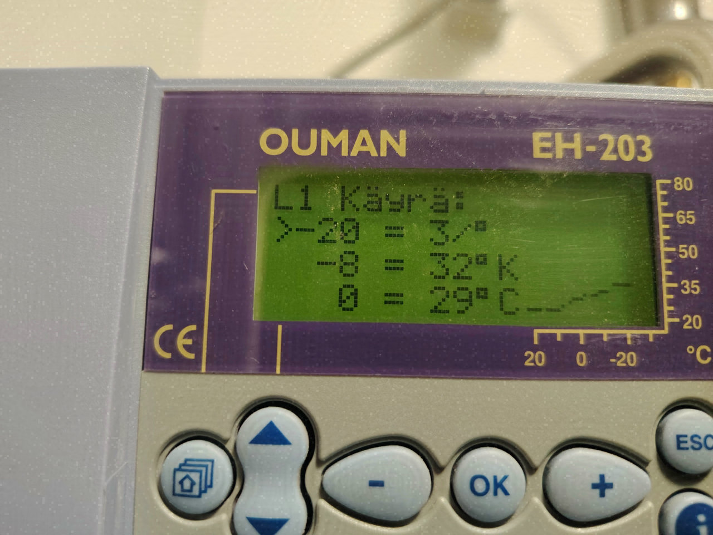
*Näytöllä olevat merkit sekoilevat ja on todella hankala asettaa asetusarvoja.*

## Näyttömoduuli irti

Näytön irrottamisen jälkeen selvisi, että rakenne on perinteinen: LCD-lasi on puristettu piirilevyä vasten kahden pitkän **zebrakumin** avulla. Zebrakumi koostuu vuorottelevista johtavista ja eristävistä kerroksista, jotka välittävät signaalit piirilevyn kontaktiraidoilta LCD-lasin elektrodeille ilman juotoksia.

Näytön muovinen kuori on kiinni kahdella ruuvilla ja kaksipuoleisella teipillä. Kuoren mukana irtoaa myös kalvonäppäimistö. Näytön takapuolella on metallinen suojalevy, jonka tehtävänä on todennäköisesti vähentää sähkömagneettisia häiriöitä. Pelti on kiinni myös tiukalla kaksipuolisella tarralla ja siitä lähtee myös piirilevyn keskiosaan juotettu johdin, joka on irrotettava juottamalla. Kaksipuolisen tarran voi rikkoa varovasti ruuvimeisselillä tai siistimmin vaikka mattoveitsellä.

Näytön piirilevyn takapuolella on kolme mustan massan alle koteloitua piiriä, merkitty U1–U3. Niiden korjaaminen ei ole tässä käytännöllinen vaihtoehto. Piirilevyn läpivientejä ja juotoksia tarkastelin mikroskoopilla, mutta en löytänyt selvää vauriota.

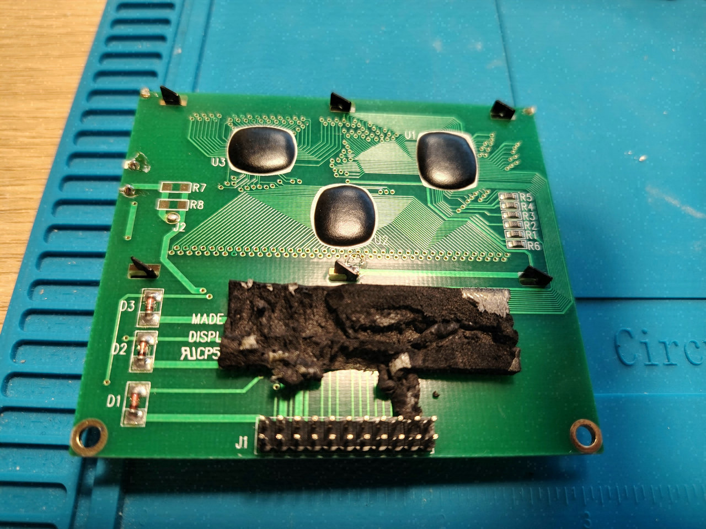
*Näyttömoduulin piirilevy takaa, U1–U3*

Kuvassa näkyy piirilevy takaa. Kiinnistä huomiota mustiin LCD-moduulia kiinnipitävän peltikehyksen hakasiin. Älä avaa niitä vielä!

### Merkitse LCD-lasin suunta ennen irrottamista

**Tämä on tärkeä vaihe.** Tein tussilla pienen merkin LCD-lasin vasempaan yläkulmaan ennen irrottamista, jotta osasin asentaa sen takaisin täsmälleen samaan suuntaan. Lasin kääntäminen väärin päin voi estää näyttöä toimimasta oikein, vaikka kaikki kontaktit olisivat puhtaat. Merkin paikka kannattaa valita niin, ettei se häiritse näkyvää kuva-aluetta eikä kontaktipintoja, joskin isopropanolilla (IPA), jota käytin puhdistukseen, irrottaa myös permanent-tussin jäljet.

Seuraavassa vaiheessa avataan moduuli kääntämällä hakaset piirilevyn aukon suuntaisesti. Koottaessa kannattaa huomata se, että kyseinen pelti painaa LCD:n zebrakumeja piirilevyyn ja jos kehys jää löysäksi, voi merkkejä hävitä esimerkiksi reunoilta kuten alla minulle kävi. 

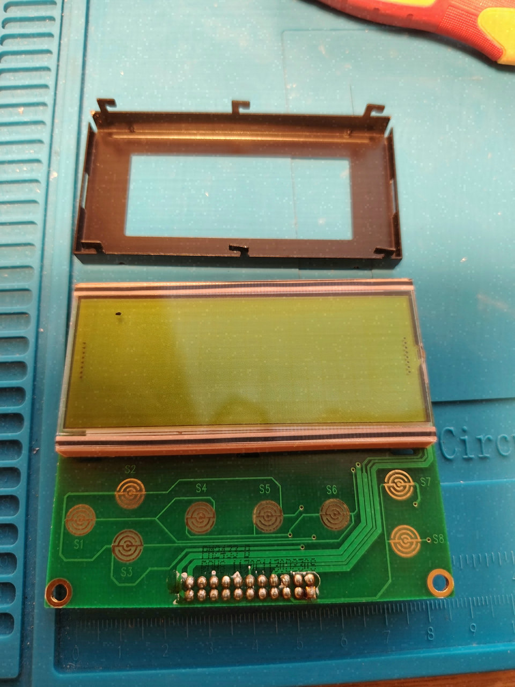
*LCD-moduulin peltinen kehys irrotettuna.*

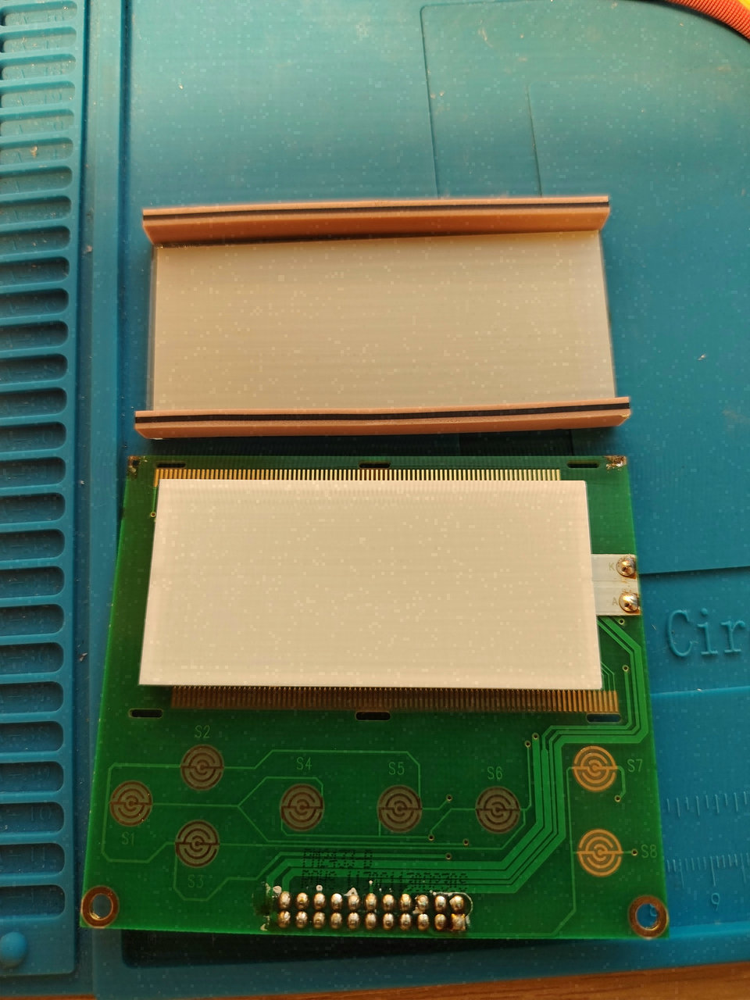
*LCD-moduuli avattuna ja taustavaloelementti (valkea osa) näkyvillä.*

## Zebrakumien irrottaminen

Zebrakumit tuntuivat aluksi olevan tiukasti kiinni. Niitä ei kuitenkaan tarvinnut repiä tai kammeta työkalulla. Käytin seuraavaa tapaa:

1. Painoin zebrakumia varovasti sormella **piirilevyn puoleiselta reunalta**, jolloin se alkoi irrota.
2. Jatkoin yhtä varovasti **LCD-lasin puoleisesta päästä**.
3. Kun kumi oli irti molemmista kosketuspinnoista, sain sen nostettua pois.

Kumit tuntuivat melko kovettuneilta. Mikroskoopissa niiden pinnoilla näkyi epätasaisuutta, mutta pelkän ulkonäön perusteella ei voi varmasti päätellä, oliko kyse hapettumisesta, liasta vai materiaalin ikääntymisestä.

En ollut dokumentoinut zebrakumien alkuperäistä asentoa yhtä tarkasti kuin LCD-lasin suuntaa. Kumien kohdalla tärkeintä on, että ne asettuvat oikeille kontaktialueille, pysyvät suorina ja puristuvat tasaisesti. Niiden mahdollinen rakenteellinen epäsymmetria kannattaa silti tarkistaa ennen asennusta.

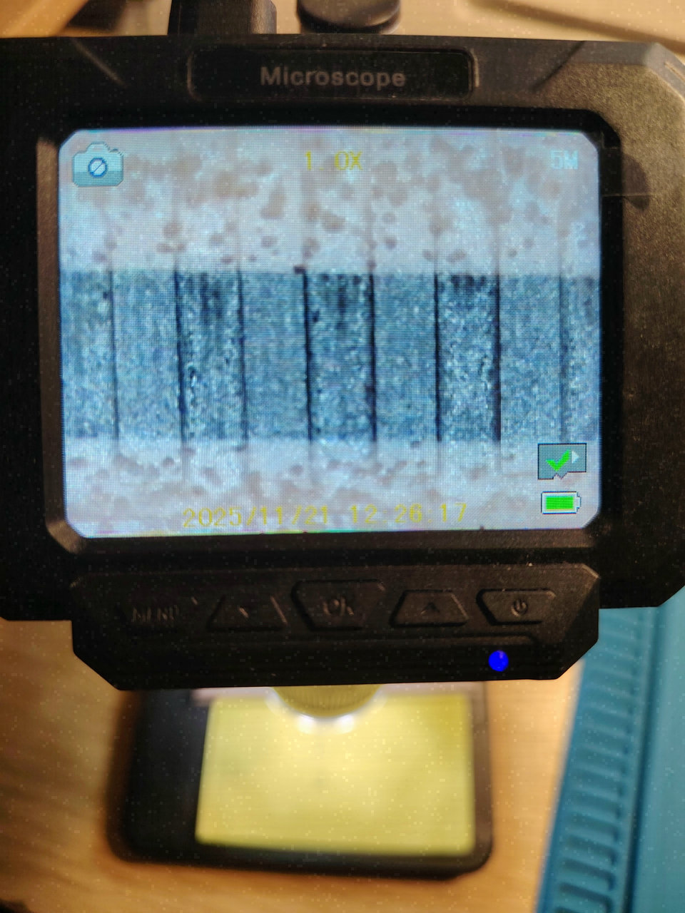
*Zebrakumin pinta mikroskoopilla*

Zebrakumien kontaktipinta piirilevyllä vaikutti olevan siisti, ei hapettumia tai halkeamia.

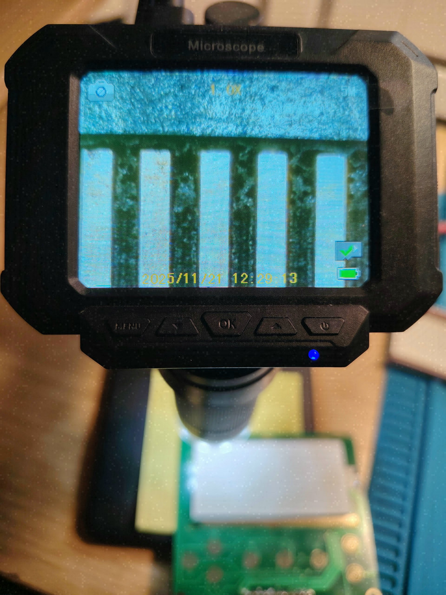
*Kontaktipinta mikroskoopilla*

## Läpivientien tutkiminen

Tutkin mikroskoopilla myös piirilevyn läpivientejä ja juotoskohtia. Sitä varten minun piti juottaa irti LCD:n taustavaloelementti. Silmämääräisesti en havainnut selvää katkeamaa tai muuta yksittäistä vikakohtaa. Lämpötilan vaihtelu voi periaatteessa paljastaa huonon liitoksen, mutta sitä ei voi todeta luotettavasti pelkästä kuvasta. 

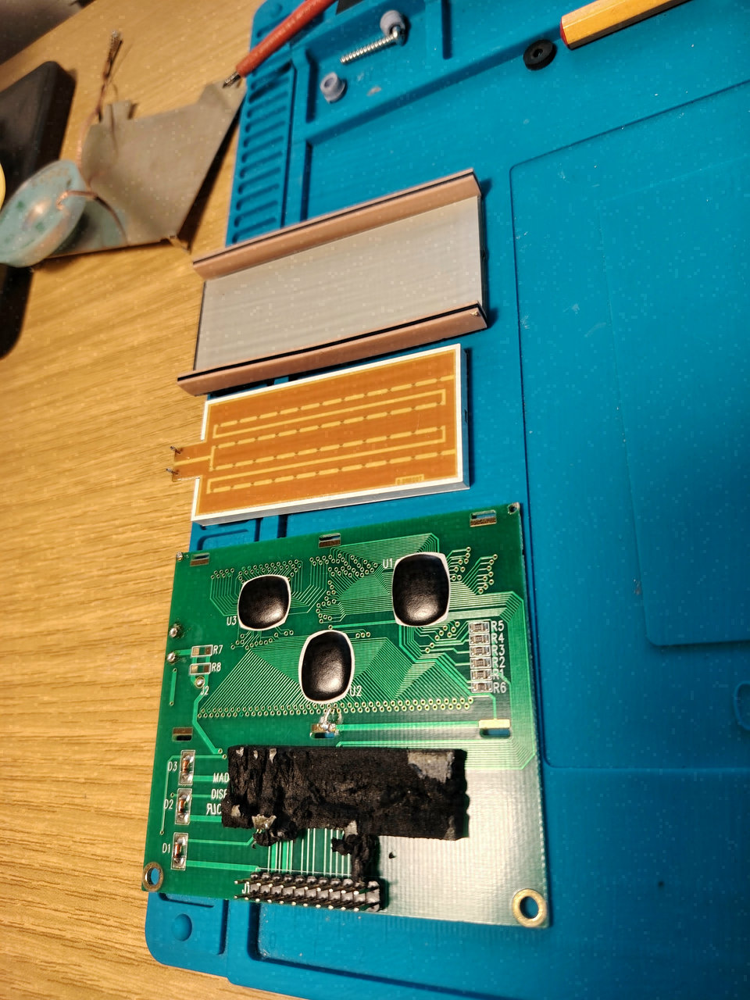
*Kuvassa piirilevy, taustavalo juotettuna irti ja LCD jossa vielä zebrakumit kiinni.*

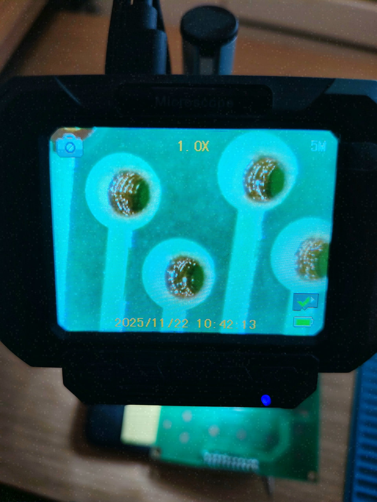
*Mikroskooppikuva läpivienneistä.*

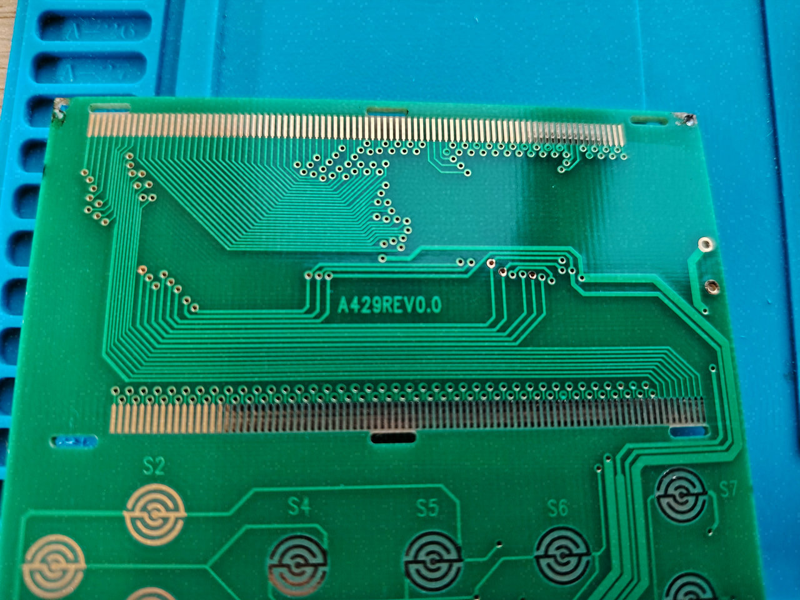
*Piirilevy.*

Vaikka kävin koko piirilevyn mikroskoopilla läpi, en nähnyt ongelmia. 

## Puhdistus isopropyylialkoholilla

Puhdistin piirilevyn kontaktiraidat, zebrakumit ja muut irrotetut osat **99,9-prosenttisella isopropyylialkoholilla (IPA)** ja annoin niiden kuivua ennen kokoamista. Puhdistus tehtiin kevyesti, ilman voimakasta hankaamista. Liuottimen joutumista polarisaattorikalvojen reunoihin ja liimauksiin kannattaa kuitenkin välttää.

LCD-lasin kontaktialueet ovat herkkiä. Niitä ei pidä raapia, eikä kumien pintoja kannata hangata voimalla. Yleensä IPA:n soveltuvuus kannattaa varmistaa käytettävälle materiaalille, erityisesti muoveille, liimoille ja polarisaattorikalvoille. Tässä tapauksessa puhdistus ei aiheuttanut havaittavaa vauriota.

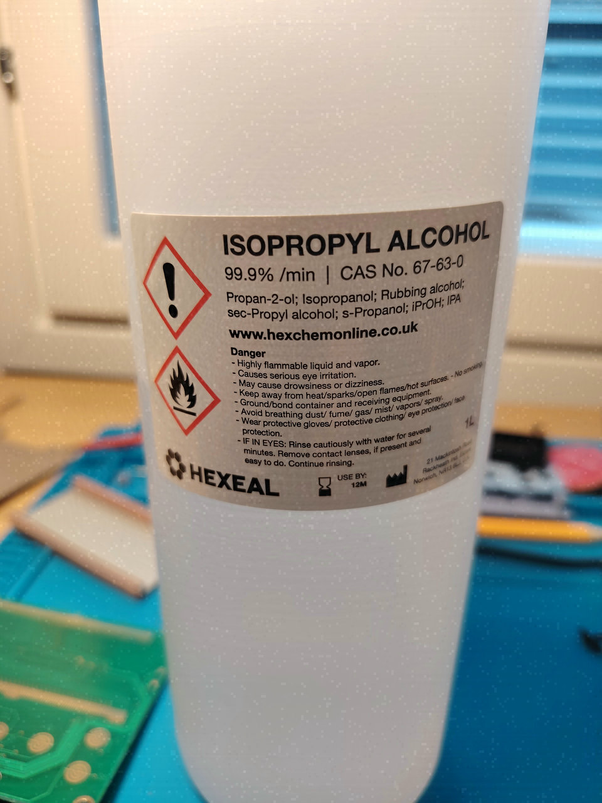
*Ostin koronapandemian aikaan useita litroja IPA:aa varastoon ja siksi näin iso pullo.*

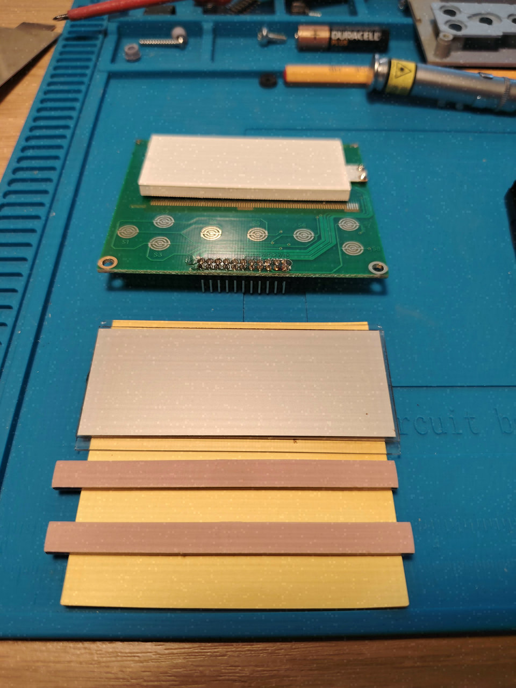
*Puhdistetut osat kuivumassa ennen kokoamista. LCD taustavalo juotettuna takaisin paikoilleen.*

## Kokoaminen: puristus ratkaisee

Koottaessa pitää käyttää kaksipuolista vahvaa teippiä näytön yläreunassa.
Koottaessa havaitsin näytössä olevan vielä suojamuovin paikallaan. Koottuna näyttömoduuli oli kuin uusi!

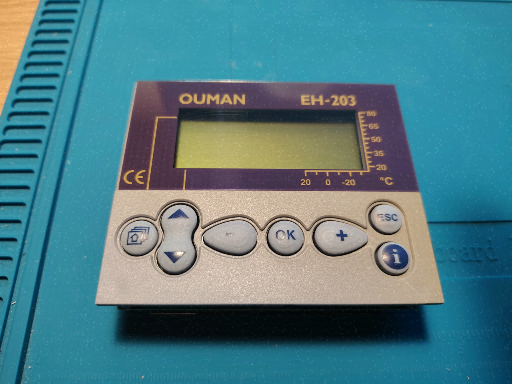
*Lähes uutta vastaavan näköinen näyttö.*

Ensimmäisen kokoamisen jälkeen näyttö heräsi, mutta **vasemmasta reunasta puuttui merkkejä**. Tämä oli hyödyllinen havainto: ongelma korjaantui, kun säädin mustan kiinnityskehikon metallisia lipareita niin, että kehikko puristi LCD-lasia ja zebrakumia paremmin piirilevyä vasten.

Kyse ei siis siinä vaiheessa ollut ohjelmistosta tai näytön ohjaimesta, vaan selvästä mekaanisesta kontaktihäiriöstä. Myös näppäimistön asennuksessa oli huolehdittava osien oikeasta asettumisesta ja puristuksesta.

**Älä kuitenkaan kiristä kehikkoa tai paina lasia väkisin.** LCD-lasi voi rikkoutua, ja liian epätasainen puristus saattaa jopa pahentaa kontaktihäiriötä.

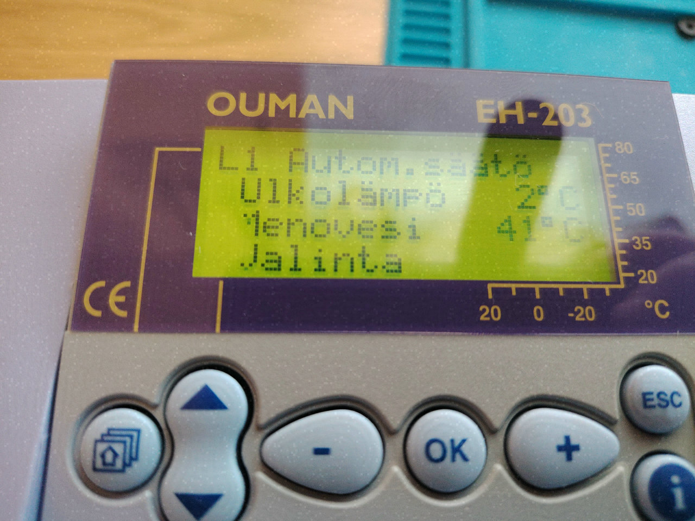
*Ensimmäinen kokoaminen, vasemman reunan puuttuvat merkit*

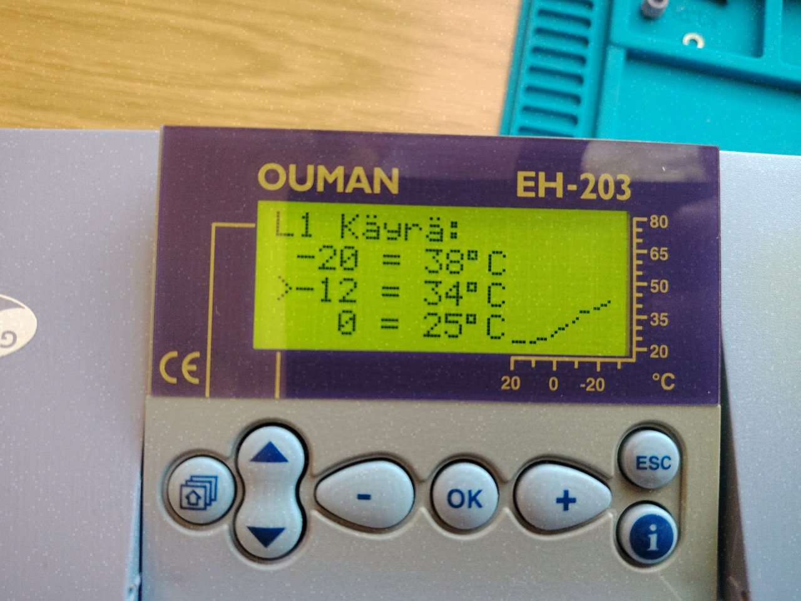
*Näyttömoduuli toiminnassa kehikon säädön jälkeen*

## Varo vanhaa muovia

EH-203:n muoviosat osoittautuivat todella hauraiksi. Kiinnitysruuveja ei kannata vetää tiukalle: muovinen ruuvin istukka voi haljeta. Sama koskee kotelon avaamista ja kiinnityskynsien käsittelyä. Tässä työssä maltillinen voima on parempi kuin varmuuden vuoksi kiristäminen.

Tämä oli ehkä koko korjauksen tärkein mekaaninen oppi. Elektroniikka voi kestää vuosikymmeniä, mutta sitä ympäröivä muovi ei välttämättä kestä enää samanlaista käsittelyä kuin uutena.

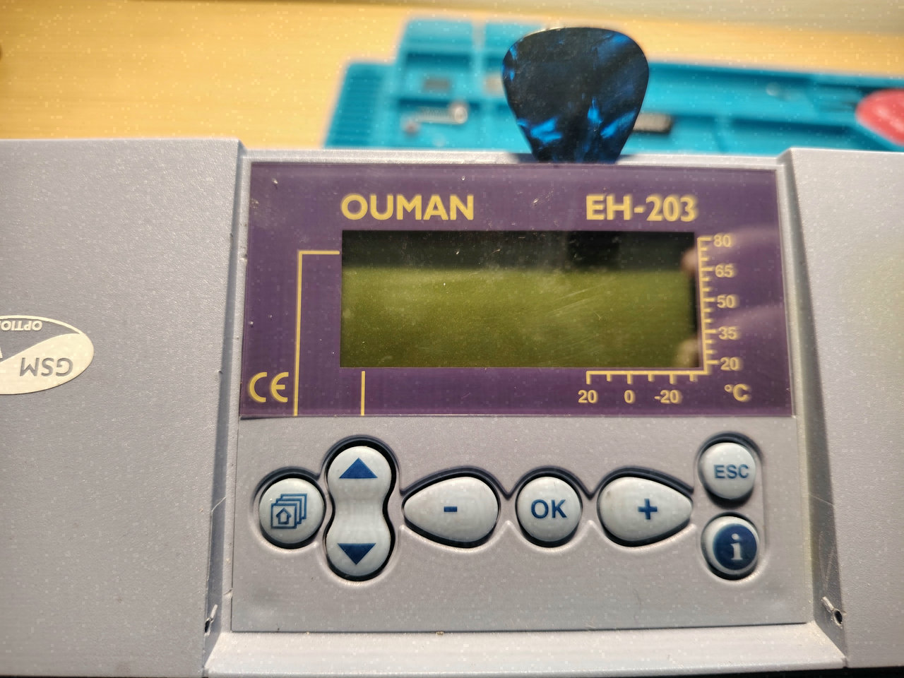
*Irrota näyttö varovasti esimerkiksi plektralla. Kannattelevat kielekkeet ovat sivuilla.*

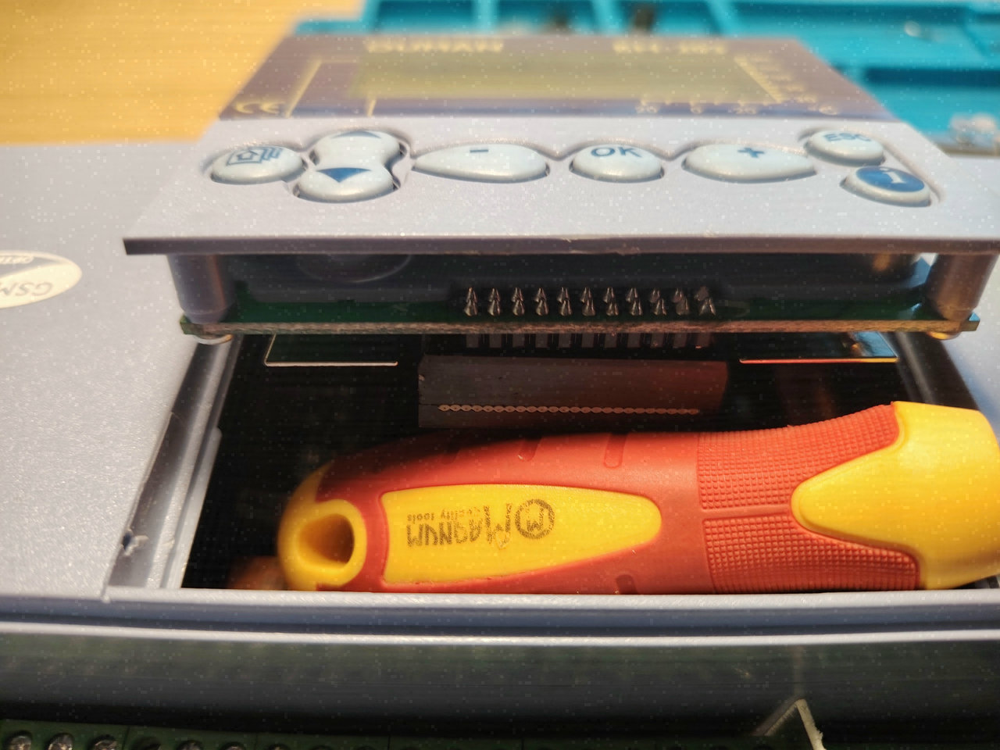
*Näyttö on kiinni lattakaapelilla.*

## Entä kondensaattorit ja varaparisto?

Pohdin myös käyttöjännitteen suodatusta ja ikääntyneiden kondensaattorien mahdollista osuutta oireeseen. En kuitenkaan lisännyt näyttömoduuliin kondensaattoreita summittaisesti: ensin pitäisi tuntea sen käyttöjännite ja kytkentä riittävän hyvin.

Laitteen pääpiirilevyllä on lisäksi kelloa varten **CR1220-varaparisto**. Varaparisto sijaitsee näytön alla ja on helppo vaihtaa. Oikealla reunalla on pienet kolot, joista voi varovasti nostaa nuppineulalla vanhan pariston oikean reunan ylös. Paristoa painavat jouset ovat vasemmalla puolella. Uusi paristo maksaa Motonetissä 2,49€. 

## Lopputulos: näyttö toimii edelleen

Kokosin laitteen, ja näyttö alkoi toimia normaalisti. Tätä kirjoittaessani **se toimii edelleen**. Puhdistus ja erityisesti kontaktien oikean puristuksen palauttaminen näyttävät siis auttaneen.

On silti syytä erottaa kaksi asiaa toisistaan. Ensimmäisen kokoamisen jälkeen havaittu vasemman reunan merkkien puuttuminen johtui selvästi zebrakumin puutteellisesta kontaktista. Alkuperäisen, vasta käytön aikana ilmaantuneen merkkien sekoilun täsmällinen syy ei ole vielä lopullisesti varmistunut. Sen selvittäminen vaatii pidempää seurantaa.

Jos häiriö palaa, seuraava tutkimuskohde olisi todennäköisesti näytön ohjaussignaalit ja käyttöjännite, ei LCD-moduulin uusi purkaminen. Vanhaa ja haurasta moduulia ei kannata avata enää ilman hyvää syytä. Mikäli vika on ohjauspiireissä U1-U3, niille ei voi kotikonstein tehdä mitään.

## Mitä tästä jäi käteen?

Elektroniikan korjaaminen on myös **ekoteko**. EU pyrkii edistämään korjaamista vuonna 2024 hyväksytyllä [korjauttamisoikeutta koskevalla direktiivillä (EU) 2024/1799](https://eur-lex.europa.eu/eli/dir/2024/1799/oj), jonka kansallisia säännöksiä on tullut soveltaa 31.7.2026 alkaen. Direktiivi vahvistaa kuluttajien mahdollisuuksia korjauttaa tuotteita, mutta valmistajien korjausvelvollisuus koskee vain erikseen määriteltyjä tuoteryhmiä. Vanhan Ouman EH-203:n varaosien saatavuutta se ei siis automaattisesti turvaa.

Tämä korjaus muistutti jälleen, ettei elektroniikkavika aina tarkoita rikkinäistä mikropiiriä. Joskus ongelma on kahden ehjän osan välissä: kontakti ei enää ole riittävän hyvä. Tässä tapauksessa vanhat zebrakumit, kontaktipintojen puhdistus ja mekaanisen puristuksen säätö olivat olennaisia tutkimuskohteita.

Nyt EH-203 saa jatkaa koekäyttöä, ja minä voin palata alkuperäiseen tavoitteeseeni: selvittämään, miten sen mittaus- ja säätötiedot saisi osaksi [Home Assistantia](https://ollavarma-create.github.io/blog/fi/posts/ouman-trend-windows11/). **Silloin näyttöä ei välttämättä tarvita ollenkaan.**

P.S. Kuvissa näkyvät vaalet jäljet johtuvat [Cryptoleaf](https://github.com/ollavarma-create/cryptoleaf) -sovelluksestani.

---
Päivitys 26.11.2026

Näyttö on toiminut oikein ilman häiriöitä testisäätimessä. Mitä ilmeisimmin näyttö on toimintakuntoinen. Huom! Testisäädin ei ole ollut niin kuumissa olosuhteissa kuin kaukolämpökeskuksen toiminnassa oleva säädin. Täyttä varmuutta korjauksen toimivuudesta ei siis ole.

