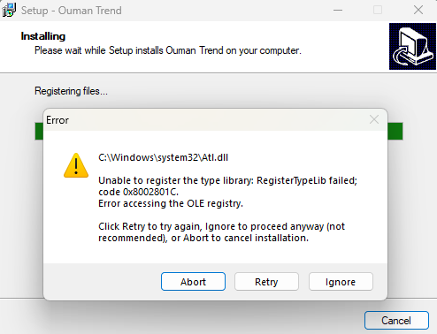
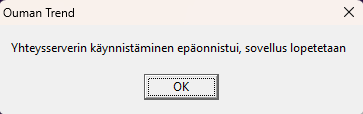
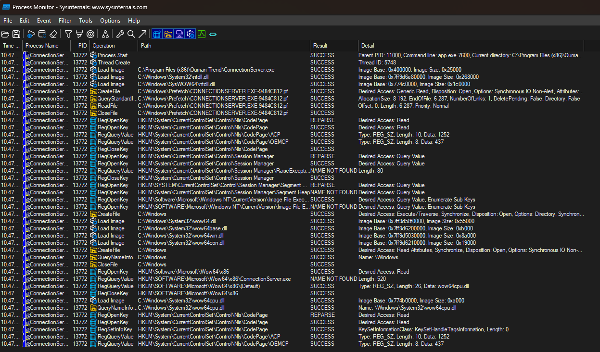
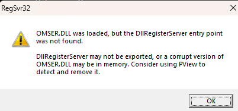
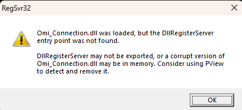
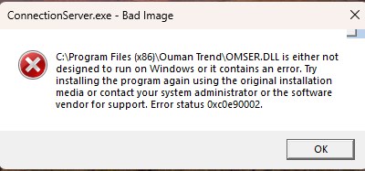
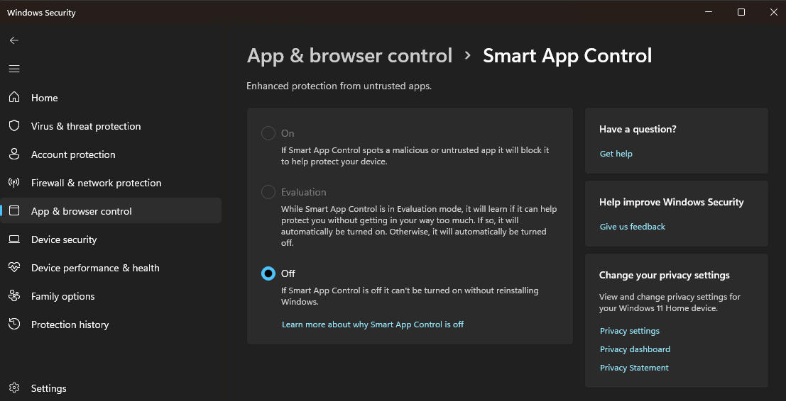
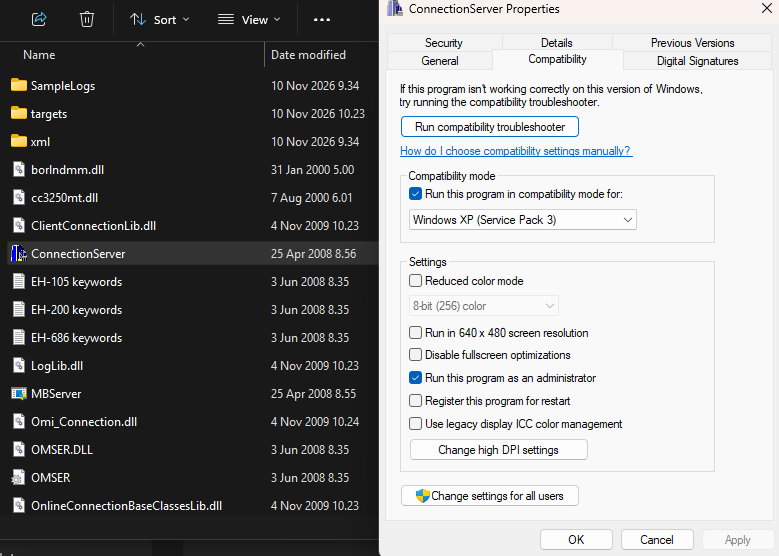
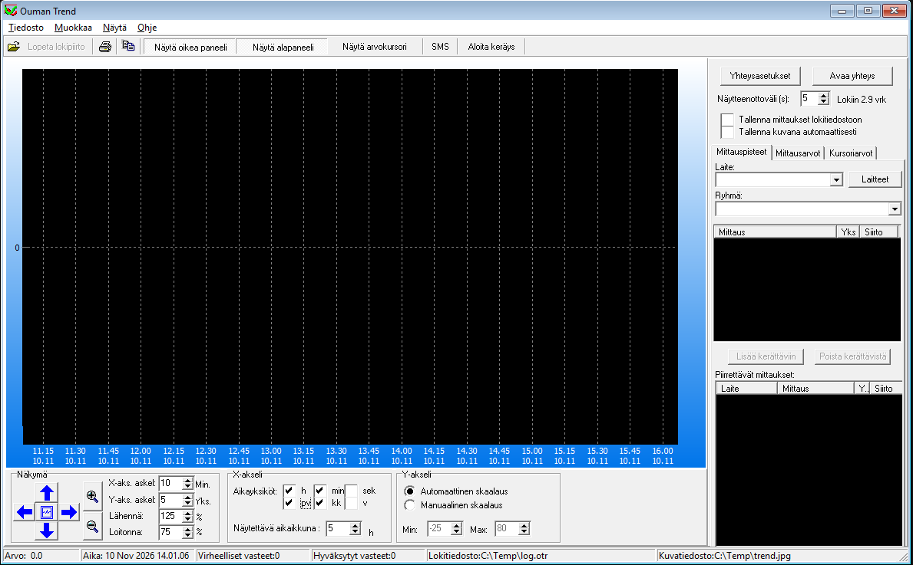

## TL;DR

Tässä kirjoituksessa näytän, miten Ouman EH-203 -kaukolämpösäädintä voi lukea ja ohjata **suoraan RS-232-sarjaportin kautta ilman erillistä Modbus-korttia**. Sarjaliikenne muunnetaan MAX3232-tasonmuuntimella ESP32:n 3,3 V UART-tasolle, ja data tuodaan Home Assistantiin ESPHomen kautta.

Kirjoitus sisältää:

- **Sarjaliikenneprotokollan** kuvauksen: kyselypaketti, vastausviestin rakenne, CRC-laskenta ja yleisimmät parametri-ID:t (mm. ulkolämpötila, menovesi, paluuvesi, venttiilit).
- **Ouman Trend -sovelluksen** käyttöönoton Windows 11:ssä: Atl.dll-asennusvirhe, ConnectionServer.exe-ongelma ja ratkaisu (Smart App Control pois päältä + yhteensopivuustila).
- **Toimivan ESPHome-koodin**, joka lukee sensorit ja venttiilit sekä purkaa tilamuuttujan bitit Home Assistantin binäärisensoreiksi.

> **Huom!** Oumanin sarjaportti on EIA-232 (RS-232) -tasolla. Käytä ehdottomasti MAX3232-tasonmuunninta — älä kytke ESP:tä suoraan Oumanin sarjaporttiin.

Lopullinen, kaikki reverse engineering -löydökset sisältävä versio julkaistaan GitHubiin ja siitä kirjoitetaan erillinen jatko-osa.


## Johdanto

### Lähtötilanne: Ouman EH-203 ja Home Assistant

Kaukolämpökeskukseni on ohjattu Ouman EH-203:lla. Haluan saada [Home Assistanttiin](https://www.home-assistant.io/) enemmän tietoa kaukolämpökeskuksen toiminnasta. EH-203:ssa on RS232/RS485-sarjaportit, mutta lähes kaikissa netistä löytyvissä artikkeleissa oletetaan, että laitteeseen pitää ostaa erillinen Modbus-kortti, jolla sarjaliikenne saadaan [Modbus-protokollan](https://fi.wikipedia.org/wiki/Modbus) mukaiseksi. Tämä on turhaa — laitetta voi lukea ja ohjata myös suoraan sarjaportin kautta ilman Modbus-korttia.

### Ratkaisu: MAX3232 ja ESPHome

Olen parhaillaan tekemässä [ESPHome:lla](https://esphome.io/) Ouman EH-203:lle sopivaa ohjausta. Ouman EH-203:a voi lukea suoraan RS-232-portista käyttämällä level shifteriä (MAX3232), eli muuntaa joko ±12 V tai +5 V TTL -tasoinen sarjaliikenne ESP:n UART:n maksimijännitteeseen 3,3 volttiin.

Tässä vaiheessa ESPHome-koodi (alla) toimii jo varsin kattavasti venttiilien ja sensoreiden lukemiseen ja osittaiseen kirjoittamiseen. Koodi pohjautuu kutakuinkin [Oumanin downloads -sivulta](https://ouflextool.ouman.net/downloads/DeviceTemplates/Ouman/EH-Controllers/) löytyvään `EH203.xml`-tiedostossa oleviin parametreihin, mutta haluan viedä sitä pidemmälle ja debugata, mitä Ouman Trend -sovellus keskustelee EH-203:n kanssa. Julkaisen koodin GitHubiin, kun olen saanut sen täysin valmiiksi.

### Laitteen tausta ja Ouman Trend -sovellus

Ouman EH-203 on jo vanha [myynnistä poistunut](https://kauppa.ouman.fi/myynnista-poistuneet-tuotteet/) säädin, mutta onneksi Tori.fi:stä saa käytettyjä aika edullisesti — myös näyttöjä, joka on tyypillinen vikakohde etenkin kaukolämpöasennuksissa. Uusi korvaava malli on [S203](https://kauppa.ouman.fi/tuote/s203/), joka maksaa 1655 €.

Jotta pystyn vakoilemaan eli reverse engineering -menetelmällä selvittämään, mitä Ouman EH-203:lla voi tehdä sarjaportin kautta, tarvitsen Ouman Trend -sovelluksen. Sen voi ladata [Oumanin sivuilta](https://ouman.fi/ouman-sovellukset/). Sovelluksen saa toimimaan Windows 11:ssä, ja seuraavassa käyn läpi tyypilliset virheet ja niiden ratkaisut.

## Ouman Trend -sovellus Windows 11:ssä

Ouman Trend on tehty Windows XP/Vista-aikana Borland Delphi/C++Builder -työkaluilla tai Borlandin ohjelmointityökaluilla. Se käyttää vanhoja Borland-kirjastoja (cc3250mt.dll, borlndmm.dll). Readme viittaa vanhoihin Microsoft runtime MFC42- ja ATL-komponentteihin, joita nykyisin ei enää normaalisti asenneta samalla tavalla. Ohjelman saa kuitenkin toimimaan Windows 11:ssa, mutta se vaatii pari pientä muutosta. Jotta hahmotat ongelman ratkaisun, alla on proseduuri, jolla päädyin ratkaisuun, joka toimii Windows 11:ssa.

Kun olet ladannut Ouman Trend -sovelluksen ja purkanut asennustiedoston, saat ensimmäisellä asennusyrityksellä Atl.dll-virheen:



Ratkaisu asennuksen läpimenoon on vaihtaa Explorerin avulla asennusohjelman yhteensopivuustilaksi Windows XP SP3 ja antaa Administrator-oikeudet. Vaikka asennus menee läpi, OuTrend.exe ei saa ConnectionServer.exe:tä käyntiin:



Tämän ongelman ratkaisu vaati hieman enemmän debuggaamista. Se onnistuu hyvin Process Monitorilla, josta virhe selviää tarkemmin:


*Process Monitor -näkymää jossa filtterinä on Process Name ConnectionServer.exe.*

Process Monitor -näkymää tarkastellessani päättelin vian olevan puutteellisessa komponentin rekisteröinnissä ja yritin rekisteröidä aluksi OMSER.DLL:n uudelleen:



ja OmiConnection.DLL:n



mutta tuloksena oli kuitenkin OMSER.DLL:n rekisteröinnissä Bad Image -virhe:



OMSER.DLL on vuodelta 2008, Borland-kirjastot vuodelta 2000, ja readme.txt mainitsee Windows XP -aikaisen polun C:\Windows\System\atl.dll. Nykyisin Atl.dll löytyy sekä C:\Windows\SysWOW64 että C:\Windows\System32 hakemistoista. Niiden rekisteröinti uudelleen on turhaa.

Näistä voisi päätellä, että komponentteja ei voi rekisteröidä COM-palvelimena regsvr32:lla. Process monitoria ja EventVieweriä tutkiessa voi todeta sen, että varsinainen kaatuminen on 0xC0000005 Access Violation -virhe ohjelman omassa koodissa, ei puuttuvassa DLL:ssä.


## Ratkaisu: näin Ouman Trend saadaan toimimaan

Lopulta ratkaisu onkin aika yksinkertainen.

1. Taustalla toimiva Windowsin Smart App Control estää ohjelman toimimisen oikein. Kohdasta App & Browser control > Smart App Control pitää laittaa Smart App pois päältä:


*Windows 11 App Controllin poistaminen käytöstä.*

2. Sitten jokaiseen C:\Program Files (x86)\Ouman Trend -hakemiston exe-tiedostoon pitää asettaa yhteensopivuustilaksi "Run this program in compatibility mode for Windows XP (Service Pack 3):


*ConnectionServer.exe compatibility asetus.*

ja kas kummaa, nyt Ouman Trend toimii!


*Ouman Trend toimii Windows 11:ssä, kun Smart App Control on pois päältä ja yhteensopivuustila on asetettu.*

En ole vielä päässyt kytkemään sovellusta EH-203 -säätimeen, koska se on tulossa postissa, mutta voi olettaa, että Ouman Trend toimii oikein ja pääsen reverse engineeraamaan.

Kun Ouman Trend saadaan toimimaan, seuraava askel on rakentaa ESPHome-integraatio. Seuraavassa on alustavaa ESPHome-koodia. Mikäli et käytä Home Assistantia ja haluat käyttää sensoritietoa verkkoselaimella, lisää alla olevaan koodiin web-osuus.

-----
## ESPHome koodia tässä vaiheessa (10.11.2026)

### Sarjaliikenteen luku ja kirjoitus

Lukeminen:
```text
02 81 02 00 <id> <crc>
```

02 = STX / aloitusbitti
81 = komento (luku)
02 = datan pituus
00 = ? (kiinteä)
<id> = mittaus/parametri-ID (esim. 18 = ulkolämpötila)
<crc> = (0x81 + 0x02 + 0x00 + id) & 0xFF

Huom! Kyse on yksinkertaisesta tavusummasta, ei esim. CRC-16:sta.

Kirjoitus:
```text
02 82 <len> 00 <id> <data...> <crc>
```
82 = kirjoituskomento
CRC lasketaan summana tietyistä tavuista.

Vastausviesti esim. 02 <len> <data> <crc>) -> 02 06 00 18 09 8A <crc>:
- Alkaa aina 02:lla
- tavu = datan pituus
- Lopussa 1-tavuinen CRC (summa tavuista 1…n-1 & 0xFF)
- Dataosan sisällä on ID + varsinainen arvo
- Lämpötilat (TYPE_TEMP100) ovat signed 16-bit arvoja, jotka jaetaan 100:lla (esim. 2450 → 24.50 °C)


## EH-203:lle tyypilliset ID:t

| ID | Merkitys | Tyyppi |
|---|--------|------|
|18|Ulkolämpötila|temp100|
|20|L1 menovesi|temp100|
|21|L1 huone|temp100|
|23|L1 paluuvesi|temp100|
|24|LV menovesi|temp100|
|25|LV kiertovesi|temp100|
|26|L2 menovesi|temp100|
|33|Varaaja ylä|temp100|
|34|Varaaja ala|temp100|
|41|Kuumakaasu|temp100|
|45|Tilamuuttuja (bitit)|uint16|
|49|L1-venttiili|uint8|
|50|L2-venttiili|uint8|
|51|LV-venttiili|uint8|


## Kytkentä ja sarjaliikenneasetukset

Oletuskommunikaatio EH203:lle RS232-portin kautta:

- Baudrate: 4800
- Data bits: 8
- Parity: None
- Stop bits: 1
- Kyselypaketti: 02 81 02 00 <id> <crc>
- CRC: (0x81 + 0x02 + 0x00 + id) & 0xFF
- Lämpötilat: signed 16-bit / 100.0

Kytkentä ESP32 (tai ESP8266):
- ESP32 TX → Ouman RX
- ESP32 RX → Ouman TX
- GND yhteinen

> **Huom! Oumanin sarjaportti on EIA-232 (RS-232) -tasolla → tarvitset ehdottomasti MAX3232-tasonmuuntimen (ei suoraan 3,3 V logiikkaa).**

## Esimerkkikoodi ESPHome:lle

Alla oleva koodi toimii sekä ESP32:lle että ESP8266:lle (kaverini testaamana). Erona on se, että ESPHome:n UART-komponentti eroaa alustojen välillä. ESP8266:n UART-komponentissa ei ole read()-metodia samalla tavalla kuin ESP32:lla. Molemmissa voi käyttää read_byte()-metodia.

**Mitä tarvitset:**
> - Ouman EH-203 -säädin
> - ESP32 tai ESP8266 ja 5V virtalähde
> - MAX3232-tasonmuunnin
> - Johtimet sarjaportin ja MAX3232 -tasomuuntimen väliin
> - (Valinnainen) USB-sarja-adapteri debuggausta varten
> - ESPHome jolla käännät seuraavan koodin firmwareksi (bin)


```yaml
esphome:
  name: ouman-eh203
  friendly_name: Ouman EH-203

esp32:
  board: esp32dev  # vaihda omaan levyyn (esim. nodemcu-32s, esp32-s3 jne.)
  framework:
    type: arduino

# WiFi + API + OTA (täytä omat tiedot)
wifi:
  ssid: !secret wifi_ssid
  password: !secret wifi_password

api:

ota:
logger:
  level: DEBUG             # voi vaihtaa INFO:ksi kun toimii

uart:
  id: ouman_uart
  tx_pin: GPIO17           # vaihda omiin pinneihin
  rx_pin: GPIO16
  baud_rate: 4800
  data_bits: 8
  parity: NONE
  stop_bits: 1
  rx_buffer_size: 256

# ----- Ouman-sensorit -----
sensor:
  # --- Lämpötilat ---
  - platform: template
    name: "Ulkolämpötila"
    id: outdoor_temp
    unit_of_measurement: "°C"
    accuracy_decimals: 1
    device_class: temperature
    state_class: measurement
    update_interval: never

  - platform: template
    name: "L1 Menovesi"
    id: l1_supply
    unit_of_measurement: "°C"
    accuracy_decimals: 1
    device_class: temperature
    state_class: measurement
    update_interval: never

  - platform: template
    name: "L1 Huonelämpötila"
    id: l1_room
    unit_of_measurement: "°C"
    accuracy_decimals: 1
    device_class: temperature
    state_class: measurement
    update_interval: never

  - platform: template
    name: "L1 Paluuvesi"
    id: l1_return
    unit_of_measurement: "°C"
    accuracy_decimals: 1
    device_class: temperature
    state_class: measurement
    update_interval: never

  - platform: template
    name: "L2 Menovesi"
    id: l2_supply
    unit_of_measurement: "°C"
    accuracy_decimals: 1
    device_class: temperature
    state_class: measurement
    update_interval: never

  - platform: template
    name: "Mittaus 6"
    id: meas6
    unit_of_measurement: "°C"
    accuracy_decimals: 1
    device_class: temperature
    state_class: measurement
    update_interval: never

  - platform: template
    name: "LV Menovesi"
    id: hw_supply
    unit_of_measurement: "°C"
    accuracy_decimals: 1
    device_class: temperature
    state_class: measurement
    update_interval: never

  - platform: template
    name: "LV Kiertovesi"
    id: hw_circ
    unit_of_measurement: "°C"
    accuracy_decimals: 1
    device_class: temperature
    state_class: measurement
    update_interval: never

  - platform: template
    name: "Mittaus 9"
    id: meas9
    unit_of_measurement: "°C"
    accuracy_decimals: 1
    device_class: temperature
    state_class: measurement
    update_interval: never

  - platform: template
    name: "Mittaus 10"
    id: meas10
    unit_of_measurement: "°C"
    accuracy_decimals: 1
    device_class: temperature
    state_class: measurement
    update_interval: never

  - platform: template
    name: "Mittaus 11"
    id: meas11
    unit_of_measurement: "°C"
    accuracy_decimals: 1
    device_class: temperature
    state_class: measurement
    update_interval: never

  # --- Venttiilit ---
  - platform: template
    name: "L1 Venttiili"
    id: l1_valve
    unit_of_measurement: "%"
    accuracy_decimals: 0
    state_class: measurement
    update_interval: never

  - platform: template
    name: "L2 Venttiili"
    id: l2_valve
    unit_of_measurement: "%"
    accuracy_decimals: 0
    state_class: measurement
    update_interval: never

  - platform: template
    name: "LV Venttiili"
    id: hw_valve
    unit_of_measurement: "%"
    accuracy_decimals: 0
    state_class: measurement
    update_interval: never

  # --- Energiamittaukset ---
  - platform: template
    name: "Huipputeho"
    id: peak_power
    unit_of_measurement: "kWh"
    accuracy_decimals: 0
    state_class: measurement
    update_interval: never

  - platform: template
    name: "Huippuvirtaus"
    id: peak_flow
    unit_of_measurement: "m³"
    accuracy_decimals: 2
    state_class: measurement
    update_interval: never

  - platform: template
    name: "KL Energia"
    id: dh_energy
    unit_of_measurement: "kWh"
    accuracy_decimals: 0
    state_class: total_increasing
    update_interval: never

  - platform: template
    name: "KL Vesi"
    id: dh_water
    unit_of_measurement: "m³"
    accuracy_decimals: 2
    state_class: total_increasing
    update_interval: never

  # --- Raaka tilamuuttuja (valinnainen) ---
  - platform: template
    name: "Tilamuuttuja"
    id: status_word
    accuracy_decimals: 0
    state_class: measurement
    update_interval: never

# --- Digitaaliset tilat tilamuuttujasta (ID 45) ---
binary_sensor:
  - platform: template
    name: "Dig1"
    id: dig1
    device_class: opening          # vaihda tarvittaessa

  - platform: template
    name: "Dig2"
    id: dig2
    device_class: opening

  - platform: template
    name: "Dig3"
    id: dig3
    device_class: opening

  - platform: template
    name: "Rele 1"
    id: relay1
    device_class: power

  - platform: template
    name: "Rele 2"
    id: relay2
    device_class: power
    
  # --- Asetusarvot ---
  - platform: template
    name: "L1 Huonelämpötilan asetusarvo"
    id: l1_room_setpoint
    unit_of_measurement: "°C"
    accuracy_decimals: 1
    device_class: temperature
    state_class: measurement
    update_interval: never

  - platform: template
    name: "L2 Huonelämpötilan asetusarvo"
    id: l2_room_setpoint
    unit_of_measurement: "°C"
    accuracy_decimals: 1
    device_class: temperature
    state_class: measurement
    update_interval: never

  - platform: template
    name: "L1 Menoveden asetusarvo"
    id: l1_supply_setpoint
    unit_of_measurement: "°C"
    accuracy_decimals: 0
    device_class: temperature
    state_class: measurement
    update_interval: never   
    
    

# ----- Lukulogikka -----
interval:
  - interval: 45s
    then:
      - lambda: |-
          auto read_value = [](uint8_t id, uint8_t type) -> float {
            // type: 0=temp100, 1=uint8, 2=uint16, 3=int32, 4=val32_100
            uint8_t crc = (0x81 + 0x02 + 0x00 + id) & 0xFF;
            uint8_t request[] = {0x02, 0x81, 0x02, 0x00, id, crc};

            while (id(ouman_uart).available()) {
              uint8_t dummy;
              id(ouman_uart).read_byte(&dummy);
            }

            id(ouman_uart).write_array(request, 6);
            delay(80);

            uint8_t buffer[40];
            int len = 0;
            uint32_t start = millis();

            while (millis() - start < 500) {
              if (id(ouman_uart).available()) {
                uint8_t c;
                if (id(ouman_uart).read_byte(&c)) {
                  buffer[len++] = c;
                  if (len >= 40) break;

                  if (len >= 4 && buffer[0] == 0x02) {
                    uint8_t dlen = buffer[2];
                    if (len >= dlen + 4) {
                      uint8_t calc = 0;
                      for (int i = 1; i < len - 1; i++) calc += buffer[i];
                      if ((calc & 0xFF) != buffer[len - 1]) return NAN;

                      if (type == 0) { // temp100
                        if (dlen < 4) return NAN;
                        int16_t raw = (int16_t)((buffer[5] << 8) | buffer[6]);
                        return raw / 100.0f;
                      }
                      else if (type == 1) { // uint8
                        if (dlen < 3) return NAN;
                        return (float)buffer[5];
                      }
                      else if (type == 2) { // uint16
                        if (dlen < 4) return NAN;
                        return (float)((buffer[5] << 8) | buffer[6]);
                      }
                      else if (type == 3) { // int32
                        if (dlen < 6) return NAN;
                        int32_t raw = (int32_t)((buffer[5] << 24) | (buffer[6] << 16) | (buffer[7] << 8) | buffer[8]);
                        return (float)raw;
                      }
                      else if (type == 4) { // val32_100
                        if (dlen < 6) return NAN;
                        int32_t raw = (int32_t)((buffer[5] << 24) | (buffer[6] << 16) | (buffer[7] << 8) | buffer[8]);
                        return raw / 100.0f;
                      }
                    }
                  }
                }
              }
              delay(1);
            }
            return NAN;
          };

          float v;

          // Lämpötilat
          v = read_value(18, 0); if (!isnan(v)) id(outdoor_temp).publish_state(v);
          v = read_value(20, 0); if (!isnan(v)) id(l1_supply).publish_state(v);
          v = read_value(21, 0); if (!isnan(v)) id(l1_room).publish_state(v);
          v = read_value(23, 0); if (!isnan(v)) id(l1_return).publish_state(v);
          v = read_value(26, 0); if (!isnan(v)) id(l2_supply).publish_state(v);
          v = read_value(27, 0); if (!isnan(v)) id(meas6).publish_state(v);
          v = read_value(24, 0); if (!isnan(v)) id(hw_supply).publish_state(v);
          v = read_value(25, 0); if (!isnan(v)) id(hw_circ).publish_state(v);
          v = read_value(33, 0); if (!isnan(v)) id(meas9).publish_state(v);
          v = read_value(34, 0); if (!isnan(v)) id(meas10).publish_state(v);
          v = read_value(41, 0); if (!isnan(v)) id(meas11).publish_state(v);

          // Venttiilit
          v = read_value(49, 1); if (!isnan(v)) id(l1_valve).publish_state(v);
          v = read_value(50, 1); if (!isnan(v)) id(l2_valve).publish_state(v);
          v = read_value(51, 1); if (!isnan(v)) id(hw_valve).publish_state(v);

          // Energiat
          v = read_value(60, 3); if (!isnan(v)) id(peak_power).publish_state(v);
          v = read_value(61, 4); if (!isnan(v)) id(peak_flow).publish_state(v);
          v = read_value(63, 3); if (!isnan(v)) id(dh_energy).publish_state(v);
          v = read_value(64, 4); if (!isnan(v)) id(dh_water).publish_state(v);

          // Tilamuuttuja + bitit
          v = read_value(45, 2);
          if (!isnan(v)) {
            uint16_t status = (uint16_t)v;
            id(status_word).publish_state(status);

            id(dig1).publish_state(status & 0x0001);   // mask 1
            id(dig2).publish_state(status & 0x0002);   // mask 2
            id(dig3).publish_state(status & 0x0004);   // mask 4
            id(relay1).publish_state(status & 0x0008); // mask 8
            id(relay2).publish_state(status & 0x0010); // mask 16
          }
          
```

## Jatkokehitys

Tarkoitus on tehdä lopullinen versio Home Assistantiin git-pullattavana C++-koodina, jossa on mukana kaikki se mitä Ouman Trend sarjaportin reverse engineering-metodilla pystyy tekemään. Siitä julkaisen erillisen blogikirjoituksen sitten kun olen valmis.

