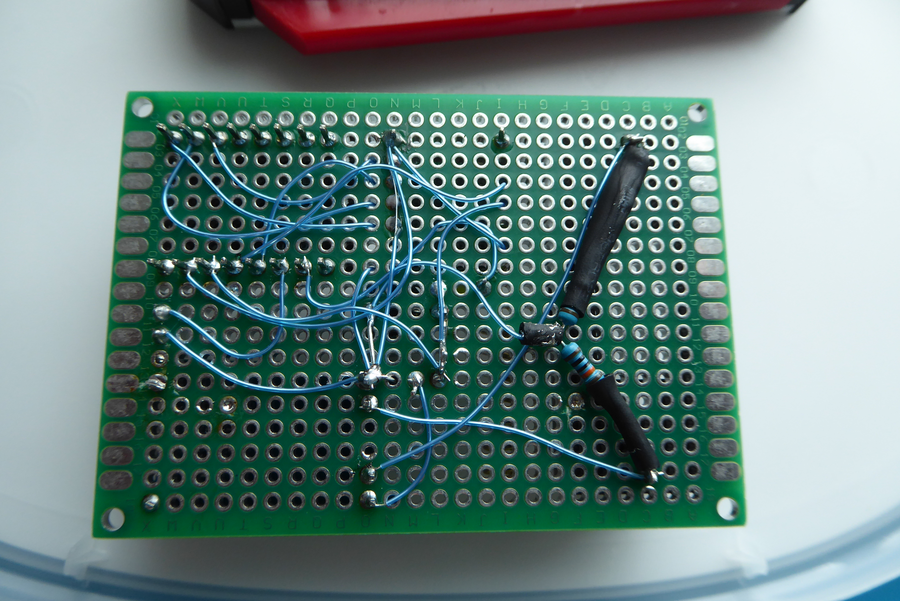

# LoRaWAN-postilaatikkohälytin ESP32-C3 SuperMinillä

## Projektin esittely

Akku­käyttöinen postilaatikon avaamisen havaitseva hälytinjärjestelmä, joka hyödyntää LoRaWAN-teknologiaa pitkän kantaman ja alhaisen virrankulutuksen ansiosta. Järjestelmä koostuu ESP32-C3 SuperMini -mikrokontrollerista, RFM95W-868S2 LoRaWAN-moduulista ja mikrokytkimestä.

### Toimintaperiaate

Kun postilaatikon kansi avataan, mikrokytkin aktivoituu ja ESP32-C3 herää syväunesta. Laite muodostaa yhteyden LoRaWAN-verkkoon ja lähettää hälytyksen ChirpStack-palvelimelle. Data virtaa edelleen Telegrafin kautta InfluxDB:hen, josta Grafana lukee sen ja lähettää sähköpostihälytyksen.

## Tekniset tiedot

### Hardware-komponentit

- **Mikrokontrolleri**: ESP32-C3 SuperMini (RISC-V, Wi-Fi + BLE)
- **LoRaWAN-moduuli**: RFM95W-868S2 (868 MHz, EU-taajuudet)
- **Akku**: 16340 Li-Ion, 3.7V, 2000mAh
- **Latauspiiri**: TP4056 Micro-USB 1A
- **Jänniteregulaattori**: HT7333 LDO (3.3V, 5µA lepovirta)
- **Suodatus**: 330µF elektrolyytti + 0.1µF keraaminen kondensaattori
- **Kytkin**: Mikrokytkin (postilaatikon kanteen)
- **PCB**: 70x50mm reikälevy (perfboard)

### Virrankulutus ja akun kesto

**Laskelma akun kestolle (2000 mAh 16340):**

- ESP32-C3 syväuni: ~43 µA
- HT7833 LDO lepovirta: ~5 µA
- Yhteensä lepotilassa: ~48 µA

**Aktiivinen käyttö kerran päivässä:**
- Herätys + LoRaWAN-lähetys: ~150 mA, 2 sekuntia
- Päivittäinen heartbeat: ~150 mA, 2 sekuntia

**Keskimääräinen kulutus:**
Lepo (23h 59min 56s): 48 µA × 86396s = 4147 mAs
Aktiivinen (2× 2s): 150 mA × 4s = 600 mAs
Yhteensä vuorokaudessa: 4747 mAs ≈ 1.32 mAh/vrk

**Arvioitu akun kesto:**
2000 mAh / 1.32 mAh/vrk ≈ 1515 vrk ≈ 4.15 vuotta

**Käytännön arvio:** 2-3 vuotta (huomioiden akun itsepurkautuminen ja lämpötilavaikutukset)

### PCB-suunnittelu

Piirilevy on suunniteltu 70x50 mm kokoiselle reikälevylle komponenttien helpon koteloinnin vuoksi:

**Komponenttien sijoittelu:**
- **Vasen yläreuna**: 16340-akun pidin
- **Alareuna**: TP4056-latausmoduuli (USB-liitin ulospäin)
- **Oikea yläreuna**: ESP32-C3 SuperMini (USB-liitin samalla tasolla TP4056:n kanssa)
- **Keskellä**: RFM95W LoRaWAN-moduuli antennineen
- **Keskellä**: HT7333 LDO ja suodatuskondensaattorit (330µF + 0.1µF) ennen RFM95W:n virransyöttöä
- **Keskellä**: 2-napainen liitin mikrokytkimelle
- **Kytkennät:** 0.25 mm tinattu kuparilanka (trap wire) PCB:n alapuolella

### Jännitteen mittaus

Akun jännitettä monitoroidaan ESP32-C3:n ADC:llä käyttäen jännitteenjakajaa:

Akku+ → [100kΩ] → GPIO1 (ADC) → [100kΩ] → GND

Tämä jakaa akun jännitteen puoliksi (max 4.2V → 2.1V), mikä on turvallinen ESP32-C3:n ADC:lle.

### Ohjelmisto

**Alusta:** PlatformIO (VS Code)

**Kirjastot:**
- Arduino-ESP32 framework
- LMIC (LoRaWAN) tai RadioLib
- ChirpStack-yhteensopiva OTAA-aktivointi

**Toimintalogiikka:**
1. Käynnistys: Tarkista mikrokytkimen tila
2. Jos kytkin aktiivinen: Lähetä hälytys LoRaWAN:in kautta
3. Lähetä heartbeat kerran päivässä
4. Mene syväuneen (deep sleep)
5. Herätys: mikrokytkimen interrupt tai ajastin

**Konfiguraatio:**
- LoRaWAN-avaimet (DevEUI, AppEUI, AppKey)
- Lähetystaajuus ja SF (Spreading Factor)
- Syväunen kesto

### Backend-järjestelmä

**Data-virta:**

ESP32-C3 → LoRaWAN Gateway → ChirpStack → Telegraf → InfluxDB → Grafana
                                                              ↓
                                                         Email Alert


**Komponentit:**
- **ChirpStack**: LoRaWAN Network Server
- **Telegraf**: Datankeruu ja muunnos
- **InfluxDB**: Aikasarjatietokanta
- **Grafana**: Visualisointi ja hälytykset

### Kotelointi

**Suunnittelutyökalu:** Autodesk Fusion 360

**Huomioitavaa:**
- USB-liittimien (ESP32 ja TP4056) oltava helposti saatavilla
- Antennille riittävästi tilaa (ei metallia lähellä)
- Mikrokytkimen johdoille reikä kotelossa
- 16340-akun helppo vaihdettavuus
- IP-luokitus ulkokäyttöä varten (vähintään IP54)

Kotelon piirrustukset ja STL-tiedostot 3D-tulostusta varten julkaistaan [Codebergiin](https://codeberg.org/hiltsu/fusion360-piirrokset-3D-tulostusobjektit).

## Asennusohjeet

### 1. Hardwaren kokoaminen

1. Juota komponentit PCB:lle käyttäen 0.25 mm kuparilankaa
2. Varmista että HT7833 LDO:n jälkeen tulee 3.3V
3. Lisää 330µF ja 0.1µF kondensaattorit ennen RFM95W:n VCC:tä
4. Juota 2×100kΩ vastukset akun jännitteen mittaukseen
5. Testaa TP4056:n toiminta (punainen LED latauksen aikana)

### 2. Ohjelmiston asennus ESP32-C3 SuperMiniin

```bash
# Kloonaa repo
git clone https://codeberg.org/hiltsu/lorawan/src/branch/main/ESP32/PlatformIO/PostboxAlarm

# Muokkaa konfiguraatiota
# - src/config.h: WiFi-avaimet, pinnit, DevEUI (eli laitteen mac), AppEUI, AppKey
# - src/config.h: aseta debug true

# Käännä ja lataa
pio run --target upload
```
> ⚠️ **Huomio:** Muista ottaa talteen laitteen MAC-osoite ennen ChirpStack-konfigurointia!

Katso serialportista debug ollessa true mikä on laitteen mac-osoite. Osoitetta käytetään Chirpstackissa laitteen rekisteröinnissä! Kun olet ottanut talteen laitteen mac-osoitteen, aseta src/config.h debug = false.

### 3. ChirpStack-konfiguraatio

- Luo Device Profile ESP32-C3:lle (käytä edellä olevaa mac-osoitetta)
- Lisää laite OTAA-aktivoinnilla 
- Määritä payload decoder (jos tarpeen)
- Konfiguroi Telegraf-integraatio

### Lähdekoodi ja dokumentaatio

Koko lähdekoodi, asennusohjeet ja konfiguraatiotiedostot löytyvät [Codebergista](https://codeberg.org/hiltsu/lorawan/src/branch/main/ESP32/PlatformIO/PostboxAlarm)

## Kuvia projektista
Muutamia kuvia projektista. Ensimmäisenä piti testata sovelluksen toimivuus ja siksi asennus oli puhtaasti johdoilla tehty:


*Kuvassa ensimmäinen toimiva testisetuppi 18650 akulla ja mikrokytkimellä.*

Toiminnan testaamisen jälkeen seuraava vaihe on kotelon suunnittelu. Kotelon suunnittelussa keskeistä on erottaa mikrokytkin ja elektroniikka toisistaa. Mikrokytkintä tulee pystyä säätämään sopivaan asentoon postilaatikon kannen suhteen. Elektroniikkaosa pitää olla helposti irrotettavissa huoltoa varten ja kiinnitys joko voimakkailla neodyymimagneeteilla tai ruuveilla.


*PCB:n komponenttipuoli: 16340-akku, ESP32-C3, TP4056, RFM95W*


*Kuvassa piirilevyn juotospuoli. Trappaaminen on vanha ja luotettava tapa tehdä koekytkentöjä. EMI/RF-kannalta tällainen asennus ei välttämättä ole kovin fiksu, mutta harrasteluprojekteissa ja tällaisten yksittäisten kappaleiden tekemisessä riittävä*

## Kehitysideat ja testaukset

- Lisää aurinkopaneeli akun lataukseen
- Lisää lämpötila-anturi postilaatikkoon
- Paranna kotelointia IP65-luokitukseen
- Varmista OTA-päivitysten toimivuus (Firmware Over-The-Air)

## Lähteet ja kiitokset

- ESP32-C3 SuperMini dokumentaatio
- RFM95W datasheet
- [LoraWan projektini juuri](https://codeberg.org/hiltsu/lorawan/src/branch/main)
- [ChirpStack asennusdokumentaationi](https://codeberg.org/hiltsu/lorawan/src/branch/main/Chirpstack/chirpstack-installation.md)
- [ChirpStack määrittelydokumentaationi](https://codeberg.org/hiltsu/lorawan/src/branch/main/Chirpstack/raspberrypi5-chirpstack-dedicated.md)
- [MQTT integraatiodokumentaationi](https://codeberg.org/hiltsu/lorawan/src/branch/main/Chirpstack/MQTT_Chirpstack_integration.md) 
- HT78XX/HT7333-a LDO datasheetit (Holtek)


Tekijä: Hiltsu
Lisenssi: MIT


