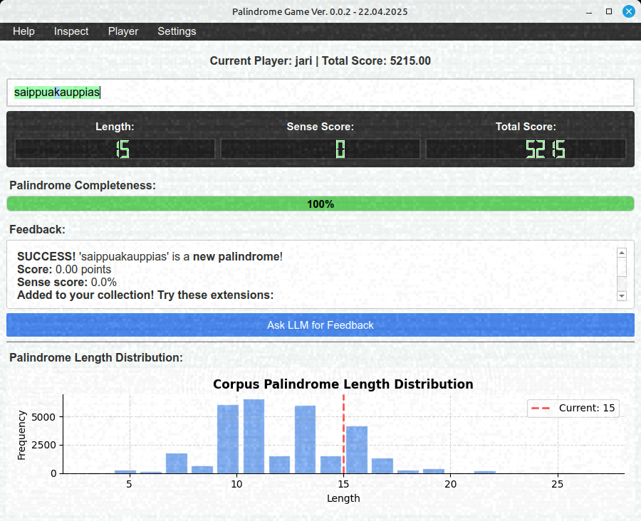
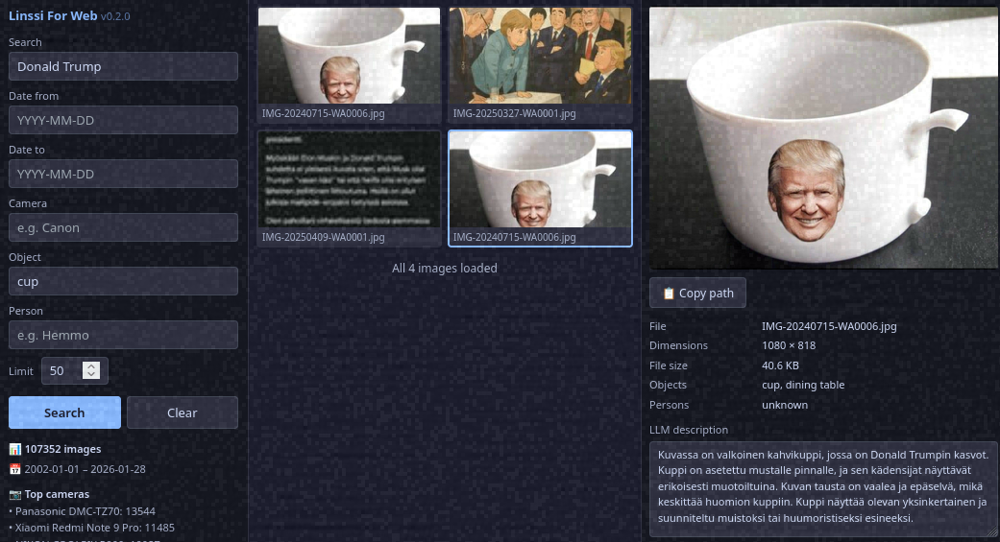
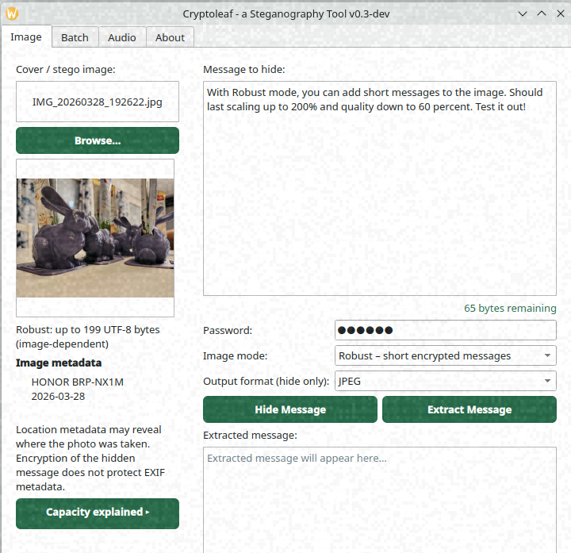
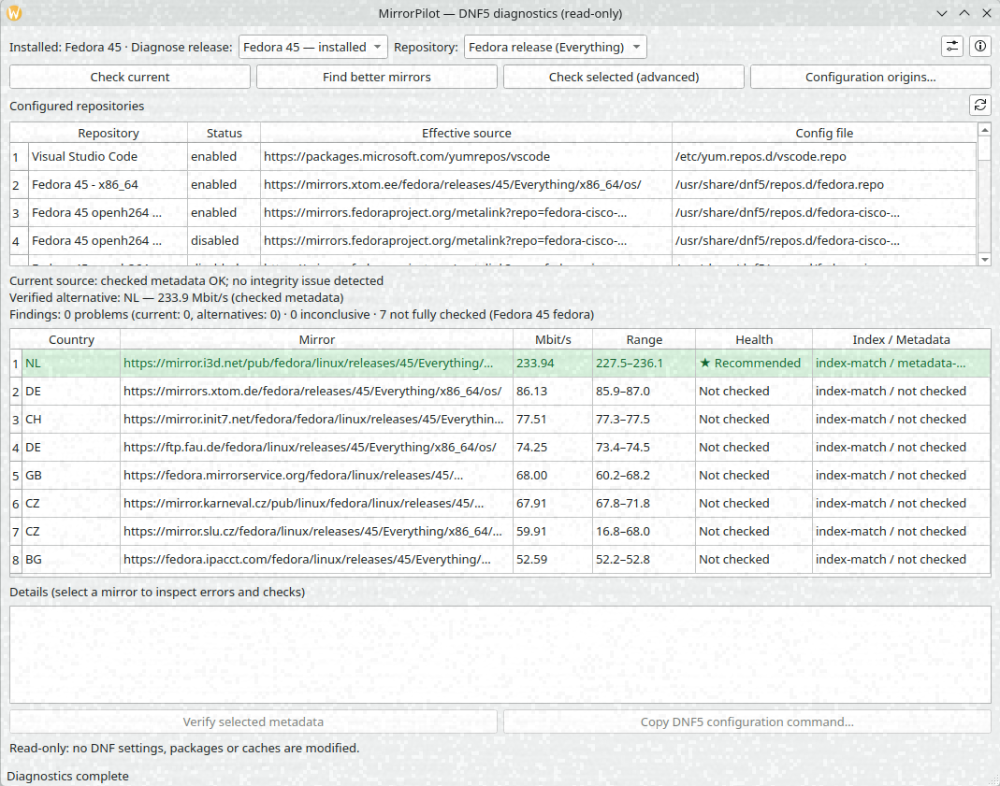
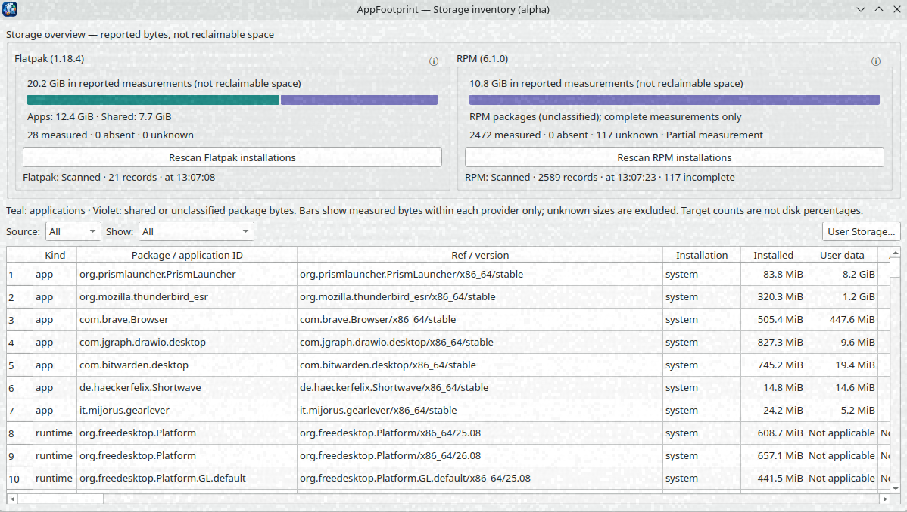
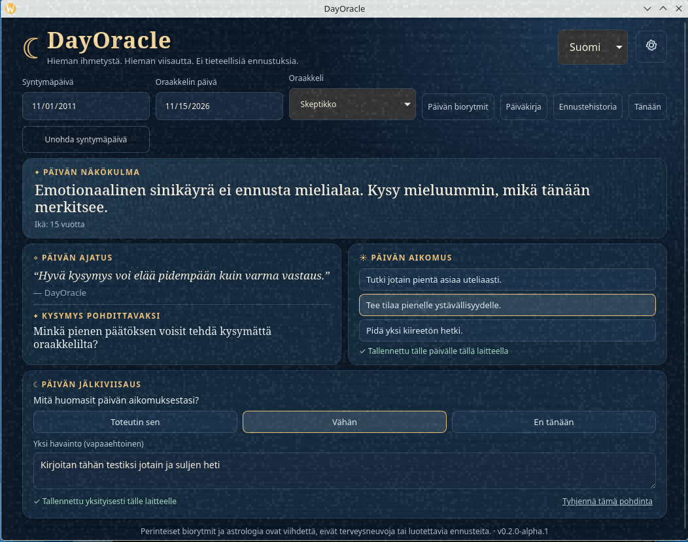

# Koodauksesta ongelmanratkaisuun – kolme vuotta LLM:n kanssa

*Vuonna 2023 tekoäly auttoi minua kirjoittamaan yksittäisiä MicroPython-funktioita, joita jouduin jatkuvasti korjaamaan. Marraskuussa 2026 voin saada ideasta toimivan, GitHubissa julkaistun Linux-sovelluksen yhden työpäivän aikana. Mitä oikein tapahtui?*

## Kaikki ei alkanut ChatGPT:stä

Kiinnostukseni koneoppimiseen alkoi jo vuonna 2016, jolloin osallistuin Åbo Akademin koneoppimiskursseille. Vuoden 2023 lopulla jatkoin opintoja IBM AI Academyssa.

Suurten kielimallien hyödyntämisen ohjelmoinnissa aloitin aktiivisemmin vuosien 2023–2024 tienoilla. Käytin ChatGPT:tä ja kokeilin myös Hugging Facen kautta saatavia malleja sekä TensorFlow-pohjaisia ratkaisuja.

Tuolloin ohjelmointini liittyi pitkälti IoT-laitteisiin. Rakentelin ESP32-mikrokontrollereilla toimivia antureita, joita ohjelmoin MicroPythonilla.

LLM oli kiinnostava apuväline, mutta sen kanssa työskentely oli välillä suorastaan turhauttavaa.

Koodia syntyi nopeasti, mutta se ei välttämättä toiminut. Ohjelmointirajapintoja keksittiin omasta päästä, kirjastoista oletettiin löytyvän toimintoja, joita niissä ei ollut, ja MicroPythonin rajoituksia ei ymmärretty.

Esimerkiksi kesä- ja talviaikaan liittyvät laskennat saattoivat muodostua yllättävän vaikeiksi. MicroPythonissa ei ollut käytettävissä kaikkia samoja aikavyöhyke- ja päivämäärätoimintoja kuin tavallisessa Python-ympäristössä. LLM tarjosi silti itsevarmasti ratkaisuja, jotka eivät kyseisessä ympäristössä toimineet.

Toinen suuri ongelma oli kontekstin pituus. Käytännössä mallille saattoi antaa tarkasteltavaksi yhden moduulin tai aliohjelman kerrallaan. Laajemman ohjelmistokokonaisuuden ymmärtäminen oli vaikeaa, koska oleellisia riippuvuuksia putosi jatkuvasti keskustelun ulkopuolelle.

Myös päättelykyvyssä oli selviä puutteita.

Muistan testanneeni malleja yksinkertaisella kysymyksellä:

**"Jos kymmenessä on kaksi viittä, montako kymmentä on sadassa?"**

Vastaus on tietenkin kymmenen, mutta aikakauden mallit saattoivat sekoittaa kysymyksen matemaattiset suhteet ja päätyä aivan väärään lopputulokseen.

Tekoäly osasi kirjoittaa uskottavan näköistä koodia, mutta uskottavuus ei tarkoittanut toimivuutta.

## Tammikuussa 2025 tekoälyllä oli vielä selvät rajansa

Löysin hiljattain varmuuskopion 15. tammikuuta 2025 Mediumissa julkaisemastani (ja myöhemmin poistamastani) artikkelista **The Year 2024: A Significant Step in Generative AI**. Artikkeli on kiinnostava aikakapseli. Siinä pohdin vuoden 2024 kehitystä ja kielimallien vaikutusta esimerkiksi luovuuteen, empatiaan ja tiedon muodostumiseen.

Eräs huomioni koski palindromeja.

Olin kehittänyt suomenkielisen palindromigeneraattorin, joka tuotti yli 21 000 palindromia yhdistämällä ohjelmallista logiikkaa ja koneoppimista.

Tuolloin pidin symmetriaa kielimalleille erityisen vaikeana ongelmana. Malli saattoi ehdottaa sanoja ja rakenteita, mutta ei luotettavasti noudattanut palindromin ehdotonta vaatimusta: tekstin on oltava sama molempiin suuntiin luettuna.

Ratkaisuna oli yhdistää kielimallien ehdotuksia deterministiseen tarkistukseen.

Vanha [Palindrome Game](https://github.com/ollavarma-create/palindrome-game) on yksi tämän kehitystyön jatkumoista.

*Palindromipelin aloitusnäkymässä lasketaan pisteitä, ja LLM voi antaa oman arvionsa.*

Olen julkaissut ohjelmiani aiemmin myös Codebergissä, mutta siirryin sen tekoälyn käyttöä koskevien linjausten vuoksi takaisin GitHubiin. Siksi GitHub-repositorion perustamispäivämäärä ei välttämättä kerro, milloin itse sovellus on alun perin tehty.

Nykyisin GPT-6 pystyy käsittelemään huomattavasti monimutkaisempia päättelytehtäviä. Esimerkiksi DNA-polypeptidien sekvenssipulmassa kahden suomenkielisen sanan, MINISTERI ja KATAINEN, tunnistaminen eri lukukehyksistä onnistuu aivan eri tavalla kuin aikaisempien mallien kanssa.

Ero on merkittävä.

Mutta vielä kiinnostavampaa on, että kielimallin kanssa voi nykyisin keskustella ratkaisun rakenteesta, vaihtoehdoista ja niiden rajoituksista.

## Linssi – vuoden 2025 ongelmasta vuoden 2026 sovellukseksi

Samassa tammikuun 2025 artikkelissa kerroin ongelmasta, johon en ollut löytänyt tyydyttävää ratkaisua.

Minulla oli valtava määrä järjestelmäkameralla otettuja valokuvia. Olin järjestänyt niitä lähinnä päivämäärien ja kameran perusteella.

Esimerkiksi hakemistossa `20221202 Nikon` saattoi olla kymmeniä tai satoja kuvia, mutta tiedostonimet eivät kertoneet kuvien sisällöstä mitään.

Halusin pystyä hakemaan kuvia niiden sisällön perusteella.

Olin kokeillut TensorFlow'ta, kuvantunnistusta ja erilaisia malleja. Tulokset eivät kuitenkaan olleet riittävän hyviä. Valkoinen koira saatettiin tunnistaa kaniksi, eikä käytettävissäni ollut riittävästi laskentatehoa kunnolliseen ratkaisuun.

En myöskään halunnut siirtää teratavua henkilökohtaisia valokuvia pilvipalveluihin.

Lokakuussa 2026 tämä aiemmin ratkaisemattomalta tuntunut ongelma sai konkreettisen ratkaisun.

Kehitin [Linssin](https://github.com/ollavarma-create/linssi), joka hyödyntää YOLO-objektintunnistusta, kasvojentunnistusta, EXIF-metatietoja ja paikallista multimodaalista kielimallia.

*Hakuehdoilla ”Donald Trump” ja YOLO:n tunnistamalla ”cup”-luokalla löytyi kuppi.*

Sovellus indeksoi valokuvat SQLite-tietokantaan ja mahdollistaa niiden selaamisen ja hakemisen sisällön perusteella.

Kuvien analysointi tapahtuu omalla laitteistollani. Minun ei tarvitse lähettää koko valokuvakokoelmaani pilveen.

Ja mikä tärkeintä, käytän Linssiä edelleen.

Tämä on mielestäni erinomainen esimerkki siitä, miten tekoälyn ja sitä ympäröivien työkalujen kehitys muuttaa aiemmin hankalalta tuntuneen idean toteuttamiskelpoiseksi.

## GPT-6 – kun tekoäly osallistuu ongelman ratkaisemiseen

Marraskuussa 2026 käytän ohjelmistokehityksessä OpenAI:n GPT-6:ta.

Muutos ei ole pelkästään siinä, että malli kirjoittaa parempaa Pythonia tai Rustia. Merkittävämpi muutos on päättelyssä, kokonaisuuksien hahmottamisessa ja kyvyssä ehdottaa vaihtoehtoisia toteutustapoja.

Enää minun ei tarvitse kertoa täsmällisesti, millainen funktio pitäisi kirjoittaa.

Voin kuvailla ongelman, tavoitteet ja rajoitukset ja pyytää mallia pohtimaan, millainen ratkaisu olisi tarkoituksenmukainen.

Tästä seuraa aivan uudenlainen ohjelmistokehityksen työnjako.

### CryptoLeaf – kun ongelma on vaikeampi kuin koodin kirjoittaminen

[CryptoLeaf](https://github.com/ollavarma-create/cryptoleaf) on steganografiasovellus, jonka tarkoituksena on piilottaa tietoa kuviin ja äänitiedostoihin. 

*CryptoLeaf v0.3-dev:n kuvansalausnäkymä.*

Tavoite kuulostaa yksinkertaiselta, kunnes mukaan tulee vaatimus piilotetun tiedon säilymisestä kuvan käsittelyn jälkeen.

Jos kuva tallennetaan uudelleen heikommalla JPEG-laadulla, skaalataan pienemmäksi tai käsitellään sosiaalisen median palvelussa, alkuperäiset pikseliarvot muuttuvat.

Perinteinen pikselien vähiten merkitseviin bitteihin perustuva steganografia ei yleensä selviä tällaisista muutoksista.

Ongelman ratkaiseminen ei ole enää pelkkää ohjelmointia. Se edellyttää kuvankäsittelyn, signaalinkäsittelyn, virheenkorjauksen ja salauksen yhteensovittamista.

GPT-6:n kanssa olemme tutkineet muun muassa diskreettiin aallokemuunnokseen (DWT), kvantisointiin, Fourier-pohjaiseen synkronointiin ja Reed–Solomon-virheenkorjaukseen perustuvia menetelmiä.

Minun ei tarvinnut etukäteen tuntea kaikkia näitä menetelmiä voidakseni osallistua ratkaisun kehittämiseen.

Kerroin, millaiseen lopputulokseen haluan päästä. LLM ehdotti menetelmiä, toteutti niitä ja auttoi analysoimaan testituloksia. Testit puolestaan osoittivat, mitkä lähestymistavat toimivat ja millaisia rajoituksia niillä oli.

**LLM ei enää pelkästään toteuta valittua ratkaisua. Se voi osallistua ratkaisuvaihtoehtojen löytämiseen.**

CryptoLeafin [v0.3-alpha](https://github.com/ollavarma-create/cryptoleaf/releases/tag/v0.3.0a1) sisältää jo kokeellisia menetelmiä kuvamuutoksia kestävään tiedon piilottamiseen. Se ei kuitenkaan tarkoita, että viesti säilyisi kaikissa kuvankäsittelytilanteissa tai että sovellus olisi riippumattomasti turvallisuusauditoitu.

Tekoälyn ehdotukset ovat hypoteeseja, kunnes ne on testattu.

> Tämän bloggauksen kaikissa kuvissa on salattuna lyhyt teksti. Tallenna jokin blogin kuvista koneellesi, avaa se Cryptoleafilla. Saatko salatun tekstin auki käyttämällä salasanaa "PublicSecret"?

### Kun kenttätesti paljasti uuden ongelman

Juuri tätä blogikirjoitusta valmistellessani huomasin CryptoLeafissä ongelman, joka oli jäänyt aiemmissa testeissä havaitsematta.

Olin testannut kokeellista Robust DWT -menetelmää pääasiassa suurilla, järjestelmäkameralla otetuilla valokuvilla. Niissä piilotetun tiedon aiheuttamat muutokset eivät erottuneet ihmissilmällä. Kun upotin viestejä blogia varten pienempiin kuvaruutukaappauksiin, tilanne muuttui. Kuvien tasaisilla, vaaleilla pinnoilla alkoi näkyä selvästi kohinaa ja kuviointia.

Kyse ei siis ollut vain kuvan koosta, vaan todennäköisesti myös sen sisällöstä. Valokuvien luonnolliset tekstuurit voivat peittää pieniä muutoksia, kun taas käyttöliittymien tasaiset väripinnat paljastavat ne helposti.

Päätin jättää käsitellyt kuvat blogiin tarkoituksella. Ne havainnollistavat, miksi ohjelmiston toimivuutta ei voi arvioida pelkästään kehitysvaiheen testien perusteella. Vasta todellinen käyttö erilaisilla aineistoilla paljastaa joskus ongelmat, joita ei osattu edes etsiä.

**Onnistunut testi ei vielä tarkoita, että kaikki olennainen olisi testattu.**

## Kun oma ongelma synnyttää ohjelmiston

Kaikki ohjelmistot eivät synny suurista suunnitelmista. Joskus ne syntyvät yksinkertaisesta ärsytyksestä.

Olen käyttänyt Fedora Linuxia ja kohdannut sen kanssa muutamia ongelmia, joihin ei tuntunut löytyvän sopivaa graafista työkalua.

Aiemmin olisin todennäköisesti etsinyt ratkaisua foorumeilta, kokeillut komentorivityökaluja ja ehkä kirjoittanut pienen skriptin.

Nyt voin kehittää kokonaisen sovelluksen.

### MirrorPilot – ongelmasta GitHubiin vuorokaudessa

[MirrorPilot](https://github.com/ollavarma-create/mirrorpilot) syntyi Fedoran DNF5-paketinhallinnan päivityslähteisiin liittyvistä ongelmista.

*MirrorPilot on löytänyt nopeamman ja luotettavammin toimivan peilipalvelimen.*

Halusin selvittää, miksi jotkin peilipalvelimet olivat hitaita tai tarjosivat virheellisiä metatietoja.

Pelkkä latausnopeuden mittaaminen ei riittänyt. Piti pystyä tarkistamaan myös, että pakettivaraston indeksit ja niihin viittaavat metatiedot olivat keskenään johdonmukaisia.

GPT-6:n avulla syntyi graafinen sovellus, joka tutkii käytössä olevia päivityslähteitä, vertailee vaihtoehtoisia palvelimia ja tarkistaa valittuja metatietoja.

Sovellus ei tee järjestelmään muutoksia käyttäjän puolesta, vaan antaa tarkistetun ehdotuksen, jonka käyttäjä voi itse toteuttaa.

Ensimmäinen toimiva kokonaisuus syntyi noin vuorokaudessa. Sen jälkeen olemme kehittäneet testausta, käyttöliittymää ja AppImage-jakelua.

Muutamassa päivässä projektista tuli avoimen lähdekoodin sovellus, jota muutkin voivat kokeilla.

### AppFootprint – kun Linux oli vähällä lähteä koneelta

Toinen esimerkki on [AppFootprint](https://github.com/ollavarma-create/appfootprint).

*Esimerkissä Flatpak- ja RPM-asennuksia. Myös Snap-asennukset tunnistetaan, jos niitä on.*

Fedora-asennukseni levytila oli loppumassa. Ongelman selvittäminen oli hankalaa, sillä esimerkiksi Flatpak-sovellukset käyttävät yhteisiä ajonaikaisia riippuvuuksia, eikä levyn käyttöä voi aina päätellä sovellusten nimistä tai tavallisesta tiedostolistauksesta.

Olin jo vakavasti harkitsemassa Linuxista luopumista.

Kirjoitin kokemuksesta myös blogiini: [Saving a Fedora Install from Disk Full Disaster](https://ollavarma-create.github.io/blog/en/posts/saving-a-fedora-install-from-disk-full-disaster/).

Ongelma johti kuitenkin uuden ohjelman syntymiseen.

AppFootprintin tavoitteena on auttaa ymmärtämään, mihin sovellusten käyttämä levytila kuluu, millaisia riippuvuuksia ne jakavat ja mitä käyttäjän kannattaa ottaa huomioon ennen siivousta.

Ohjelma on tarkoituksella vain luku -tilassa. Se ei poista mitään automaattisesti.

Tässäkin ensimmäinen toimiva alfaversio syntyi alle vuorokaudessa.

Molemmissa projekteissa keskeinen ajatus oli sama: **tarvitsin työkalun, jota ei ollut omiin tarpeisiini sopivana olemassa, joten teimme sellaisen.**

## DayOracle – ideasta julkaisuun yhden työpäivän aikana

Ehkä havainnollisin esimerkki uudenlaisesta ohjelmistokehityksestä on [DayOracle](https://github.com/ollavarma-create/dayoracle).

*Oraakkelin tarjoama näkökulma.* 

Marraskuun 17. päivänä 2026 aloitin aamulla noin kello 10 pohtimalla, voisiko vaimolleni aiemmin tekemästäni yksinkertaisesta biorytmisovelluksesta kehittää jotain hauskempaa.

Ajatuksena oli yhdistää positiivista ajattelua, päivän pohdiskelua, filosofiaa ja leikillistä ennustamista.

Tavoitteena ei ollut tehdä tieteellistä ennustusjärjestelmää. Biorytmit ja astrologiset ennusteet eivät ole luotettavia menetelmiä tulevaisuuden ennustamiseen.

Halusin rakentaa sovelluksen, joka voisi antaa päivään uuden näkökulman tai pienen ajattelemisen aiheen.

Projektissa käytettiin Rustia, Tauri 2:ta, Reactia ja TypeScriptiä.

**En ole koskaan varsinaisesti opetellut ohjelmoimaan Rustilla.**

Silti saman päivän aikana syntyi toimiva Linuxille jaeltava sovellus, jossa oli kaksikielinen käyttöliittymä, biorytmikuvaajat, erilaisia näkökulmia tarjoavia ennusteita, päiväkirja, paikallinen tietojen tallennus sekä valinnainen salattu päiväkirjaholvi.

Ensimmäinen julkinen alfaversio, [DayOracle v0.2.0-alpha.1](https://github.com/ollavarma-create/dayoracle/releases/tag/v0.2.0-alpha.1), julkaistiin GitHubissa kello 17.28 Suomen aikaa.

Aamun ideasta julkiseen julkaisuun kului siis noin seitsemän ja puoli tuntia.

Tämä oli oma nopeusennätykseni.

Tätä voisi kutsua vibekoodaamiseksi.

En kuitenkaan tarkoita sillä sitä, että pyytäisin tekoälyä tekemään sovelluksen ja hyväksyisin kritiikittä kaiken, mitä se tuottaa.

Minä määrittelen tavoitteen, kokeilen sovellusta, arvioin käyttäjäkokemusta ja päätän, mitä muutetaan.

GPT-6 huolehtii suuresta osasta teknistä toteutusta, arkkitehtuuriehdotuksista, refaktoroinnista, testeistä ja dokumentaatiosta.

Ohjelmointikielen tunteminen ei ole enää samanlainen este idean toteuttamiselle kuin ennen.

Se ei tarkoita, että ohjelmointiosaaminen olisi tarpeetonta. Sen merkitys vain muuttuu.

## Uusi työnjako: LLM koodaa, ihminen ohjaa ja testaa

Olen huomannut, että tällä hetkellä minulle toimivin kehitysmenetelmä on varsin yksinkertainen.

1. Kuvaan ongelman ja sen, millainen lopputulos olisi hyödyllinen.
2. Keskustelemme toteutusvaihtoehdoista ja niiden rajoituksista.
3. LLM kirjoittaa tai muokkaa koodia sekä ehdottaa testejä.
4. Minä ajan ohjelman oikeassa ympäristössä, kokeilen sen toimintaa ja annan palautetta.
5. Korjaamme havaittuja ongelmia, tarvittaessa muutamme alkuperäistä suunnitelmaa.
6. Kun kokonaisuus toimii riittävän hyvin, rakennamme jakelupaketin ja julkaisemme sen GitHubissa.

Kehityksessä hyödynnämme myös GitHubin pull request -työnkulkua, automaattisia testejä ja jatkuvaa integraatiota.

Ohjelmiston ensimmäinen versio ei enää välttämättä edellytä viikkojen suunnittelua ennen kuin näkee, toimiiko idea käytännössä.

Toimiva prototyyppi voi syntyä tunneissa, ja se voi puolestaan paljastaa asioita, joita en olisi osannut suunnitteluvaiheessa huomioida.

Minusta tämä muuttaa olennaisesti myös kokeilemisen taloutta.

Kun idean testaaminen maksaa muutaman tunnin eikä useita kuukausia, voidaan tutkia paljon enemmän vaihtoehtoja.

### Kun tekoäly haluaa rakentaa ydinvoimalan

Yhteistyö ei kuitenkaan ole täysin kitkatonta.

Olen huomannut, että LLM:llä on toisinaan taipumus mennä teknisesti tarpeettoman syvälle.

Esimerkiksi tiedostojen tallennukseen liittyvistä testeistä voi syntyä valtava testauskokonaisuus, jossa huomioidaan yhä uusia poikkeustilanteita, tiedostojärjestelmän virheitä, keskeytyksiä, korruptoitumista ja palautumistilanteita.

Välillä alkaa tuntua siltä kuin olisimme rakentamassa ydinvoimalaa emmekä pientä työpöytäsovellusta.

Osa näistä testeistä on tietenkin tarpeellisia. Erityisesti salaus, tietojen eheys ja käyttäjän tärkeiden tiedostojen käsittely edellyttävät huolellisuutta.

Mutta yhtä tärkeää on osata kysyä:

**Onko tämä riskin kannalta olennaista, vai olemmeko jo käyttämässä enemmän aikaa testausjärjestelmän rakentamiseen kuin itse ongelman ratkaisemiseen?**

Tässä ihmisen kokemus ja kokonaiskuva ovat edelleen arvokkaita.

LLM osaa ehdottaa teknisesti perusteltuja ratkaisuja, mutta se ei automaattisesti tiedä, mikä on juuri tämän projektin kannalta tarkoituksenmukainen työmäärä.

Toisaalta ihmisen pitää osata tunnistaa tilanteet, joissa tekoälyn ehdottamasta tarkemmasta testauksesta ei pidä tinkiä vain nopeuden vuoksi.

## Koodaamisen nopeus ei ole sama asia kuin ohjelmiston laatu

Tekoälyn avulla voidaan tuottaa koodia hämmästyttävän nopeasti.

Se ei kuitenkaan automaattisesti tarkoita, että syntyvä ohjelmisto olisi turvallinen, ylläpidettävä tai valmis laajaan käyttöön.

Alpha-julkaisulla ja vuosia tuotantokäytössä olleella sovelluksella on edelleen suuri ero.

LLM voi tehdä virheitä, vaikka sen päättely olisi parantunut merkittävästi. Se voi keksiä olemattomia rajapintoja, ymmärtää vaatimuksen väärin tai kirjoittaa testin, joka vahvistaa saman virheellisen oletuksen kuin varsinainen koodi.

Myös tietoturva on oma kysymyksensä. Se, että ohjelma käyttää tunnettua salausalgoritmia, ei yksin todista koko sovelluksen turvallisuutta.

Siksi pidän tärkeänä, että tekoälyn tuottamaa koodia testataan oikeassa käyttöympäristössä, riskejä arvioidaan ja julkaistujen versioiden rajoitukset dokumentoidaan.

Minun käyttämässäni työnjaossa ihminen ei välttämättä enää kirjoita suurinta osaa lähdekoodista, mutta vastuu lopputuloksesta säilyy ihmisellä.

## Entä jos tärkein taito ei enää olekaan koodaaminen?

Viime vuosien kehityksessä minua kiinnostaa lopulta eniten se, mitä tämä tarkoittaa ihmisen luovuudelle.

Aikaisemmin ohjelmistoidean toteuttamista rajoittivat käytettävissä oleva aika, ohjelmointikielten tuntemus ja teknisen työn määrä.

Nyt voin ryhtyä kokeilemaan myös sellaisia ideoita, jotka olisin aiemmin jättänyt toteuttamatta.

Pääsen nopeammin käsiksi olennaiseen kysymykseen: ratkaiseeko tämä ohjelma oikean ongelman?

Mutta tässä on myös paradoksi.

Mitä enemmän tekoäly kirjoittaa koodia, sitä vaikeampaa ihmisen voi olla arvioida sen oikeellisuutta, erityisesti jos käytetty ohjelmointikieli tai teknologia ei ole hänelle tuttu.

DayOracle on tästä hyvä esimerkki. Pystyn arvioimaan sovelluksen toimintaa ja käyttäjäkokemusta, mutta en voisi väittää hallitsevani Rustin kaikkia yksityiskohtia.

Automaattiset testit auttavat, mutta nekään eivät ratkaise ongelmaa kokonaan. Jos sama LLM kirjoittaa sekä varsinaisen koodin että sen testit, molemmat voivat perustua samaan virheelliseen oletukseen.

Syntyy kiinnostava kysymys:

**Jos tekoäly toteuttaa ratkaisun ja tekoäly myös tarkistaa sen, kuka tarkistaa tekoälyn oletukset?**

Tässä ihmisen arviointikyky korostuu.

Ei riitä, että osaa pyytää tekoälyltä ratkaisun. Pitää myös ymmärtää, mitä kannattaa testata, mitä riskejä hyväksyä ja milloin on syytä hakea riippumatonta arviota.

### Divergentti ajattelu ja tekoälyn rajat

Jo tammikuussa 2025 pohdin Medium-artikkelissani divergentin ajattelun merkitystä tekoälyn luovuudelle.

Kielimallit perustuvat opittuihin tilastollisiin rakenteisiin. Ne pyrkivät usein tuottamaan johdonmukaisia ja todennäköisiä vastauksia.

Tämä on hyödyllistä monissa tehtävissä, mutta voi myös johtaa siihen, että malli suosii tuttuja ratkaisuja ja vahvistaa keskustelussa jo muodostunutta käsitystä.

Luovuus edellyttää joskus päinvastaista.

Pitää kyseenalaistaa lähtöoletukset, etsiä epätodennäköisiä vaihtoehtoja ja uskaltaa ehdottaa jotain, mikä ei sovi vallitsevaan ajattelutapaan.

Tässä näen ihmisen ja tekoälyn yhteistyön kiinnostavimman mahdollisuuden.

LLM voi tuottaa nopeasti suuren määrän vaihtoehtoja ja arvioida niiden teknistä toteutettavuutta. Ihminen voi puolestaan muuttaa koko kysymyksenasettelua.

Ehkä paras kehitysprosessi ei olekaan sellainen, jossa tekoäly tekee kaiken mahdollisimman itsenäisesti.

Ehkä paras prosessi on sellainen, jossa ihminen ja tekoäly kyseenalaistavat jatkuvasti myös toistensa ehdotuksia.

## Lopuksi

En ole oppinut muutamassa vuodessa koodaamaan kymmentä kertaa nopeammin.

Sen sijaan tapa, jolla ohjelmistoja tehdään, on muuttunut niin perusteellisesti, ettei minun enää tarvitse tehdä kaikkia samoja asioita itse.

Ohjelmointi ei katoa. Mutta suhde ohjelmointiin muuttuu.

Minulle GPT-6 ei ole pelkkä koodigeneraattori. Se on tekninen yhteistyökumppani, jonka kanssa voin tutkia vaihtoehtoja, testata ajatuksia ja tehdä asioita, joihin en yksin käyttäisi kuukausia.

Se ei kuitenkaan ole erehtymätön asiantuntija.

Yhteistyö toimii parhaiten silloin, kun sen ehdotuksia saa ja pitää kyseenalaistaa.

Ja ehkä juuri tässä on koko muutoksen kiinnostavin puoli.

**Aikaisemmin minun piti miettiä, osaanko toteuttaa ideani. Nykyisin voin aloittaa kysymällä, kannattaako idea ylipäätään toteuttaa.**

---

*Kirjoitettu marraskuussa 2026. Artikkeli perustuu omiin ohjelmistokehityskokemuksiini OpenAI:n GPT-6:n ja aikaisempien kielimallien kanssa. Myös tämän artikkelin kirjoittamisessa on hyödynnetty GPT-6:ta.*

*Projektien lähdekoodit ja kehitysvaiheet löytyvät linkitetyistä GitHub-repositorioista.*
