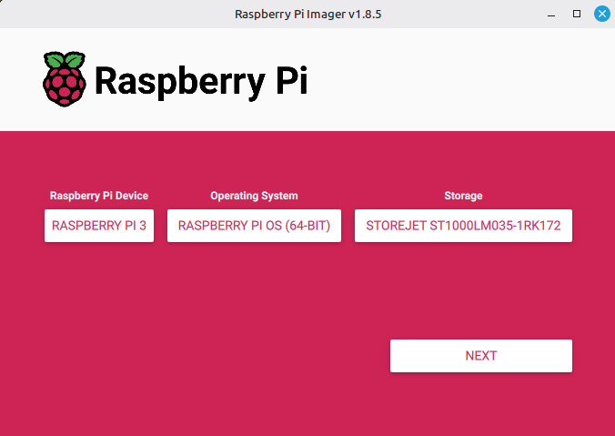

# Vanhojen SSD- ja NVMe-levyjen käyttö Raspberry Pi:ssä

Raspberry Pi 3B on yhä käyttökelpoinen laite moniin kevyempiin palvelutehtäviin, ja sen suorituskykyä voidaan parantaa huomattavasti siirtymällä SD-kortilta kiintolevyltä tai SSD:ltä käynnistämiseen. Tämä ohje käy läpi prosessin vaihe vaiheelta, mukaan lukien vaadittu OTP-asetus, USB-käynnistyksen aktivointi ja suora levyjen kirjoittaminen Raspberry Pi Imagerilla.

## 1. Tärkeä huomio NVMe-levyistä
Raspberry Pi 3B (tai Pi 4/5) ei sisällä luonnollista M.2/NVMe-liitäntää. NVMe-aseman käyttö edellyttää **NVMe-to-USB-sovitinta tai ulkoista koteloa**. Sovittimen kautta Pi tunnistaa levyn tavallisena USB-muistilaitteena, joten ohjeistus toimii identtisesti sekä SATA-SSD:lle että NVMe-levylle.

## 2. Vaiheittainen ohjeistus

### Vaihe 1: Valmistele väliaikainen SD-kortti
Raspberry Pi 3B:ssä USB-käynnistystuki on oletuksena **pois päältä** ja se täytyy aktivoida kerran OTP-muistiin. Tämä edellyttää aluksi SD-korttia.

1. Lataa [Raspberry Pi Imager](https://www.raspberrypi.com/software/).
2. Valitse **Raspberry Pi OS (32-bit tai 64-bit)**.
3. Valitse kohdaksi **SD-kortti**.
4. Kirjoita levy ja käynnistä Pi.

### Vaihe 2: Ota USB-käynnistys käyttöön (vain Pi 3B)
Pi 3B+:sta lähtien tämä on oletuksena päällä. Pi 3B:llä se täytyy asettaa manuaalisesti.

1. Avaa terminaali Pi:llä (tai SSH-yhteys).
2. Lisää asetustiedostoon seuraava rivi:
   ```bash
   echo "program_usb_boot_mode=1" | sudo tee -a /boot/firmware/config.txt
   ```
>**Huomio: Jos käytät vanhempaa Raspberry Pi OS -versiota (Bullseye tai aiempi), polku on /boot/config.txt.**

Uudelleenkäynnistä Pi: ```sudo reboot```

#### Vaihe 3: Varmista OTP-asetus
Käynnistyksen jälkeen tarkista, onko bitti asetettu pysyvästi OTP-muistiin:

```bash
vcgencmd otp_dump | grep 17: 
```

**Odotettu tulos:** ```17:3020000a```

Tässä arvossa bitti 0x02 on asetettu, mikä tarkoittaa, että USB-muistilta käynnistyminen on nyt pysyvästi sallittu. Asetus on kertaluonteinen, eikä sitä voi peruuttaa. Voit nyt poistaa program_usb_boot_mode=1 rivin config.txt:stä siisteyden vuoksi (valinnainen).

### Vaihe 4: Kirjoita suoraan SSD/NVMe-levylle

Kun OTP-asetus on varmistettu, SD-korttia ei enää tarvita.

1. Kytke SSD- tai NVMe-levy tietokoneeseesi USB-sovittimen kautta.
2. Avaa Raspberry Pi Imager.
3. Valitse haluamasi käyttöjärjestelmä.
4. Valitse kohdelaitteeksi USB-asema (tarkista tarkka koko/malli, ettet vahingossa pyyhi väärää levyä).
5.  Valitse Write. Imager kirjoittaa boot-osion, juurijärjestelmän ja tarvittavat ohjaimet suoraan SSD:lle.
   

**Esimerkki pi-imagerin käytöstä terabitin uloiselle levylle**


### Vaihe 5: Ensimmäinen käynnistys SSD:ltä

1. Irrota SD-kortti Raspberry Pi:stä.
2. Kytke SSD/NVMe-levy Pi:n USB-porttiin.
3. Käynnistä virta. Pi hakee boot-sekvenssin suoraan USB-levyltä.
4. Ensimmäinen käynnistys voi kestää hieman pidempään tiedostojärjestelmän laajennuksen ja päivitysten vuoksi.

## 3. Käytännön vinkit ja rajoitukset

|Aihe|Huomio|
|--|--|
|USB-nopeus|Pi 3B:ssä on vain USB 2.0. Käytännön siirtonopeus rajoittuu ~40–45 Mt/s. Tämä on silti huomattavasti luotettavampaa ja nopeampaa kuin useimmat SD-kortit.|
|Virransyöttö|SSD/NVMe-levyt voivat vaatia enemmän virtaa. Käytä vähintään 5.1V / 2.5A virransyöttöä. Jos levy irtoilee tai Pi boottaa uudelleen, harkitse virtasyötettyä USB-hubia.|
|Lämpötila|Vanhat levyt eivät ole suunniteltu 24/7 käyttöön. Varmista riittävä ilmavirta, erityisesti suljetuissa koteloissa.|
|Tiedostojärjestelmä|Raspberry Pi Imager käyttää oletuksena ext4. Se on optimaalinen valinta. Älä käytä NTFS/exFAT juurijärjestelmänä.|
|TRIM / Fstrim|SSD:n eliniän pidentämiseksi ota fstrim käyttöön: ```sudo systemctl enable fstrim.timer.```|

## 4. Vianmääritys

|Ongelma|Ratkaisu|
|--|--|
|Pi ei käynnisty USB-levyltä|Varmista `vcgencmd otp_dump|
|Levyä ei näy Imagerissa|Irrota ja kytke uudelleen. Tarkista lsblk tai dmesg Linuxissa. Jotkut NVMe-sovittimet vaativat erillisiä ohjaimia.|
|Boot jää "rainbow screeniin"|SD-kortti on vielä paikalla tai config.txt:ssä on ristiriitaisia asetuksia. Poista SD ja tarkista config.txt.|
|Hidas I/O tai pätkivä käyttö|Virransyöttö ei riitä. Käytä laadukasta virtalähdettä tai aktiivista USB-hubia.|

## 5. Yhteenveto

Raspberry Pi 3B:n muuntaminen SSD/NVMe-käyttöiseksi on suoraviivainen prosessi, kunhan OTP-asetus on kerran tehty. Vaikka USB 2.0 rajoittaa huippunopeuksia, levyjen luotettavuus, elinikä ja satunnaislukunopeudet paranevat SD-kortteihin verrattuna radikaalisti. Pi 3B+:sta alkaen USB-boot on oletuksena päällä, joten ohje koskee ensisijaisesti alkuperäistä 3B-mallia.
Kun asetukset on tehty ja Imager on kirjoittanut levyvalmiin kuvan, voit irrottaa SD-kortin lopullisesti ja nauttia vakaammasta, pidempikäyttöisestä Raspberry Pi -kokemuksesta.
