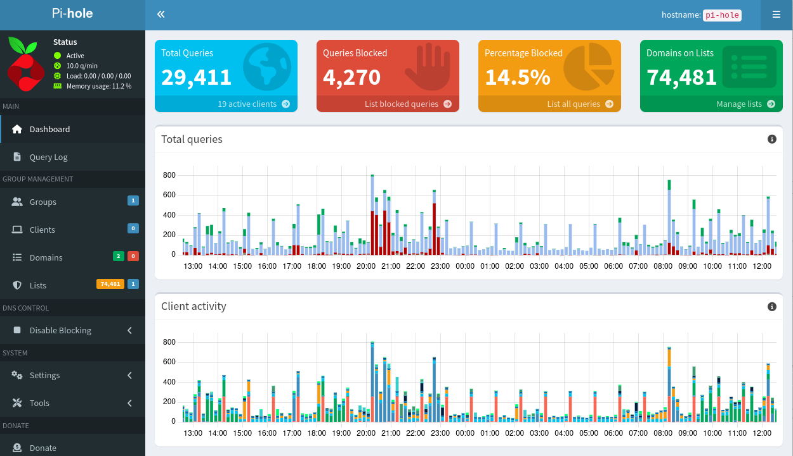

# Miten rakennetaan redundantti Pi-hole-varapalvelin lähiverkkoon

Pi-hole on erinomainen työkalu verkkomainosten ja telemetrian estämiseen, mutta mitä tapahtuu, jos se kaatuu? Tässä artikkelissa käydään läpi, miten lähiverkkoon rakennetaan toimiva varapalvelin (High Availability) Dockerin ja NebulaSync-työkalun avulla. Lisäksi pureudumme siihen, miksi DNS-palvelimen valinnalla on väliä.

## Mikä on Pi-hole?

Pi-hole on avoimen lähdekoodin DNS-palvelin (DNS sinkhole), joka toimii lähiverkkosi portinvartijana internettiin. Kun asennat Pi-holen osaksi verkkoasi, se suodattaa kaikki laitteidesi tekemät DNS-kyselyt. Jos jokin verkkotunnus löytyy mainos- tai seurantalistalta, Pi-hole estää yhteyden muodostamisen palauttamalla tyhjän vastauksen (0.0.0.0).

**Miksi Pi-hole kannattaa ottaa käyttöön?**
- **Koko verkon laajuinen esto:** Yksi asennus estää mainokset kaikissa laitteissa (puhelimet, älytelevisiot, tabletit), ei vain selaimissa.
- **Nopeus:** Verkkosivut latautuvat nopeammin, kun raskaat mainosverkostot jäävät kokonaan latautumatta.
- **Tietosuoja:** Estää telemetrian ja seurannan lähettämisen kolmansille osapuolille.



## Turvalliset ja suodatetut DNS-palvelimet (Quad9, Cloudflare jne.)

Pi-hole itsessään ei tiedä, mitä internetissä on – se tarvitsee "upstream" DNS-palvelimen, jolle se välittää ne kyselyt, joita se ei itse estä. Vaikka käyttäisitkin operaattorisi oletus-DNS:ää, on suositeltavaa vaihtaa se tietoturvalliseen ja yksityisyyttä kunnioittavaan palveluun.

Esimerkiksi tässä artikkelissa käytetään seuraavaa yhdistelmää, joka on lisätty Pi-holen Custom DNS -asetuksiin:

```text
1.1.1.2    (Cloudflare, haittaohjelmien esto)
1.0.0.2    (Cloudflare, haittaohjelmien esto)
94.140.14.14 (AdGuard DNS)
94.140.14.15 (AdGuard DNS)
9.9.9.11   (Quad9, suodatettu)
```

## Miksi juuri nämä?

1. Quad9 (9.9.9.11): Quad9 on voittoa tavoittelematon säätiö, joka estää tunnetut haittaohjelma- ja phishing-verkkotunnukset. Se on erittäin hyvä valinta tietoturvan kannalta.
2. Cloudflare (1.1.1.2 / 1.0.0.2): Nämä ovat Cloudflaren "Malware Blocking" -versiot. Ne ovat nopeita (erittäin matala latenssi) ja estävät haitalliset sivustot.
3. AdGuard DNS: Tarjoaa hyvän yleisen mainos- ja telemetriaestön.

Käyttämällä useampaa suodatettua DNS-palvelinta varmistat, että jos yksi palveluntarjoaja on alhaalla tai estää jonkin tarvitsemasi sivuston, toinen ottaa vastuun.

## Ongelma: Yhden palvelimen arkkitehtuuri

Jos kotiverkossasi on vain yksi Pi-hole (esimerkiksi Raspberry Pi 4:llä), se on Single Point of Failure (SPOF). Jos laite kaatuu, SD-kortti hajoaa tai joudut tekemään järjestelmäpäivityksen, koko kotisi internet-yhteys katkeaa. Tämä johtuu siitä, että reitittimesi osoittaa kaikki DNS-kyselyt sille yhdelle laitteelle.

## Ratkaisu: Kaksi Pi-holea ja synkronointi

Ratkaisu ongelmaan on pystyttää toinen Pi-hole (esimerkiksi Raspberry Pi 5:lle) ja asettaa se reitittimen toissijaiseksi DNS-palvelimeksi. Jotta ylläpito ei muutu painajaiseksi, palvelimien tiedot (paikalliset DNS-tietueet, mainoslistat) pitää synkronoida automaattisesti.

Tähän tarkoitukseen käytämme NebulaSync-työkalua, joka keskustelee Pi-holejen API-rajapintojen kanssa.

### Vaihe 1: Uuden Pi-holen asennus (Docker)

Oletetaan, että isäntäkoneellasi (esim. Raspberry Pi 5) pyörii jo muita palveluita, kuten Home Assistant tai Grafana. Tämän vuoksi Pi-hole asennetaan Docker-konttiin, jotta se ei varaa porttia 80 alleen.

Luo docker-compose.yml -tiedosto:

```yaml
services:
  pihole:
    container_name: pihole
    image: pihole/pihole:latest
    ports:
      - "53:53/tcp"
      - "53:53/udp"
      - "8082:80/tcp" # Web-käyttöliittymä portissa 8082 (koska 80 on varattu)
      - "8443:443/tcp"
    environment:
      TZ: 'Europe/Helsinki'
      FTLCONF_webserver_api_password: 'VahvaSalasanaTähän'
      FTLCONF_dns_listeningMode: 'all'
    volumes:
      - './etc-pihole:/etc/pihole'
    restart: unless-stopped
```

Käynnistä kontti:

```bash
docker compose up -d
```

Voit tarkastella logeja komennolla:
```bash
sudo docker logs -f pihole
```


### Vaihe 2: Verkkojen yhdistäminen

Jotta kontissa pyörivä NebulaSync löytää Pi-holen, niiden on oltava samassa Docker-verkossa. Luodaan verkko nimeltä pihole-net:

```bash
docker network create pihole-net
```

Lisää tämä verkko Pi-holen docker-compose.yml-tiedostoon:

```yaml

    networks:
      - pihole-net
# ... ja tiedoston loppuun:
networks:
  pihole-net:
    external: true
```

### Vaihe 3: NebulaSync-työkalun asennus

NebulaSync synkronoi tiedot ensisijaisesta (Primary) Pi-holesta toissijaiseen (Replica). Luo sille oma hakemisto /opt/nebulasync ja tiedosto docker-compose.yml:

```yaml
services:
  nebula-sync:
    image: ghcr.io/lovelaze/nebula-sync:latest
    container_name: nebula-sync
    restart: unless-stopped
    environment:
      # Ensisijainen Pi-hole (esim. Raspberry Pi 4)
      - PRIMARY=http://192.168.1.100|API_SALASANA_1
      # Toissijainen Pi-hole (Docker-kontin nimi)
      - REPLICAS=http://pihole:80|API_SALASANA_2
      
      # Asetukset: Synkronoidaan vain paikalliset DNS-tietueet (Local DNS)
      - FULL_SYNC=false
      - SYNC_CONFIG_DNS=true
      - SYNC_CONFIG_DNS_INCLUDE=hosts
      - RUN_GRAVITY=true
      - CRON=0 * * * * # Synkronoi kerran tunnissa
    networks:
      - pihole-net

networks:
  pihole-net:
    external: true
```

**Tärkeä huomio:** Pi-hole v6:n API vaatii app_sudo-oikeuden, jotta konfiguraatioita voi muuttaa API:n kautta. Aja tämä komento toissijaisessa Pi-holessa ennen synkronointia:

```bash
docker exec -it pihole pihole-FTL --config webserver.api.app_sudo true
```

Voit tarkastella logeja komennolla:
```bash
sudo docker logs -f nebula-sync
```
### Vaihe 4: Reitittimen asetukset

Kun molemmat Pi-holet ovat käynnissä ja synkronointi toimii (tarkista lokit: docker logs -f nebula-sync), mene reitittimesi DHCP-asetuksiin:
- Ensisijainen DNS: Pi-hole 1:n IP-osoite (esim. 192.168.1.100)
- Toissijainen DNS: Pi-hole 2:n IP-osoite (esim. 192.168.1.101)

## Yhteenveto

Nyt sinulla on vikasietoinen DNS-arkkitehtuuri. Jos ensisijainen Pi-holesi menee alas, reititin ohjaa DNS-kyselyt automaattisesti toissijaiselle. Koska NebulaSync pitää huolen siitä, että paikalliset DNS-tietueesi ja mainoslistasi pysyvät identtisinä molemmilla laitteilla, verkkosi toiminta jatkuu keskeytyksettä.

Tämä on pieni mutta erittäin tehokas parannus koko kotiverkon luotettavuuteen ja tietoturvaan!