Tämä on **ESP32-pohjaisen LoRaWAN-sääasemani projektin kotelointi**. Ultra Low Power elektroniikka, laiteohjelmisto (C++), kytkentäkuvat ja rakennusohjeet löytyvät [lorawan-repositoriosta Githubista](https://github.com/ollavarma-create/lorawan). 

Tässä postauksessa **käsitellään mekaanista suunnittelua**: Stevenson-suoja sensoreille, joka on suunniteltu Fusion360:llä FDM-tulostusta varten.

*Laite asennettuna lopulliseen asennuspaikkaansa.*

## Mikä on Stevenson-suoja?

Stevenson-suoja (tai Stevenson screen) on meteorologinen vakiorakenne, joka suojaa antureita sateelta ja auringonsäteilyltä mahdollistaen samalla vapaan ilmankierron. Lamellirakenteen ansiosta sensori pysyy varjossa ympäristön lämpötilassa, mikä on oleellista tarkan lämpötila- ja kosteusmittauksen kannalta. Tässä suunnittelussa sama periaate on toteutettu seinäkiinnikkeisenä, 3D-tulostettavana ratkaisuna integroidulla elektroniikkakotelolla ja aurinkosähköllä.

## Elektroniikka

Elektroniikka on kuvattu tarkemmin [LoRaWAN-repositoriossa](https://github.com/ollavarma-create/lorawan). Lyhyesti:

- **MCU:** ESP32-WROOM32 SMD ultra-low-power (ULP) -tilassa
- **Radio:** RFM95W 868 MHz LoRa-moduuli
- **Sensori:** BME280 — lämpötila, kosteus, paine
- **Virta:** CN3791 MPPT-aurinkosähkölaturin ohjain + NCR18650-kenno + 6V 133×73 mm monoaurinkopaneeli
- **Regulaattori:** HT7833 3,3V LDO

*KiCad-kytkentäkaavio — ESP32 ULP + RFM95W + BME280, Rev 3, 28.4.2026*

*Ensimmäinen prototyyppi-PCB*

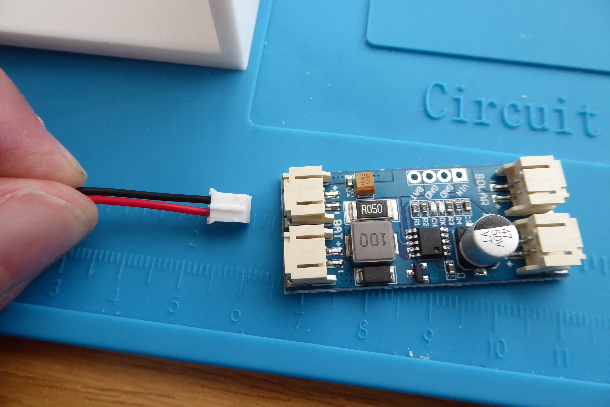
*Aliexpressistä saatavassa CN3791 MPPT Adjustable Solar Charger moduulissa on vakava suunnitteluvirhe! Moduulin SolarPanel liittimissä miinus on sivuilla, akun liittimissä miinus keskellä. Sama liitin käy molempiin, eli punainen onkin miinus eikä plussa jos käytät väärää kaapelia! Tarkista ennen kytkentää! Oikea järjestys on: akun liitin ensin kiinni, sitten aurinkopaneelin liitin. Moduuli palaa herkästi!*

## Mekaaninen suunnittelu

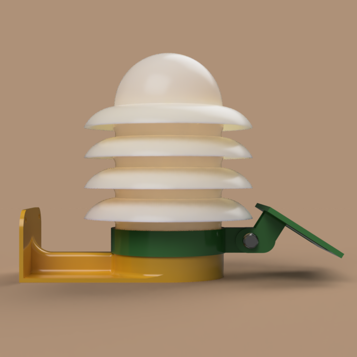
*Koko kokoonpano — neljä lehteä, kupolikansi, seinäkiinnike ja aurinkopaneeli oletuskallistuksessa 40°*

### Parametrinen Fusion360-malli

Suunnittelu on tehty pääosin parametrisesti. Putken halkaisija, kitkaväli, lehtien välistys, seinämäpaksuus — ovat parametritaulukossa. Geometria on linkitetty projektioin ja rakenteellisin constraintein (midpoint, parallel, coincident), joten yhden arvon muuttaminen päivittää koko mallin automaattisesti. 

Käytännössä: lataa F3D-tiedosto ja muuta putken halkaisijaa — bajonetinlukitus, kitkaväli ja kaikki sovituspinnat päivittyvät mukana.

### Osat

Kokoonpano koostuu kahdeksasta tulostettavasta osasta:

1. ElectronicLid.stl
2. EspPCBHolder.stl
3. SensorLid.stl
4. SolarPanelJoint.stl
5. SolarPanelSupport.stl
6. StevensonShield.stl
7. TopLid.stl
8. WallSupport.stl

Tulostus onnistuu 210x210 kokoisella FDM 3D-tulostimella.

**1 ElectronicLid.stl**

Elektroniikkaa suojaava kansi (keskellä valkea osa). Kannen sivuilla on 3 mm rako sensoreille ylöspäin nousevalle johdotukselle ja alempaa akkutasolta tulevalle sähkölle. Ajatuksena on se, että vesi ei voi tehdä vahinkoa elektroniikalle.

| Mitta | Arvo |
|---|---|
|Area|17054.72 mm^2|
|Mass|17.477 g|
|Volume|16487.52 mm^3|
|Length|80.40 mm|
|Width|61.40 mm|
|Height|14.00 mm|

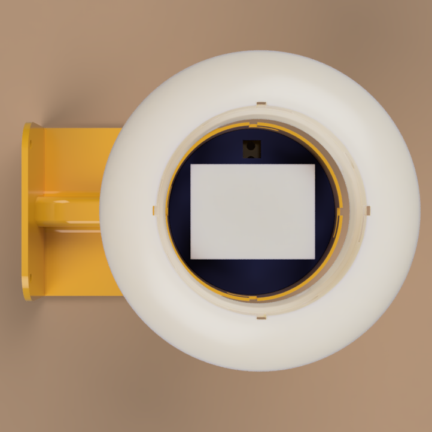
*Renderöidyssä kuvassa näkyy keskellä valkea kansi, joka peittää ja tiivistää elektroniikan.*

**2. EspPCBHolder.stl**

Elektroniikan pesä (sininen osa keskellä) on suunniteltu koekytkentäpiirilevyn mittojen mukaan. Edellä oleva kansi asettuu tämän pesän päälle ja estää veden pääsyn elektroniikkaan. Johdotusten jälkeen raot kannattaa peittää esimerkiksi kuumaliimalla.

| Mitta | Arvo |
|---|---|
|Area|24405.294 mm^2|
|Mass|24.911 g|
|Volume|23500.657 mm^3|
|Length|109.60 mm|
|Width|109.60 mm|
|Height|17.00 mm|

*Renderöidyssä kuvassa näkyy ESP32 tarkoitetun koekytkentälevyn ja muun elektroniikan paikka.*

**3. SensorLid.stl**

Sensoritaso on symmetrinen lautanen, joka voidaan asettaa lehden sisälle. Lautasessa on valmiina upotukset BME280 sensorille ja RFM95W lähettimelle. Mikäli haluat lähettimen ja sensorin eri tasoille EMI/RF tms. asoiden vuoksi, tulosta toinen kansi. Ne ovat symmetrisiä.

| Mitta | Arvo |
|---|---|
|Area|20253.453 mm^2|
|Mass|20.169 g|
|Volume|19026.976 mm^3|
|Length|109.60 mm|
|Width|109.60 mm|
|Height|15.00 mm|

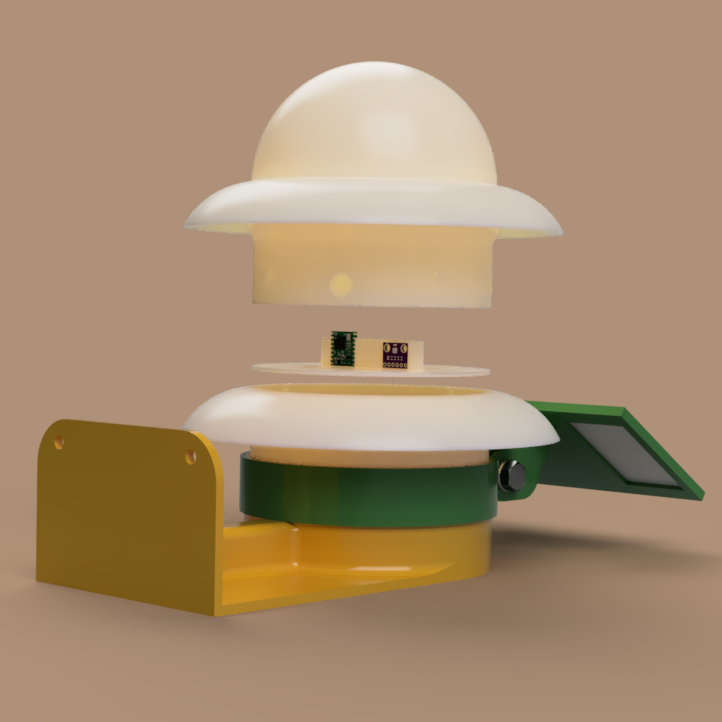
*Renderöidyssä kuvassa näkyy keskellä sensoritaso, jossa taaimmaisena RFM95W LoraWan-moduuli ja lähimpänä BME280 sensori.*

**4. SolarPanelJoint.stl**

Aurinkopaneelin rinkula (vihreä osa) asettuu alatuen päälle ja sitä voi kääntää lähes 360 astetta. Rinkulan päässä on aurinkopaneelin kehykseen kytkeytyvä nivel.

| Mitta | Arvo |
|---|---|
|Area|24365.588 mm^2|
|Mass|43.362 g|
|Volume|40907.664 mm^3|
|Length|168.40 mm|
|Width|118.40 mm|
|Height|25.00 mm|

*Renderöidyssä kuvassa näkyy aurinkopaneelin vertikaali ja horisontaalisäätö.*

**5. SolarPanelSupport.stl**

Aurinkopaneelin kehys (vihreä osa) on suunniteltu 6V paneelille, paneelin kiinnitys liimalla. Johdotus laitteen alapuolella olevan reiän kautta vesilenkki huomioiden. Asento asetetaan kerran asennuksen yhteydessä kohti etelää sopivaan kallistuskulmaan leveysasteelle (Suomessa noin 40–55°). Käytännössä Ultra Low Power elektroniikka kuluttaa niin vähän, että kulmalla ei ole suurta merkitystä akun lataamisessa. 

| Mitta | Arvo |
|---|---|
|Area|24898.965 mm^2|
|Mass|30.913 g|
|Volume|29162.85 mm^3|
|Length|99.989 mm|
|Width|143.80 mm|
|Height|48.999 mm|

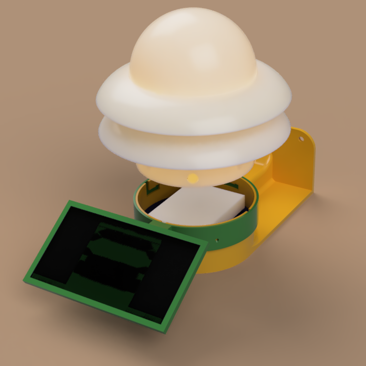
*Renderöidyssä kuvassa näkyy ISO M4x3 ruuville tarkoitettu reikä kierteineen, jolla sivuttaissäätö lukittuu jalustaan.*

*Tässä kuvassa aurinkopaneeli on kiinni alustassaan ja elektroniikkatasoa ollaan asentamassa paikoilleen.*

**6. StevensonShield.stl**

Tulosta lehtiä 3 tai enemmän riippuen miten korkealle haluat sensorin ja lähettimen suhteessa jalustaan.

| Mitta | Arvo |
|---|---|
|Area|72039.593 mm^2|
|Mass|73.786 g|
|Volume|69609.584 mm^3|
|Length|174.00 mm|
|Width|174.00 mm|
|Height|52.50 mm|

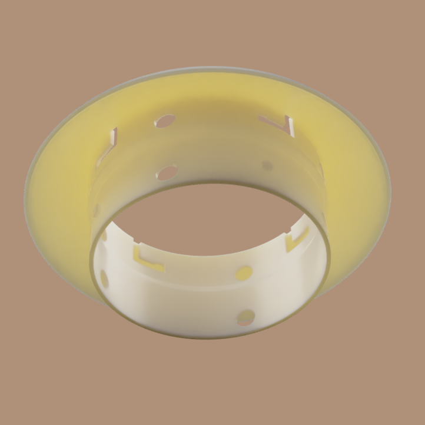
*Renderöity kuva yksittäisestä lehdestä alapuolelta — bajonetinlukitustapat ja tuuletusaukot näkyvissä.*

Lehdet menevät teleskoopmaisesti sisäkkäin: yläpää on hieman kapeampi, joten se menee alempaan lehteen ja kiinnittyy bajonetillä. Neljällä lehdellä kokonaiskorkeus on noin 230 mm. Lehdet ovat symmetrisiä, eli niitä voi tulostaa haluamansa määrän ja pinota sopivaan korkeuteen. Bajonetinlukitustapat näkyvät sisäputkessa.

*Poista supportit huolellisesti. Bajonetin nystyröihin jäänyt supportti estää lehtien yhteenliittämisen, sillä kaikki neljä bajonettiä pitää olla kohdallaan ennen kuin liitos toimii.*

**7. TopLid.stl**

Kupolimainen kansi (kuvassa ylimpänä) jää tarkoituksella siten, että bajonetin upotukset peittyvät. Tarkoitus on liimata kansi paikoilleen. Vaihtoehtoisesti voit kaventaa suunnitelmaa siten, että kansi menee bajonettiin.

| Mitta | Arvo |
|---|---|
|Area|52827.623 mm^2|
|Mass|57.819 g|
|Volume|54546.476 mm^3|
|Length|	 112.00 mm|
|Width|112.00 mm|
|Height|73.50 mm|

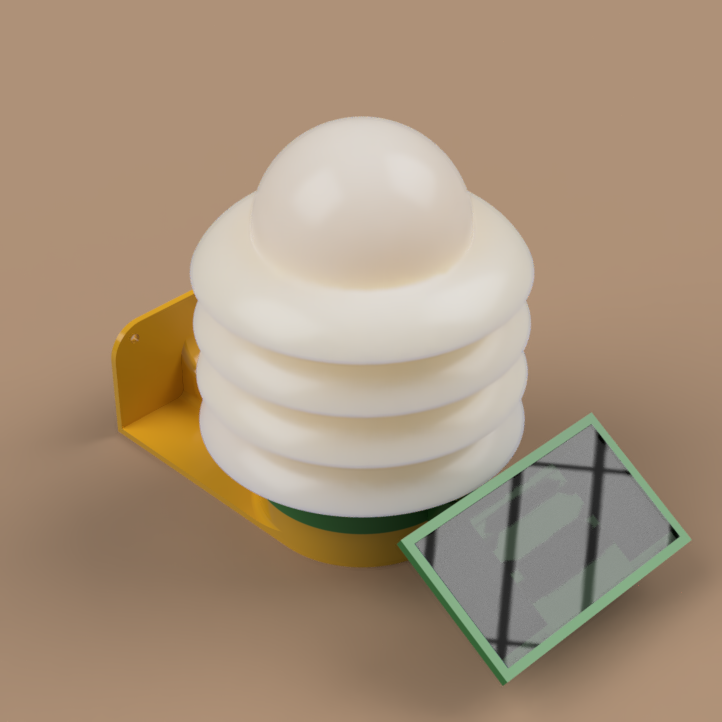
*Renderoitu kuva kokonaisuudesta, kansi ylimpänä.*

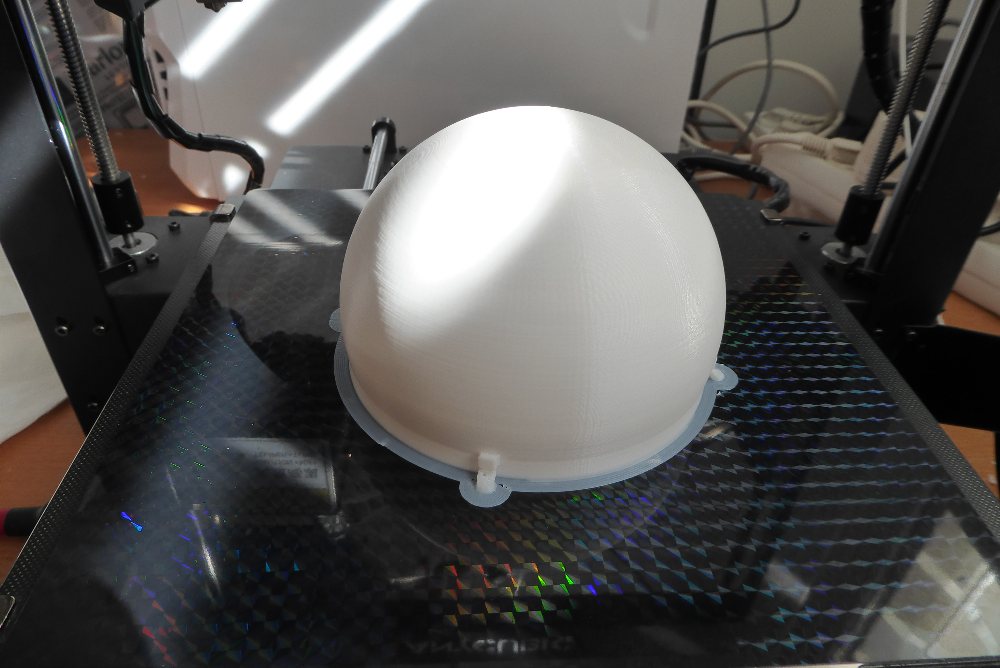
*Kansi tulostettuna.*

*Supportti on aika hauskan näköinen.*

**8. WallSupport.stl**

Seinään kiinnitettävään jalustaan on istutettu ESP32-PCB, 18650-akku (sijoitettu alimmaksi painopisteen optimoimiseksi seinäkiinnikkeen suhteen), CN3791 MPPT-moduuli ja HT7833-regulaattori. Erillinen PCB-alusta pitää elektroniikan paikallaan ja sen päälle asetettava kansi veden pois elektroniikasta. 

Seinäkiinnikkeen varsi ja pohja ovat 4 mm paksu ja kestää koko kokoonpanon painon. Ruuvireijät näkyvät rendereissä. Aurinkopaneelin johdotus kulkee vesilenkillä, kaapeli laskeutuu alas ja nousee takaisin ylös ennen koteloon menoa, mikä estää kapillaarisen veden pääsyn sisälle.

| Mitta | Arvo |
|---|---|
|Area|1.023E+05 mm^2|
|Mass|183.596 g|
|Volume|1.732E+05 mm^3|
|Length|201.00 mm|
|Width|114.00 mm|
|Height|70.00 mm|

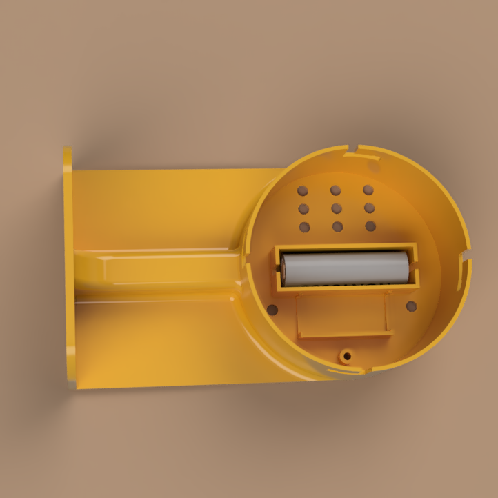
*Seinäkiinnikkeen renderoity kuva.*

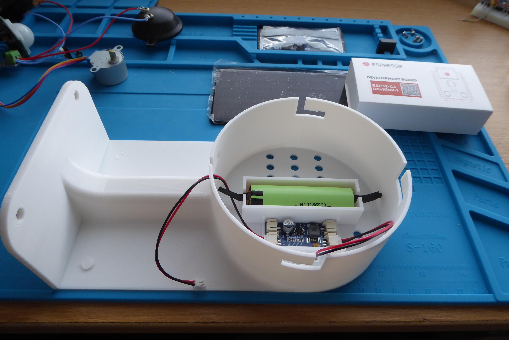
*Seinäkiinnike tulostettuna, lataussäädin ja akku paikallaan.*

## Tulostus

| Parametri | Arvo |
|---|---|
| Materiaali | Valkoinen PETG |
| Perustelu | Heijastaa auringonsäteilyä, kestää ulkolämpötilojen vaihtelut |
| Resoluutio | 0.2 mm |
| Infill | 10 % riittää|
| Infill pattern | Gyroid |
| Support Structure | Tree |
| Shell Thickness | pysty ja vaaka 1.2 mm |

Osien kitkaväliksi on parametrisoitu 0,2 mm. Sama kitkaväli on käytössä kaikkialla suunnitelmassa. Tämä pitäisi olla riittävä PETG, PLA ja muille filamenteille. 

Tulosta ensin WallSupport, sitten yksi lehti ja tarkista bajonettisovitus ennen kuin tulostat kaikki neljä lehteä ja kannen. Voit lukita bajonetit lopuksi kuumaliimalla jos tarpeen.

## Tulostusajoista

Tulostaminen on aikaa vievää. Kannattaa tarkistaa tulostimen levelointi ja muut tulostukseen liittyvät asiat ennen pitkäkestoisten tulostusten aloittamista. Etenkin PETG filamentissa tarkkaile miten hyvin osa pysyy kiinni tulostuspedissä. Magneettinen PEI alusta sopii parhaiten PETG:lle.

Tulostusajat riippuvat käyttämästäsi FDM-tulostimesta, filamentista ja muista tekijöistä. 

Esimerkkejä tulostusajoista ja kulutuksesta:

| Osa | Tulostusaika | Grammoja | Metriä |
|---|---|---|---|
|1. ElectronicLid.stl|2h 10m|21|6.93|
|2. EspPCBHolder.stl|3h 42m|33|11.04|
|3. SensorLid.stl|2h 58m|23|7.83|
|4. SolarPanelJoint.stl|5h 39m|44|14.74|
|5. SolarPanelSupport.stl|2h 52m|36|12.08|
|6. StevensonShield.stl|8h 46m|99|33.23|
|7. TopLid.stl|6h 7m|78|26.03|
|8. WallSupport.stl|17h 11m|164|54.88|

Yhteensä voi arvioida tulostusajaksi **yhdellä lehdellä** 49 tuntia ja 25 minuuttia, filamentin kulutukseksi 558 grammaa ja 166.74 metriä. Jokainen lehti (StevensonShiled.stl) lisää siis tulostusaikaa ja filametin kulutusta.

Pari esimerkkiä osien sijoitteluun tulostuspedillä:

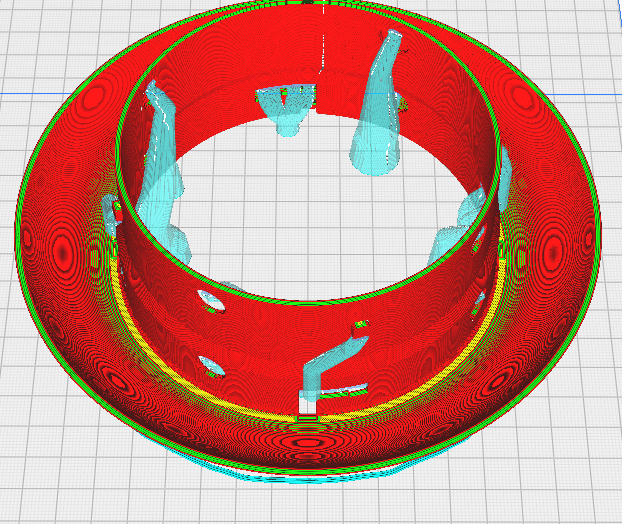
*Cura slicerista otetussa kuvassa näkyy tree-supportteja ja stevenson shieldin yksi lehti aseteltuna tulostuspedille. Tämä säästää filamenttia, mutta tekee yläpinnasta hieman rosoisen, koska supportti ja adhesion eivät lähde kauniisti pois. Voit siistiä lopputulosta hiekkapaperilla.*

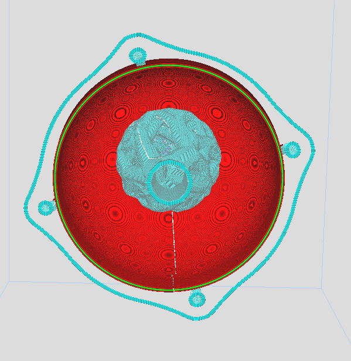
*Cura slicerista otetussa kuvassa näkyy tree-supportti ja kansi. Tässä kannattaa käyttää myös adhesion, sillä tartuntapinta on pieni.*

## Lataus

Fusion360-suunnittelutiedosto (F3D) on ladattavissa ja katseltavissa osoitteessa:

**[Autodesk360 — Stevenson Shield ESP32](https://outlook37929.autodesk360.com/g/shares/SH90d2dQT28d5b602811ac630ee472134f83)**

Sieltä voit viedä STL-tiedostot haluamistasi osista ja slicata omalla slicerillasi. Kaikki osat on mallinnettu tulostusasentoon — ei tarvetta kääntää.

Valmiit stl-tiedostot löydät myös Printables.com:sta
**[StevensonShield_ESP32_BME280_RFM95W_18650](
https://www.printables.com/model/1851996-parametric-stevenson-shield-for-esp32-weather-stat)**

## Lisenssi

Kaikki suunnittelutiedostot julkaistaan lisenssillä **[CC BY-NC 4.0](https://creativecommons.org/licenses/by-nc/4.0/)** — vapaa käyttö, muokkaus ja jakaminen ei-kaupallisiin tarkoituksiin, maininnalla.
