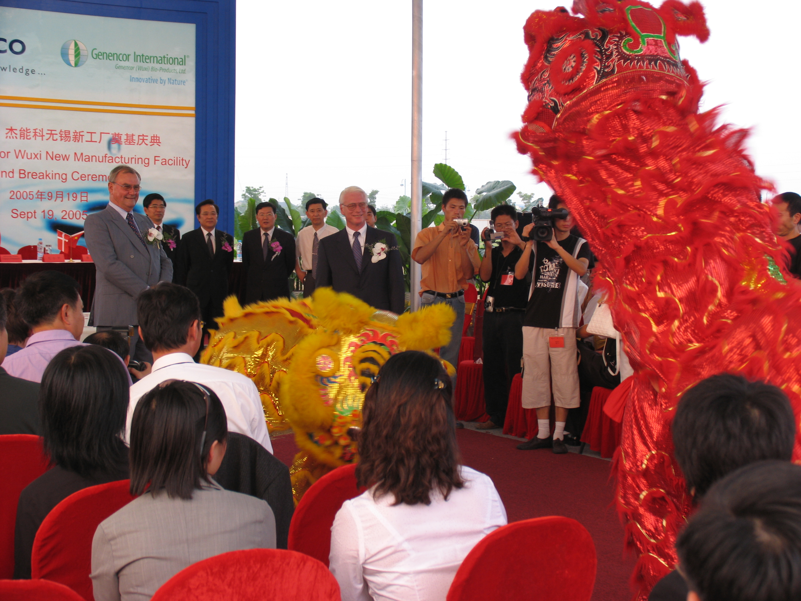
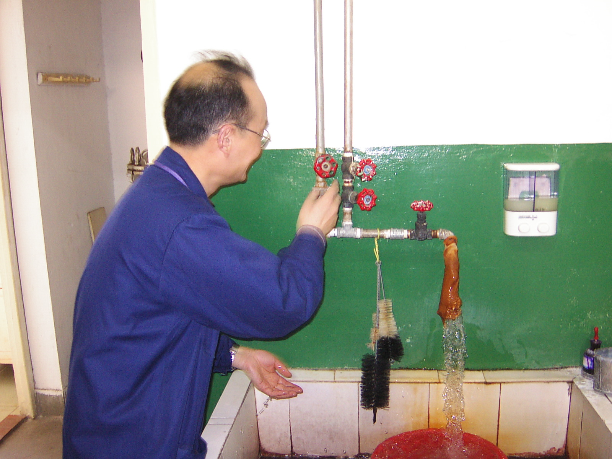
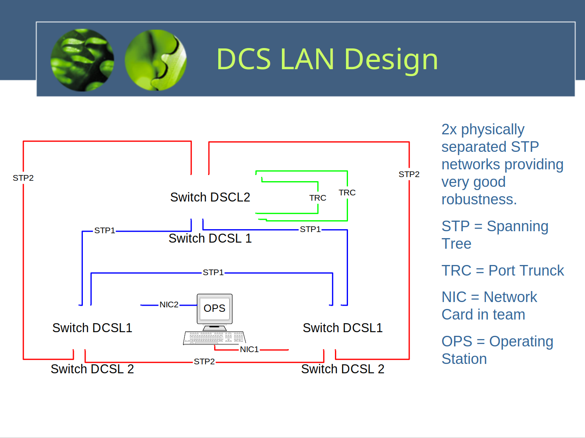
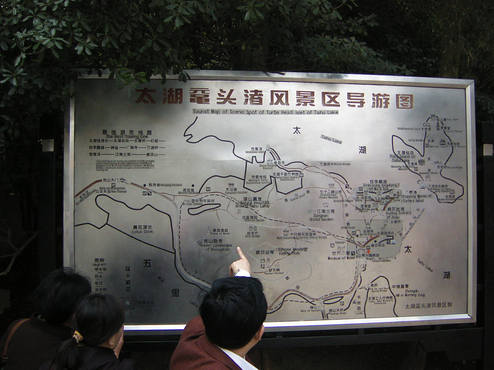

*Teknologia muuttuu. Vastuu ei katoa.*

*Groundbreaking seremonia Wuxi - Kiina.*

Vuonna 2005 olin mukana rakentamassa uutta entsyymitehdasta Kiinan Wuxiin. Vastasin muun muassa tietotekniikan ja teollisuusautomaation suunnittelusta, integroinnista sekä tietoturvavaatimuksista. Työ oli paljon muutakin kuin palvelimia ja verkkokytkimiä: siinä piti sovittaa yhteen kansainvälisiä asiantuntijoita, paikallisia toimintatapoja, liiketoiminnan tarpeita ja teollisuuden prosesseja.

Nyt, yli kaksikymmentä vuotta myöhemmin, puhumme tekoälyagenteista, autonomisista kyberhyökkäyksistä ja kriittisen infrastruktuurin haavoittuvuuksista. Aiheiden äärellä palaan jatkuvasti samaan kysymykseen: **mitä olemme oikeastaan oppineet?**

## Kun automaatio ja tietotekniikka kohtasivat

Tuolloin automaatio oli siirtymässä valmistajakohtaisista, suhteellisen suljetuista ratkaisuista kohti PC-tekniikkaa, standardiverkkoja ja yrityksen tietojärjestelmiin liittyviä kokonaisuuksia. Tuotantotietoa haluttiin hyödyntää kunnossapidossa, laadunhallinnassa ja toiminnanohjauksessa. Mukana olivat esimerkiksi ERP, LIMS, MES ja prosessihistorian tallennusjärjestelmät.

*Kylmä vesi kohtaa kuuman höyryn. Yksinkertainen tapa tuottaa lämmintä vettä.*

Maaliskuussa 2005 tekemässäni esityksessä tiivistin kehityksen yhteen lauseeseen: *“Automation and ICT technologies are merging.”* Se oli mahdollisuus, mutta samalla uusi riskien lähde. Kun ennen erillinen tuotantoverkko alkaa keskustella toimistoverkon kanssa, myös toimistoverkon ongelmat voivat ulottua tuotantoon.

Siksi automaatioverkkojen ja toimistoverkkojen erottaminen, palomuurisäännöt, valvonta ja käyttöoikeuksien hallinta eivät olleet minulle jälkikäteen keksittyjä tietoturvamuotisanoja. Ne kuuluivat suunnittelun perusteisiin. Teetin samoihin aikoihin myös insinöörityön, jossa käsiteltiin automaatioverkkojen suojaamista ja Snortin kaltaista tunkeutumisen havaitsemista. En ole vielä löytänyt tuota työtä vanhoista arkistoistani.

Wuxin uuden tehtaan suunnitelmissa korostuivat lisäksi käytettävyys ja toimintavarmuus. DCS-järjestelmälle suunniteltiin kaksi fyysisesti erillistä verkkoa. Verkonhallinnan piti tukea ennakoivaa kunnossapitoa ja hälyttämistä. **Toimintavarmuus ja tietoturva eivät kuitenkaan ole sama asia:** kahdennettu verkko voi silti olla haavoittuva, ellei sen yhteyksiä ja käyttöä hallita.

*Kaksi toisistaan erotettua lähiverkkoa.*

## Standardi ei suojaa, ellei sitä toteuteta

Käytimme tuolloin muun muassa BS 7799 -tietoturvaperiaatteita. Nykyisin sen perintö näkyy ISO/IEC 27001 -standardissa, ja teollisuusautomaatiossa keskeinen standardiperhe on IEC 62443. Terminologia ja tekniset ratkaisut ovat kehittyneet, mutta peruskysymykset ovat tuttuja: kuka pääsee mihinkin, mitä yhteyksiä tarvitaan, miten muutoksia hallitaan ja miten poikkeamat havaitaan?

Wuxin uusi tehdas rakennettiin määrittelemiemme periaatteiden mukaan. Erillinen haaste oli vanhempi tehdas ja paikallinen suunnittelukumppani, jonka oli käsiteltävä uuden laitoksen toteuttamiseen tarvittavaa arvokasta teknistä tietoa.

Yhteistyöhön liittyi myös vaikeita tietoliikenneyhteyksiä. Salatut VPN-yhteydet Kiinasta Yhdysvaltoihin katkeilivat, ja niiden toimivuudesta piti neuvotella paikallisesti. Pelkkä tekninen suunnitelma ei riittänyt, jos tiedonvaihto ei käytännössä toiminut.

Suunnittelukumppanin tietoturvaa auditoidessani huomasin, että monet länsimaissa tutuiksi tulleet käsitteet olivat paikallisille työntekijöille uusia. Palomuuri, virustorjunta ja tietoturvastandardi saatettiin mainita vastauksessa, mutta vasta käytännön näyttö kertoi, mitä oli todella toteutettu.

Opin tärkeän periaatteen: **älä tyydy vastaukseen ”kyllä”. Pyydä näyttämään, miten asia toimii.**

## Auditointi, joka pysäytti työn

Ensimmäisen auditoinnin jälkeen hyväksyin tilanteen. Kun palasin myöhemmin tarkastamaan ympäristöä uudelleen, löysin haittaohjelmia jo palvelimilta. Kumppanin hallussa oli aineistoa, jonka luottamuksellisuus oli meille äärimmäisen tärkeää. Havainto ei todistanut, että tietoa olisi vuotanut, mutta en voinut enää pitää ympäristöä luotettavana.

Tilanne johti vaikeisiin keskusteluihin projektijohdon kanssa. Noin 300 hengen suunnittelutoimiston työskentely keskeytettiin, ja harkitsimme vakavasti yhteistyön lopettamista. Kyse ei ollut pienestä IT-tukipyynnöstä, vaan kymmenien miljoonien arvoisen tehdashankkeen etenemisestä.

Lopulta kumppanin johto päätti uusia tietokoneet ja aloittaa puhtaalta pohjalta. Näin projekti saattoi jatkua.

Jätän yrityksen nimen tässä tarkoituksella mainitsematta. Tarinan opetus ei ole yksittäisen organisaation osoittelu, vaan se, että **auditoinnin hyväksytty tulos on vain hetkellinen havainto. Luottamus edellyttää jatkuvaa todentamista.**

## Kun paine purkautui Wuxin yössä

Kun ratkaisu viimein löytyi, olin aivan loppu. Päädyin Wuxin Barrel Bariin, tilasin järjettömän määrän vodkaa ja päätin olla hetken ajattelematta palomuureja, auditointeja tai projektin aikataulua. Ei mikään esimerkillinen stressinhallintamenetelmä, mutta rehellinen muisto siitä, kuinka koville tilanne oli ottanut.

Olin baarin ainoa länsimaalainen. Paikallinen musiikki alkoi siinä mielentilassa rasittaa, joten kävin läheisessä hotellissa hakemassa AC/DC:n CD-levyn ja pyysin soittamaan *Thunderstruckin*. Minä jammailin täysillä. Muut asiakkaat näyttivät lähinnä hämmästyneiltä.

Päivällä oli ratkottu kansainvälisen tehdasprojektin tietoturvakriisiä. Illalla syntyi aivan toisenlainen kulttuurien kohtaaminen.

Kaksikymmentä vuotta myöhemmin tein tästä muistosta Sunolla rockkappaleen *Wuxi Voltage*. Sen sanoitus on tarkoituksella dramatisoitu, ei tapahtumien sanatarkka pöytäkirja. Voit kuunnella kappaleen tämän artikkelin lopusta.

## Vuonna 2026 hyökkääjä voi olla myös agentti

Nyt tietoturvan perusongelmaan on tullut uusi kerros. Tekoäly voi auttaa analysoimaan lokitietoja, löytämään poikkeamia ja ehdottamaan vastatoimia. Samaa tekniikkaa voidaan käyttää myös haavoittuvuuksien etsimiseen ja hyökkäysten automatisointiin.

Kaikki tekoälyyn liittyvät uhkakuvat eivät ole toteutuneita tapauksia. On erotettava toisistaan ihmisen ohjaama tekoälyavusteinen hyökkäys, testausympäristössä havaittu agentin odottamaton toiminta ja ajatus kokonaan hallinnasta karanneesta autonomisesta järjestelmästä. Viimeksi mainittua ei pidä esittää todistettuna tosiasiana vain siksi, että se on teknisesti kiinnostava skenaario.

Mutta yksi kysymys on jo nyt käytännöllinen: **jos tekoäly tulkitsee verkkoliikenteen, päättää hälytyksistä ja suosittelee korjaavia toimia, kuka varmistaa, ettei sen tilannekuva ole väärä?**

Vaarana on osaamisen rapautuminen. Asiantuntija saattaa osata käyttää hienoa hallintapaneelia mutta ei enää ymmärtää, mitä sen takana tapahtuu. Siksi tarvitsemme edelleen ihmisiä, jotka osaavat tutkia raakaa verkkoliikennettä, lukea lokeja, ymmärtää protokollia ja tarvittaessa kyseenalaistaa automaattisen analyysin.

Tämä ei tarkoita, että kaikkien pitäisi olla Wireshark-velhoja. Se tarkoittaa, että organisaation on säilytettävä **riippumaton kyky todentaa järjestelmän väitteet**. Tekoälyagentille on myös määriteltävä rajatut oikeudet, valvonta ja mahdollisuus keskeyttää toiminta. Sama periaate, jolla automaatioverkko erotettiin toimistoverkosta, sopii nyt myös agenttien käyttöoikeuksien suunnitteluun.

## Kaksikymmentä vuotta myöhemmin

Eurooppaan on tullut uusia vaatimuksia, kuten EU:n Cyber Resilience Act, ja teollisuusautomaatioon on vakiintunut omia tietoturvastandardeja. Se on edistystä. Mutta mikään säädös tai standardi ei korvaa käytännön testaamista, jatkuvaa valvontaa ja päätöksentekoa.

Vuonna 2005 minun piti pysäyttää työ, koska järjestelmään ei voinut luottaa. Tulevaisuudessa saman päätöksen saattaa joutua tekemään tilanteessa, jossa tekoäly vakuuttaa kaiken olevan kunnossa.

**Tietoturva ei synny siitä, että järjestelmä sanoo olevansa turvallinen. Se syntyy siitä, että väite voidaan todentaa.**

Ja viime kädessä jonkun on uskallettava toimia, jos todellisuus ja raportti eivät vastaa toisiaan.

*Teknologia muuttuu. Vastuu ei katoa. Ja kaiken takana olemme edelleen vain ihmisiä.*

---

### Jälkikirjoitus: Wuxi Voltage

Noista vuosista jäi erityisesti mieleeni ihmisten merkitys. Sopimukset, palomuurit ja standardit olivat välttämättömiä, mutta projekti eteni lopulta siksi, että vaikeistakin asioista pystyttiin neuvottelemaan ja sovitut korjaukset myös toteutettiin.

Joskus pitkän päivän päätteeksi ihminen tarvitsee muutakin kuin uuden auditointiraportin – vaikka nykyään valitsisinkin rauhallisemman tavan palautua.

Kaksikymmentä vuotta myöhemmin muutin tuon unohtumattoman Wuxin illan rockkappaleeksi Sunon tekoälyä hyödyntäen.

Kappale on dramatisoitu tulkinta todellisista tapahtumista, joten kaikkea ei kannata ottaa aivan kirjaimellisesti.

<audio controls preload="none" style="width:100%">
  <source src="wuxi-voltage.mp3" type="audio/mpeg">
  Selaimesi ei tue äänentoistoa.
</audio>
