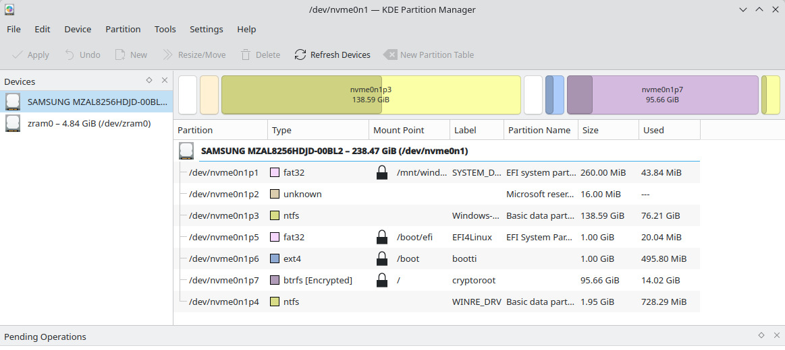

# Fedora Linux 44 (KDE Plasma) asennus Windows 11 rinnalle – täydellinen opas

**Esimerkissä käytetty laite:** Lenovo ThinkBook 14 G7 - 14" kannettava, Windows 11 Home (21MV00AGMX). Laite asennettu oletusasetuksin, päivitetty BIOS ja muut Lenovo Vantagella päivitettävät asetukset. OEM-asennus tekee oletuksena liian pienen EFI-partition, joka on ratkaistu tässä ohjeessa tekemällä Fedoralle oma EFI-partitionsa.


# Asennusvaiheet

## 1. Valmistelut Windows 11:ssä

- Vapauta tilaa levyltä Windowsin Levyhallinnalla (Disk Management)
- Luo vähintään 50-100 GB vapaata tilaa Linuxille
- Älä koske Windowsin EFI-osioon (n. 100-260 MB, FAT32)
- Poista Bitlocker käytöstä toistaiseksi
- Poista virranhallinnasta Fastboot ja varmista, että Windows sulkeutuu Power offista
- Poista väliaikaisesti realiaikainen virustorjunta käytöstä, sillä se voi rikkoa ISO-imagen purun USB-tikulle
- Lataa [Rufus](https://rufus.ie/en/#download) ja [Fedora KDE Plasma Desktop 44 Live ISO](https://fedoraproject.org/kde/download/)
- Asenna ISO Rufuksen avulla USB-tikulle
- Sammuta kone, bootissa paina Enter ja valitse F12 valikosta USB-tikkusi nimi boottilaitteeksi.

## 2. Käynnistä Fedora Live USB

Valitse käynnistyksessä "Start Fedora-KDE-Live" mm. valitse kieli ja näppäimistö sekä loggaudu WiFi tai kiinnitä ethernet-kaapeli:


>**Tärkeä huomio näppäimistöstä ja salasanoista:** vaikka vaihdat näppäimistön asettelun Suomi (FI) -tilaan, salasanan erikoismerkit (#@[]{} jne.) eivät välttämättä toimi odotetusti. Tämä johtuu siitä, että järjestelmä saattaa käyttää edelleen US-näppäimistöasettelua taustalla, vaikka olet "poistanut" sen.
> **Ratkaisu:** tee näppäimistövalinta kahdesti – älä luota ensimmäiseen asetukseen. Käytä silmäkuvaketta 👁️ salasanaa syöttäessäsi – näet kirjoitetut merkit ja voit varmistaa että ne ovat oikein. Testaa erikoismerkit ennen kuin vahvistat salasanan – kirjoita ne näkyviin ja varmista että saat haluamasi merkit.
> **Esimerkki:** Jos haluat kirjoittaa @, US-näppäimistöllä se on Shift+2, mutta FI-näppäimistöllä AltGR+2. Ero tulee esiin merkeissä kuten #, }, {, | jne.

## 3. Osioi Levy KDE Partition Managerilla
 
Avaa KDE Partition Manager ja luo seuraavat osiot vapaaseen tilaan:

### A: EFI-osio Linuxille

- Koko: 1024 MB (1 GB)
- Tiedostojärjestelmä: FAT32
- Label: EFI4Linux
- Liput (Flags): boot (GPT-levyillä tämä = EFI System Partition)
- Anna Partition Managerin muotoilla osio FAT32:ksi. Älä valitse uutta formatointia Anaconda-asennusohjelmassa.

### B: /boot-osio

- Koko: 2048 MB (2 GB)
- Tiedostojärjestelmä: ext4
- Ei salausta! (tarvitaan käynnistykseen ennen LUKS-unlockia)

### C: LUKS-salattu juuriosio

- Koko: Loput tilasta (vähintään 30-50 GB)
- Tiedostojärjestelmä: btrfs (tai ext4)
- Salaus: LUKS2
- Label: cryptroot
- Permissions: Only Root
- Salasana: Käytä silmäkuvaketta ja varmista erikoismerkit! 
- Paina Apply (vihreä rasti) toteuttaaksesi muutokset.

>Huom! Linuxin EFI: varmista  EFI-osion lippu:

- Oikea-klikkaa uutta 1 GB EFI-osiota (EFI4Linux)
- Valitse Properties tai Manage Flags
- Laita raksi kohtaan boot
- Paina OK ja Apply

## 4. Käynnistä asennus

> Huom! Jos laitteessasi on NVIDIA näytönohjain, asennusohjelman käyttämä slitherer-prosessi kaatuu segmentation fault -virheellä (Signal 11 SEGV). **Korjaus:** pakota Firefox käyttöön: ```sudo nano /usr/libexec/anaconda/webui-desktop``` ja muuta rivi: ```DEFAULT_BROWSER_CMD=firefox```

- Valitse "Installation method"
- Valitse "Mount point assignment" (manuaalinen osiointi)

>Huom! Jos saat varoituksen "Your boot partition is less than 500 MiB which is lower than...", älä jatka! Et ole tällöin tehnyt Linuxille omaa suurempaa EFI-partitiota tai laajentanut Windowsin n. 260 MiB EFI-partitiota.

## 5. Määritä Mount Pointit

|Mount Point|Device|Huomio|
|--|--|--|
|/| cryptroot (LUKS-osio)|Kysyy LUKS-salasanaa|
|/boot/efi|nvme0n1p5 (1 GB EFI)|Uusi EFI-osiosi|
|/boot|nvme0n1p6 (2 GB ext4)|Erillinen boot-osio|

## 6. Suojaa Windowsin EFI-osio!!

>**TÄRKEÄ VAIHE!** Fedora saattaa yrittää formatoida Windowsin EFI-osion (nvme0n1p1, n. 273 MB). Estä tämä:

- Paina "Add mount"
- Valitse Windowsin EFI-osio (nvme0n1p1)
- Aseta mount pointiksi esim. /mnt/windows_efi
- Tämä estää formatoinnin – osio vain liitetään (mount) eikä alusteta!

## 7. Tarkista ennen asennusta
   
Review and install -sivulla pitäisi näkyä:

```bash
nvme0n1p1    273 MB    mount              /mnt/windows_efi 
nvme0n1p5    1.07 GB   mount              /boot/efi         
nvme0n1p6    2.07 GB   mount              /boot             
nvme0n1p7    103 GB    format as btrfs    / (encrypt)       
```

>**Jos näet "format as efi" Windowsin EFI-osiolla, ÄLÄ JATKA! Peru ja lisää mount point.**



*Asennetun koneen toimiva partitiointitaulu*

## 8. Asenna

- Paina "Begin Installation"
- Odota asennuksen valmistumista
- >Huom! Jos tulee virhe "Installation failed: Storing configuration files", mutta asennus eteni loppuun asti, järjestelmä todennäköisesti toimii


## 9. Ensimmäinen käynnistys

- Käynnistä kone uudelleen
- Valitse GRUB-valikosta Fedora Linux tai  Windows Boot Manager.
- Avaa levysi salaus ja loggaudu sisään. Homma hoidettu!


*Infocenternäkymää*

---
# Asennuksen jälkeen

## Päivitä järjestelmä:
```bash
sudo dnf update
sudo dnf groupupdate core
```

Kerneleiden ja drivereiden koko on kasvanut ja siksi vanha default 1GB boot-partitiolle alkaa käydä vähäiseksi. Mikäli teit edellä 2GB boot-partition, ei ongelmaa.

Tarvittaessa rajoita montako kerneliä pidetään muistissa: ```sudo nano /etc/dnf/dnf.conf```. Lisää tai muokkaa rivi: etsi [main]-osio ja lisää sinne (tai muuta olemassa oleva): ```installonly_limit=2```

## Lisää swap

Swap-tiedosto antaa järjestelmälle "turvaventtiilin": kun RAM loppuu, vähemmän käytetty data siirtyy levylle sen sijaan, että prosessit tapettaisiin äkillisesti tai KDE jäädyttäisi koko käyttöliittymän. Btrfs vaatii swap-tiedostolta tietyt asetukset, koska sen Copy-on-Write (CoW) -mekanismi ei sovi yhteen swapin kanssa:

- NODATACOW: swap-tiedoston on oltava ilman CoW-ominaisuutta (chattr +C)
- Ei reikiä: tiedoston on oltava ennalta varattu (fallocate)
- Ei pakkausta: swap-tiedoston sisältävä alipuolue ei saa käyttää btrfs-pakkausta
- Yksi laite/profiili: swap-tiedoston ekstenttien on sijaittava yhdellä laitteella

**Käytännön ohje:** swap-tiedoston luominen Fedorassa btrfs:lle:

1. Luo oma alipuolue swapille (helpottaa ylläpitoa ja estää snapshot-ongelmat): ```sudo btrfs subvolume create /var/swap```

2. Luo swap-tiedosto btrfs:n omalla työkalulla (hoitaa NODATACOW + ennaltavarauksen). Esim. 8 GB: ```sudo btrfs filesystem mkswapfile --size 8G /var/swap/swapfile```  ja
```sudo btrfs filesystem mkswapfile --size 8G /var/swap/swapfile```

3. Aseta oikeudet ```sudo chmod 600 /var/swap/swapfile```

4. Ota swap käyttöön heti ```sudo swapon /var/swap/swapfile```

5. Lisää SELinux-konteksti (tärkeä Fedorassa!) ```sudo semanage fcontext -a -t swapfile_t '/var/swap(/.*)?'```
ja ```sudo restorecon -RF /var/swap```

6. Lisää /etc/fstab:hin pysyvää käyttöä varten (matala prioriteetti, jotta zramia käytetään ensisijaisesti) ```echo '/var/swap/swapfile none swap defaults,pri=0 0 0' | sudo tee -a /etc/fstab```

Swap-laitteet ja prioriteetit (zram tulisi olla korkeammalla, esim. 100) ```swapon --show```

Tarkka reaaliaikainen seuranta (paina 'M' lajitellaksesi muistin mukaan) ```htop```

Koska swap-tiedostosi on nyt btrfs-levyllä, muista nämä kaksi asiaa tulevaisuudessa: 
1. **Levyntarkistukset** (btrfs scrub / balance): 
   -Jos ajat näitä komentoja, on suositeltavaa kytkeä swap pois päältä operaation ajaksi, jotta kaikki lohkot saadaan käsiteltyä:

```bash
sudo swapoff /var/swap/swapfile
sudo btrfs scrub start /
# ...operaation jälkeen...
sudo swapon /var/swap/swapfile
```
2. **Snapshots:** koska loimme swapille oman alipuolueen (/var/swap), se ei todennäköisesti sisälly järjestelmän normaaleihin root-snapshoteihin. Tämä on toivottavaa, sillä swap-tiedoston sisällyttäminen snapshoteihin voi aiheuttaa ongelmia palautustilanteissa.


## Asenna h.234 codec videotoistolle:

```bash
sudo dnf install https://mirrors.rpmfusion.org/free/fedora/rpmfusion-free-release-$(rpm -E %fedora).noarch.rpm \
                 https://mirrors.rpmfusion.org/nonfree/fedora/rpmfusion-nonfree-release-$(rpm -E %fedora).noarch.rpm
```

```bash
sudo dnf install rpmfusion-free-release rpmfusion-nonfree-release
sudo dnf install ffmpeg vlc
```
Lisää H.264/H.265-tuen ilman ffmpeg-free:n poistoa. Toimii useimmille: ```sudo dnf install libavcodec-freeworld ```

Jos tarvitset täyden ffmpeg-komentorivityökalun koodaukseen/muunnokseen: ```sudo dnf swap ffmpeg-free ffmpeg --allowerasing```

GStreamer-sovelluksille (Totem, Rhythmbox, selaimet):
```bash
sudo dnf update @multimedia --setopt="install_weak_deps=False" --exclude=PackageKit-gstreamer-plugin
```

## Vs Code asennus (jos koodailet)

1. Lisää Flathub-repository (kysyy sudo-salasanasi) ```flatpak remote-add --if-not-exists flathub https://dl.flathub.org/repo/flathub.flatpakrepo```

2. Päivitä tiedot repoista (varmistaa että uudet paketit näkyvät) ```flatpak update```

3. Asenna VSCode (tarkka nimi: com.visualstudio.code) ```flatpak install flathub com.visualstudio.code ```
   
4. Käynnistä Flatpak-VSCode ```flatpak run com.visualstudio.code `` tai etsi sovellukista kuvake.

5. Anna VSCode:lle pääsy USB-laitteisiin (ESP32-flashaus) ```flatpak override --user --device=all com.visualstudio.code```

6. Tarvittaessa ```sudo usermod -a -G dialout $USER ```


*Visual Code ja PyCharm asennettuna*


## PyCharm asennus (jos koodailet)

1. Lataa viimeisin [JetBrains Toolbox App](https://www.jetbrains.com/toolbox-app/)
2.  Pura ja siirrä: ```tar -xzf jetbrains-toolbox-*.tar.gz ```, ```mkdir -p ~/apps ``` ja ```mv jetbrains-toolbox-* ~/apps/jetbrains-toolbox```
3.  Luo käynnistyskuvake: ```~/apps/jetbrains-toolbox/bin/jetbrains-toolbox --install-desktop-entry```


---

# Vianetsintä

## Windows ei käynnisty GRUBista

- Käynnistä BIOS/UEFI:hin (F2/F12)
- Varmista että Windows Boot Manager on boot-listalla
- Kokeile sudo os-prober ja sudo grub2-mkconfig -o /boot/grub2/grub.cfg

## Salasana ei toimi

- Muistitko tarkistaa erikoismerkit silmäkuvakkeella?
- FI ja US-näppäimistöt tuottavat eri merkkejä samoilla näppäinyhdistelmillä

