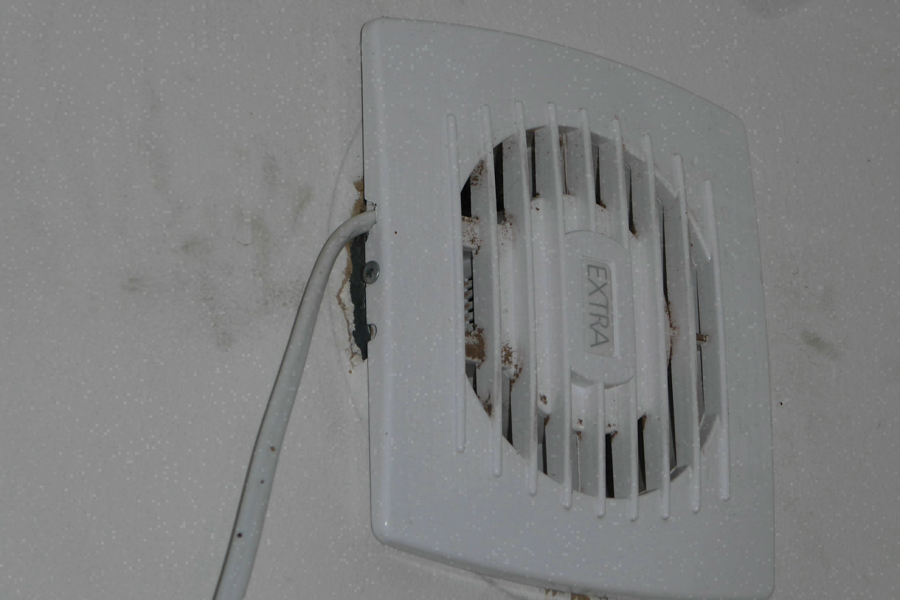
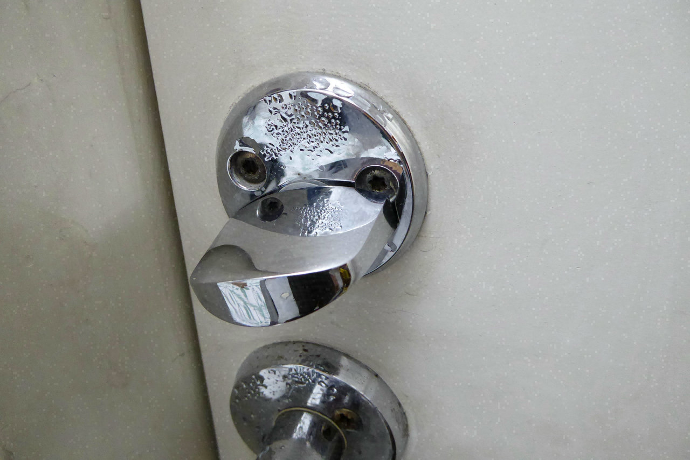
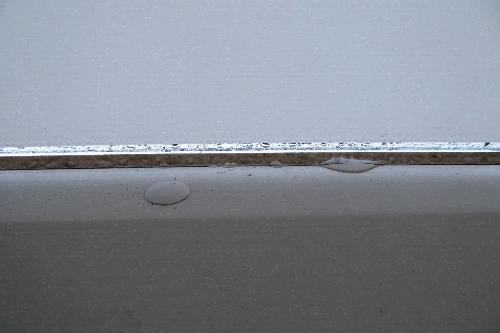

## Kaikki alkoi autotallin lämmityksestä

Autotallissani on Mitsubishi-ilmalämpöpumppu, jolla olen pitänyt tilan lämpimänä talvisin. Ongelmana oli kuitenkin pumpun alin normaali lämpötila-asetus, 16 °C. Käytännössä autotallin lämpötila pysytteli lähes 19 asteessa, mikä on noin 90 neliömetrin autotallille mielestäni tarpeettoman paljon.

Aloin pohtia, voisiko lämpötilaa ohjata Home Assistantilla. Ensimmäinen ajatukseni oli selvittää Mitsubishin kaukosäätimen infrapunakomennot ja rakentaa niiden avulla oma ohjaus. Tilasin projektia varten IR -vastaanottimia TSOP38238 ja IR -lähettimiä Osram SFH4544, mutta Posti valitettavasti tai onneksi hävitti Saksasta minulle tulleen paketin. Teknisesti projekti olisi ollut kiinnostava, mutta ennen uuden tilauksen tekemistä satuin katsomaan mitä asetuksia kaukosäätimessä on. Löysin kaukosäätimestä **iSave-painikkeen**.

iSave-toiminnolla ilmalämpöpumpun saa ylläpitämään huomattavasti matalampaa, noin 10 °C:n lämpötilaa. Juuri tällaista asetusta olin etsinyt. Kaukosäätimen hakkerointi sai siis jäädä, ja autotallin lämpötilaa pystyi laskemaan ilman uusia laitteita tai ohjelmointia.

Lämpötilan laskeminen toi kuitenkin esiin uuden ilmiön. Ikkunoiden alareunoihin alkoi muodostua kondenssivettä, ja myös ulko-oven metallinen kahva hikoili. Erikoista oli, että autotallin kaksi erillistä kosteusanturia näyttivät edelleen alle 60 prosentin suhteellista kosteutta.

Oliko autotallissa liikaa kosteutta, liian vähän ilmanvaihtoa vai oliko kyse vain kylmistä pinnoista?

Tästä alkoi pieni rakennusfysiikan ja kotiautomaation tutkimus, jonka lopputuloksena syntyi Home Assistantilla toteutettu, absoluuttiseen kosteuteen perustuva ilmanvaihdon ohjaus.


## Ikkuna hikoilee, vaikka kosteusmittari näyttää alle 60 prosenttia

Autotallini on noin 90 m²:n tila, jossa ilmanvaihto on alun perin ollut painovoimainen. Seinässä oleva korvaus- tai poistoventtiili on korvattu pienellä, noin 100 mm:n puhaltimella. Lisäksi tilassa on säädettäviä venttiilejä ja nosto-ovessa korvausilma-aukkoja. Puhaltimen sähköteho on mittauksen mukaan noin 13 W; sen todellista ilmavirtaa ei ole mitattu. Samankokoisen laitteen ilmoitettu 66 m³/h on tässä vain suuntaa antava vertailuarvo.


*Pitkään toiminut kanavapuhallin ilmanvaihtoräppänän tilalla.*

Syksyn kosteilla keleillä ikkunoiden alareunaan ja listojen päälle ilmestyi vesipisaroita. Myös ulko-oven metallinen sisäkahva hikoili. Kaksi erillistä kosteusanturia näytti silti alle 60 prosentin suhteellista kosteutta (RH).


*Hikoileva oven kahva ja hela.*


*Vesipisaroita ikkunan karmilla.*

Tämä ei ole ristiriita. RH kertoo, kuinka lähellä *juuri kyseisen lämpötilan* ilma on kyllästymistä. Jos huoneilma on esimerkiksi 12 °C ja RH 55 %, kastepiste on noin 3,2 °C. Ikkunan alumiininen reunarakenne tai metallinen ovenkahva voi jäähtyä tämän alle, vaikka muu huoneilma ei ole erityisen kosteaa. Silloin vettä tiivistyy kylmälle pinnalle.

Satunnaiset pisarat eivät yksin todista rakennevauriota, mutta jatkuvasti märkä puulista on syytä kuivata ja tarkistaa. Kosteuden poistaminen ilmasta pienentää kondenssiriskiä, mutta ei poista kylmäsiltaa.

## Miksi ulkoilman RH ei kerro, kannattaako tuulettaa?

Kylmä ulkoilma voi olla suhteellisesti lähes kylläistä mutta sisältää silti vähemmän vesihöyryä kuutiometriä kohti kuin lämmin sisäilma. Siksi vertaamme **absoluuttista kosteutta** (g/m³), emme pelkkiä RH-prosentteja.

Lämpötilasta **T** (°C) ja suhteellisesta kosteudesta **RH** (%) voidaan arvioida kylläisen vesihöyryn paine Magnus-kaavalla:

```text
e_s(T) = 6.112 × exp(17.67 × T / (T + 243.5))   [hPa]
```

Todellinen vesihöyryn osapaine **e** ja absoluuttinen kosteus **AH** saadaan:

```text
e  = (RH / 100) × e_s(T)                         [hPa]
AH = 216.7 × e / (T + 273.15)                   [g/m³]
```

Yhdistämällä saadaan suoraan anturiarvoista laskettava muoto:

```text
AH = 2.167 × RH × 6.112 × exp(17.67 × T / (T + 243.5)) / (T + 273.15)
```

Tässä viimeisessä kaavassa **RH annetaan prosenttilukuna**, esimerkiksi 55, ei lukuna 0,55. `exp(x)` tarkoittaa eksponenttifunktiota e potenssiin x. Kyse on likiarvosta, joka sopii hyvin tavallisiin autotallin lämpötiloihin.

Saman kaavan avulla laskettu ulko- ja sisäilman kosteusero on:

```text
Kosteusero = AH(autotalli) − AH(ulko)           [g/m³]
```

Positiivinen erotus tarkoittaa, että ulkoilmalla on *potentiaalia* kuivattaa autotallia, kun sitä tuodaan sisään ja lämmitetään. Se ei vielä kerro todellista ilmavirtaa tai kuivumisnopeutta. Lisäksi ulkoilman kosteus arvioidaan tässä sääpalvelusta, joten se voi poiketa pihan todellisista olosuhteista.

## Miksi Home Assistantin apurit ovat hyödyllisiä?

Voisimme sijoittaa kaikki laskut suoraan yhteen automaatioon. Kolme erillistä **mallisensoria (template sensor)** on kuitenkin selkeämpi ratkaisu:

1. `sensor.autotalli_absoluuttinen_kosteus` – sisäilman vesihöyrymäärä.
2. `sensor.ulkoilma_absoluuttinen_kosteus` – ulkoilman vesihöyrymäärä.
3. `sensor.autotalli_kosteusero` – niiden erotus.

Näin laskennan voi testata Kehittäjätyökalujen Mallit-näkymässä, arvot näkyvät historiassa, ja automaatio voi keskittyä ohjaukseen. Lisäksi **kytkinapuri** `input_boolean.autotalli_kosteustehostus` säilyttää tiedon siitä, onko kosteustehostus käynnissä. Sen avulla toteutetaan hystereesi: puhallin ei räpsy päälle ja pois yhden raja-arvon ympärillä.

Seuraavat esimerkit ovat Home Assistantin YAML-mallisensoreita. Vaihda entity ID:t omiasi vastaaviksi. Tarkista myös, että `weather.forecast_home` todella tarjoaa attribuutit `temperature` ja `humidity`; kaikissa sääintegraatioissa näin ei ole.

```yaml
# configuration.yaml tai erillinen template:-määrittely
# Jos sinulla on jo template:-lohko, yhdistä nämä sen alle.
template:
  - sensor:
      - name: "Autotalli absoluuttinen kosteus"
        unique_id: autotalli_absoluuttinen_kosteus
        unit_of_measurement: "g/m³"
        state_class: measurement
        availability: >
          {{ is_number(states('sensor.autotalli_pohjoinen_temperature'))
             and is_number(states('sensor.autotalli_ja_varasto_autotalli_pohjoinen_humidity')) }}
        state: >
          
          
          {{ (2.167 * rh * 6.112 * (2.718281828 ** ((17.67 * t) / (t + 243.5))) / (273.15 + t)) | round(2) }}

      - name: "Ulkoilma absoluuttinen kosteus"
        unique_id: ulkoilma_absoluuttinen_kosteus
        unit_of_measurement: "g/m³"
        state_class: measurement
        availability: >
          {{ is_number(state_attr('weather.forecast_home', 'temperature'))
             and is_number(state_attr('weather.forecast_home', 'humidity')) }}
        state: >
          
          
          {{ (2.167 * rh * 6.112 * (2.718281828 ** ((17.67 * t) / (t + 243.5))) / (273.15 + t)) | round(2) }}

      - name: "Autotalli kosteusero"
        unique_id: autotalli_kosteusero
        unit_of_measurement: "g/m³"
        state_class: measurement
        availability: >
          {{ is_number(states('sensor.autotalli_absoluuttinen_kosteus'))
             and is_number(states('sensor.ulkoilma_absoluuttinen_kosteus')) }}
        state: >
          {{ (states('sensor.autotalli_absoluuttinen_kosteus') | float
             - states('sensor.ulkoilma_absoluuttinen_kosteus') | float) | round(2) }}
```

**Huomautus:** Älä aseta näille sensoreille `device_class: humidity`, sillä se tarkoittaa suhteellista kosteutta (%) eikä absoluuttista kosteutta (g/m³). Jos luot apurit käyttöliittymän kautta, syötä vastaavat `state`-mallit erillisinä mallisensoreina ja jätä kosteuslaiteluokka tyhjäksi. Entity ID:t kannattaa tarkistaa luomisen jälkeen.

## Puhaltimen ohjaus: perusvaihto ja kosteustehostus

Tavoitteena on kaksi toimintoa. Puhallin käy normaalisti 15 minuuttia tunnissa ympäri vuorokauden. Kosteustehostus käynnistyy, kun autotallin RH ylittää 55 % **ja** sisäilman absoluuttinen kosteus on vähintään 1,0 g/m³ ulkoilmaa suurempi. Tehostus pysyy päällä, kunnes RH laskee alle 50 % **tai** kosteusero alle 0,5 g/m³.

Luo ensin Home Assistantissa kytkinapuri nimeltä `Autotalli kosteustehostus` ja varmista sen entity ID: `input_boolean.autotalli_kosteustehostus`.

Alla on yleiskäyttöinen esimerkkiautomaatio, jossa käytetään suoraan puhaltimen **switch-entityä**. Korvaa `switch.autotallin_puhallin` oman laitteesi oikealla entity ID:llä. Esimerkki tarkistaa tilanteen viiden minuutin välein ja Home Assistantin käynnistyessä.

```yaml
alias: Autotallin puhallin - Älykäs ilmanvaihto
mode: restart
triggers:
  - trigger: time_pattern
    minutes: "/5"
  - trigger: homeassistant
    event: start
conditions: []
actions:
  - variables:
      rh_ok: "{{ is_number(states('sensor.autotalli_ja_varasto_autotalli_pohjoinen_humidity')) }}"
      ero_ok: "{{ is_number(states('sensor.autotalli_kosteusero')) }}"
      rh: "{{ states('sensor.autotalli_ja_varasto_autotalli_pohjoinen_humidity') | float(0) }}"
      ero: "{{ states('sensor.autotalli_kosteusero') | float(0) }}"
      perusvaihto: "{{ now().minute < 15 }}"
  - choose:
      - conditions:
          - condition: template
            value_template: "{{ rh_ok and ero_ok and rh > 55 and ero > 1.0 }}"
        sequence:
          - action: input_boolean.turn_on
            target:
              entity_id: input_boolean.autotalli_kosteustehostus
      - conditions:
          - condition: template
            value_template: "{{ not rh_ok or not ero_ok or rh < 50 or ero < 0.5 }}"
        sequence:
          - action: input_boolean.turn_off
            target:
              entity_id: input_boolean.autotalli_kosteustehostus
  - choose:
      - conditions:
          - condition: template
            value_template: >
              {{ perusvaihto or
                 is_state('input_boolean.autotalli_kosteustehostus', 'on') }}
        sequence:
          - action: switch.turn_on
            target:
              entity_id: switch.autotallin_puhallin
    default:
      - action: switch.turn_off
        target:
          entity_id: switch.autotallin_puhallin
```

**Turvakäyttäytyminen:** Tässä esimerkissä puuttuva anturi- tai sääpalvelutieto sammuttaa kosteustehostuksen, mutta tuntikohtainen perusvaihto jatkuu. Tämä on tietoinen valinta; tilaan, jossa vaaditaan taattua ilmanvaihtoa, tarvitaan erillinen mitoitus ja häiriötilanteen toimintatapa. Viiden minuutin tarkistus tarkoittaa myös, että ohjaus reagoi enintään noin viiden minuutin viiveellä ja ajastus voi hieman siirtyä käynnistystilanteessa.

## Ensimmäiset mittaustulokset

Marras­kuun 22.–23. päivän kokeessa mittarit näyttivät seuraavaa:

| Mittaushetki | Autotallin absoluuttinen kosteus |
|---|---:|
| Kokeen alku | 6,69 g/m³ |
| 22.11. noin klo 17 | 6,42 g/m³ |
| 22.11. klo 19.16 | 6,02 g/m³ |
| 22.11. klo 22.19 | 5,84 g/m³ |
| 23.11. noin klo 13.36 | 5,37 g/m³ |

Kokonaislasku oli **1,32 g/m³ eli noin 19,7 %**. Viimeisessä mittauksessa autotallin lämpötila oli 11,4 °C, RH 52,5 %, ulkoilman absoluuttinen kosteus noin 4,1 g/m³ ja kosteusero noin +1,29 g/m³. Kosteustehostus oli edelleen päällä, ja puhaltimen sähkönkulutus noin 13 W.

Tämä on havainto, ei vielä kontrolloitu koe: myös ulkosää, lämpötila, painovoimainen ilmanvaihto, rakenteiden kosteuden luovutus ja sääpalvelun mittauspiste vaikuttavat tuloksiin. Lisäksi RH voi pysyä samana tai jopa nousta, vaikka absoluuttinen kosteus laskee, jos ilma samalla viilenee.

## Mitä tekisin seuraavaksi?

Kerään useamman päivän historiaa puhaltimen tilasta, sisälämpötilasta, RH:sta, absoluuttisesta kosteudesta ja kosteuserosta. Vertaan käynti- ja seisontajaksoja sekä erilaisia ulko-olosuhteita. Mittaan mahdollisuuksien mukaan myös ikkunan alareunan ja ovenkahvan pintalämpötilan, jotta kondensoituminen voidaan yhdistää kastepisteeseen.

Pieni puhallin ei automaattisesti tarkoita riittävää ilmanvaihtoa: esimerkiksi 66 m³/h nimellisilmavirta vastaisi 225 m³:n tilassa jatkuvasti noin 0,29 ilmanvaihtokertaa tunnissa, mutta 15 minuutin tuntikäytöllä vain noin 0,073 kertaa tunnissa *ennen* kanaviston painehäviöitä. Painovoimainen ilmanvaihto täydentää tätä, mutta sen määrää ei ole mitattu. Ajoneuvojen pakokaasujen ja muiden epäpuhtauksien hallintaa ei saa arvioida pelkän kosteuden perusteella; moottoria ei pidä käyttää suljetussa autotallissa.

**Opetus:** älykäs ohjaus ei synny siitä, että lisätään yksi RH-raja. Se syntyy siitä, että valitaan oikea fysikaalinen suure, tehdään laskenta näkyväksi, lisätään hystereesi ja tarkistetaan tulokset mittaamalla.
